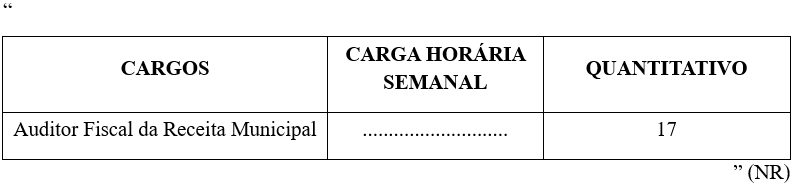

LEI COMPLEMENTAR Nº 426, DE 17 DE NOVEMBRO DE 2025.

Altera a Lei Complementar nº 319, de 2 de outubro de 2023, que dispõe sobre o Sistema de Cargos e Salários da Carreira de Auditor Fiscal da Receita Municipal.

**A CÂMARA MUNICIPAL DE RIO VERDE - GO aprova E EU SANCIONO A SEGUINTE LEI:**

Art. 1º Altera a Lei Complementar nº 319, de 2 de outubro de 2023, para acrescentar o quantitativo de 01 (uma) vaga para o cargo de Auditor Fiscal da Receita Municipal.

Art. 2º O Anexo II (Quadro de Pessoal) da Lei Complementar nº 319, de 02 de outubro de 2023, passará a vigorar na forma do Anexo Único desta lei.

Art. 3º Esta Lei Complementar entrará em vigor na data de sua publicação.

Gabinete do Prefeito de Rio Verde, aos 17 de novembro de 2025.

WELLINGTON SOARES CARRIJO FILHO

Prefeito de Rio Verde

VINÍCIUS FONSÊCA CAMPOS

Procurador-Geral

ÁLVARO CÉSAR DE SOUZA COSTA

Secretário de Planejamento e Gestão

**ANEXO ÚNICO**

**(Alteração no Anexo II da Lei Complementar nº 319/2023 – QUADRO DE PESSOAL)**

