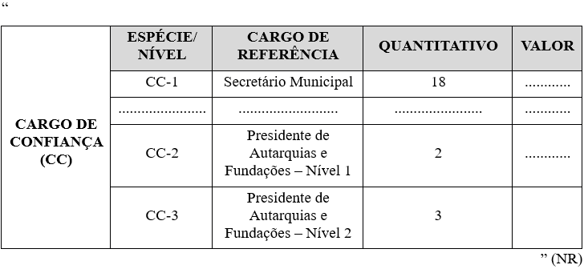
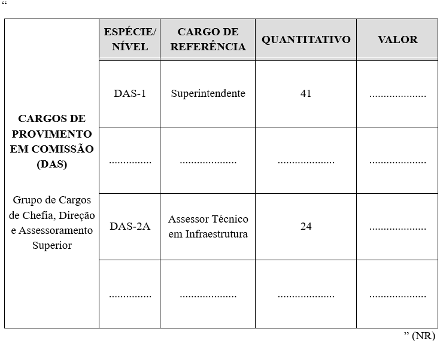

LEI COMPLEMENTAR Nº 451, DE 19 DE FEVEREIRO DE 2026.

Altera a Lei Complementar nº 182, de 06 de maio de 2020, que dispõe sobre a Estrutura Orgânica Básica da Administração Pública Municipal, para a extinguir a Secretaria Municipal de Desenvolvimento e Mobilidade Urbana - SMDMU e dá outras providências.

**A CÂMARA MUNICIPAL DE RIO VERDE-GO aprova E EU SANCIONO A SEGUINTE LEI:**

Art. 1º A Lei Complementar nº 182, de 06 de maio de 2020, passa a vigorar com as seguintes alterações:

“Art. 4º ...................................................................................................

§ 1º Os cargos de Chefe de Gabinete do Prefeito, Procurador-Geral do Município, Controlador Geral do Município, Presidente da Agência Municipal de Regulação dos Serviços de Água e Esgoto - AMAE, Presidente do Instituto de Previdência e Assistência dos Servidores de Rio Verde - IPARV, Presidente da Agência Municipal de Mobilidade e Trânsito - AMT e Secretários Municipais possuem o mesmo nível hierárquico e funcional, isonomia no vencimento e iguais direitos, deveres e responsabilidades administrativas, respeitadas as atribuições inerentes às competências legais de cada Órgão e Entidade.

.......................................................................................................” (NR)

“Art. 38. ...................................................................................................

.................................................................................................................

III - ...........................................................................................................

.................................................................................................................

d) (Revogado).

........................................................................................................” (NR)

“Art. 48. ...................................................................................................

.................................................................................................................

XVI - (Revogado).” (NR)

“Art. 59....................................................................................................

.................................................................................................................

XXVII - realizar o licenciamento de todas as obras de construção, reforma, ampliação ou demolição no âmbito do Município;

XXVIII - processar e aprovar os licenciamentos relacionados aos parcelamentos do solo dentro do perímetro urbano de Rio Verde, em conformidade com as normas municipais, estaduais e federais aplicáveis;

XXIX - prestar orientações e supervisionar o crescimento urbano do Município, além de propor ajustes na legislação urbanística, sempre que necessário;

XXX - supervisionar e coordenar a atualização e revisão do Plano Diretor Municipal;

XXXI - emitir parecer técnico e realizar a análise detalhada dos processos de regularização fundiária;

XXXII - monitorar e fiscalizar as obras de construção, reforma, ampliação ou demolição, bem como os processos de parcelamento do solo no Município, garantindo a conformidade com as leis e regulamentos vigentes.” (NR)

“Art. 60....................................................................................................

................................................................................................................

VII - garantir, por meio de fiscalização efetiva, o cumprimento do Código de Posturas do Município que institui as normas disciplinadoras da higiene e do bem-estar público, da localização e funcionamento de estabelecimentos comerciais, industriais e prestadores de serviços, bem como as correspondentes relações jurídicas entre a Administração Pública Municipal e os Munícipes.” (NR)

“Art. 61-A. (Revogado)

I - (Revogado);

II - (Revogado);

III - (Revogado);

IV - (Revogado);

V - (Revogado);

VI - (Revogado);

VII - (Revogado);

VIII - (Revogado);

IX - (Revogado);

X - (Revogado);

XI - (Revogado);

XII - (Revogado);

XIII - (Revogado);

XIV - (Revogado);

XV - (Revogado);

XVI - (Revogado);

XVII - (Revogado);

XVIII - (Revogado);

XIX - (Revogado);

XX - (Revogado);

XXI - (Revogado);

XXII - (Revogado);

XXIII - (Revogado);

XXIV - (Revogado);

XXV - (Revogado);

XXVI - (Revogado);

XXVII - (Revogado);

XXVIII - (Revogado);

XXIX - (Revogado);

XXX - (Revogado);

XXXI - (Revogado);

XXXII - (Revogado);

XXXIII - (Revogado)” (NR)

“Art. 71....................................................................................................

................................................................................................................

XXVII - planejar e supervisionar a execução dos serviços de mobilidade urbana no Município, propondo melhorias e ações que garantam eficiência e qualidade;

XXVIII - gerir e fiscalizar contratos relacionados à prestação de serviços de transporte público e projetos de mobilidade urbana, em articulação com órgãos municipais e demais parceiros;

XXIX - coordenar o planejamento e a implementação de políticas públicas relacionadas à mobilidade e ao transporte público no âmbito do Município;

XXX - monitorar e regulamentar a política de gestão tarifária do transporte público, garantindo a acessibilidade econômica e a sustentabilidade dos serviços;

XXXI - propor e elaborar normas, regulamentos e estudos técnicos que promovam a otimização da infraestrutura viária e a melhoria dos serviços de transporte público;

XXXII - implementar iniciativas que integrem os diversos modos de transporte, promovendo soluções para a mobilidade urbana sustentável;

XXXIII - elaborar e implementar projetos geométricos viários e de infraestruturas urbanas, tendo por propósito, notadamente, a melhoria da mobilidade;

XXXIV - realizar estudos de circulação viária para identificar e propor soluções que aprimorem a mobilidade urbana do Município;

XXXV - desenvolver e ajustar planos semafóricos com base em análises volumétricas e estudos de demanda viária;

XXXVI - avaliar novos empreendimentos que possam atrair um aumento de tráfego, identificando e mitigando potenciais impactos no sistema viário;

XXXVII - propor e implementar medidas mitigadoras e compensatórias relacionadas à implantação de empreendimentos com impacto viário;

XXXVIII - coordenar a equipe responsável pela sinalização viária e semafórica, garantindo a correta implementação e manutenção dos sistemas;

XXXIX - gerenciar a equipe técnica de engenharia de trânsito, composta por engenheiros, arquitetos e profissionais da área, visando a realização de estudos e projetos urbanos;

XL - administrar contratos e convênios relacionados à melhoria e à otimização da mobilidade urbana no Município;

XLI - avaliar a compatibilidade entre projetos urbanísticos e viários, assegurando sua integração e adequação às necessidades de mobilidade;

XLII - realizar estudos detalhados sobre os diversos modos de transporte no Município, com foco na integração e na melhoria dos serviços;

XLIII - desenvolver simulações de tráfego para cenários atuais e futuros, a fim de orientar as decisões de planejamento viário e mobilidade urbana;

XLIV - prestar apoio técnico na análise de viabilidade de soluções viárias urbanas que favoreçam a mobilidade eficiente e sustentável no Município;

XLV - auxiliar tecnicamente na elaboração de estudos sobre o transporte público, propondo melhorias e inovações;

XLVI - contribuir com apoio técnico em audiências públicas e eventos relacionados à mobilidade urbana, garantindo a inclusão da comunidade no processo de planejamento;

XLVII - participar ativamente de discussões sobre mobilidade urbana em congressos, seminários e em reuniões com órgãos públicos e privados especializados;

XLVIII - apoiar tecnicamente a fiscalização e o ordenamento do trânsito, além de promover ações educativas voltadas à conscientização no trânsito;

XLIX - implementar e manter as sinalizações vertical, horizontal e semafórica, conforme as normas vigentes, garantindo a segurança viária;

L - formular e executar políticas de mobilidade urbana e acessibilidade, promovendo a articulação com diferentes esferas de governo, a iniciativa privada e organizações não governamentais, visando a implementação de projetos de urbanização e desenvolvimento local;

LI - monitorar e analisar os indicadores de mobilidade e acessibilidade urbana, observando as normas e diretrizes estabelecidas;

LII - estabelecer parcerias com institutos de pesquisa, universidades, empresas do setor da construção civil, instituições de ensino superior e organizações sociais, com o objetivo de promover estudos e soluções inovadoras para a mobilidade e acessibilidade urbana.” (NR)

“Art. 94. ...................................................................................................

.................................................................................................................

s) (Revogado).” (NR)

Art. 2º Fica alterada a Lei Complementar nº 182, de 06 de maio de 2020, para:

I - aumentar em:

a) 1 (uma) unidade do cargo de Superintendente (DAS-1);

b) 1 (uma) unidade do cargo de Presidente de Autarquias e Fundações - Nível 1 (CC2);

c) 2 (duas) unidades do cargo de Assessor Técnico em Infraestrutura (DAS-2A).

II - extinguir:

a) 1 (uma) unidade do cargo de Secretário (

III – CC-1);

b) 1 (uma) unidade do cargo de Presidente de Autarquias e Fundações - Nível 2 (CC3).

Art. 3º O Anexo I (Quadro de Classificação, Quantitativo e Valores dos Cargos de Confiança (CC)), e Anexo II (Quadro de Classificação, Quantitativo e Valores dos Cargos de Provimento em Comissão (DAS), ambos da Lei Complementar nº 182, de 06 de maio de 2020, passam a vigorar conforme os Anexos I e II desta Lei.

Art. 4º Fica extinta a Secretaria Municipal de Desenvolvimento e Mobilidade Urbana - SMDMU, constante do Anexo VII - Tabela Resumo de Alterações na Estrutura Orgânica Básica.

Art. 5º Ficam revogados a alínea “d”, do inciso III, do art. 38, o inciso XVI do art. 48, o art. 61-A e alínea “s” do art. 94, todos da Lei Complementar nº 182, de 06 de maio de 2020.

Art. 6º Esta Lei Complementar entrará em vigor em 01 de março de 2026.

Gabinete do Prefeito de Rio Verde, aos 19 de fevereiro de 2026.

WELLINGTON SOARES CARRIJO FILHO

Prefeito de Rio Verde

VINÍCIUS FONSÊCA CAMPOS

Procurador-Geral

ÁLVARO CÉSAR DE SOUZA COSTA

Secretário de Planejamento e Gestão 

**ANEXO I**

**(Alteração no Anexo I da Lei Complementar nº 182/2020 – QUADRO DE CLASSIFICAÇÃO, QUANTITATIVO E VALORES DOS CARGOS DE CONFIANÇA (CC))**

**ANEXO II

(Alteração no Anexo II da Lei Complementar nº 182/2020 – QUADRO DE CLASSIFICAÇÃO, QUANTITATIVO E VALORES DOS CARGOS DE PROVIMENTO EM COMISSÃO (DAS))**

