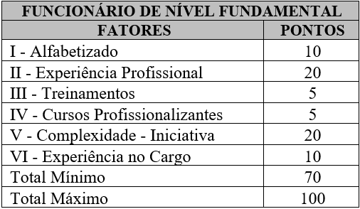
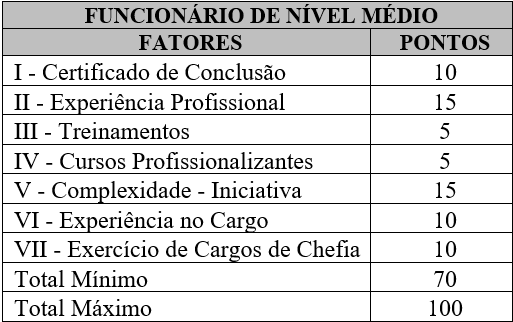
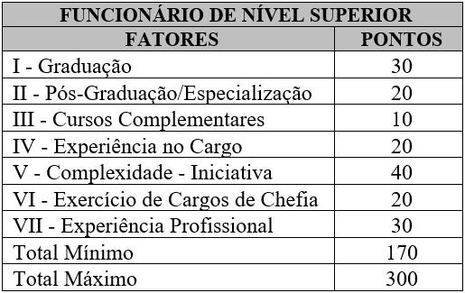
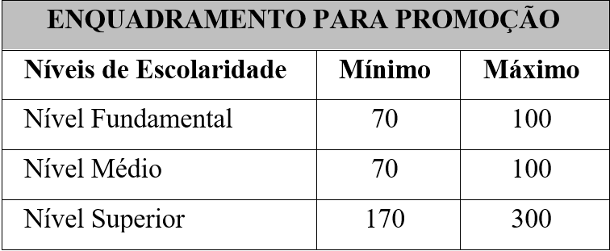

LEI Nº. 3.968, DE 31 DE AGOSTO DE 2000.

Reformula o Estatuto dos Funcionários do Município de Rio Verde - GO, e dá outras providências.

**CONSOLIDADA COM AS LEIS:**

[Lei Complementar nº. 4.113/2001 ..................... 14/08/2001](https://legisla.casacivil.go.gov.br/rio-verde/pesquisa_legislacao/114261/lei-complementar-4113)

[Lei nº. 4.222/2001 ............................................. 14/12/2001](https://legisla.casacivil.go.gov.br/rio-verde/pesquisa_legislacao/114286/lei-ordinaria-4222)

[Lei nº. 4.472/2002 ............................................. 20/08/2002](https://legisla.casacivil.go.gov.br/rio-verde/pesquisa_legislacao/114288/lei-ordinaria-4472)

[Lei Complementar nº. 4.723/2003 ..................... 28/11/2003](https://legisla.casacivil.go.gov.br/rio-verde/pesquisa_legislacao/114289/lei-complementar-4723)

[Lei Complementar nº. 4.810/2004 ..................... 18/05/2004](https://legisla.casacivil.go.gov.br/rio-verde/pesquisa_legislacao/114290/lei-complementar-4810)

[Lei Complementar nº. 4.835/2004 ..................... 05/06/2004](https://legisla.casacivil.go.gov.br/rio-verde/pesquisa_legislacao/114291/lei-complementar-4835)

[Lei nº. 5.041/2005 ............................................. 20/09/2005](https://legisla.casacivil.go.gov.br/rio-verde/pesquisa_legislacao/114292/lei-ordinaria-5041)

[Lei Complementar nº. 5.458/2008 ..................... 20/06/2008](https://legisla.casacivil.go.gov.br/rio-verde/pesquisa_legislacao/114294/lei-complementar-5458)

[Lei Complementar nº. 5.595/2009 ..................... 26/05/2009](https://legisla.casacivil.go.gov.br/rio-verde/pesquisa_legislacao/114299/lei-complementar-5595)

[Lei nº. 5.654/2009 ............................................. 01/09/2009](https://legisla.casacivil.go.gov.br/rio-verde/pesquisa_legislacao/114300/lei-ordinaria-5654)

[Lei nº. 5.684/2009 ............................................. 04/11/2009](https://legisla.casacivil.go.gov.br/rio-verde/pesquisa_legislacao/114327/lei-ordinaria-5684)

[Lei Complementar nº. 5.801/2010 ..................... 16/06/2010](https://legisla.casacivil.go.gov.br/rio-verde/pesquisa_legislacao/114301/lei-complementar-5801)

[Lei nº. 5.816/2010 ............................................. 27/08/2010](https://legisla.casacivil.go.gov.br/rio-verde/pesquisa_legislacao/114302/lei-ordinaria-5816)

[Lei Complementar nº. 05/2014 .......................... 15/04/2014](https://legisla.casacivil.go.gov.br/rio-verde/pesquisa_legislacao/114323/lei-complementar-5)

[Lei Complementar nº. 20/2014 .......................... 19/08/2014](https://legisla.casacivil.go.gov.br/rio-verde/pesquisa_legislacao/114324/lei-complementar-20)

[Lei Complementar nº. 34/2015 .......................... 01/07/2015](https://legisla.casacivil.go.gov.br/rio-verde/pesquisa_legislacao/114325/lei-complementar-34)

[Lei Complementar nº. 52/2015 .......................... 14/12/2015](https://legisla.casacivil.go.gov.br/rio-verde/pesquisa_legislacao/114326/lei-complementar-52)

[Lei Complementar nº. 92/2017 .......................... 30/05/2017](https://legisla.casacivil.go.gov.br/rio-verde/pesquisa_legislacao/114328/lei-complementar-92)

[Lei Complementar nº. 110/2018 ........................ 26/02/2018](https://legisla.casacivil.go.gov.br/rio-verde/pesquisa_legislacao/114329/lei-complementar-110)

[Lei Complementar nº. 124/2018 ........................ 30/05/2018](https://legisla.casacivil.go.gov.br/rio-verde/pesquisa_legislacao/114330/lei-complementar-124)

[Lei Complementar nº. 128/2018 ........................ 03/07/2018](https://legisla.casacivil.go.gov.br/rio-verde/pesquisa_legislacao/114331/lei-complementar-128)

[Lei Complementar nº. 149/2019 ........................ 20/02/2019](https://legisla.casacivil.go.gov.br/rio-verde/pesquisa_legislacao/114332/lei-complementar-149)

[Lei Complementar nº. 156/2019 ........................ 27/06/2019](https://legisla.casacivil.go.gov.br/rio-verde/pesquisa_legislacao/114348/lei-complementar-156)

[Lei Complementar nº. 181/2020 ........................ 06/05/2020](https://legisla.casacivil.go.gov.br/rio-verde/pesquisa_legislacao/114349/lei-complementar-181)

[Lei Complementar nº. 212/2021 ........................ 30/06/2021](https://legisla.casacivil.go.gov.br/rio-verde/pesquisa_legislacao/114350/lei-complementar-212)

[Lei Complementar nº. 241/2022 ........................ 01/04/2022](https://legisla.casacivil.go.gov.br/rio-verde/pesquisa_legislacao/114351/lei-complementar-241)

[Lei Complementar nº. 242/2022 ........................ 01/04/2022](https://legisla.casacivil.go.gov.br/rio-verde/pesquisa_legislacao/114352/lei-complementar-242)

[Lei Complementar nº. 247/2022 ........................ 27/05/2022](https://legisla.casacivil.go.gov.br/rio-verde/pesquisa_legislacao/114383/lei-complementar-247)

[Lei Complementar nº. 252/2022 ........................ 27/06/2022](https://legisla.casacivil.go.gov.br/rio-verde/pesquisa_legislacao/114385/lei-complementar-252)

[Lei Complementar nº. 293/2023 ........................ 30/03/2023](https://legisla.casacivil.go.gov.br/rio-verde/pesquisa_legislacao/114386/lei-complementar-293)

[Lei Complementar nº. 327/2023 ........................ 27/11/2023](https://legisla.casacivil.go.gov.br/rio-verde/pesquisa_legislacao/114387/lei-complementar-327)

[Lei Complementar nº. 329/2023 ........................ 22/12/2023](https://legisla.casacivil.go.gov.br/rio-verde/pesquisa_legislacao/114388/lei-complementar-329)

[Lei Complementar nº. 340/2024 ........................ 26/02/2024](https://legisla.casacivil.go.gov.br/rio-verde/pesquisa_legislacao/114391/lei-complementar-340)

[Lei Complementar nº. 379/2025..........................24/02/2025](https://legisla.casacivil.go.gov.br/rio-verde/pesquisa_legislacao/114392/lei-complementar-379)

[Lei Complementar nº. 398/2025..........................30/06/2025](https://legisla.casacivil.go.gov.br/rio-verde/pesquisa_legislacao/114393/lei-complementar-398)

[Lei Complementar nº. 415/2025..........................31/10/2025](https://legisla.casacivil.go.gov.br/rio-verde/pesquisa_legislacao/114394/lei-complementar-415)

[Lei Complementar nº. 427/2025 ........................ 17/11/2025](https://legisla.casacivil.go.gov.br/rio-verde/pesquisa_legislacao/114116/lei-complementar-427)

[Lei Complementar nº. 448/2026 ........................ 19/02/2026](https://legisla.casacivil.go.gov.br/rio-verde/pesquisa_legislacao/114049/lei-complementar-448)

**APÊNDICE:**

DISPOSIÇÕES TRANSITÓRIAS DA LEI COMPLEMENTAR Nº 181, DE 06 DE MAIO DE 2020

Lei Complementar nº 265/2022 ........................ 25/11/2022

Lei Complementar nº 330/2023 ........................ 22/12/2023

Lei Complementar nº 381/2025 ........................ 24/03/2025 

**A CÂMARA MUNICIPAL DE RIO VERDE-GO APROVA E EU SANCIONO A SEGUINTE LEI:**

**TÍTULO I**

**ESTATUTO DOS FUNCIONÁRIOS DO MUNICÍPIO DE RIO VERDE – GO DISPOSIÇÕES PRELIMINARES**

Art. 1º Esta Lei reformula o regime jurídico dos funcionários do Município de Rio Verde.

Art. 2º Funcionário do Município de Rio Verde é o servidor legalmente investido em cargo de provimento efetivo ou em comissão, com denominação, função e vencimentos próprios.

§ 1º Os cargos de provimento efetivo serão agrupados em quadros e obedecerão aos Planos de Classificação estabelecidos de modo a assegurar a plena mobilidade e progressão funcionais.

~~§ 2º Os cargos comissionados destinam-se apenas às atribuições de direção, chefia e assessoramento superior; são cargos de confiança do chefe do poder executivo e somente serão providos por este, sem quaisquer benefícios, direitos e vantagens, fazendo jus somente aos vencimentos mensais, férias e a gratificação natalina, de livre exoneração.~~

§ 2º Os cargos comissionados destinam-se apenas às atribuições de direção, chefia e assessoramento superior, são cargos de confiança do chefe do poder executivo, somente serão providos por este por livre nomeação e exoneração, e não gozarão de quaisquer benefícios, direitos e vantagens, fazendo jus somente aos vencimentos mensais, férias, gratificação natalina e gratificação por atividade extra na forma da legislação de regência, quando o caso. [(Redação dada pela Lei Complementar nº. 247, de 27 de maio 2022)](https://legisla.casacivil.go.gov.br/rio-verde/pesquisa_legislacao/114383/lei-complementar-247)

§ 3º A análise, definição e a descrição de cada cargo, são especificadas no Plano de Cargos e Vencimentos.

Art. 3º São vedadas aos servidores públicos municipais, atribuições diferentes das do seu cargo, salvo quando designados para função especial em comissões ou grupos de trabalhos específicos, estritamente de interesse do município.

Art. 4º Anualmente será procedida avaliação de desempenho dos servidores para aferir o grau de produtividade. (Vide Lei Complementar nº 6.104/2012)

§ 1º Para o procedimento da avaliação de desempenho dos servidores, será constituída a Comissão Especial de Avaliação. (Vide Lei Complementar nº 6.104/2012)

**TÍTULO II**

**DO CONCURSO, DO PROVIMENTO E DA VACÂNCIA**

**CAPÍTULO I**

**DO CONCURSO**

Art. 5º O concurso público será de provas, ou de provas e títulos e com edital regulamentador e planos de carreira, condicionado a inscrição do candidato e ao pagamento do valor fixado no edital.

§ 1º À pessoa deficiente é assegurado o direito de candidatar-se ao ingresso no serviço público municipal, para o exercício de cargos cujas atribuições não sejam incompatíveis com a deficiência de que é portadora.

§ 2º O concurso público terá validade por 02 (dois) anos, podendo ser prorrogado uma única vez por igual período.

§ 3º Não será aberto novo concurso enquanto houver candidato aprovado em concurso anterior.

~~§ 4º Para as pessoas deficientes, candidatas a cargo público municipal cujas atribuições sejam compatíveis com a deficiência de que são portadoras, será reservado um percentual de 5% (cinco por cento) das vagas oferecidas no concurso público municipal. (Inserido pela Lei nº. 4.222, de 14 de dezembro de 2001)~~

§ 4º Para as pessoas portadoras de deficiência, candidatas a cargo público municipal, cujas atribuições sejam compatíveis com a deficiência de que são portadoras, será reservado um percentual de 10% (dez por cento) das vagas oferecidas para o cargo. [(Redação dada pela Lei Complementar nº. 5.595, de 26 de maio de 2009)](https://legisla.casacivil.go.gov.br/rio-verde/pesquisa_legislacao/114299/lei-complementar-5595)

§ 5º Na hipótese de não comparecer candidato às vagas reservadas aos portadores de deficiência ou não havendo aprovação destes no concurso, as vagas destinadas às pessoas com deficiência poderão ser preenchidas por outros candidatos aprovados no concurso. [(Inserido pela Lei nº. 4.222, de 14 de dezembro de 2001)](https://legisla.casacivil.go.gov.br/rio-verde/pesquisa_legislacao/114286/lei-ordinaria-4222)

§ 6º Sem embargos da reserva de vagas de que trata o § 4º deste artigo, as pessoas portadoras de deficiência poderão concorrer às outras vagas em igualdade de condições com os demais candidatos. [(Inserido pela Lei nº. 4.222, de 14 de dezembro de 2001)](https://legisla.casacivil.go.gov.br/rio-verde/pesquisa_legislacao/114286/lei-ordinaria-4222)

~~§ 7º Em caso de aplicação do percentual estabelecido no § 4º deste artigo não resultar em número inteiro, far-se-á o arredondamento para menor. (Inserido pela Lei nº. 4.222, de 14 de dezembro de 2001)~~

§ 7º Caso a aplicação do percentual no § 4º deste artigo resulte em número fracionado superior a cinco décimos, este deverá ser elevado até o primeiro número inteiro subsequente. [(Redação dada pela Lei Complementar nº. 5.595, de 26 de maio de 2009)](https://legisla.casacivil.go.gov.br/rio-verde/pesquisa_legislacao/114299/lei-complementar-5595)

§ 8º Os casos omissos, relativos aos portadores de deficiência, serão resolvidos no regulamento do concurso correspondente. [(Inserido pela Lei nº. 4.222, de 14 de dezembro de 2001)](https://legisla.casacivil.go.gov.br/rio-verde/pesquisa_legislacao/114286/lei-ordinaria-4222)

Art. 6º O concurso para provimento de cargos será realizado pela Secretaria de Administração e Finanças, através do Departamento de Recursos Humanos.

§ 1º Para efeito deste artigo, a Secretaria de Administração e Finanças procederá:

I - Publicação da relação de cargos e das vagas.

II - Elaboração dos editais que deverão conter os critérios, os programas e demais elementos indispensáveis.

III - Dará publicidade da relação dos candidatos concorrentes, cujas inscrições tiverem sido deferidas, e das indeferidas, se for o caso.

IV - Decidirá sobre questões relativas às inscrições.

V - Publicará a relação de candidatos aprovados, obedecida a ordem de classificação, até 60 (sessenta) dias após a realização do concurso.

§ 2º Em casos especiais, o titular da Secretaria de Administração e Finanças, sem prejuízo de sua supervisão e homologação, poderá delegar competência para a realização de concurso público.

§ 3º Os concursos para provimento de cargos que, pela especialidade de suas atribuições, sejam privativos de determinado órgão, serão realizados sob a supervisão de o respectivo titular, com a coordenação e homologação do Secretário de Administração e Finanças.

~~Art. 7º. São requisitos para inscrição em concurso, além de outros que as especificações exigirem:~~

Art. 7º. São requisitos para a posse em cargo público, além de outros que as especificações exigirem: [(Redação dada pela Lei Complementar nº. 181, de 6 de maio de 2020)](https://legisla.casacivil.go.gov.br/rio-verde/pesquisa_legislacao/114349/lei-complementar-181)

I - ser brasileiro;

II - estar em dia com suas obrigações eleitorais e militares;

III - idade mínima de 18 (dezoito) anos;

IV - ter nível de escolaridade ou habilitação legal para o exercício do cargo;

V - estar em gozo dos direitos políticos;

VI - possuir aptidão física e mental;

VII - não ter nenhum impedimento previsto em lei; [(Inserido pela Lei complementar nº. 181, de 6 de maio de 2020)](https://legisla.casacivil.go.gov.br/rio-verde/pesquisa_legislacao/114349/lei-complementar-181)

VIII - não ter sofrido pena de demissão no serviço público dentro dos últimos 05 (cinco) anos; [(Inserido pela Lei complementar nº. 181, de 6 de maio de 2020)](https://legisla.casacivil.go.gov.br/rio-verde/pesquisa_legislacao/114349/lei-complementar-181)

IX - possuir idoneidade moral; (Inserido pela Lei complementar nº. 181, de 6 de maio de 2020)

X - apresentação de declaração dos bens e dos valores que constituam o seu patrimônio; [(Inserido pela Lei complementar nº. 181, de 6 de maio de 2020)](https://legisla.casacivil.go.gov.br/rio-verde/pesquisa_legislacao/114349/lei-complementar-181)

XI - apresentação de declaração de não acumulação de cargos públicos. [(Inserido pela Lei complementar nº. 181, de 6 de maio de 2020)](https://legisla.casacivil.go.gov.br/rio-verde/pesquisa_legislacao/114349/lei-complementar-181)

§ 1º Os meios de comprovação dos requisitos previstos no caput deste artigo serão previstos em regulamento ou no edital do concurso, observando-se, no mínimo, o seguinte para a comprovação da idoneidade moral: [(Inserido pela Lei complementar nº. 181, de 6 de maio de 2020)](https://legisla.casacivil.go.gov.br/rio-verde/pesquisa_legislacao/114349/lei-complementar-181)

a) certidão negativa criminal das Justiças Federal, Estadual (inclusive Juizados Especiais Criminais) ou do Distrito Federal, Militar e Eleitoral dos lugares em que haja residido nos últimos 5 (cinco) anos; [(Inserido pela Lei complementar nº. 181, de 6 de maio de 2020)](https://legisla.casacivil.go.gov.br/rio-verde/pesquisa_legislacao/114349/lei-complementar-181)

b) certidão de antecedentes criminais expedida pela Polícia Federal e pela Secretaria de Segurança Pública das unidades federativas onde haja residido nos últimos 5 (cinco) anos; [(Inserido pela Lei complementar nº. 181, de 6 de maio de 2020)](https://legisla.casacivil.go.gov.br/rio-verde/pesquisa_legislacao/114349/lei-complementar-181)

c) declaração firmada pelo candidato, sob as penas da lei, da qual conste não haver inquérito policial em curso em seu desfavor; [(Inserido pela Lei complementar nº. 181, de 6 de maio de 2020)](https://legisla.casacivil.go.gov.br/rio-verde/pesquisa_legislacao/114349/lei-complementar-181)

d) declaração firmada pelo candidato, sob as penas da lei, da qual conste não ter sofrido penalidade de demissão na Administração Pública federal, estadual ou municipal nos últimos 05 (cinco) anos anteriores à posse; [(Inserido pela Lei complementar nº. 181, de 6 de maio de 2020)](https://legisla.casacivil.go.gov.br/rio-verde/pesquisa_legislacao/114349/lei-complementar-181)

§ 2º Como meio de aferição do requisito previsto no inciso IX do caput deste artigo, a Administração poderá realizar sindicância que consistirá na coleta de informações sobre a vida pregressa e atual do convocado, podendo o regulamento ou o edital do concurso esclarecer fatos e situações que possam caracterizar inidoneidade moral. [(Inserido pela Lei complementar nº. 181, de 6 de maio de 2020)](https://legisla.casacivil.go.gov.br/rio-verde/pesquisa_legislacao/114349/lei-complementar-181)

§ 3º A posse do servidor será declarada nula se posteriormente ficar comprovada a falsidade de qualquer declaração ou certidão, sem prejuízo das sanções de outra natureza. [(Inserido pela Lei complementar nº. 181, de 6 de maio de 2020)](https://legisla.casacivil.go.gov.br/rio-verde/pesquisa_legislacao/114349/lei-complementar-181)

§ 4º As atribuições do cargo podem justificar a exigência de outros requisitos estabelecidos em lei específica. [(Inserido pela Lei complementar nº. 181, de 6 de maio de 2020)](https://legisla.casacivil.go.gov.br/rio-verde/pesquisa_legislacao/114349/lei-complementar-181)

§ 5º A emancipação civil supre a exigência da idade mínima prevista no inciso III do caput deste artigo. [(Inserido pela Lei complementar nº. 181, de 6 de maio de 2020)](https://legisla.casacivil.go.gov.br/rio-verde/pesquisa_legislacao/114349/lei-complementar-181)

**CAPÍTULO II**

**SEÇÃO I DO PROVIMENTO**

Art. 8º Os cargos serão providos de acordo com a forma e condições seguintes:

I - nomeação;

II - posse;

III - exercício;

IV - estágio probatório;

V - estabilidade;

VI - remoção;

VII - regime de trabalho;

VIII - regime de tempo integral;

~~IX - recondução;~~ [(Revogado pela Lei Complementar nº. 181, de 6 de maio de 2020)](https://legisla.casacivil.go.gov.br/rio-verde/pesquisa_legislacao/114349/lei-complementar-181)

X - promoção;

XI - acesso;

XII - aproveitamento;

XIII - reintegração;

~~XIV –recondução~~ [(Revogado pela Lei Complementar nº. 181, de 6 de maio de 2020)](https://legisla.casacivil.go.gov.br/rio-verde/pesquisa_legislacao/114349/lei-complementar-181)

XV - reversão;

XVI - readaptação.

Art. 9º Compete ao Chefe do Poder Executivo prover por decreto os cargos públicos.

**SEÇÃO II**

**DA NOMEAÇÃO**

Art. 10. Nomeação é a forma originária de provimento de cargo público.

Art. 11. A nomeação será feita:

I - Obedecendo a concurso público para assegurar efetividade após 03 (três) anos de estágio probatório.

II - Em comissão, para os cargos que, em virtude de lei, sejam livres de nomeação e exoneração.

Art. 12. Dentre os candidatos aprovados, os classificados até o limite das vagas publicadas terão o direito assegurado à nomeação, no prazo de validade do concurso.

Parágrafo único. A convocação será feita por edital publicado regularmente.

**SEÇÃO III**

**DA POSSE**

Art. 13. Posse é a aceitação formal das atribuições, deveres e responsabilidades inerentes ao cargo e será dada pela Secretaria de Administração e Finanças.

~~Art. 14 - Além dos requisitos exigidos quando da inscrição ao concurso público, o nomeado deve apresentar declaração de bens e valores que constituem seu patrimônio e declaração de não acumulação de cargos públicos.~~ [(Revogado pela Lei Complementar nº. 181, de 6 de maio de 2020)](https://legisla.casacivil.go.gov.br/rio-verde/pesquisa_legislacao/114349/lei-complementar-181)

Art. 15. Em caso de doença comprovada, a posse poderá ser dada por procuração.

~~Art. 16 - A posse deverá ser tomada no prazo de 30 (trinta) dias, a contar da data de publicação, improrrogavelmente.~~

Art. 16. A posse deverá ser tomada dentro do prazo de 30 (trinta) dias, a contar da data de publicação do decreto de nomeação. [(Redação dada pela Lei Complementar nº. 181, de 6 de maio de 2020)](https://legisla.casacivil.go.gov.br/rio-verde/pesquisa_legislacao/114349/lei-complementar-181)

§ 1º Não tomando posse o servidor, no prazo fixado, o ato de nomeação será tornado sem efeito. [(Inserido pela Lei complementar nº. 181, de 6 de maio de 2020)](https://legisla.casacivil.go.gov.br/rio-verde/pesquisa_legislacao/114349/lei-complementar-181)

§ 2º Mediante requerimento do servidor, o prazo previsto no caput deste artigo poderá ser prorrogado, se comprovado impedimento temporário, físico ou legal, que impeça a posse no prazo inicialmente fixado, limitada a prorrogação a 60 (sessenta) dias. [(Inserido pela Lei complementar nº. 181, de 6 de maio de 2020)](https://legisla.casacivil.go.gov.br/rio-verde/pesquisa_legislacao/114349/lei-complementar-181)

§ 3º Não haverá prorrogação do prazo para a posse, mesmo na hipótese prevista no § 2º, se houver imperiosa necessidade de exercício imediato para o atendimento de serviços públicos urgentes, observado, quanto à servidora grávida, o disposto no art. 16-C,

parágrafo único, deste Estatuto. [(Inserido pela Lei complementar nº. 181, de 6 de maio de 2020)](https://legisla.casacivil.go.gov.br/rio-verde/pesquisa_legislacao/114349/lei-complementar-181)

Art. 16-A. Não será considerado desistente o candidato que requerer, no prazo determinado para posse, o seu remanejamento: [(Inserido pela Lei complementar nº. 181, de 6 de maio de 2020)](https://legisla.casacivil.go.gov.br/rio-verde/pesquisa_legislacao/114349/lei-complementar-181)

I - para o último lugar da lista dos classificados dentro do número de vagas abertas no edital, hipótese em que será tornada sem efeito a nomeação; [(Inserido pela Lei complementar nº. 181, de 6 de maio de 2020)](https://legisla.casacivil.go.gov.br/rio-verde/pesquisa_legislacao/114349/lei-complementar-181)

II - para o último lugar da lista dos aprovados, logo após o último aprovado como excedente, se houver, hipótese em que será tornada sem efeito a nomeação. [(Inserido pela Lei complementar nº. 181, de 6 de maio de 2020)](https://legisla.casacivil.go.gov.br/rio-verde/pesquisa_legislacao/114349/lei-complementar-181)

Parágrafo único. O benefício previsto no inciso II do caput deste artigo não gera direito à nomeação. [(Inserido pela Lei complementar nº. 181, de 6 de maio de 2020)](https://legisla.casacivil.go.gov.br/rio-verde/pesquisa_legislacao/114349/lei-complementar-181)

Art. 16-B. A deficiência física do candidato não impedirá a posse, salvo se a deficiência inviabilizar o exercício do cargo. [(Inserido pela Lei complementar nº. 181, de 6 de maio de 2020)](https://legisla.casacivil.go.gov.br/rio-verde/pesquisa_legislacao/114349/lei-complementar-181)

Art. 16-C. A gravidez da candidata não impede a posse e o exercício, salvo, neste último caso, se houver restrição médica. [(Inserido pela Lei complementar nº. 181, de 6 de maio de 2020)](https://legisla.casacivil.go.gov.br/rio-verde/pesquisa_legislacao/114349/lei-complementar-181)

§ 1º Tomando posse a servidora grávida, e havendo restrição médica para o trabalho normal, o exercício ficará prorrogado até o final da restrição oriunda da gestação. [(Inserido pela Lei complementar nº. 181, de 6 de maio de 2020)](https://legisla.casacivil.go.gov.br/rio-verde/pesquisa_legislacao/114349/lei-complementar-181)

§ 2º Enquanto não por possível à servidora entrar em exercício, não haverá pagamento da remuneração. [(Inserido pela Lei complementar nº. 181, de 6 de maio de 2020)](https://legisla.casacivil.go.gov.br/rio-verde/pesquisa_legislacao/114349/lei-complementar-181)

**SEÇÃO IV**

**DO EXERCÍCIO**

Art. 17. Exercício é a efetiva entrada do funcionário em serviço público, caracterizada pela frequência e execução de atividades atribuídas ao cargo público ou da função de confiança.

Art. 18. O funcionário nomeado terá exercício na repartição em que for lotado.

§ 1º Lotação é o ato de designação no órgão em que o funcionário vai exercer sua função.

§ 2º O funcionário elevado por acesso poderá continuar em exercício na repartição em que estiver servindo.

Art. 19. O funcionário nomeado terá exercício na repartição em que houver vaga de lotação.

Art. 20. O exercício do cargo terá início dentro do prazo de 15 (quinze) dias, contados da:

I - data da posse;

II - publicação oficial do ato, nos demais casos.

§ 1º A promoção e o acesso não interrompem o exercício, que é contado na nova classe a partir da data da publicação dos respectivos atos.

§ 2º O funcionário que não entrar em exercício no prazo legal, perderá o direito ao cargo.

Art. 21. Ao entrar em exercício, o funcionário apresentará ao Departamento de Recursos Humanos da prefeitura os elementos necessários à abertura do assentamento individual.

Art. 22. Somente em casos especiais e mediante prévia e expressa autorização formal do Chefe do Poder Executivo o funcionário poderá:

I - ter exercício fora do órgão de sua lotação;

II - ausentar-se do Município para estudo ou missão de qualquer natureza, com ou sem ônus para os cofres públicos.

Art. 23. Considera-se efetivo exercício, além dos dias feriados ou em que o ponto for considerado facultativo, o afastamento motivado por:

I - férias;

II - casamento, até 08 (oito) dias consecutivos;

III - luto, pelo falecimento de cônjuge, filho, pais ou de irmão, até 8 (oito) dias consecutivos;

IV - convocação para o serviço militar;

V - júri e outros serviços obrigatórios;

VI - exercício de cargo de provimento em comissão na administração;

VII - exercício do cargo de secretário de município com prévia e expressa autorização formal do prefeito;

VIII - licença-prêmio;

IX - licença a funcionária gestante;

X - licença para tratamento de saúde;

XI - licença por motivo de doença em pessoa da família, sem remuneração;

XII - licença por acidente em serviço, ou ocorrência de doença profissional;

XIII - doença de notificação compulsória;

XIV - participação em programa de treinamento regularmente instituído;

XV - exercício de mandato eletivo;

XVI - licença – paternidade / maternidade.

XVII - doação voluntária de sangue, devidamente comprovada, até 1 (um) dia por semestre; [(Inserido pela Lei complementar nº. 181, de 6 de maio de 2020)](https://legisla.casacivil.go.gov.br/rio-verde/pesquisa_legislacao/114349/lei-complementar-181)

XVIII - cessão, nos termos desse Estatuto; ([Inserido pela Lei complementar nº. 181, de 6 de maio de 2020)](https://legisla.casacivil.go.gov.br/rio-verde/pesquisa_legislacao/114349/lei-complementar-181)

XIX - outros casos previstos em lei; [(Inserido pela Lei complementar nº. 181, de 6 de maio de 2020)](https://legisla.casacivil.go.gov.br/rio-verde/pesquisa_legislacao/114349/lei-complementar-181)

Parágrafo único. O início do prazo nos casos dos incisos II e III deste artigo será contado a partir da data do evento, inclusive. [(Inserido pela Lei complementar nº. 181, de 6 de maio de 2020)](https://legisla.casacivil.go.gov.br/rio-verde/pesquisa_legislacao/114349/lei-complementar-181)

Art. 24. Preso preventivamente, pronunciado por crime comum ou condenado por crime inafiançável em processo no qual não haja pronúncia, o funcionário será afastado do exercício até decisão final passada em julgado.

Parágrafo único. No caso de condenação que não determine a demissão do funcionário, continuará ele afastado do exercício.

Art. 25. Salvo os casos expressamente previstos neste estatuto, o funcionário que interromper o exercício por mais de 30 (trinta) dias consecutivos ou 45 (quarenta e cinco) dias intercalados, sem justa causa, dentro do período de 365 (trezentos e sessenta e cinco) dias, será demitido por abandono do cargo, depois de convocado por edital.

~~Parágrafo único. Verificada a hipótese prevista neste artigo, incumbe ao superior imediato do faltoso, sob pena de responsabilidade civil e funcional, comunicar o fato a autoridade competente para a imposição da penalidade ali preconizada.~~

Parágrafo único. Verificada a hipótese prevista neste artigo, incumbe ao Diretor de Recursos Humanos, sob pena de responsabilidade civil e funcional, comunicar o fato à autoridade competente para a imposição da penalidade ali preconizada. [(Redação dada pela Lei Complementar nº. 181, de 6 de maio de 2020)](https://legisla.casacivil.go.gov.br/rio-verde/pesquisa_legislacao/114349/lei-complementar-181)

Art. 26. A autoridade que irregularmente der exercício a funcionário responderá civil e criminalmente pelo ato e ficará pessoalmente responsável por quaisquer pagamentos em decorrência dessa situação.

**SEÇÃO V**

**DO ESTÁGIO PROBATÓRIO**

(Vide Lei Complementar nº 6.104/12)

Art. 27. O funcionário nomeado para cargo de provimento efetivo fica sujeito a um período de estágio probatório de 03 (três) anos, com o objetivo de apurar os requisitos necessários à sua confirmação no cargo para o qual foi nomeado.

§ 1º São requisitos básicos a serem apurados no estágio probatório:

I - idoneidade moral;

II - assiduidade e pontualidade;

III - disciplina;

IV- produtividade;

V - responsabilidade.

§ 2º A verificação dos requisitos mencionados neste artigo será efetuada pela Comissão Especial de Avaliação, que informará reservadamente ao Secretário de Administração e Finanças.

Art. 27-A. O estágio probatório ficará suspenso durante as licenças e os afastamentos legais, bem como durante as faltas injustificadas e suspensões disciplinares. [(Inserido pela Lei complementar nº. 181, de 6 de maio de 2020)](https://legisla.casacivil.go.gov.br/rio-verde/pesquisa_legislacao/114349/lei-complementar-181)

Art. 27-B. O servidor em estágio probatório poderá ser nomeado para cargo ou função em comissão, hipótese em que o estágio probatório ficará suspenso, salvo na hipótese da função de direção, chefia ou assessoramento ter correlação direta com a área de atuação do cargo efetivo. [(Inserido pela Lei complementar nº. 181, de 6 de maio de 2020)](https://legisla.casacivil.go.gov.br/rio-verde/pesquisa_legislacao/114349/lei-complementar-181)

Art. 27-C. Ao servidor em estágio probatório poderá ser concedida licença não remunerada, por uma única vez, pelo prazo improrrogável de 180 (cento e oitenta) dias, para participar de curso de formação decorrente de aprovação em concurso para outro cargo na Administração Pública. [(Inserido pela Lei complementar nº. 293, de 30 de março de 2023)](https://legisla.casacivil.go.gov.br/rio-verde/pesquisa_legislacao/114349/lei-complementar-181)

Parágrafo único. O estágio probatório ficará suspenso durante a licença concedida na hipótese de participação em curso de formação, conforme o caput deste artigo. [(Inserido pela Lei complementar nº. 293, de 30 de março de 2023)](https://legisla.casacivil.go.gov.br/rio-verde/pesquisa_legislacao/114349/lei-complementar-181)

Art. 28. O não atendimento de quaisquer das condições estabelecidas para o estágio probatório, a Comissão Especial de Avaliação, através de relatório circunstanciado procederá à análise sobre os requisitos de acordo com o artigo anterior e parágrafo primeiro.

§ 1º A apuração dos requisitos de que trata o artigo deverá processar-se de modo que a exoneração do funcionário possa ser feita até 30 dias findo o período do estágio probatório, sob pena de responsabilidade do Departamento de Recursos Humanos.

§ 2º A prática de atos que infrinjam os itens I e II do parágrafo I do artigo 27 importará na suspensão automática do período ali estabelecido e, uma vez concluído pela sua improcedência, o prazo da suspensão será considerado de nenhum efeito.

§ 3º Uma vez encerrado o processo da exoneração, será ele encaminhado, com a manifestação conclusiva do titular do órgão de exercício do funcionário, ao Secretário de Administração e Finanças que o submeterá, com seu pronunciamento, à decisão final do Chefe do Poder Executivo.

**SEÇÃO VI**

**DA ESTABILIDADE**

Art. 29. Cumprido regularmente o estágio probatório, o servidor adquirirá estabilidade no serviço público, após avaliação obrigatória através da Comissão Especial de Avaliação, instituída para essa finalidade, e somente perderá o cargo por sentença condenatória por processo administrativo que lhe seja assegurada ampla defesa.

Parágrafo único. Extinto o cargo ou declarada sua desnecessidade, o funcionário estável ficará em disponibilidade remunerada, até seu adequado aproveitamento em outro cargo.

Art. 30. O servidor estável somente perderá o cargo:

I - em virtude de sentença judicial transitada em julgado;

II - mediante processo administrativo em que lhe seja atribuída ampla defesa;

III - mediante procedimento de avaliação periódica de desempenho, assegurada ampla defesa.

§ 1º No caso de sentença judicial invalidar a demissão de servidor estável, será ele reintegrado e o ocupante do cargo ocupado, se estável, será reconduzido ao seu cargo de origem, sem quaisquer direitos ou benefícios.

**SEÇÃO VII**

**DA REMOÇÃO**

Art. 31. Remoção é a movimentação do funcionário, a pedido ou de ofício mediante preenchimento de lotação, sem se modificar, entretanto, a sua situação funcional.

§ 1º A remoção dar-se-á no interesse da Administração, devidamente comprovada:

I - de um para outro órgão da Administração;

II - de uma para outra unidade integrante do mesmo órgão.

§ 2º Em qualquer caso, porém, a remoção somente poderá ser feita, respeitada a lotação de cada órgão ou unidade.

Art. 32. Somente se dará a remoção, a pedido, para outra localidade, em razão de doença do próprio funcionário, do cônjuge ou dependente, desde que comprovado o motivo, através de documento hábil.

Art. 33. Sendo ambos os funcionários, a remoção de ofício de um dos cônjuges assegurará a do outro para serviço na mesma localidade.

**SEÇÃO VIII**

**DO REGIME DE TRABALHO**

~~Art. 34 - O período normal de trabalho do funcionário é de 6 (seis) horas diárias, ou 40 (quarenta) horas semanais.~~

~~Art. 34. O período normal de trabalho do funcionário é de 8 (oito) horas diárias, ou 44 (quarenta e quatro) horas semanais.~~ [(Redação dada pela Lei nº. 5.041, de 20 de setembro de 2005)](https://legisla.casacivil.go.gov.br/rio-verde/pesquisa_legislacao/114292/lei-ordinaria-5041)

Art. 34. O período normal de trabalho do servidor público é de 8 (oito) horas diárias ou 40 (quarenta) horas semanais. [(Redação dada pela Lei Complementar nº. 181, de 6 de maio de 2020)](https://legisla.casacivil.go.gov.br/rio-verde/pesquisa_legislacao/114349/lei-complementar-181)

Parágrafo único. Os chefes das repartições ou serviços, mediante aprovação do Secretário de Administração e Finanças, poderão alterar esse horário sempre que as necessidades do serviço assim o exigirem.

Art. 34-A. Poderá ser adotada escala de trabalho em razão da natureza e necessidade do serviço, que poderá abranger dias de sábado, domingo ou feriado, em horários diurnos ou noturnos. [(Inserido pela Lei complementar nº. 181, de 6 de maio de 2020)](https://legisla.casacivil.go.gov.br/rio-verde/pesquisa_legislacao/114349/lei-complementar-181)

§ 1º O regime de escala não poderá ultrapassar a jornada normal mensal do servidor e deverá ser justificada e previamente regulamentada por Decreto do Chefe do Poder Executivo ou por Portaria do Secretário da Pasta. [(Inserido pela Lei complementar nº. 181, de 6 de maio de 2020)](https://legisla.casacivil.go.gov.br/rio-verde/pesquisa_legislacao/114349/lei-complementar-181)

§ 2º Não se considera extraordinário o trabalho realizado na forma prevista neste artigo, salvo se ultrapassar o número de horas da jornada mensal do servidor. [(Inserido pela Lei complementar nº. 181, de 6 de maio de 2020)](https://legisla.casacivil.go.gov.br/rio-verde/pesquisa_legislacao/114349/lei-complementar-181)

§ 3º Se, por força da escala autorizada por este artigo, houver trabalho em horário considerado noturno (22:00h às 05:00h), será devido o adicional respectivo proporcional ao número de horas trabalhadas no horário especial, na forma prevista neste Estatuto. [(Inserido pela Lei complementar nº. 181, de 6 de maio de 2020)](https://legisla.casacivil.go.gov.br/rio-verde/pesquisa_legislacao/114349/lei-complementar-181)

Art. 34-B. O servidor tem direito ao repouso semanal remunerado, preferencialmente aos domingos. [(Inserido pela Lei complementar nº. 181, de 6 de maio de 2020)](https://legisla.casacivil.go.gov.br/rio-verde/pesquisa_legislacao/114349/lei-complementar-181)

§ 1º O repouso semanal remunerado não trabalhado já está embutido no vencimento mensal do servidor, nos termos do § 2º do art. 7º da Lei Federal nº. 605, de 5 de janeiro de 1949. [(Inserido pela Lei complementar nº. 181, de 6 de maio de 2020)](https://legisla.casacivil.go.gov.br/rio-verde/pesquisa_legislacao/114349/lei-complementar-181)

§ 2º Quando houver trabalho nos dias destinados ao repouso semanal remunerado observar-se-á a regra do art. 152-A deste Estatuto. [(Inserido pela Lei complementar nº. 181, de 6 de maio de 2020)](https://legisla.casacivil.go.gov.br/rio-verde/pesquisa_legislacao/114349/lei-complementar-181)

Art. 34-C. A Administração poderá regulamentar, por decreto, o banco de horas. [(Inserido pela Lei complementar nº. 181, de 6 de maio de 2020)](https://legisla.casacivil.go.gov.br/rio-verde/pesquisa_legislacao/114349/lei-complementar-181)

§ 1º Só serão acumuláveis no banco de horas, as horas extras trabalhadas em quantidade equivalente a até 50% (cinquenta por cento) da carga horária mensal do servidor a cada semestre. [(Inserido pela Lei complementar nº. 181, de 6 de maio de 2020)](https://legisla.casacivil.go.gov.br/rio-verde/pesquisa_legislacao/114349/lei-complementar-181)

§ 2º O quantitativo de horas de extras que superar o teto definido no parágrafo anterior deverá ser paga com acréscimo de 50% juntamente com a remuneração mensal do servidor. [(Inserido pela Lei complementar nº. 181, de 6 de maio de 2020)](https://legisla.casacivil.go.gov.br/rio-verde/pesquisa_legislacao/114349/lei-complementar-181)

§ 3º As horas extras acumuladas e não compensadas deverão ser pagas ao servidor com acréscimo de 50% (cinquenta por cento) ao término de cada semestre. [(Inserido pela Lei complementar nº. 181, de 6 de maio de 2020)](https://legisla.casacivil.go.gov.br/rio-verde/pesquisa_legislacao/114349/lei-complementar-181)

Art. 34-D. O servidor que, sem motivo justificado, faltar ao serviço perderá, além da remuneração do dia de ausência, a remuneração correspondente ao repouso semanal ou ao período de descanso compensatório integrante do respectivo ciclo de trabalho, os quais serão considerados como falta. [(Inserido pela Lei Complementar nº 415, de 31 de outubro de 2025)](https://legisla.casacivil.go.gov.br/rio-verde/pesquisa_legislacao/114394/lei-complementar-415)

§ 1º Para fins do caput deste artigo, nos casos de servidor submetido a regime de escala ou plantão, entende-se por período de descanso compensatório integrante do respectivo ciclo de trabalho aquele que integra o ciclo previsto na escala adotada, seja ela 12x36, 12x48, 12x60, 24x72 ou outras que venham a ser instituídas. [(Inserido pela Lei Complementar nº 415, de 31 de outubro de 2025)](https://legisla.casacivil.go.gov.br/rio-verde/pesquisa_legislacao/114394/lei-complementar-415)

§ 2º O desconto abrangerá o dia, plantão ou escala da falta injustificada, bem como o período de repouso ou descanso vinculado ao mesmo ciclo de trabalho, calculado em dias de 24 horas, conforme regulamentação específica, repercutindo também no cômputo de férias, licenças-prêmio e demais vantagens que dependam de efetiva assiduidade. [(Inserido pela Lei Complementar nº 415, de 31 de outubro de 2025)](https://legisla.casacivil.go.gov.br/rio-verde/pesquisa_legislacao/114394/lei-complementar-415)

§ 3º O disposto neste artigo, sem prejuízo das demais consequências previstas em lei, importará na abertura de processo administrativo disciplinar para apuração de abandono de cargo, quando configurado. [(Inserido pela Lei Complementar nº 415, de 31 de outubro de 2025)](https://legisla.casacivil.go.gov.br/rio-verde/pesquisa_legislacao/114394/lei-complementar-415)

Art. 35. Os órgãos cujos serviços se fizerem necessários diuturnamente e / ou aos sábados, domingos e feriados civis ou religiosos, funcionarão nesses dias em regime de plantão fixado pelos respectivos dirigentes.

Art. 36. Os ocupantes de cargos em comissão ou de função gratificada por encargo chefia, assessoramento superior, secretariado ou inspeção, estão sujeitos, qualquer que seja seu cargo ou emprego de origem, a jornada de 8 (oito) horas diárias de trabalho.

Parágrafo único. A jornada de que trata o caput deste artigo poderá ser cumprida sob regime de escala ou plantão, inclusive aos sábados, domingos e feriados, quando a natureza das atribuições de direção, chefia ou assessoramento estratégico assim o exigir, sem descaracterização das atribuições do cargo ou função. [(Inserido pela Lei Complementar nº 448, de 19 de fevereiro de 2026)](https://legisla.casacivil.go.gov.br/rio-verde/pesquisa_legislacao/114049/lei-complementar-448)

Art. 37. A jornada de trabalho dos médicos, cirurgiões e professores municipais, é fixada de acordo com a legislação específica.

Art. 38. Frequência é o comparecimento obrigatório do funcionário ao serviço dentro do horário fixado em lei ou regulamento do órgão de sua lotação, para cabal desempenho dos deveres inerentes ao cargo ou a função, observadas a natureza e condições do trabalho.

Parágrafo único. Apura-se a frequência:

I - pelo ponto;

II - pela forma determinada em regimentos quanto aos funcionários que, em virtude das atribuições que desempenham, não estão sujeitos a ponto.

Art. 39. Ponto é o registro pelo qual se verificarão, diariamente, a entrada e a saída do funcionário em serviço.

§ 1º No registro do ponto deverão ser lançados todos os elementos necessários à apuração da frequência.

§ 2º Para o registro do ponto serão usados, preferencialmente, meios mecânicos.

§ 3º Salvo nos casos expressamente previstos neste Estatuto, é vedado dispensar do registro do ponto e abonar faltas ao serviço.

§ 4º As autoridades e os funcionários que de qualquer forma contribuírem para o descumprimento do disposto no parágrafo anterior serão obrigados a repor, aos cofres públicos, a importância indevidamente paga aos servidores faltosos, sem prejuízo da ação disciplinar cabível.

§ 5º A dispensa da marcação do ponto, quando assim o exigir o serviço, não desobriga o funcionário por ela atingido do comparecimento à repartição durante os horários de expediente, para o cumprimento de suas obrigações funcionais.

§ 6º As fraudes praticadas no registro de frequência, ou a prática de quaisquer outros atos para justificar ausências indevidas do local de trabalho, acarretarão ao seu autor, se por força das circunstâncias não houver cominação de outra maior, a pena de:

I - repreensão, na primeira ocorrência.

II - suspensão por 30 (trinta) dias, na segunda ocorrência.

III - demissão, na terceira.

§ 7º Recebendo o autor a conivência de terceiros, a estes será aplicada a mesma pena. Se o conivente for encarregado do ponto, ser-lhe-á aplicada, na primeira ocorrência, suspensão por 30 (trinta) dias e, na segunda, a pena de demissão.

Art. 40. Excetuados os ocupantes de cargos de assessoramento e direção superior, todos os funcionários estão sujeitos à prova de pontualidade e frequência mediante o sistema de marcação de ponto.

Parágrafo único. O disposto neste artigo não se aplica ao funcionário que, necessariamente, desempenhe suas atividades em serviços externos, bem assim ao que pela natureza de suas atribuições quando comprovadamente no exercício delas tenha de deslocar-se da repartição em que estiver lotado.

Art. 41. A falta de marcação do ponto importará:

I - na perda de vencimento ou da remuneração do dia.

II - se prolongada por 30 (trinta) dias consecutivos ou 45 (quarenta e cinco) intercalados, dentro do período de 365 (trezentos e sessenta e cinco) dias, na perda do cargo por abandono, na forma do art.25 deste estatuto.

Art. 42. Os funcionários que estiverem cursando estabelecimentos de ensino oficiais ou reconhecidos poderão marcar o ponto até meia hora depois, na entrada, ou até meia hora antes, na saída, dos horários a que estiverem sujeitos.

§ 1º Em casos especiais, atendida a conveniência do serviço, ao funcionário estudante poderá ser concedido horário especial, quando comprovada a incompatibilidade entre o horário escolar e o da repartição, contudo, sem prejuízo de sua carga horária semanal.

§ 2º Para se valer de qualquer das faculdades previstas neste artigo, o funcionário, semestralmente no início das aulas, encaminhará requerimento à autoridade competente, instruindo com atestado do diretor do estabelecimento de ensino que estiver frequentado, o qual deverá preencher os seguintes requisitos:

I - ser passado em papel com o timbre do estabelecimento.

II - conter o nome e a filiação do funcionário, data e local em que nasceu curso e classe em que estiver matriculado, número da matrícula, horário completo de suas atividades escolares e declaração de frequência.

§ 3º Deferido o horário especial de trabalho ao servidor estudante, e não sendo possível a compensação de horário nos termos do § 1º deste artigo, admitir-se-á, se não houver prejuízo para as atividades do órgão, e a requerimento do servidor e a juízo da Administração, a redução parcial da jornada de trabalho por tempo determinado com redução proporcional dos vencimentos. (Inserido pela Lei complementar nº. 181, de 6 de maio de 2020)

~~§ 4º Também será concedido horário especial, independentemente de compensação de horário e redução de vencimentos, ao servidor portador de deficiência quando comprovada a necessidade por junta médica oficial, perícia que, se temporária a incapacidade, deverá se repetir a cada 06 (seis) meses. (Inserido pela Lei complementar nº. 181, de 6 de maio de 2020)~~ [(Revogado pela Lei Complementar nº 427, de 17 de novembro de 2025)](http://legisla.casacivil.go.gov.br/pesquisa_legislacao/114116)

~~§ 5º As disposições constantes do § 4o deste artigo são extensivas ao servidor quando indispensável o horário diferenciado para o servidor assistir cônjuge, filho ou dependente com deficiência comprovável por junta médica oficial. (Inserido pela Lei complementar nº. 181, de 6 de maio de 2020)~~ [(Revogado pela Lei Complementar nº 427, de 17 de novembro de 2025)](http://legisla.casacivil.go.gov.br/pesquisa_legislacao/114116)

~~§ 6º Até que se realize a perícia médica oficial de que trata os §§ 4º e 5º deste artigo, a Administração poderá conceder a redução de jornada provisoriamente, desde que o requerimento esteja instruído com início de prova documental que demonstre a necessidade. (Inserido pela Lei complementar nº. 181, de 6 de maio de 2020)~~ [(Revogado pela Lei Complementar nº 427, de 17 de novembro de 2025)](http://legisla.casacivil.go.gov.br/pesquisa_legislacao/114116)

Art. 42-A. Poderá ser concedido horário especial ao servidor público que se enquadra como pessoa com deficiência ou que tenha cônjuge, companheiro, filho ou dependente legal nesta condição, desde que comprovada a necessidade. [(Inserido pela Lei Complementar nº 427, de 17 de novembro de 2025)](http://legisla.casacivil.go.gov.br/pesquisa_legislacao/114116)

§ 1º Cabe ao servidor que deseja usufruir do benefício contido no caput deste artigo a comprovação da sua condição ou de seu dependente como pessoa com deficiência, bem como da inviabilidade do cumprimento da jornada regular de trabalho, por razões médicas. [(Inserido pela Lei Complementar nº 427, de 17 de novembro de 2025)](http://legisla.casacivil.go.gov.br/pesquisa_legislacao/114116)

§ 2º Comprovada a necessidade junto à gestão imediata, poderá o servidor marcar o ponto até meia hora depois, na entrada, ou até meia hora antes, na saída, dos horários a que estiver sujeito, desde que não implique em prejuízo ao interesse público. [(Inserido pela Lei Complementar nº 427, de 17 de novembro de 2025)](http://legisla.casacivil.go.gov.br/pesquisa_legislacao/114116)

§ 3º Caso o horário especial demande a redução de carga horária, o pedido será analisado em processo administrativo, conduzido pela Comissão de Processos Administrativos Relativos a Atos de Pessoal, instruído com base em: [(Inserido pela Lei Complementar nº 427, de 17 de novembro de 2025)](http://legisla.casacivil.go.gov.br/pesquisa_legislacao/114116)

I - requerimento do servidor, detalhando e justificando sua necessidade, inclusive com indicação dos dias e horários em que pretende obter a redução; [(Inserido pela Lei Complementar nº 427, de 17 de novembro de 2025)](http://legisla.casacivil.go.gov.br/pesquisa_legislacao/114116)

II - laudo emitido pela perícia oficial do Município, que ateste a qualidade do servidor ou de seu dependente como pessoa com deficiência; [(Inserido pela Lei Complementar nº 427, de 17 de novembro de 2025)](http://legisla.casacivil.go.gov.br/pesquisa_legislacao/114116)

III - relatório emitido pela perícia oficial do Município, detalhando os motivos da impossibilidade de cumprimento da jornada pelo servidor. [(Inserido pela Lei Complementar nº 427, de 17 de novembro de 2025)](http://legisla.casacivil.go.gov.br/pesquisa_legislacao/114116)

§ 4º Os parâmetros e critérios a serem analisados nos laudos e relatórios emitidos pela perícia oficial poderão ser regulados por ato próprio. [(Inserido pela Lei Complementar nº 427, de 17 de novembro de 2025)](http://legisla.casacivil.go.gov.br/pesquisa_legislacao/114116)

§ 5º Até que se finalize o processo administrativo de que trata o § 3º deste artigo, a Administração poderá conceder a redução de jornada provisoriamente, desde que o requerimento esteja instruído com início de prova documental que demonstre a condição do servidor ou de seu cônjuge, companheiro, filho ou dependente legal como pessoa com deficiência, bem como a comprovação da necessidade de horário especial. [(Inserido pela Lei Complementar nº 427, de 17 de novembro de 2025)](http://legisla.casacivil.go.gov.br/pesquisa_legislacao/114116)

§ 6º Não haverá redução de jornada se a necessidade do servidor puder ser suprida por licença para tratamento de saúde, licença por motivo de doença em pessoa da família, teletrabalho em caráter excepcional ou se os tratamentos necessários puderem ser realizados fora do horário do expediente. [(Inserido pela Lei Complementar nº 427, de 17 de novembro de 2025)](http://legisla.casacivil.go.gov.br/pesquisa_legislacao/114116)

§ 7º A redução da jornada será de até 25% (vinte e cinco por cento) da carga horária diária, semanal ou mensal, admitida exceção em casos devidamente justificados por laudo técnico oficial e aprovados pela autoridade competente. [(Inserido pela Lei Complementar nº 427, de 17 de novembro de 2025)](http://legisla.casacivil.go.gov.br/pesquisa_legislacao/114116)

§ 8º A concessão de horário especial estará, em qualquer caso, condicionada à compatibilidade da medida com as atribuições do cargo, devendo ser indeferida nos casos em que: [(Inserido pela Lei Complementar nº 427, de 17 de novembro de 2025)](http://legisla.casacivil.go.gov.br/pesquisa_legislacao/114116)

I - o servidor estiver investido em cargo em comissão ou função gratificada cuja natureza exija presença física contínua incompatível com a flexibilização; [(Inserido pela Lei Complementar nº 427, de 17 de novembro de 2025)](http://legisla.casacivil.go.gov.br/pesquisa_legislacao/114116)

II - o servidor estiver contratado por tempo determinado para atender a necessidade temporária de excepcional interesse público, quando a flexibilização comprometer a finalidade da contratação. [(Inserido pela Lei Complementar nº 427, de 17 de novembro de 2025)](http://legisla.casacivil.go.gov.br/pesquisa_legislacao/114116)

§ 9º Quando se tratar de cargos que possuem mais de uma carga horária legalmente prevista, não haverá redução de jornada quando a necessidade puder ser suprida mediante o enquadramento do servidor na carga horária menor, salvo quando este já esteja enquadrado na carga horária maior há pelo menos 01 (um) ano, e a necessidade de concessão de horário especial tenha surgido após tal enquadramento. [(Inserido pela Lei Complementar nº 427, de 17 de novembro de 2025)](http://legisla.casacivil.go.gov.br/pesquisa_legislacao/114116)

§ 10. O servidor beneficiado com o horário especial não terá direito a horas extras quando eventualmente trabalhe além da jornada reduzida, salvo quando ultrapassada a carga horária legal do cargo. [(Inserido pela Lei Complementar nº 427, de 17 de novembro de 2025)](http://legisla.casacivil.go.gov.br/pesquisa_legislacao/114116)

§ 11. As disposições que regem os processos relativos a atos de pessoal constituem fonte subsidiária para o processo de concessão de horário especial com redução de jornada. [(Inserido pela Lei Complementar nº 427, de 17 de novembro de 2025)](http://legisla.casacivil.go.gov.br/pesquisa_legislacao/114116)

§ 12. A concessão de horário especial terá validade de 12 (doze) meses, podendo ser novamente concedida ou revogada mediante nova análise. [(Inserido pela Lei Complementar nº 427, de 17 de novembro de 2025)](http://legisla.casacivil.go.gov.br/pesquisa_legislacao/114116)

§ 13. A Administração poderá regulamentar o disposto neste artigo em ato próprio. [(Inserido pela Lei Complementar nº 427, de 17 de novembro de 2025)](http://legisla.casacivil.go.gov.br/pesquisa_legislacao/114116)

§ 14. O disposto neste artigo se aplica também aos cargos disciplinados em lei específica. [(Inserido pela Lei Complementar nº 427, de 17 de novembro de 2025)](http://legisla.casacivil.go.gov.br/pesquisa_legislacao/114116)

Art. 43. Nos dias úteis, só por determinação contida em decreto poderão deixar de funcionar as repartições integrantes do Poder Executivo ou deixar suspensos seus trabalhos.

**SEÇÃO IX**

**DO REGIME DE TEMPO INTEGRAL**

Art. 44. Considera-se regime de tempo integral a obrigatoriedade de funcionário de cargos comissionados e funções gratificadas, de permanecer à disposição do órgão em que tiver exercício.

Art. 45. Quando se tratar de médicos, vigilância sanitária, enfermeira de curso superior e professor, dependerão de regulamento a ser baixado pelo chefe do Poder Executivo.

§ 1º Com a manifestação do titular do órgão em que for lotado o funcionário, compete ao Chefe do Poder Executivo decidir sobra a opção de que trata este artigo.

Art. 46. O funcionário em regime de tempo integral deverá apresentar, por ocasião da opção, declaração de não acumulação de cargos, funções ou empregos na administração direta ou indireta, inclusive nas esferas estadual e federal.

§ 1º Uma vez oficializada a situação de que trata este artigo, somente poderá ser retratada:

I - por descumprimento das condições estabelecidas no artigo precedente, devidamente comprovado.

II - por conveniência de qualquer das partes.

§ 2º Verificado a inveracidade da declaração a que se refere este artigo ou ficando ela descaracterizada, o funcionário faltoso ficará obrigado a restituir, de uma vez e no prazo de 30 (trinta) dias, toda e qualquer importância auferida em razão da prática da infração prevista, sem prejuízo de outras sanções.

Art. 47. O disposto nesta seção não se aplica aos titulares de cargos que, por sua natureza, exijam a prestação de serviço em regime de tempo integral.

**SEÇÃO X**

**DA RECONDUÇÃO**

~~Art. 48. Recondução é o retorno ao cargo anteriormente ocupado, a pedido, de funcionário estável inabilitado em estágio probatório relativo a outro cargo, dependendo sempre da existência de vaga, desde que não haja algum impedimento de ordem funcional.~~ (Revogado pela Lei Complementar nº. 181, de 6 de maio de 2020)

**SEÇÃO XI**

**DA PROMOÇÃO**

(Vide Lei nº 3.853/99 alterada pela LC nº 6.093/12)

Art. 49. Promoção é o provimento na referência seguinte de cargo na série de classes imediatamente superior a categoria funcional a que pertença, de funcionário efetivo ou estável que estejam na referência horizontal de sua classe.

Art. 50. As promoções far-se-ão por avaliação periódica de desempenho.

§1º Em cada classe da mesma carreira profissional, a primeira promoção obedecerá ao princípio do desempenho.

§2º Qualquer outra forma de provimento de vaga não interromperá a sequência dos critérios de que trata este artigo.

§3º O critério a que obedecer a promoção deverá vir expresso no respectivo ato.

Art. 51. As promoções serão obrigatoriamente realizadas a cada 2 (dois) anos.

Parágrafo único. A Secretaria da Administração e Finanças fará publicar, impreterivelmente no mês de janeiro, o aviso de avaliação de desempenho para efeito de promoção.

Art. 52. Avaliação de desempenho é a demonstração positiva do funcionário durante sua permanência na classe, tendo em vista a responsabilidade funcional, o esforço despedido na execução do trabalho.

Art. 53. O merecimento do funcionário será apurado em pontos positivos e negativos segundo critérios estabelecidos no Artigo 54.

Art. 54. As condições essenciais a que se refere o artigo anterior dizem respeito a sua atuação no exercício de suas funções ou seus requisitos indispensáveis, e serão apurados segundo:

I - Conceituação de fatores:

a) a conceituação de fatores será medida através de critérios de pontuação, auferidos no decorrer do exercício das atividades do funcionário no cargo.

II - a cada 2 (dois) anos de efetivo exercício, a promoção será procedida após análise efetuada pela comissão especial de avaliação, obedecido o seguinte critério:

a) para funcionário possuidor de nível de escolaridade fundamental.

b) para funcionário possuidor de nível de escolaridade médio completo.

c) para funcionário possuidor de nível de escolaridade superior.

Art. 55. A conceituação dos fatores constantes do Art. precedente será apurada a cada 2 (dois) anos, através do Departamento de Recursos Humanos e aprovada pela Comissão Especial de Avaliação.

Art. 56. As condições de que trata o Art. 55 referem-se aos aspectos da avaliação periódica de desempenho.

§ 1º Para efeito deste artigo são consideradas as seguintes dimensões de fatores:

I -

II - 

III - 

§ 2º Serão os seguintes critérios a serem considerados: 

A) para o funcionário de nível fundamental: 

I - nível fundamental compreende o funcionário que tenha conhecimentos de nível fundamental, alfabetizado. 

II - experiência profissional compreende o funcionário que tenha conhecimentos generalizados para o desempenho do cargo. 

III - treinamento compreende o funcionário que tenha participado de treinamentos práticos, comprovados, na sua área de atuação. 

IV - curso profissionalizante compreende o funcionário que tenha participado de cursos regulares em instituições legalmente constituídas e comprovados, através de certificados. 

V - complexidade - iniciativa compreende o funcionário que tenha tarefas rotineiras, porém bem diversificadas com situações de solução em precedentes e iniciativa. 

VI - experiência no cargo compreende o funcionário que tenha conhecimentos básicos para o desempenho de tarefas do cargo. 

B) para o Funcionário de Nível Médio: 

I - nível médio compreende o funcionário que tenha concluído o nível médio, ou equivalente; que seja possuidor do certificado de conclusão. 

II - experiência profissional compreende o funcionário que tenha conhecimentos com domínio da área de atuação do cargo. 

III - treinamento compreende o funcionário que tenha participado de treinamentos comprovados, de formação na sua área de atividade. 

IV - curso profissionalizante compreende o funcionário que tenha participado de cursos regulares em instituições legalmente constituídas e comprovados através de certificados. 

V - complexidade - iniciativa compreende o funcionário que tenha tarefas rotineiras, porém bem diversificadas, com situações de solução em precedentes e iniciativa. 

VI - experiência no cargo compreende o funcionário que tenha conhecimentos específicos para o desempenho de cargo. 

VII - exercício de cargos de chefia compreende o funcionário que ocupe ou que tenha ocupado cargo em comissão ou função gratificada. 

C) para o Funcionário de Nível Superior: 

I - nível superior compreende o funcionário que tenha concluído curso de graduação. 

II - pós-graduação / especialização compreende o funcionário que tenha concluído curso de pós graduação e / ou especialização. 

III - cursos complementares compreendem os cursos complementares isolados, extracurriculares, ligados à sua área. 

IV - experiência no cargo compreende o funcionário possuidor de conhecimentos fundamentais exigidos para o desempenho das técnicas das tarefas formais do cargo. 

V - complexidade - iniciativa compreende o funcionário que tenha iniciativa e responsabilidade de tarefas desprovidas de rotinas diárias bem definidas, planejadas e analisadas, com grande variedade de detalhes e essencialmente complexas. 

VI - exercício de cargos de chefia compreende o funcionário que ocupe ou que tenha ocupado cargos comissionados ou função gratificada. 

VII - experiência profissional compreende o funcionário possuidor de conhecimentos exigidos na sua área de atuação e domínio das exigências das atividades formais da profissão. 

Art. 57. Os dados de avaliação do funcionário na classe a que pertença será acompanhada mediante o preenchimento da Ficha Individual de Acompanhamento de Desempenho, conforme modelo próprio. 

Parágrafo único. Os dados sobre o funcionário com exercício em órgão diversos do de sua lotação serão neste avaliadas. 

Art. 58. As condições essenciais e complementares constantes da Ficha Individual serão aferidas pela Comissão Especial de Avaliação, definidas pelo chefe imediato atual e o anterior do funcionário, sem prejuízo de outros meios e fontes de indagação e formação de convencimento. 

Art. 59. A aferição da avaliação, que se dará nos meses imediatamente posteriores ao da expedição da ficha individual prevista no art. 57, será publicada no órgão através de portaria, podendo o funcionário, a partir desta e no prazo de 10 (dez) dias, interpor recurso para a autoridade de que trata o artigo precedente, a qual, em igual prazo, decidirá a respeito em caráter definitivo. 

Art. 60. Não participarão ao processo de promoção os funcionários que estejam cumprindo estágio probatório. 

Art. 61. O funcionário do quadro de cargos da Prefeitura, se ocupante de cargo em comissão e/ou função gratificada, passarão pelo processo de avaliação e participarão da promoção, obedecidos os critérios dos artigos 55 e 56. 

Art. 62. Serão habilitados à promoção somente os funcionários que participarem de avaliação periódica de desempenho, regularmente aprovada pela Comissão Especial de Avaliação. 

Art. 63. No caso de afastamento do funcionário; de cargo comissionado e função gratificada, será considerado para efeito de avaliação de exercício de cargo, somente o período que no cargo permaneceu. 

Art. 64. Para efeito de cálculo do artigo precedente, a avaliação será procedida pela proporcionalidade do período correspondente a 25% (vinte e cinco por cento) por trimestre, do fator VII correspondente ao exercício de chefia, considerando-se o fracionamento para maior, no período de 2 (dois) anos precedentes da avaliação. 

Art. 65. Para medição dos fatores definidos no art. 56, serão considerados: 

a) Nos 3 (três) níveis de escolaridade, o fator I será considerado sempre que houver o procedimento de avaliação, por se tratar de situação de escolaridade. 

b) Nos fatores III e IV, do nível fundamental e médio, serão considerados os quantitativos de pontos por treinamento e por cursos profissionalizantes, até atingir o total de pontos do fator. 

c) Nos fatores II e III do nível de escolaridade superior, serão considerados os quantitativos de pontos por cursos de pós-graduação, especialização e complementares até atingir o total de pontos do fator. 

Art. 66. Procedida a avaliação pelo Departamento de Recursos Humanos e aprovada pela Comissão Especial de Avaliação, os funcionários serão promovidos, obedecidos os seguintes fatores: 

§1º Os funcionários que perfizerem a quantidade mínima de pontuação serão promovidos 1(uma) letra na série de classes. 

§2º Os funcionários que perfizerem a quantidade máxima de pontos, serão promovidos em 2 (duas) letras na série de classes. 

Art. 67. Não concorrerão à promoção, nas hipóteses dos incisos, os funcionários: 

I - o funcionário em disponibilidade. 

II - que não obtiver o mínimo estabelecido no art. 66. 

III - que estiver em exercício de mandato eletivo remunerado. 

IV - que estiver em licença para tratar de interesse particular ou afastado a qualquer título, sem ônus para os cofres públicos. 

V - que estiver cumprindo pena disciplinar. 

VI - que estiver à disposição da administração federal, estadual, bem como em virtude de convênios. 

Art. 68. O funcionário que não obtiver o mínimo estabelecido no art. 66 e no art. 67, item II, serão imediatamente encaminhados para treinamento obrigatório, pela prefeitura, como forma de habilitá-los à melhor qualidade de serviços e evolução profissional. 

Art. 69. Uma vez encerrado os treinamentos obrigatórios, de acordo com o art. 68, o funcionário será submetido à nova avaliação. 

Art. 70. O Departamento de Recursos Humanos, após a aprovação das promoções pela Comissão Especial de Avaliação, fará publicar edital contendo os nomes dos funcionários promovidos e dos encaminhados à treinamento. 

Art. 71. Os comprovantes, certificados e demais documentos de cursos, treinamento, especialização, pós-graduação e correlatos, utilizados em uma avaliação, são terminantemente proibidos de serem usados em avaliações futuras. 

§ 1º No caso de omissão ou negligência do funcionário não ter entregado os comprovantes na habilitação para promoção, estes não serão utilizados em futuras avaliações em decorrência do atraso da data do documento. 

Art. 72. Para todos os efeitos será considerado promovido o funcionário que vier a falecer, sem que tenha sido decretada, no prazo legal, a promoção que lhe cabia. 

Art. 73. Encerrado o processo de avaliação, as promoções serão efetivadas através de decreto do chefe do Poder Executivo. 

Parágrafo único. O funcionário, quando de 2 (duas) avaliações contínuas, mesmo sendo encaminhados para treinamento e cursos, não alcançar a quantidade mínima de pontos, será notificado pelo Departamento de Recursos Humanos da formalização do processo administrativo de perda do cargo, sendo-lhe assegurada ampla defesa. 

 

**SEÇÃO XII 

DO ACESSO**

**(Vide Lei nº 3.853/99)**

 

Art. 74. Acesso é a passagem do funcionário, pelo critério de merecimento, de classe integrante de uma série de classes, ou de uma classe única para classe inicial de outra série de classes, ou outra classe única de nível hierárquico superior, da mesma ou de outra categoria funcional. 

Art. 75 - São requisitos indispensáveis para o acesso: 

I - concurso de provas. 

II - comprovação da habilitação profissional exigida para o cargo a que concorra o funcionário. 

III - frequência e titulação em cursos de treinamento ou de especialização, quando esta condição se fizer necessária. 

Art. 76. Não poderá concorrer ao acesso o funcionário que incorrer nas situações previstas no Art. 67. 

Art. 77. Os concursos de acesso serão realizados anualmente, se existirem vagas. 

 Art. 78. Os trabalhos relativos ao concurso de acesso reger-se-ão pelos mesmos moldes do concurso público de que trata o Art. 5 deste Estatuto. 

Art. 79. O concurso de acesso precederá ao concurso público, destinando a cada um 50% (cinquenta por cento) das vagas apuradas em classes únicas ou iniciais de série de classes; 

§ 1º Sendo ímpar o número de vagas, serão reservadas para o acesso metade mais uma. 

§ 2º Na falta de funcionários habilitados, ou não sendo preenchida a totalidade das vagas destinadas ao acesso, serão elas providas por concurso público. 

§ 3º A distribuição de vagas para efeito de acesso far-se-á de acordo com as necessidades dos diversos órgãos da Administração. 

Art. 80. O edital de abertura do concurso será publicado no local próprio da Prefeitura e anunciado com prazo de 8 (oito) dias, dele constando prazo, horário e local de recebimento das inscrições, bem como instruções especiais, determinando: 

I - classes com especificação das respectivas atribuições. 

II - número de vagas por classes e cargos. 

III - condições para inscrição e provimento do cargo, a saber: 

a) situação funcional do candidato. 

b) diploma, certificado e títulos. 

c) outras considerações necessárias. 

IV - tipo e programas das provas. 

V - curso de treinamento a que ficarão sujeitos os candidatos, quando previsto. 

VI - critério de avaliação dos certificados e / ou títulos obtidos no curso de treinamento de que trata item anterior. 

VII - documento de moral e do desempenho anterior da função. 

Art. 81. A inscrição para o concurso de acesso será feita pelo próprio candidato ou por procurador, mediante comprovação dos requisitos exigidos e preenchimento de formulário próprio.

Art. 82. As inscrições deferidas e / ou indeferidas serão publicadas até 2 (dois) dias úteis após o encerramento do prazo da apuração. 

Art. 83. Do indeferimento de inscrições cabe recurso administrativo impetrável no prazo de 3 (três) dias úteis, contado a partir da publicação a que se refere o artigo anterior. 

§ 1º O recurso, devidamente instruído, deverá ser dirigido a autoridade competente para execução dos trabalhos inerentes ao concurso, nos termos do Art. 80. 

§ 2º O candidato poderá participar condicionalmente das provas enquanto seu recurso estiver pendente de decisão. 

§ 3º A decisão do recurso de que trata este artigo, de ciência obrigatória ao funcionário, será irrecorrível. 

Art. 84. A inexatidão ou irregularidade na documentação apresentada, ainda que verificada posteriormente, eliminará o candidato do concurso de acesso, anulando todos os atos decorrentes da inscrição. 

Art. 85. Os candidatos serão convocados para as provas por edital com a designação do dia, hora e local de sua realização. 

Art. 86. O resultado da avaliação das provas será homologado pela autoridade competente e publicado em ordem de classificação por pontos obtidos pelos aprovados. 

Parágrafo único. A classificação a que se refere este artigo ficará limitada ao número de vagas oferecidas. 

Art. 87. Quando ocorrer empate na classificação, terá preferência, sucessivamente, o funcionário: 

I - Que tiver a maior carga horária em cursos de especialização e / ou extensão, treinamento ou aperfeiçoamento, compatíveis com o cargo objeto do concurso. 

II - Com maior número de pontos constantes da última publicação da Avaliação Periódica de Desempenho. 

III - De maior tempo de serviço na Prefeitura. 

IV - De maior tempo de serviço público. 

V - De maior número de dependentes. 

VI - Mais idoso. 

 Art. 88. O curso de treinamento ou de especialização será realizado periodicamente para complementação das qualificações exigidas pelo exercício do cargo. 

 

Parágrafo único. Poderão participar do curso de que trata este artigo os funcionários selecionados previamente pelo Departamento de Recursos Humanos, tomando por base a avaliação periódica de desempenho. 

 

Art. 89. O provimento por acesso far-se-á por ordem de classificação, no prazo máximo de 20 (vinte) dias da publicação do resultado final do concurso. 

 

Art. 90. O funcionário elevado por acesso passará a integrar a nova classe e poderá ser lotado em outro órgão, no interesse do serviço público. 

Art. 91. No caso de concurso de acesso realizado na forma da delegação prevista no parágrafo 2º do Art. 6º, deverá ser apresentado à Secretaria da Administração e Finanças o competente relatório, no prazo de 30 (trinta) dias após a homologação do resultado final do concurso. 

Parágrafo único. Verificada qualquer irregularidade praticada em decorrência da delegação referida neste artigo, o Secretário da Administração e Finanças poderá anular total ou parcialmente o concurso. 

Art. 92. Os casos omissos serão resolvidos pelo titular da Secretaria da Secretaria de Administração e Finanças. 

 

**SEÇÃO XIII 

DO APROVEITAMENTO** 

 

Art. 93. O retorno de funcionário em disponibilidade será feito obrigatoriamente em cargo de atribuições e vencimentos de acordo com o anteriormente ocupado. 

Parágrafo único. Para os fins deste artigo, o ex-funcionário deverá: 

I - gozar de boa saúde física e mental, comprovada em inspeção por Junta Médica Oficial do Município. 

II - satisfazer as condições e os requisitos exigidos para o provimento do cargo. 

Art. 93-A. Poderá haver o aproveitamento do servidor estável em cargo de vencimento inferior ao do cargo extinto, desde que sejam observadas, cumulativamente, as seguintes condições: (Inserido pela Lei complementar nº. 181, de 6 de maio de 2020) 

I - não seja possível o aproveitamento em cargo com atribuições compatíveis e vencimento equivalente ao anteriormente ocupado, nos termos do art. 93 desta Lei; (Inserido pela Lei complementar nº. 181, de 6 de maio de 2020) 

II - o vencimento do cargo em que se der o aproveitamento deve ser maior que a remuneração da disponibilidade com proventos proporcionais; (Inserido pela Lei complementar nº. 181, de 6 de maio de 2020) 

III - haja expressa opção do servidor pelo seu aproveitamento nas condições deste artigo, com preferência sobre a disponibilidade; (Inserido pela Lei complementar nº. 181, de 6 de maio de 2020)

IV - preenchidos os demais requisitos legais para o aproveitamento. (Inserido pela Lei complementar nº. 181, de 6 de maio de 2020) 

Parágrafo único. O aproveitamento, no caso deste artigo, poderá ser revisto se posteriormente surgir a possibilidade do aproveitamento nos termos dos arts. 93 e 95 deste Estatuto. (Inserido pela Lei Complementar nº 181, de 6 de maio de 2020) 

Art. 94. Não haverá aproveitamento em cargo para o qual haja candidato habilitado em concurso público ou em avaliação para promoção e acesso. 

Art. 95. O aproveitamento dependerá sempre da existência de vaga, excluída a destinada a promoção ou acesso, e se dará, de preferência, no cargo anteriormente ocupado ou em outro de atribuições análogas e de vencimentos equivalentes. 

Parágrafo único. Havendo mais de um concorrente para uma só vaga, terá preferência o de maior tempo de disponibilidade e, em caso de empate, o de maior tempo de serviço no Município. (Inserido pela Lei complementar nº. 181, de 6 de maio de 2020) 

Art. 95-A. Será tornado sem efeito o aproveitamento se o servidor não entrar em exercício no prazo de até 15 (quinze) dias úteis contados de sua notificação pessoal, após a publicação do ato de aproveitamento. (Inserido pela Lei complementar nº. 181, de 6 de maio de 2020) 

Art. 96. O tempo de serviço público será computado para os efeitos previstos nesta lei. 

**SEÇÃO XIV 

DA REINTEGRAÇÃO** 

 

Art. 97. Reintegração é o reingresso no serviço público do funcionário demitido, com ressarcimento de vencimento e vantagens inerentes ao cargo, por força de decisão administrativa ou judiciária. 

Parágrafo único. A decisão administrativa da reintegração será sempre proferida à vista de pedido de reconsideração através de recurso ou revisão de processo. 

Art. 98. A reintegração dar-se-á no cargo anteriormente ocupado, no que resultou de sua transformação ou, se extinto, em equivalente, para cujo provimento seja exigida a mesma habilitação profissional, e tenha vencimento idêntico. 

Art. 99. Invalidada por sentença a demissão, o funcionário será reintegrado e o eventual ocupante da vaga, se estável, retornará ao cargo de origem, sem direito a indenização. 

Parágrafo único. Se extinto ou transformado o cargo, dar-se-á o retorno no resultante da transformação ou em outro de mesmo vencimento e atribuições equivalentes, observada a habilitação legal. 

**SEÇÃO XV 

DA RECONDUÇÃO** 

~~Art. 100. Recondução é o retorno do funcionário ao cargo anteriormente ocupado, inabilitado em estágio probatório relativo a outro cargo.~~ (Revogado pela Lei Complementar nº. 181, de 6 de maio de 2020) 

~~Art. 101. Somente será reconduzido o funcionário estável, nos seguintes casos:~~ (Revogado pela Lei Complementar nº. 181, de 6 de maio de 2020) 

~~I - Em cargo de atribuições e vencimentos ou remuneração compatíveis com o anteriormente ocupado, respeitada sempre a habilitação profissional.~~ (Revogado pela Lei Complementar nº. 181, de 6 de maio de 2020) 

~~II - No cargo restabelecido, ainda que modificada a sua denominação, ressalvado o direito de opção por outro, desde que o aproveitamento já tenha ocorrido.~~ (Revogado pela Lei Complementar nº. 181, de 6 de maio de 2020) 

~~Parágrafo único. O aproveitamento dependerá de prova de capacidade física e mental mediante inspeção por médico credenciado pela Prefeitura.~~ (Revogado pela Lei Complementar nº. 181, de 6 de maio de 2020) 

~~Art. 102. Na ocorrência de vaga no quadro de pessoal, o aproveitamento terá preferência sobre as demais formas de provimento.~~ (Revogado pela Lei Complementar nº. 181, de 6 de maio de 2020) 

~~§ 1º Havendo mais de um concorrente à mesma vaga, terá preferência o de maior tempo de disponibilidade e, em caso de empate, o de maior tempo de serviço na Prefeitura.~~ (Revogado pela Lei Complementar nº. 181, de 6 de maio de 2020) 

~~§ 2º O aproveitamento far-se-á a pedido ou de ofício, no interesse da Administração.~~ (Revogado pela Lei Complementar nº. 181, de 6 de maio de 2020) 

~~Art. 103 - Será tornado sem efeito o aproveitamento e cassada a disponibilidade se o funcionário não tomar posse no prazo legal, salvo por motivo de doença comprovada em inspeção médica por órgão oficial, ou de exercício de mandato eletivo, casos em que ficará adiada até 5 (cinco) dias úteis após a cassação do impedimento.~~ (Revogado pela Lei Complementar nº. 181, de 6 de maio de 2020)

**SEÇÃO XVI**

**DA REVERSÃO**

Art. 104. Reversão é o retorno à atividade do funcionário aposentado por invalidez, quando insubsistentes os motivos determinantes da aposentadoria, dependendo sempre da existência de vaga. 

§ 1º A reversão dar-se-á a requerimento do interessado ou de ofício. 

§ 2º Em nenhum caso poderá reverter a atividade o aposentado que, em inspeção médica, não comprovar a capacidade para o exercício do cargo. 

Art. 105. A reversão dar-se-á de preferência no mesmo cargo ou no resultante de sua transformação. 

§ 1º Em hipótese alguma a reversão poderá ser decretada em cargo de vencimento ou remuneração inferior ao provento da inatividade, excluídas, para este efeito, as vantagens já incorporadas por força de legislação. 

Art. 106. O funcionário revertido não será aposentado novamente sem que tenha cumprido pelo menos 5 (cinco) anos de efetivo exercício no cargo em que se deu o seu retorno à atividade, salvo se a aposentadoria for por motivo de saúde. 

Art. 107. Será tornada sem efeito a reversão do funcionário que não tomar posse ou deixar de entrar em exercício nos prazos legais. 

**SEÇÃO XVII**

**DA READAPTAÇÃO**

~~Art. 108. Readaptação é a investidura do funcionário em outro cargo mais compatível com sua capacidade física ou mental ou quando comprovadamente revelar-se inapto para o exercício das atribuições, deveres e responsabilidades inerentes ao cargo que venha ocupando, sem causa que justifique a sua demissão, podendo efetivar-se de ofício ou a pedido.~~ 

Art. 108. O servidor público titular de cargo efetivo poderá ser readaptado para exercício de cargo cujas atribuições e responsabilidades sejam compatíveis com a limitação que tenha sofrido em sua capacidade física ou mental, enquanto permanecer nesta condição, e desde que possua a habilitação e o nível de escolaridade exigidos para o cargo de destino, mantida a remuneração do cargo de origem, nos termos do §13 do art. 37 da Constituição Federal. (Redação dada pela Lei Complementar nº. 181, de 6 de maio de 2020) 

§ 1º A limitação da capacidade física ou mental do servidor será aferida por inspeção médica oficial e, quando não for possível definir que a limitação seja permanente, e nem seja caso de licença para tratamento de saúde, a readaptação poderá se dar de forma temporária no exercício das funções de outro cargo, observando-se os requisitos previstos no caput deste artigo. (Inserido pela Lei complementar nº. 181, de 6 de maio de 2020) 

§ 2º Não poderá haver readaptação em funções ou cargo cujo valor do vencimento seja superior ao do cargo de origem, salvo por opção expressa do servidor, que não fará jus ao recebimento da diferença. (Inserido pela Lei complementar nº. 181, de 6 de maio de 2020) 

§ 3º Se julgado incapaz para o serviço público, sendo insuscetível de readaptação, o servidor será aposentado nos termos da lei. (Inserido pela Lei complementar nº. 181, de 6 de maio de 2020) 

§ 4º Se a limitação, permanente ou temporária, não impedir o exercício das atribuições essenciais do cargo, não haverá readaptação e o servidor continuará a exercer apenas as funções autorizadas pela perícia médica oficial, desde que possa ser exercido o núcleo essencial das atividades próprias do cargo. (Inserido pela Lei complementar nº. 181, de 6 de maio de 2020) 

~~Art. 109 - Verificar-se-á a readaptação:~~ (Revogado pela Lei Complementar nº. 181, de 6 de maio de 2020) 

~~I - Quando ficar comprovada a modificação do estado físico das condições de saúde do funcionário, que lhe diminuam a eficiência para a função;~~ (Revogado pela Lei Complementar nº. 181, de 6 de maio de 2020) 

~~II - Quando se apurar que o funcionário não possui a habilitação profissional exigida em lei para o cargo que ocupa.~~ (Revogado pela Lei Complementar nº. 181, de 6 de maio de 2020) 

~~III - Quando o nível de desenvolvimento mental do funcionário corresponder às exigências da função.~~ (Revogado pela Lei Complementar nº. 181, de 6 de maio de 2020) 

~~Art. 110. O processo de readaptação baseado nos incisos I e II do artigo anterior será iniciado mediante laudo firmado por Médico Oficial do IPARV e, nos demais casos, por proposta fundamentada da autoridade competente.~~ 

~~Art. 110. Emitido o laudo pericial oficial, atestando a limitação sofrida pelo servidor em sua capacidade física ou mental, e não sendo caso de licença para tratamento de saúde, o processo de readaptação será instaurado pelo departamento de recursos humanos do órgão ou entidade à qual o servidor estiver vinculado.~~ (Redação dada pela Lei Complementar nº. 181, de 6 de maio de 2020) 

~~Art. 111. A readaptação dependerá da existência de vaga e não acarretará redução ou aumento de vencimento, exceto no caso de expressa opção do interessado para cargo de vencimento inferior.~~ (Revogado pela Lei Complementar nº. 181, de 6 de maio de 2020)

Art. 112. Não se fará readaptação em cargo para o qual haja candidato aprovado em concurso ou teste de avaliação e acesso. 

Art. 113. O funcionário readaptado que não se ajustar às condições de trabalho e atribuições do novo cargo será submetido a nova avaliação por Médico Oficial do IPARV. 

**SEÇÃO XVIII**

**DA CESSÃO**

(Inserido pela Lei complementar nº. 156, de 27 de junho de 2019)

Art. 113-A. A cessão de servidor para ter exercício em outra entidade dos Poderes da União, dos Estados, do Distrito Federal e dos Municípios, somente será permitida para atender o interesse público e com ônus para o órgão solicitante. (Inserido pela Lei complementar nº. 156, de 27 de junho de 2019) 

§ 1º Em casos excepcionais, mediante convênio, a cessão de servidor poderá dar-se com ônus para a origem. (Inserido pela Lei complementar nº. 156, de 27 de junho de 2019) 

§ 2º Aplicar-se-á, quantos aos direitos e deveres do servidor cedido, a lei que rege sua relação jurídica de origem, salvo se a cessão for para o exercício de cargo comissionado ou função de confiança, quando será aplicada a norma prevista para o cargo comissionado ou função de confiança da entidade solicitante. (Inserido pela Lei complementar nº. 156, de 27 de junho de 2019) 

§ 3º O servidor em estágio probatório não poderá ser cedido, salvo em caso de relevância pública devidamente justificada e desde que seja possível a avaliação probatória do servidor. (Inserido pela Lei complementar nº. 156, de 27 de junho de 2019) 

§ 4º A cessão deverá ser precedida da anuência do servidor. (Inserido pela Lei complementar nº. 156, de 27 de junho de 2019) 

§ 5º Em caso de ato de infração praticado pelo servidor durante a cessão, o cessionário devolverá o servidor à origem, com as informações e documentos necessários para instauração de processo disciplinar. (Inserido pela Lei complementar nº. 156, de 27 de junho de 2019) 

§ 6º A entidade cessionária deverá recolher a contribuição previdenciária, parte do servidor e a patronal, para o instituto de previdência a que estiver vinculado o cedido, salvo se com ônus para a origem, quando a responsabilidade permanecerá com a entidade cedente. (Inserido pela Lei complementar nº. 156, de 27 de junho de 2019) 

§ 7º A cessão far-se-á mediante Decreto do Prefeito, sem prejuízo do Termo de Cessão. (Inserido pela Lei complementar nº. 156, de 27 de junho de 2019) 

§ 8º Qualquer dano causado pelo servidor cedida a terceiros será de responsabilidade do cessionário. (Inserido pela Lei complementar nº. 156, de 27 de junho de 2019) 

Art. 113-B. O tempo em que o servidor estiver cedido contar-se-á para todos os efeitos legais. (Inserido pela Lei complementar nº. 156, de 27 de junho de 2019) 

Parágrafo único. Para efeito da evolução na carreira, o servidor cedido será avaliado no órgão em que estiver em exercício. (Inserido pela Lei complementar nº. 156, de 27 de junho de 2019) 

Art. 113-C. A cessão será pelo prazo fixado no termo da cessão ou no decreto. (Inserido pela Lei complementar nº. 156, de 27 de junho de 2019) 

Parágrafo único. A cessão poderá ser interrompida nas seguintes hipóteses: (Inserido pela Lei complementar nº. 156, de 27 de junho de 2019) 

I - devolução voluntária do cedido pela entidade cessionária; (Inserido pela Lei complementar nº. 156, de 27 de junho de 2019) 

II - pedido de devolução da entidade cedente, mediante aviso à cessionária, com antecedência mínima de 30 (trinta) dias; (Inserido pela Lei complementar nº. 156, de 27 de junho de 2019) 

III - ato conjunto das entidades interessadas; (Inserido pela Lei complementar nº. 156, de 27 de junho de 2019) 

IV - nas hipóteses fixadas no Decreto ou no termo da cessão; (Inserido pela Lei complementar nº. 156, de 27 de junho de 2019) 

V - a pedido do servidor cedido, que deverá manifestar essa intenção com antecedência de 30 (trinta) dias. (Inserido pela Lei complementar nº. 156, de 27 de junho de 2019) 

Art. 113-D. No término da cessão, caso o ônus seja da entidade solicitante, esta providenciará o acerto dos direitos adquiridos pelo servidor durante a cessão. (Inserido pela Lei complementar nº. 156, de 27 de junho de 2019) 

§ 1º As férias vencidas do servidor cedido serão gozadas durante a cessão, observando-se o período concessivo. (Inserido pela Lei complementar nº. 156, de 27 de junho de 2019) 

§ 2º As férias vencidas e não gozadas durante o período da cessão serão indenizadas à entidade cedente, salvo se não ultrapassado o período concessivo, devendo o servidor, em qualquer caso, gozá-las após o seu retorno. (Inserido pela Lei complementar nº. 156, de 27 de junho de 2019) 

Art. 113-E. O Município poderá receber, em cessão, servidor federal, estadual e de outros municípios, arcando com o ônus correspondente, salvo se o convênio ou o ato congênere estabelecer o contrário, aplicando-se, no que couber, as disposições previstas neste estatuto sobre a cessão. (Inserido pela Lei complementar nº. 156, de 27 de junho de 2019) 

Art. 113-F. O Município poderá ceder servidores a organizações sem fins lucrativos, com ou sem ônus para o destino, quando houver contrato de gestão, termo de fomento, termo de colaboração ou acordo de cooperação, aplicando-se, no que couber, as regras previstas nos arts. 113-A a 113-E desta Lei. (Inserido pela Lei complementar nº. 156, de 27 de junho de 2019) 

§ 1º No caso da cessão com ônus para o destino, o Município poderá manter o servidor cedido em sua folha de pagamento, mediante ressarcimento pela organização cessionária por meio de glosas nas liberações financeiras dos valores referentes à cessão, inclusive salários, encargos sociais e eventuais gratificações transitórias. (Inserido pela Lei complementar nº. 156, de 27 de junho de 2019) 

§ 2º Durante o período de cessão de que trata esse artigo, o servidor cedido observará as normas internas da entidade cessionária, que deverá respeitar a carga horária legal prevista para o cargo. (Inserido pela Lei complementar nº. 156, de 27 de junho de 2019) 

§ 3º O pagamento da remuneração mensal do servidor cedido, na forma do § 1º deste artigo, será processado mediante a apresentação de comprovante de frequência enviado pela entidade. (Inserido pela Lei complementar nº. 156, de 27 de junho de 2019) 

§ 4º Não será incorporada aos vencimentos de origem do servidor cedido qualquer vantagem pecuniária que vier ser paga pela organização civil de que trata o “caput” deste artigo. (Inserido pela Lei complementar nº. 156, de 27 de junho de 2019) 

§ 5º As organizações civis previstas no “caput” deste artigo poderão pagar ao servidor cedido gratificação relativa ao exercício de função temporária de direção e assessoria. (Inserido pela Lei complementar nº. 156, de 27 de junho de 2019) 

§ 6º Se o pagamento do servidor cedido for feito pela folha do Município, a gratificação de que trata o § 5º deste artigo deverá ser previamente autorizada pelo Município e será lançada no contracheque como gratificação comissionada de cessão. (Inserido pela Lei complementar nº. 156, de 27 de junho de 2019) 

§ 7º Aos servidores colocados em cessão para organização sem fins lucrativos são assegurados todos os direitos e vantagens do respectivo cargo. (Inserido pela Lei complementar nº. 156, de 27 de junho de 2019) 

**SEÇÃO XIX**

**DA SUBSTITUIÇÃO**

(Inserido pela Lei complementar nº. 181, de 6 de maio de 2020)

Art. 113-G. O Prefeito, ou a autoridade máxima da pessoa jurídica interessada, poderá designar substituto interino aos servidores de cargos em comissão e funções de confiança durante seus afastamentos temporários. (Inserido pela Lei complementar nº. 181, de 6 de maio de 2020) 

Parágrafo único. O substituto assumirá, se possível cumulativamente, o exercício interino das funções do substituído, e perceberá a remuneração do cargo ou da função do substituído, com direito a optar pela remuneração do seu cargo ou função. (Inserido pela Lei complementar nº. 181, de 6 de maio de 2020) 

**CAPÍTULO III**

**DA VACÂNCIA**

Art. 114. Vacância é a abertura de vaga no quadro de pessoal do serviço público, permitindo o preenchimento do cargo, em decorrência de: 

I - promoção  

II - acesso 

III - readaptação 

IV - aposentadoria 

V - exoneração 

VI - demissão 

VII - falecimento 

Art. 115. Exoneração é o desfazimento da relação jurídica que une o funcionário à Prefeitura ou suas entidades, operando seus efeitos a partir da publicação do respectivo ato no órgão ou local próprio, salvo disposição expressa quanto à sua eficácia no passado. 

§ 1º Dar-se-á a exoneração: 

I - a pedido. 

II - de ofício, nos seguintes casos: 

a) o critério da autoridade competente para o respectivo provimento, quando se tratar de cargo em comissão. 

b) quando o funcionário não tomar posse ou deixar de entrar em exercício nos prazos legais. 

c) quando não satisfeitos os requisitos do estágio probatório. 

d) quando o funcionário for investido em cargo, emprego ou função pública incompatíveis com o de que é ocupante. 

e) na hipótese de abandono de cargo, quando extinta a punibilidade por prescrição. 

f) nos casos de transgressão aos requisitos do art. 27 e na hipótese do art. 30. 

§ 2º A exoneração prevista no inciso I do parágrafo anterior será precedida de requerimento escrito do próprio interessado e as de que tratam as alíneas “b” a “e” do inciso II do mesmo dispositivo, mediante proposta motivada da autoridade competente da repartição em que o funcionário estiver lotado. 

§ 3º O funcionário, quando respondendo a processo administrativo, só poderá ser exonerado a pedido após a conclusão da medida, desde que reconhecida a sua inocência. 

Art. 116. Ocorrerá a vaga na data: 

I - Da publicação do ato de recondução, promoção, acesso, readaptação, aposentadoria, exoneração ou demissão. 

II - Da posse em outro cargo cuja acumulação seja incompatível. 

III - Do falecimento do funcionário. 

IV - Da vigência da lei que criar o cargo. 

Parágrafo único. O ato de demissão mencionará sempre o dispositivo em que se fundamenta. 

Art. 117. Em se tratando de encargos de chefia, assessoramento, secretariado ou inspeção, a vacância se dará por dispensa: 

I - A pedido do funcionário. 

II - De ofício, nos seguintes casos: 

a) quando o funcionário designado não assumir o exercício no prazo legal. 

b) a critério da autoridade competente para o provimento. 

§ 1º A vacância ainda se dará por destituição na forma prevista no inciso II, alínea “b” deste artigo, como penalidade, no caso de falta de exação no cumprimento do dever. 

§ 2º Constituem falta de exação no cumprimento do dever dispensa do funcionário do registro do ponto e abono de falta ao serviço fora dos casos expressamente previstos neste Estatuto. 

 

**TÍTULO III**

**DOS DIREITOS E VANTAGENS**

**CAÍTULO I**

**DO VENCIMENTO, DA REMUNERAÇÃO E DAS VANTAGENS**

**SEÇÃO I**

**DISPOSIÇÕES PRELIMINARES**

Art. 118. Além do vencimento, poderão ser deferidas ao funcionário as seguintes vantagens pecuniárias:  

I - indenizações: 

a) ajuda de custo. 

b) diárias. 

c) despesas de transporte;

d) auxílio-transporte (Inserido pela Lei Complementar nº. 329, de 22 de dezembro de 2023) 

II - auxílios:  

a) salário-família. 

b) auxílio doença. 

c) pensão por morte.  

III - gratificações:  

a) adicional por tempo de serviço. 

b) do incentivo funcional. 

c) de representação de gabinete. 

d) especial de localidade e por atividades penosas, insalubres ou perigosas. 

e) pela prestação de serviço extraordinário. 

f) pelo exercício do encargo de chefia, assessoramento, secretariado e inspeção. 

g) progressão horizontal.  

IV - gratificação natalina.  

§ 1º As indenizações não se incorporam aos vencimentos ou proventos para qualquer efeito, nem ficam sujeitas a imposto ou contribuição previdenciária. 

§ 2º As gratificações poderão incorporar-se ao vencimento ou provento nos casos e condições indicados nesta lei. 

§ 3º É vedada a participação do funcionário público no produto da arrecadação de tributos e multas, na produção da Receita em geral. 

§ 4º Para cálculo de qualquer vantagem, será ele realizado pelo vencimento-base e não sobre as demais vantagens e benefícios.  

**SEÇÃO II**

**DO VENCIMENTO, DA REMUNERAÇÃO E DAS VANTAGENS**

Art. 119. Vencimento é a retribuição paga ao servidor pelo efetivo exercício de cargo público. 

Art. 120. Remuneração é o vencimento acrescido das vantagens de caráter permanente ou a ele incorporáveis na forma prevista nesta lei. 

Art. 121. O servidor somente perceberá o vencimento ou a remuneração quando estiver em efetivo exercício do cargo ou nos casos de afastamento expressamente previsto nesta lei. 

~~Art.122. O servidor investido em mandato eletivo será afastado do exercício de seu cargo de acordo com as normas legais, a requerimento ou compulsoriamente, sem vencimentos.~~ (Revogado pela Lei Complementar nº. 181, de 6 de maio de 2020)

Art. 123. Ao servidor investido em cargo de provimento em comissão é dado optar pelo vencimento ou remuneração a que fizer jus em razão de seu cargo efetivo, sem prejuízo da gratificação de representação respectiva. 

Art. 124. O funcionário perderá: 

~~I - 1/3 (um terço) do vencimento ou da remuneração diária quando comparecer ao serviço até meia hora depois de encerrado o ponto ou quando se retirar até meia hora antes de findo o período de expediente, excetuados os casos previstos no art. 42.~~ 

I - a parcela proporcional da remuneração diária quando comparecer ao serviço com mais de quinze minutos de atraso, excetuados os casos previstos no art. 42. (Redação dada pela Lei complementar nº. 128, de 3 de julho de 2018) 

II - 1/3 (um terço) do vencimento ou da remuneração: 

a) enquanto durar o afastamento por motivo de prisão preventiva, pronúncia por crime comum ou condenação por crime inafiançável em processo no qual não haja pronuncia, com direito a receber a diferença, se absolvido. 

~~III - 2/3 (dois terços) do vencimento ou da remuneração:~~ (Revogado pela Lei Complementar nº. 181, de 6 de maio de 2020) 

~~a) durante o período de afastamento em virtude de condenação por sentença definitiva a pena que não determine a demissão.~~ (Revogado pela Lei Complementar nº. 181, de 6 de maio de 2020) 

IV - O vencimento ou remuneração: 

a) do dia em que, não sendo feriado ou ponto facultativo, deixar de comparecer ao serviço, salvo motivo legal ou falta abonada, até três em cada mês. 

~~Art. 125. O vencimento e as vantagens pecuniárias percebidas pelo funcionário não sofrerão:~~ 

Art. 125. Salvo por disposição legal ou judicial, nenhum desconto ou redução incidirá sobre a remuneração ou provento. (Redação dada pela Lei Complementar nº. 181, de 6 de maio de 2020) 

~~I - Redução, salvo a disposta em lei, convenção ou acordo coletivo.~~ (Revogado pela Lei Complementar nº. 181, de 6 de maio de 2020) 

~~II - Descontos além dos previstos em lei.~~ (Revogado pela Lei Complementar nº. 181, de 6 de maio de 2020) 

~~Parágrafo único. Os benefícios de que trata este artigo não serão objeto de arresto, sequestro ou penhora, ressalvado o caso de prestação de alimentos resultante de sentença judicial.~~ (Revogado pela Lei Complementar nº. 181, de 6 de maio de 2020) 

§ 1º Mediante autorização do servidor, se não houver vedação legal, poderá haver consignação em folha de pagamento a favor de terceiros, a critério da Administração. (Inserido pela Lei complementar nº. 181, de 6 de maio de 2020) 

~~§ 2º O total de consignações facultativas de que trata o § 1º deste artigo não excederá a 30% (trinta por cento) da remuneração mensal do servidor, nos termos do regulamento, podendo este acrescentar outros limites de definição da margem consignável.~~ (Inserido pela Lei complementar nº. 181, de 6 de maio de 2020) 

§ 2º O total de consignações facultativas de que trata o § 1º deste artigo não excederá a 40% (quarenta por cento) da remuneração mensal do servidor, nos termos do regulamento, podendo este acrescentar outros limites de definição da margem consignável. (Inserido pela Lei complementar nº. 379, de 24 de fevereiro de 2025) 

Art. 126. A indenização ou restituição devida pelo funcionário à Fazenda Municipal será descontada em parcelas mensais não excedentes à décima parte do valor do vencimento ou remuneração. 

§ 1º O funcionário que se aposentar ou passar à condição de disponível continuará a responder pelas parcelas remanescentes da indenização, na mesma proporção. 

§ 2º O saldo devedor do funcionário demitido, exonerado, ou que tiver cessada a sua disponibilidade, será resgatado de uma só vez no prazo de 60 (sessenta) dias, respondendo da mesma forma o espólio, em caso de morte. 

§ 3º Após o prazo previsto no parágrafo anterior, o saldo remanescente será inscrito na Dívida Ativa e cobrado por ação executiva. 

§ 4º O desconto de que trata o caput deste artigo depende da anuência do servidor. (Inserido pela Lei complementar nº. 181, de 6 de maio de 2020) 

§ 5º O número de parcelas não poderá ultrapassar a 36 (trinta e seis) mensais e consecutivas, observando-se o disposto no § 7º deste artigo. (Inserido pela Lei complementar nº. 181, de 6 de maio de 2020) 

§ 6º Se não for possível observar o limite previsto no caput deste artigo dentro do número máximo de 36 (trinta e seis) parcelas, o valor mensal a ser descontado poderá ser maior, observando-se o mínimo existencial previsto no § 2º do art. 125 desta Lei. (Inserido pela Lei complementar nº. 181, de 6 de maio de 2020) 

§ 7º Não sendo possível o atendimento do disposto no § 6º deste artigo, não haverá o parcelamento, salvo se a Administração entender ser inviável ou difícil o recebimento do débito judicialmente, caso em que o parcelamento poderá exceder o limite de 36 (trinta e seis) parcelas. (Inserido pela Lei complementar nº. 181, de 6 de maio de 2020) 

§ 8º Apurado o valor a ser restituído à Fazenda Pública e firmado o parcelamento nos termos deste artigo, o saldo devedor deverá ser atualizado a cada 06 (seis) meses pelo INPC, ou índice o substituir, se extinto, com redefinição do valor das parcelas para a continuação dos descontos mensais. (Inserido pela Lei complementar nº. 181, de 6 de maio de 2020) 

§ 9º Na hipótese de não parcelamento, o débito será inscrito em dívida ativa e executado judicialmente. (Inserido pela Lei complementar nº. 181, de 6 de maio de 2020) 

§ 10. Quando o pagamento indevido houver ocorrido no mês anterior ao do processamento da folha, a reposição será feita imediatamente, em uma única parcela, independente da anuência de trata o § 4º deste artigo. (Inserido pela Lei complementar nº. 181, de 6 de maio de 2020)

**SEÇÃO III**

**DAS INDENIZAÇÕES**

**SUBSEÇÃO I**

**DA AJUDA DE CUSTO**

Art. 127. Ajuda de custo é o auxílio concedido ao funcionário: 

I - A título de compensação das despesas motivadas por mudança e instalação na nova sede em que passar a ter exercício. 

II - Para fazer em face de despesas de viagem para fora do Município, em objeto de serviço. 

§ 1º A ajuda de custo na hipótese do inciso I deste artigo será atribuída pelo Prefeito em importância que não excederá a 2 (duas) vezes o Piso Nacional de Salário, acrescida da indenização pelas despesas com a mudança, mediante comprovação por documento legal. 

§ 2º Quando se tratar de viagem para fora do Município, compete ao Chefe do poder Executivo o arbitramento da ajuda de custo, independentemente do limite previsto no §1º. 

Art. 128. Não se concederá ajuda de custo ao funcionário removido a pedido ou por medida disciplinar. 

Art. 129. O funcionário restituirá a ajuda de custo quando: 

I - Não se transportar para nova sede nos prazos determinados. 

II - Antes de terminada a missão, regressar voluntariamente, pedir exoneração ou abandonar o serviço. 

§ 1º A restituição é de responsabilidade pessoal e, em casos especiais a critério da autoridade competente para atribuir o benefício, poderá ser feita parceladamente, salvo nas hipóteses de exoneração e de demissão. 

§ 2º Não haverá obrigação de restituir: 

I - Quando o regresso do servidor for determinado de ofício ou por doença comprovada. 

II - Quando o pedido de exoneração for apreciado após 90 (noventa) dias de exercício na nova sede. 

III - No caso de falecimento do servidor, mesmo antes de empreender viagem. 

**SUBSÇÃO II**

**DAS DIÁRIAS**

Art. 130. O funcionário que a serviço da Prefeitura se deslocar da sede em caráter eventual e transitório fará jus a diárias compensatórias das despesas de alimentação e pousadas. 

§ 1º Entende-se por sede da repartição a cidade ou localidade onde o funcionário tem exercício habitualmente. 

§ 2º Não se concederá diária ao funcionário em período de trânsito. 

Art. 131. As diárias serão pagas adiantadamente, mediante cálculo da duração estimada do deslocamento do funcionário, de acordo com a regulamentação que for expedida pela Secretaria da Administração e Finanças. 

Art. 132. O funcionário que indevidamente receber diárias será obrigado a restituir, de uma só vez, a importância recebida, ficando ainda sujeito a punição prevista nesta lei. 

Art. 133. É vedada a concessão de diárias com o objetivo de remunerar outros serviços ou encargos, sob pena de responsabilidade. 

**SUBSEÇÃO III**

**DAS DESPESAS DE TRANSPORTES**

Art. 134. Conceder-se-á indenização de transporte ao funcionário que realizar despesas em serviços externos por força das atribuições normais de seu cargo. 

Parágrafo único. O valor das indenizações de que trata este artigo e as condições para a sua concessão serão estabelecidos pela Secretaria de Administração e Finanças. 

**SUBSEÇÃO IV**

**DO AUXÍLIO-TRANSPORTE**

(Inserido pela Lei Complementar nº. 329, de 22 de dezembro de 2023)

Art. 134-A. Fica a Administração autorizada a conceder auxílio-transporte ao servidor efetivo e temporário, previamente cadastrado, cuja remuneração paga pelo Município, incluídas as verbas transitórias, não ultrapasse o valor de 1,5 (um vírgula cinco) salário mínimo. (Inserido pela Lei Complementar nº. 329, de 22 de dezembro de 2023) 

§ 1º O servidor cedido pelo Município ou para o Município somente fará jus ao recebimento do auxílio-transporte se cedido com ônus para o Município e se desempenhar suas atividades no âmbito do território municipal. (Inserido pela Lei Complementar nº. 329, de 22 de dezembro de 2023) 

§ 2º O auxílio-transporte será concedido mensalmente para utilização no sistema de transporte público coletivo municipal como subsídio para as despesas de deslocamento da residência para o trabalho e vice-versa, considerando, para esse fim, 02 (dois) deslocamentos diários, e não compreenderá dias úteis não trabalhados, recesso, férias e demais hipóteses de afastamento. (Inserido pela Lei Complementar nº. 329, de 22 de dezembro de 2023) 

§ 3º O pagamento do 1/3 (um terço) das férias e o decorrente do trabalho prestado em jornada extraordinária não serão computados para o teto previsto no caput deste artigo. (Inserido pela Lei Complementar nº. 329, de 22 de dezembro de 2023) 

§ 4º O auxílio-transporte não será concedido aos servidores cujos órgãos ou entidades em que estejam lotados transportem seus servidores por meios próprios. (Inserido pela Lei Complementar nº. 329, de 22 de dezembro de 2023) 

§ 5º Decreto regulamentar estabelecerá, se necessário, outras condições de uso e hipóteses de redução na concessão do benefício em caso de não utilização frequente. (Inserido pela Lei Complementar nº. 329, de 22 de dezembro de 2023) 

Art. 134-B. O auxílio-transporte: (Inserido pela Lei Complementar nº. 329, de 22 de dezembro de 2023) 

I - será concedido através de meio definido pela Administração em decreto regulamentar, vedada sua substituição por dinheiro; (Inserido pela Lei Complementar nº. 329, de 22 de dezembro de 2023) 

II - não tem natureza salarial; (Inserido pela Lei Complementar nº. 329, de 22 de dezembro de 2023) 

III - não será incorporado, para quaisquer efeitos, ao vencimento ou vantagens recebidas pelo servidor; (Inserido pela Lei Complementar nº. 329, de 22 de dezembro de 2023) 

IV - não configura rendimento tributável; (Inserido pela Lei Complementar nº. 329, de 22 de dezembro de 2023) 

V - pode ser suprimido a qualquer tempo, no interesse da Administração, por ato do Chefe do Poder Executivo. (Inserido pela Lei Complementar nº. 329, de 22 de dezembro de 2023) 

Art. 134-C. O auxílio-transporte poderá ser suspenso nas seguintes hipóteses: (Inserido pela Lei Complementar nº. 329, de 22 de dezembro de 2023) 

I - nos casos de férias, licenças e cessão de servidores, salvo o disposto no § 1º do art. 134-A desta lei complementar; (Inserido pela Lei Complementar nº. 329, de 22 de dezembro de 2023) 

II - suspensão decorrente de sindicância ou instauração do processo disciplinar; (Inserido pela Lei Complementar nº. 329, de 22 de dezembro de 2023) 

III - a pedido do servidor; (Inserido pela Lei Complementar nº. 329, de 22 de dezembro de 2023) 

IV - outras hipóteses previstas em regulamento. (Inserido pela Lei Complementar nº. 329, de 22 de dezembro de 2023) 

Art. 134-D. A concessão do auxílio-transporte cessará nas seguintes hipóteses: (Inserido pela Lei Complementar nº. 329, de 22 de dezembro de 2023) 

I - percepção de vencimento superior ao teto salarial previsto no caput do art. 134-A desta lei complementar; (Inserido pela Lei Complementar nº. 329, de 22 de dezembro de 2023) 

II - a pedido do servidor; (Inserido pela Lei Complementar nº. 329, de 22 de dezembro de 2023) 

III - pela não utilização, conforme regulamento; (Inserido pela Lei Complementar nº. 329, de 22 de dezembro de 2023) 

III - pela exoneração, aposentadoria, demissão, falecimento, rescisão contratual ou outro evento que implique em sua exclusão do serviço público municipal; (Inserido pela Lei Complementar nº. 329, de 22 de dezembro de 2023) 

IV - outras hipóteses previstas em decreto regulamentar. (Inserido pela Lei Complementar nº. 329, de 22 de dezembro de 2023) 

Art. 134-E. O auxílio-transporte não será devido cumulativamente com benefício de espécie semelhante ou auxílio pago sob o mesmo título ou idêntico fundamento. (Inserido pela Lei Complementar nº. 329, de 22 de dezembro de 2023) 

**SEÇÃO IV** 

**DOS AUXÍLIOS**

**SUBSEÇÃO I** 

**DO SALÁRIO-FAMÍLIA**

Art. 135 - O salário família será concedido nos termos definidos nos arts. 41 a 50 da Lei nº 3.844/99 e alterações posteriores se houver.  

**SUBSEÇÃO II**

**DO AUXÍLIO-DOENÇA**

Art. 136. O Auxílio Doença será devido ao funcionário, nos termos dos arts. 36 a 40 da Lei nº 3.844/99 e alterações posteriores se houver.  

**SUBSEÇÃO III** 

**DA PENSÃO POR MORTE**

Art. 137. A pensão por morte será concedida ao funcionário, nos termos dos arts. 55 ao 62 da Lei nº 3.844/99 e alterações posteriores, se houver. 

**SEÇÃO V**

**DAS GRATIFICAÇÕES** 

**SUBSEÇÃO I**

**DA GRATIFICAÇÃO ADICIONAL POR TEMPO DE SERVIÇO** 

Art. 138. Ao funcionário será concedida, por quinquênio de efetivo serviço público, gratificação adicional de 05% (cinco por cento) sobre o vencimento base do respectivo cargo de provimento efetivo, vedada a sua computação para fins de novos cálculos de idêntico benefício. 

§ 1º O funcionário fará jus a percepção da gratificação adicional a partir do dia em que completar cada quinquênio. 

§ 2º A gratificação adicional será sempre atualizada, acompanhando automaticamente as modificações do vencimento do funcionário. 

§ 3º A apuração do quinquênio será feita em dias e o total convertido em anos, considerando-se este sempre como de 365 (trezentos e sessenta e cinco) dias. 

§ 4º Quando da passagem do funcionário à inatividade, a incorporação da gratificação adicional será integral, se decretada a aposentadoria com proventos correspondentes à totalidade de remuneração e proporcional ao tempo de serviço, na hipótese de ser ela concedida, cessando a contagem de tempo a partir da data de inatividade. 

§ 5º Entende-se por serviço público, para efeito desse artigo, apenas o exercício no âmbito da Administração direta e indireta do Município de Rio Verde - Goiás, respeitado o direito adquirido e o ato jurídico perfeito. (Inserido pela Lei complementar nº. 128, de 03 de julho de 2018) 

§ 6º Quando for necessária a averbação de tempo de serviço Municipal anterior ao do cargo atual do servidor, a gratificação adicional por tempo de serviço, surgida em decorrência da averbação, será devida a partir da data do requerimento. (Inserido pela Lei complementar nº. 128, de 03 de julho de 2018)  

§ 7º Depois de averbado o tempo de serviço de que trata o § 6º deste artigo, observar-se-á o disposto no § 1º deste artigo. (Inserido pela Lei complementar nº. 128, de 03 de julho de 2018) 

 

§ 8º O tempo de serviço do servidor Municipal cedido para prestar serviço fora do âmbito da Administração direta ou indireta também será computado para efeito da gratificação adicional por tempo de serviço. (Inserido pela Lei complementar nº. 128, de 03 de julho de 2018) 

Art. 139. A concessão da gratificação adicional far-se-á a vista das informações prestadas pelo órgão de pessoal que centralizar o assentamento individual do funcionário, através de processo formal. 

Art. 140. O funcionário que exercer cumulativamente mais de um cargo terá direito a gratificação adicional em relação àquele de vencimento mais elevado. 

Art. 141. Não será concedida gratificação adicional, qualquer que seja o tempo de serviço, a funcionários que ocupem cargos comissionados ou função gratificada, salvo em relação ao cargo de que for titular efetivo. 

Art. 142. A gratificação adicional não será devida enquanto o funcionário, por motivo, deixar de receber o vencimento do cargo, exceto na hipótese artigo anterior. 

Parágrafo único. Toda vez que o funcionário sofrer corte em seu vencimento será também feita, automática e proporcionalmente, a redução correspondente gratificação adicional. 

**SUBSEÇÃO II**

**DA GRATIFICAÇÃO DE INCENTIVO FUNCIONAL**

Art. 143. A título de incentivo funcional, será concedida uma gratificação mensal sobre o vencimento base do funcionário portador de certificado de curso de aperfeiçoamento ou especialização ministrados: 

I - treinamento em estabelecimentos de ensino legalmente instituídos. 

II - por entidade de ensino superior, respeitando o item I. 

III - por instituição de ensino mantido pelo Poder Público e destinada a treinamento de funcionários. 

IV - pelo Município de Rio Verde, suas Autarquias, Fundações, Secretarias e equiparados, em qualquer modalidade, desde que expressamente autorizados e homologados pela Secretaria de Planejamento e Gestão para esta finalidade. (Inserido pela Lei Complementar nº 415, de 31 de outubro de 2025)

~~§1º Os cursos de que trará este artigo deverão obrigatoriamente versar sobre disciplinas relacionadas com as atribuições do cargo ocupado pelo funcionário.~~ 

§ 1º Os cursos de que trata este artigo devem possuir correlação direta com as atribuições do cargo ocupado pelo servidor, sendo insuficiente a correlação indireta, salvo os casos disciplinados no inciso IV, em que não se exigirá a correlação direta. (Redação dada pela Lei Complementar nº 415, de 31 de outubro de 2025)

§ 2º Será garantida a todos os funcionários igualdade de condições para ingresso nos cursos a que se referem os incisos I e III deste artigo. 

§ 3º Caso o número de pretendentes a determinado curso supere o número de vagas, serão eles selecionados à base de 50% (cinquenta por cento) mediante provas, e 50% (cinquenta por cento) por merecimento, nos termos do Art. 61 deste Estatuto. 

§ 4º A gratificação de que trata este artigo, será concedida sempre se procedendo os cálculos somente sobre o vencimento base, sendo vedada qualquer acumulação.  

§ 5º Para efeito deste artigo, considera-se vencimento-base o vencimento do cargo efetivo do servidor, sem quaisquer acréscimos. (Inserido pela Lei nº. 4.472, de 20 de agosto de 2002) 

§ 6º Somente serão aceitáveis cursos concluídos após a posse no cargo, respeitando-se o direito adquirido e o ato jurídico perfeito. (Inserido pela Lei complementar nº. 128, de 03 de julho de 2018)

Art. 143-A. Para fins de concessão de vantagens pecuniárias por cursos realizados, será analisada a compatibilidade entre a carga horária total e o período de realização do curso, considerando a jornada de trabalho do servidor e os princípios da proporcionalidade e moralidade administrativa. (Inserido pela Lei Complementar nº 415, de 31 de outubro de 2025)

§ 1º Sempre que a carga horária média semanal do curso, apurada pela divisão da carga horária total, pelo número de semanas efetivamente cursadas, atingir ou ultrapassar os limites abaixo, será adotado procedimento de verificação quanto à viabilidade da jornada de estudos do servidor: (Inserido pela Lei Complementar nº 415, de 31 de outubro de 2025)

I - 42 (quarenta e duas) horas semanais, para servidores com jornada de 8 (oito) horas diárias ou 40 (quarenta) horas semanais; (Inserido pela Lei Complementar nº 415, de 31 de outubro de 2025)

II - 49 (quarenta e nove) horas semanais, para servidores com jornada de 6 (seis) horas diárias ou 30 (trinta) horas semanais; (Inserido pela Lei Complementar nº 415, de 31 de outubro de 2025)

III - 56 (cinquenta e seis) horas semanais, para servidores com jornada de 4 (quatro) horas diárias ou 20 (vinte) horas semanais; (Inserido pela Lei Complementar nº 415, de 31 de outubro de 2025)

IV - 42 (quarenta e duas) horas semanais, para servidores submetidos a regime de escala de 12x36 ou 24x72. (Inserido pela Lei Complementar nº 415, de 31 de outubro de 2025)

§ 2º Para efeitos deste artigo, considera-se semana o período de 7 (sete) dias corridos. (Inserido pela Lei Complementar nº 415, de 31 de outubro de 2025)

Art. 144. Compete ao titular do órgão de lotação do funcionário o pedido da gratificação disciplinada nesta subseção, observados os seguintes critérios. 

I - Para cursos de duração igual ou superior a 06 (seis) meses ou 260 (duzentos e sessenta) a 520 (quinhentas e vinte) horas aula, 3% (três por cento). 

II - Para cursos de duração igual ou superior a um ano letivo ou 600 (seiscentas) horas aula, 5% (cinco por cento). 

~~Parágrafo único. A gratificação de que trata este artigo, incorporar-se-á ao vencimento base para efeito de aposentadoria e disponibilidade.~~ 

§ 1º A gratificação de que trata este artigo, incorporar-se-á ao vencimento base para efeito de aposentadoria e disponibilidade. (Redação dada pela Lei nº. 5.041, de 20 de setembro de 2005) 

§ 2º O servidor não poderá perceber a título de gratificação de incentivo funcional, valor superior a 20% (vinte por cento) do seu vencimento base, respeitado o direito adquirido. (Inserido pela Lei nº. 5.041, de 20 de setembro de 2005) 

§ 3º A concessão da gratificação de incentivo funcional fica limitada a um acréscimo anual de 5% (cinco por cento) sobre o vencimento do servidor, observado o limite máximo total de 20% (vinte por cento) estabelecido no § 2º deste artigo. (Inserido pela Lei Complementar nº 415, de 31 de outubro de 2025)

Art. 145. Não se concederá a gratificação prevista nesta subseção quando o curso constituir requisito exigido para a nomeação, promoção ou acesso, bem como quando se tratar de curso vago ou de frequência não obrigatória. 

**SUBSEÇÃO III**

**DA GRATIFICAÇÃO DE REPRESENTAÇÃO**

Art. 146. A gratificação de representação será concedida, individualmente, por ato do Chefe do Poder Executivo a quem, a seu juízo, julgar conveniente atribuí-la, para prestação de encargos de confiança, junto ao gabinete do Prefeito. 

§ 1º A gratificação de representação será concedida até o máximo de 30% (trinta por cento) do vencimento base do servidor estável. 

Art. 147. A gratificação prevista nesta subseção não é acumulável com vencimento de cargo em comissão ou com outras de qualquer natureza, exceto as de adicional por tempo de serviço e incentivo funcional, se for o caso, e poderá ser retirada a qualquer momento, não gerando qualquer direito.

**SUBSEÇÃO IV**

**DA GRATIFICAÇÃO ESPECIAL DE LOCALIDADE E POR ATIVIDADES INSALUBRES OU PERICULOSAS**

~~Art. 148. Pelo exercício em determinadas zonas ou locais e pela execução de atividades insalubres ou perigosas, o funcionário terá direito:~~ 

Art. 148. Os servidores que trabalhem com habitualidade em atividades insalubres ou perigosas fazem jus a um adicional, conforme os valores abaixo: (Redação dada pela Lei Complementar nº. 181, de 6 de maio de 2020) 

~~I - adicional de insalubridade de 20% (vinte por cento) do salário mínimo nacional;~~ 

I - adicional de insalubridade de 20% (vinte por cento) sobre o menor padrão de vencimento previsto no Anexo IX (Nível I-A) da Lei nº 3.853/99. (Redação dada pela Lei Complementar nº. 181, de 6 de maio de 2020) 

II - adicional de periculosidade de 30% (trinta por cento) do vencimento base. 

~~III - a concessão da gratificação que trata este artigo será mediante apresentação de atestado pelo médico credenciado pelo IPARV.~~ 

~~III - a concessão da gratificação que trata este artigo será mediante a apresentação de atestado médico emitido por profissional habilitado, autorizado pelo Município. (Redação dada pela Lei Complementar nº. 5.801, de 16 de junho de 2010~~ (Revogado pela Lei Complementar nº. 181, de 6 de maio de 2020) 

§ 1º Para o direito ao adicional previsto neste artigo, a insalubridade e a periculosidade deverão ser atestadas por laudo pericial oficial, que deverá observar os limites de tolerância, as normas regulamentadoras e o quadro de atividades e operações insalubres e perigosas aprovado pelo Ministério do Trabalho. (Inserido pela Lei Complementar nº. 181, de 6 de maio de 2020) 

§ 2º Os adicionais de insalubridade e periculosidade não são cumulativos, devendo o servidor optar por um deles, caso exerça atividade aferida pelo laudo como perigosa e insalubre. (Inserido pela Lei Complementar nº. 181, de 6 de maio de 2020) 

§ 3º O direito ao adicional de insalubridade ou periculosidade cessa com a eliminação das condições ou dos riscos que deram causa a sua concessão. (Inserido pela Lei Complementar nº. 181, de 6 de maio de 2020) 

§ 4º Os benefícios previstos nos incisos I e II deste artigo não serão concedidos a ocupantes de cargos ou funções comissionadas. (Inserido pela Lei Complementar nº. 181, de 6 de maio de 2020) 

Art. 148-A. Ao servidor titular de cargo de fiscal será concedido um adicional de risco de 30% (trinta por cento) sobre seu vencimento base. (Inserido pela Lei Complementar nº. 181, de 6 de maio de 2020) 

§ 1º O adicional de risco é inacumulável com os adicionais de periculosidade e de insalubridade. (Inserido pela Lei Complementar nº. 181, de 6 de maio de 2020) 

§ 2º O adicional de risco segue, no que couber, o regime jurídico do adicional de periculosidade. (Inserido pela Lei Complementar nº. 181, de 6 de maio de 2020) 

~~§ 3º O benefício previsto no caput deste artigo também se aplica ao titular do cargo de Especialista em Regulação e Vigilância Sanitária e ao Analista de Fiscalização da Agência Municipal de Regulação dos Serviços de Água e Esgoto de Rio Verde - AMAE, vedada a interpretação extensiva nos demais casos. (Inserido pela Lei Complementar nº. 181, de 6 de maio de 2020)~~ 

~~§ 3º O benefício previsto no caput deste artigo também se aplica ao titular do cargo de Especialista em Regulação e Vigilância Sanitária, ao Analista de Fiscalização da Agência Municipal de Regulação dos Serviços de Água e Esgoto de Rio Verde – AMAE, ao Auxiliar de Fiscalização, ao Especialista em Serviços Ambientais e ao Especialista em Serviços de Inspeção Municipal, vedada a interpretação extensiva nos demais casos. (Redação dada pela Lei Complementar nº. 242, de 1º de abril de 2022)~~

§ 3º O benefício previsto no caput deste artigo também se aplica ao titular do cargo de Especialista em Regulação e Vigilância Sanitária, ao Analista de Fiscalização da Agência Municipal de Regulação dos Serviços de Agua e Esgoto de Rio Verde - AMAE, ao Auxiliar de Fiscalização, ao Especialista em Serviços Ambientais, ao Especialista em Serviços de Inspeção Municipal e ao Motorista, Técnico de Enfermagem e Enfermeiro que desempenham a função de socorrista nas ambulâncias do Serviço de Atendimento Móvel de Urgência (SAMU), vedada a interpretação extensiva nos demais casos. (Redação dada pela Lei Complementar nº. 329, de 22 de dezembro de 2023) 

**SUBSEÇÃO IV - A** 

**DO ADICIONAL NOTURNO**

(Inserido pela Lei Complementar nº. 181, de 6 de maio de 2020)

Art. 148-B. O serviço noturno, prestado em horário compreendido entre 22 (vinte e duas) horas de um dia e 5 (cinco) horas do dia seguinte, terá o valor da hora normal de trabalho acrescida de 20% (vinte por cento), observado o § 4º do art. 118 deste Estatuto. (Inserido pela Lei Complementar nº. 181, de 6 de maio de 2020)  

 

**SUBSEÇÃO V**

**DA REMUNERAÇÃO PELA PRESTAÇÃO DE SERVIÇO EXTRAORDINÁRIO**

Art. 149. A remuneração pela prestação de serviço extraordinário se destina a remunerar os serviços prestados fora da jornada normal de trabalho a que estiver sujeito o funcionário no desempenho das atribuições do seu cargo. 

~~Parágrafo único. A remuneração pela prestação de serviço extraordinário será paga por hora de trabalho antecipado ou prorrogado, calculada na mesma base percebida pelo funcionário por hora de período normal de expediente, acrescida de 50% (cinquenta por cento).~~ 

Parágrafo único. A remuneração pela prestação de serviço extraordinário não compensado será paga por hora de trabalho com acréscimo de 50% (cinquenta por cento) sobre a hora normal, observado o § 4º do art. 118 deste Estatuto. (Redação dada pela Lei Complementar nº. 181, de 6 de maio de 2020) 

Art. 150. O serviço extraordinário somente será permitido para atender a situações excepcionais e temporárias, respeitado o limite máximo de duas horas por jornada. 

§ 1º O funcionário que receber importância relativa a serviço extraordinário que não prestou, será obrigado a restituí-la de uma só vez, sujeito ainda a punição disciplinar. 

§ 2º Será responsabilizada a autoridade que infringir o disposto neste artigo. 

Art. 151. Será punido com a pena de suspensão e, na reincidência, com a demissão, o funcionário que atestar falsamente em seu favor ou de outrem a prestação de serviço extraordinário. 

Art. 152. O funcionário que exercer cargo em comissão ou encargo gratificado não poderá perceber a vantagem prevista nesta subseção.

**SUBSEÇÃO V - A**

**DO TRABALHO EM DIA DE DESCANSO SEMANAL REMUNERADO**

(Inserido pela Lei Complementar nº. 181, de 6 de maio de 2020)

Art. 152-A. O trabalho realizado em dias de descanso semanal remunerado não compensado será pago com acréscimo de 50% (cinquenta por cento) sobre a hora normal de trabalho, calculada sobre o vencimento base. (Inserido pela Lei Complementar nº. 181, de 6 de maio de 2020) 

**SUBSEÇÃO VI**

**DA GRATIFICAÇÃO PELO EXERCÍCIO DE ENCARGO DE CHEFIA E ASSESSORAMENTO SUPERIOR E SECRETARIADO**

[(Vide Lei Complementar nº 182/2020)](http://legisla.casacivil.go.gov.br/pesquisa_legislacao/111774)

Art. 153. A função gratificada será aprovada pela Câmara Municipal por proposta do Chefe do Poder Executivo para atender encargos de chefia e assessoramento previstos em regulamento ou regimento e que não justifiquem a criação de cargo. 

Parágrafo único. A vantagem de que trata este artigo: 

I - Não constitui situação permanente e os valores e critérios para fixação de seus níveis ou símbolos serão definidos pela Câmara Municipal por proposta do Chefe do Poder Executivo. 

II - Será percebida pelo funcionário cumulativamente com o respectivo vencimento base. 

Art. 154. Não perderá o encargo gratificado o funcionário que se ausentar em virtude de férias, luto, casamento e licença para tratamento de saúde.  

Parágrafo único. Somente será permitida a substituição nos termos dos arts. 22 e 24 deste estatuto. 

Art. 155. O funcionário investido em encargo gratificado ficará sujeito a prestação de serviço em regime de tempo integral. 

Art. 156. A destituição do funcionário da função gratificada por encargos de chefia e assessoramento dar-se-á por livre arbítrio do Chefe do Poder Executivo. 

**SUBSEÇÃO VII**

**DA PROGRESSÃO HORIZONTAL**

(Vide Lei nº 3.853/99)

Art. 157. Progressão horizontal é a variação remuneratória correspondente à passagem do funcionário de uma para outra referência dentro da mesma classe, obedecidos aos critérios de antiguidade, mediante avaliação periódica de desempenho efetuada pela Comissão Especial de Avaliação. 

§ 1º Pelo critério de avaliação periódica de desempenho, o funcionário passará de uma para outra referência a cada 03 (três) anos de efetivo exercício na classe. 

§ 2º Para os efeitos deste artigo, o merecimento e a respectiva aferição far-se-ão tomando se por base os resultados decorrentes da aplicação pela Comissão Especial de Avaliação. 

Art. 158. O cálculo para a aferição do merecimento correspondente à progressão de que trata o artigo 157 far-se-á tomando-se por base a avaliação periódica de desempenho e constantes do “Relatório de Avaliação”. 

Art. 159. A progressão horizontal será concedida por ato do Secretário da Administração e Finanças aos funcionários que preencham os requisitos estabelecidos nesta seção, mediante processo formalizado no órgão em que tiverem exercício. 

 

**SUBSEÇÃO VIII**

**DA GRATIFICAÇÃO NATALINA**

Art. 160. Até o dia 20 de dezembro de cada ano será paga a gratificação natalina a todos os servidores independentemente da remuneração a que fizerem jus.  

§ 1º A gratificação natalina corresponderá a 1/12 (um doze avos) da remuneração devida em dezembro, por mês de serviço do ano correspondente, ou à média aritmética da remuneração do exercício, no caso de ser esta maior. 

§2 º A fração igual ou superior a 15 (quinze) dias de trabalho será havida como mês integral para os efeitos do parágrafo anterior. 

§ 3º As faltas legais e justificadas ao serviço não serão deduzidas para os fins previstos no parágrafo primeiro. 

§ 4º Para efeito de cálculo da gratificação natalina, nos termos do § 1º deste artigo, considerar-se-á, além da remuneração (art. 120), os adicionais noturno, de insalubridade e de periculosidade, a gratificação de produtividade e a parcela correspondente à função comissionada. (Inserido pela Lei Complementar nº. 5, de 15 de abril de 2014) 

§ 5º Fica autorizado o pagamento da gratificação natalina em duas parcelas, a primeira, no percentual de 40% (quarenta por cento), no mês do aniversário do servidor e, a segunda, no prazo a que se refere o caput deste artigo. (Inserido pela Lei Complementar nº. 181, de 6 de maio de 2020) 

§ 6º A regra prevista no § 5º deste artigo aplica-se somente aos servidores com mais de um ano de tempo de efetivo exercício no cargo. (Inserido pela Lei Complementar nº. 181, de 6 de maio de 2020) 

§ 7º No caso de servidor recebido em cessão, a regra do § 5º aplica-se àquele que já tiver mais de um ano de cessão. (Inserido pela Lei Complementar nº. 181, de 6 de maio de 2020) 

Art. 161. A gratificação natalina é extensiva ao inativo e será paga até o dia 20 de dezembro de cada ano, tomando-se por base o valor do provento devido nesse mês. 

Art. 162. A gratificação natalina não será considerada no cálculo de qualquer outra vantagem pecuniária.  

**SUBSEÇÃO IX**

**DA GRATIFICAÇÃO POR ATIVIDADE EXTRA**

(Inserido pela Lei Complementar nº. 4.723, de 28 de novembro de 2003)

~~Art. 162-A. Os membros da Comissão de Processo Disciplinar farão jus à gratificação, entendidos os seus trabalhos como atividades extras, no valor correspondente à 15% dos vencimentos dos cargos que têm por requisito o 3º Grau, Referência “A”, da Tabela de Vencimentos do pessoal do Município, por processo concluído. (Inserido pela Lei Complementar nº. 4.723, de 28 de novembro de 2003)~~ 

~~Art. 162-A. Os membros da Comissão de Processo Disciplinar farão jus à gratificação, entendidos seus trabalhos como atividades extras, no valor correspondente a R$ 629,81 (seiscentos e vinte e nove reais e oitenta e um centavos) por processo concluído, limitada a gratificação, no mês, ao dobro desse valor, vedada qualquer transposição para o mês seguinte. (Redação dada pela Lei Complementar nº. 34, de 1º de julho de 2015)~~ (Revogado pela Lei Complementar nº. 52, de 14 de dezembro de 2015) 

~~Parágrafo único. A gratificação de que trata o caput deste artigo aplicar-se-á ao servidor designado pela autoridade para proceder à sindicância preliminar para apuração do fato e descoberta da autoria em Processo Disciplinar de que trata o art. 243, § 2º da Lei 3.968/2000 –Estatuto dos Funcionários do Município de Rio Verde. (Inserido pela Lei Complementar nº. 20, de 19 de agosto de 2014)~~ 

~~Parágrafo único. – A gratificação de que trata o caput deste artigo aplicar-se-á ao servidor designado pela autoridade para proceder à sindicância preliminar para apuração do fato e descoberta da autoria em processo disciplinar de que trata o art. 243, §2º, desta Lei, observando-se a limitação prevista no caput deste artigo, em relação a cada sindicante. (Redação dada pela Lei Complementar nº. 34, de 1º de julho de 2015)~~ (Revogado pela Lei Complementar nº. 52, de 14 de dezembro de 2015) 

~~Art. 162-B. Os membros da Comissão de Processo Disciplinar, da Comissão de Processo Administrativo Relativos a Atos de Pessoal e da Comissão de Penalidades Administrativas da Central de Compras e Licitações farão jus a gratificação, entendidos seus trabalhos como atividades extras, no valor de R$ 300,00 (trezentos reais) por processo concluído, limitada a gratificação, no mês, ao triplo desse valor, vedada a transposição para o mês seguinte. (Inserido pela Lei Complementar nº. 92, de 30 de maio de 2017)~~ 

~~Art. 162-B. Os membros da Comissão de Processo Disciplinar, da Comissão de Processo Administrativo Relativos a Atos de Pessoal, da Comissão de Penalidades Administrativas da Central de Compras e Licitações, da Comissão Central de Avaliação de Desempenho Funcional e da Junta de Avaliação de Desempenho Funcional farão jus a gratificação, entendidos seus trabalhos como atividades extras, no valor de R$ 300,00 (trezentos reais) por processo concluído, limitada a gratificação, no mês, ao triplo desse valor, vedada a transposição para o mês seguinte. (Redação dada pela Lei Complementar nº. 241, de 1º de abril de 2022)~~ 

Art. 162-B. Os membros da Comissão de Processo Disciplinar, da Comissão de Processo Administrativo Relativos a Atos de Pessoal, da Comissão de Penalidades Administrativas da Central de Compras e Licitações, da Comissão Central de Avaliação de Desempenho Funcional, da Comissão de Tomadas de Contas Especial e da Junta de Avaliação de Desempenho Funcional farão jus a gratificação, entendidos seus trabalhos como atividades extras, no valor de R$ 450,00 (quatrocentos e cinquenta reais) por processo concluído, limitada a gratificação, no mês, ao triplo desse valor, vedada a transposição para o mês seguinte. (Redação dada pela Lei Complementar nº. 340, de 26 de fevereiro de 2024)

~~Parágrafo único. A gratificação em questão aplicar-se-á também ao servidor designado pela autoridade para proceder à sindicância preliminar para apuração do fato e descoberta da autoria em processo disciplinar, observando-se a limitação prevista no caput deste artigo. (Inserido pela Lei Complementar nº. 92, de 30 de maio de 2017)~~ (Revogado pela Lei Complementar nº. 124, de 30 de maio de 2018)

§ 1º A gratificação prevista no caput deste artigo será devida também nos seguintes casos: (Inserido pela Lei Complementar nº. 124, de 30 de maio de 2018) 

I - servidor designado pela autoridade para proceder à sindicância preliminar para apuração do fato e descoberta da autoria em processo disciplinar, observando-se a limitação prevista no caput deste artigo; (Inserido pela Lei Complementar nº. 124, de 30 de maio de 2018)  

II - servidor designado como defensor dativo em processo disciplinar (art. 247, § 3º), observando-se a limitação prevista no caput deste artigo. (Inserido pela Lei Complementar nº. 124, de 30 de maio de 2018) 

III - servidor integrante de comissão de heteroidentificação, observando-se a limitação prevista no caput deste artigo. (Inserido pela Lei Complementar nº 398, de 30 de junho de 2025)

~~§ 2º A designação de servidor, na forma dos incisos I ou II do § 1º deste artigo, que esteja participando de comissão nos termos do art. 3º deste Estatuto, não impede a percepção cumulativa das correspondentes gratificações previstas em lei. (Inserido pela Lei Complementar nº. 124, de 30 de maio de 2018)~~

§ 2º A designação de servidor, na forma dos incisos I, II ou III do § 1º deste artigo, que esteja participando de comissão nos termos do art. 3º deste Estatuto, não impede a percepção cumulativa das correspondentes gratificações previstas em lei. (Redação dada pela Lei Complementar nº 398, de 30 de junho de 2025)

Art. 162-C. O valor previsto no caput do artigo anterior será reajustado na data-base e pelo mesmo índice de reajuste dos servidores municipais. (Inserido pela Lei Complementar nº. 92, de 30 de maio de 2017)

**SUBSEÇÃO X**

**DA GRATIFICAÇÃO POR ATUAÇÃO EM COMISSÃO DE CONCURSO PÚBLICO OU PROCESSO SELETIVO**

(Inserido pela Lei complementar nº. 241, de 1º de abril de 2022)

Art. 162-D. O servidor designado para compor as Comissões Especiais de Concurso Público ou Processo Seletivo fará jus a uma gratificação por atividade extra no valor de R$ 384,41 (trezentos e oitenta e quatro reais e quarenta e um centavos) mensais, enquanto perdurar esta situação, limitado a 6 (seis) meses. (Inserido pela Lei complementar nº. 241, de 1º de abril de 2022)

§ 1º A gratificação a que se refere o caput deste artigo não poderá ser cumulada com adicional de horas extras decorrentes do desempenho da mesma atividade. (Inserido pela Lei complementar nº. 241, de 1º de abril de 2022)

§ 2º O valor previsto no caput deste artigo será reajustado na data-base e pelo mesmo índice de reajuste dos servidores municipais. (Inserido pela Lei complementar nº. 241, de 1º de abril de 2022)

§ 3º As Comissões poderão ser compostas por, no mínimo, 03 (três) e, no máximo, 07 (sete) membros, a critério da Administração. (Inserido pela Lei complementar nº. 241, de 1º de abril de 2022)

Art. 162-E. As Comissões Especiais de Concurso Público ou Processo Seletivo terão por atribuições o acompanhamento da realização do certame, da elaboração dos editais, julgamento dos casos omissos ou duvidosos e coordenação das atividades necessárias ao bom andamento do concurso ou processo seletivo, dentre outras. (Inserido pela Lei complementar nº. 241, de 1º de abril de 2022)

**SUBSEÇÃO XI**

**DA GRATIFICAÇÃO DE INSTURORIA INTERNA** 

(Inserido pela Lei Complementar nº 415, de 31 de outubro de 2025)

Art. 162-F. Será concedida Gratificação de Instrutoria Interna aos servidores que ministrarem em qualquer modalidade, presencial, semipresencial e online, cursos de capacitação, treinamento e aperfeiçoamento para os servidores do Município de Rio Verde - GO. (Inserido pela Lei Complementar nº 415, de 31 de outubro de 2025)

§ 1º A gratificação mencionada no caput deste artigo terá a hora-aula ministrada no valor de R$ 49,15 (quarenta e nove reais e quinze centavos) para cursos oferecidos nas modalidades presencial, semipresencial ou online (EAD), sendo esse valor reajustado anualmente com base no percentual aplicado na reposição salarial anual dos servidores. (Inserido pela Lei Complementar nº 415, de 31 de outubro de 2025)

§ 2º A Gratificação de Instrutoria Interna será paga junto com o vencimento, podendo ser cumulada com outras gratificações. (Inserido pela Lei Complementar nº 415, de 31 de outubro de 2025)

§ 3º O pagamento da Gratificação de Instrutoria Interna ocorrerá de forma proporcional às horas ministradas e será efetuado até o segundo mês subsequente à sua efetiva realização, em conformidade com o cronograma do curso apresentado em projeto. (Inserido pela Lei Complementar nº 415, de 31 de outubro de 2025)

§ 4º A designação para a atividade de Instrutoria Interna é condicionada à prévia aprovação e classificação em Processo Seletivo Simplificado, nos termos do art. 162-G desta lei. (Inserido pela Lei Complementar nº 415, de 31 de outubro de 2025)

§ 5º As horas-aulas compreendem o tempo dedicado à preparação de material didático e à gravação de conteúdo, quando essas tarefas estiverem previstas no projeto do curso. (Inserido pela Lei Complementar nº 415, de 31 de outubro de 2025)

§ 6º Nos casos dos cursos fornecidos na modalidade online, em plataforma previamente estabelecida pela Administração, a gratificação será devida uma única vez, após a sua disponibilização. (Inserido pela Lei Complementar nº 415, de 31 de outubro de 2025)

§ 7º A gratificação não se incorporará à remuneração do servidor para qualquer efeito e não poderá ser utilizada como base de cálculo para quaisquer outras vantagens, inclusive para fins de cálculo de proventos de aposentadoria e pensões. (Inserido pela Lei Complementar nº 415, de 31 de outubro de 2025)

§ 8º As horas-aula de que tratam o caput deste artigo poderão ser desempenhadas durante a jornada de trabalho, respeitada a conveniência administrativa e mediante prévia anuência e autorização da chefia imediata, devendo ser compensadas no mesmo mês da instrução, sob pena de redução proporcional dos vencimentos. (Inserido pela Lei Complementar nº 415, de 31 de outubro de 2025)

§ 9º Cada hora-aula corresponderá ao período de 50 (cinquenta) minutos. (Inserido pela Lei Complementar nº 415, de 31 de outubro de 2025)

Art. 162-G. O Processo Seletivo Simplificado para a seleção de instrutores será realizado pela Secretaria Municipal de Planejamento e Gestão e será regido por edital específico. (Inserido pela Lei Complementar nº 415, de 31 de outubro de 2025)

§ 1º Para participação no Processo Seletivo Simplificado, os servidores interessados deverão preencher os seguintes requisitos: (Inserido pela Lei Complementar nº 415, de 31 de outubro de 2025)

I - ter no mínimo 01 (um) ano de expediência na área de atuação do curso a ser ofertado; (Inserido pela Lei Complementar nº 415, de 31 de outubro de 2025)

II - não ter sofrido penalidade disciplinar nos últimos 03 (três) anos que antecedem à data de publicação do edital do processo seletivo; (Inserido pela Lei Complementar nº 415, de 31 de outubro de 2025)

III - pontuação igual ou superior a 400 (quatrocentos) pontos nas últimas 02 (duas) avaliações de desempenho funcional imediatamente anteriores à data de publicação do edital. (Inserido pela Lei Complementar nº 415, de 31 de outubro de 2025)

§ 2º Os projetos de cursos submetidos pelos servidores serão avaliados pelo Secretário Municipal de Planejamento e Gestão, ou por comissão por ele designada, que decidirá sobre a aceitação ou rejeição dos projetos, baseando-se no interesse público e nas diretrizes estratégicas do órgão ou entidade, considerando os resultados obtidos nas etapas do processo seletivo. (Inserido pela Lei Complementar nº 415, de 31 de outubro de 2025)

§ 3º O edital do processo seletivo simplificado quando publicado permanecerá aberto durante o ano ou até o período que a Administração Pública considerar conveniente, conforme necessidades institucionais e disponibilidade orçamentária. (Inserido pela Lei Complementar nº 415, de 31 de outubro de 2025)

§ 4º Todas as disposições e critérios de análise dos projetos, prazos, local de inscrição e demais informações relevantes para o Processo Seletivo Simplificado serão detalhados no edital. (Inserido pela Lei Complementar nº 415, de 31 de outubro de 2025)

§ 5º O edital do processo seletivo interno poderá estabelecer outros requisitos complementares para participação, desde que compatíveis com a natureza e os objetivos do curso a ser ministrado, respeitados os princípios da legalidade, impessoalidade, moralidade, publicidade e eficiência. (Inserido pela Lei Complementar nº 415, de 31 de outubro de 2025)

Art. 162-H. Em caráter excepcional e devidamente justificado por necessidade imediata da Administração Pública, poderá ser dispensado o Processo Seletivo Simplificado previsto no art. 162-G desta lei, para fins de designação de instrutor interno. (Inserido pela Lei Complementar nº 415, de 31 de outubro de 2025)

§ 1° A dispensa somente será admitida quando o servidor possuir comprovada formação na área do curso, reconhecida experiência profissional e notório saber sobre o tema a ser ministrado, caracterizando-se como autoridade técnica no assunto. (Inserido pela Lei Complementar nº 415, de 31 de outubro de 2025)

§ 2° A justificativa para dispensa do processo seletivo deverá ser formalmente apresentada pelo Departamento de Gestão de Pessoas e aprovada pelo Secretário Municipal de Planejamento e Gestão. (Inserido pela Lei Complementar nº 415, de 31 de outubro de 2025)

§ 3º Nesses casos, os demais critérios e limites estabelecidos nesta seção, inclusive quanto ao valor da hora-aula e às formas de pagamento, permanecem aplicáveis. (Inserido pela Lei Complementar nº 415, de 31 de outubro de 2025)

**CAPÍTULO II**

**DAS FÉRIAS**

~~Art. 163. O funcionário fará jus anualmente a 30 (trinta) dias consecutivos de férias, que poderão ser acumuladas em até dois períodos, no caso de haver extrema necessidade de serviço.~~                  

~~Art. 163. O servidor fará jus a férias anuais remuneradas, com adicional de 1/3 (um terço) sobre o vencimento, na seguinte proporção: (Redação dada pela Lei Complementar nº. 4.113, de 14 de agosto de 2001)~~ 

Art. 163. O servidor fará jus a férias anuais remuneradas, na seguinte proporção: (Redação dada pela Lei Complementar nº. 5, de 15 de abril de 2014)

I - 30 (trinta) dias corridos, quando não houver faltado ao serviço mais de 05 (cinco) vezes; (Inserido pela Lei Complementar nº. 4.113, de 14 de agosto de 2001)

II - 24 (vinte e quatro) dias corridos quando houver tido de 06 (seis) a 14 (quatorze) faltas; (Inserido pela Lei Complementar nº. 4.113, de 14 de agosto de 2001) 

III - 18 (dezoito) dias corridos, quando houver tido 15 (quinze) a 23 (vinte e três) faltas; (Inserido pela Lei Complementar nº. 4.113, de 14 de agosto de 2001) 

IV - 12 (doze) dias corridos, quando houver tido de 24 (vinte quatro) a 32 (trinta e duas) faltas; (Inserido pela Lei Complementar nº. 4.113, de 14 de agosto de 2001) 

~~§ 1º Para o primeiro período aquisitivo serão exigidos 12 (doze) meses de exercício.~~                        

§ 1º Para cada período de férias são necessários 12 (doze) meses de exercício e as faltas mencionadas nos incisos deste artigo referem-se a esse período. (Redação dada pela Lei Complementar nº. 4.113, de 14 de agosto de 2001) 

~~§ 2º De acordo com a necessidade do serviço e interesse do bem-estar público, os órgãos da Prefeitura poderão estabelecer períodos de férias coletivas que serão deduzidas das férias normais.~~                         

§ 2º As férias serão gozadas pelo servidor dentro dos 12 (doze) meses subsequentes ao período aquisitivo de que trata o Parágrafo anterior. (Redação dada pela Lei Complementar nº. 4.113, de 14 de agosto de 2001) 

~~§ 3º A remuneração das férias será acrescida de 1/3 (um terço).~~                                          

§ 3º A administração não permitirá que as férias sejam acumuladas por mais de um período, sob pena de responsabilidade da autoridade competente, salvo comprovada necessidade pública. (Redação dada pela Lei Complementar nº. 4.113, de 14 de agosto de 2001)

~~§ 4º As férias não gozadas no prazo de 24 (vinte e quatro) meses, serão pagas em dobro ao servidor público, que as requererá junto ao departamento próprio do Município.~~

§ 4º De acordo com a necessidade do serviço, os órgãos da Prefeitura poderão estabelecer período de férias coletivas. (Redação dada pela Lei Complementar nº. 4.113, de 14 de agosto de 2001) 

~~§ 5º Na hipótese do Parágrafo anterior, caso o servidor não tenha completado um período aquisitivo, poderá ser incluído nas férias coletivas, mas perceberá o adicional de férias proporcionalmente, reiniciando novo período aquisitivo a partir do término das férias. (Inserido pela Lei Complementar nº. 4.113, de 14 de agosto de 2001)~~

§ 5º Na hipótese do parágrafo anterior, os servidores que não contarem com período aquisitivo, gozará das férias coletivas e perceberá o adicional de forma proporcional, reiniciando a contagem do período aquisitivo a partir da data de início de fruição das férias coletivas. (Redação dada pela Lei Complementar nº. 212, de 30 de junho de 2021)

§ 6º Só se considera falta para efeitos dos incisos deste artigo, aquelas sem motivo justificado. (Inserido pela Lei Complementar nº. 4.113, de 14 de agosto de 2001) 

§ 7º A base de cálculo das férias será a remuneração (art. 120) do mês de gozo, acrescida, se houver, dos adicionais noturno, insalubridade e periculosidade e da gratificação de produtividade, calculada esta última pela média dos últimos 12 (doze) meses. (Inserido pela Lei Complementar nº. 5, de 15 de abril de 2014) 

§ 8º Para efeito do § 7º deste artigo, os adicionais, por serem parcelas transitórias, só irão compor a base de cálculo das férias se o servidor os percebeu no mês anterior ao mês de gozo. (Inserido pela Lei Complementar nº. 5, de 15 de abril de 2014) 

§ 9º Ao servidor de cargo efetivo que exercer cargo comissionado ou função de confiança aplicar-se-á a seguinte regra, para efeito da base de cálculo das férias: (Inserido pela Lei Complementar nº. 5, de 15 de abril de 2014) 

I - se ainda estiver no cargo comissionado ou na função de confiança, a parcela comissionada será considerada integralmente na composição das férias, ou aplicada a média dos últimos 12 (doze) meses, se esta for maior; (Inserido pela Lei Complementar nº. 5, de 15 de abril de 2014) 

II - se o servidor não estiver mais no cargo comissionado ou na função de confiança, a parcela comissionada será considerada pela média dos últimos 12 (doze) meses. (Inserido pela Lei Complementar nº. 5, de 15 de abril de 2014)

§ 10. Independentemente de solicitação, será pago ao servidor, por ocasião de férias, um adicional correspondente a 1/3 (um terço) da remuneração do período das férias. (Inserido pela Lei Complementar nº. 5, de 15 de abril de 2014) 

§ 11. A pedido do servidor, as férias integrais poderão ser divididas em até três períodos não inferiores a 10 (dez) dias, se houver conveniência para o serviço e a juízo da Administração, observando-se, entre um período e outro, interregno mínimo de 30 (trinta) dias. (Inserido pela Lei Complementar nº. 181, de 6 de maio de 2020) 

§ 12. No caso do § 11 deste artigo, o adicional de férias também será fracionado proporcionalmente ao período de gozo. (Inserido pela Lei Complementar nº. 181, de 6 de maio de 2020) 

§ 13. A requerimento do servidor, um terço das férias poderá ser convertido em abono pecuniário a juízo da Administração e desde que demonstrada a necessidade, sob pena de responsabilidade da autoridade competente. (Inserido pela Lei Complementar nº. 181, de 6 de maio de 2020) 

~~Art. 164 - É vedado levar a conta de férias qualquer falta ao serviço.~~ 

Art. 164 – Não terá direito a férias o servidor que, no curso do período aquisitivo: (Redação dada pela Lei Complementar nº. 4.113, de 14 de agosto de 2001) 

~~I - Permanecer em gozo de licença por mais de 30 (trinta) dias consecutivos ou 60 (sessenta) intercalados, salvo nos casos de licença para aprimoramento profissional, licença para tratamento de saúde do próprio servidor ou de pessoa da família, licença prêmio e licença gestante; (Inserido pela Lei Complementar nº. 4.113, de 14 de agosto de 2001)~~ 

I - Permanecer em gozo de licença por mais de 30 (trinta) dias consecutivos ou 60 (sessenta) intercalados, salvo nos casos de licença para tratamento de saúde do próprio servidor ou de pessoa da família, licença prêmio e licença gestante; (Redação dada pela Lei Complementar nº. 181, de 6 de maio de 2020) 

II - Permanecer em disponibilidade por mais de 90 (noventa) dias consecutivos ou 120 (cento e vinte) dias intercalados; (Inserido pela Lei Complementar nº. 4.113, de 14 de agosto de 2001) 

Parágrafo único. Nos casos de licença por mais de 30 (tinta) dias consecutivos e disponibilidade por mais de 60 (sessenta) dias consecutivos, iniciar-se-á novo período aquisitivo, após o retorno ao serviço. (Inserido pela Lei Complementar nº. 4.113, de 14 de agosto de 2001) 

~~Art. 165. As férias não gozadas e excedidas nos termos do art. 163, serão automaticamente prescritas, vedado qualquer outro procedimento, não gerando qualquer direito.~~  

Art. 165. Nos casos de aposentadoria, falecimento, demissão e exoneração de ofício ou a pedido, é devido o valor das férias vencidas. (Redação dada pela Lei Complementar nº. 4.113, de 14 de agosto de 2001) 

~~§ 1º As férias proporcionais são devidas nos casos de aposentadoria compulsória ou por invalidez, falecimento e exoneração de ofício. No caso de exoneração a pedido, o servidor só terá direito a férias proporcionais se já tiver completado 12 (doze) meses de exercício no serviço público. (Inserido pela Lei Complementar nº. 4.113, de 14 de agosto de 2001)~~

§ 1º Na extinção do vínculo estatutário será devido o pagamento da remuneração das férias proporcionais, ainda que incompleto o período aquisitivo de 12 (doze) meses, salvo no caso de pena de demissão. (Redação dada pela Lei Complementar nº. 181, de 6 de maio de 2020) 

§ 2º O valor das férias incompletas será calculado na proporção de 1/12 (um doze avos) por mês de serviço ou fração superior a quatorze dias. (Inserido pela Lei Complementar nº. 4.113, de 14 de agosto de 2001) 

**CAPÍTULO III**

**DAS LICENÇAS**

Art. 166. Ao funcionário poderá ser concedida licença: 

I - para tratamento de saúde. 

II - por motivo de doença em pessoa da família. 

III - a gestante, de 120 (cento e vinte) dias. 

IV - para o serviço militar. 

V - por motivo de afastamento do cônjuge. 

VI - para atividade política. 

VII - para tratar de interesses particulares. 

VIII - prêmio. 

IX - para frequência a curso de especialização, treinamento ou aperfeiçoamento. 

X - licença paternidade/maternidade. 

XI - para desempenho de mandato classista. (Inserido pela Lei Complementar nº. 181, de 6 de maio de 2020) 

~~Art. 167. Ao funcionário ocupante de cargo em comissão só poderão ser concedidas licenças para tratamento de saúde, licença a gestante e por motivo de doença em pessoa da família, no caso de esposa e / ou filhos.~~ 

Art. 167. Ao servidor ocupante de cargo em comissão só poderão ser concedidas licenças para tratamento de saúde, licença à gestante, licença paternidade e licença por motivo de doença em pessoa da família. (Redação dada pela Lei Complementar nº. 181, de 6 de maio de 2020) 

Art. 168. O funcionário deverá aguardar em exercício a concessão da licença, salvo doença comprovada que o impeça de comparecer ao serviço, hipótese em que o prazo começará a correr a partir da data do impedimento. 

Art. 169. A licença depende de inspeção médica e será concedida pelo prazo indicado no laudo ou atestado, a partir de cuja data terá início o afastamento, ressalvada a hipótese prevista na parte final do artigo anterior. 

Art. 170. A licença dependente de inspeção médica poderá ser prorrogada de ofício ou a requerimento do funcionário. 

Parágrafo único. O pedido de prorrogação deverá ser apresentado pelo menos 10 (dez) dias antes de findo o prazo da licença; se indeferido, contar-se-á como de licença o período compreendido entre seu término e a data do conhecimento do despacho denegatório. 

~~Art. 171. O funcionário não poderá permanecer em licença por prazo superior a 30 (trinta) dias nos casos previstos no art. nº 178.~~ 

Art. 171. As condições e prazos a serem concedidos para licença por motivo de doença em pessoa da família são os relacionados no art. 178. (Redação dada pela Lei Complementar nº. 5.458, de 20 de junho de 2008) 

~~§ 1º Terminada a licença, o funcionário reassumirá imediatamente o exercício do cargo, salvo pedido aceito de prorrogação.~~  

§ 1º Terminada a licença, o funcionário reassumirá imediatamente o exercício do cargo, salvo quando ocorrer pedido aceito de prorrogação. (Redação dada pela Lei Complementar nº. 5.458, de 20 de junho de 2008) 

~~§ 2º O não cumprimento do disposto no parágrafo anterior importará na perda total do vencimento e, se a ausência perdurar por mais de 30 (trinta) dias sem causa justificada, na demissão por abandono de cargo.~~  

§ 2º O descumprimento do disposto no parágrafo anterior importará na perda total do vencimento e, se a ausência perdurar por período que exceda a licença, na demissão por abandono de cargo. (Redação dada pela Lei Complementar nº. 5.458, de 20 de junho de 2008) 

Art. 172. Decorrido o prazo de 24 (vinte e quatro) meses de licença para tratamento de saúde, o funcionário será submetido à nova inspeção médica e aposentado, se for julgado total e definitivamente inválido para o serviço público. 

Art. 173. O funcionário licenciado nos termos dos itens I, e II do art. 178 não poderá dedicar-se a qualquer atividade remunerada, sob pena de ser cassada a licença e de ser multado ou demitido por abandono de cargo. 

Art. 174. O funcionário em gozo de licença comunicará ao seu chefe imediato o local onde poderá ser encontrado. 

**SEÇÃO I**

**DA LICENÇA PARA TRATAMENTO DE SAÚDE**

~~Art. 175. A licença para tratar de saúde será concedida de ofício ou a pedido do funcionário, até 30 (trinta) dias.~~ 

Art. 175. A licença para tratamento de saúde será concedida de ofício ou a pedido do servidor, pelo prazo indicado no laudo médico oficial, aplicando-se ao servidor ocupante de cargo comissionado os prazos e regras do regime geral de previdência social, inclusive quanto ao auxílio doença. (Redação dada pela Lei Complementar nº. 181, de 6 de maio de 2020) 

~~§ 1º Em qualquer das hipóteses, será indispensável a inspeção por médico oficial do IPARV, que se poderá realizar, caso as circunstâncias o exigirem, no local onde se encontrar o funcionário.~~ 

§ 1º Em qualquer das hipóteses, será indispensável a inspeção por médico oficial, que poderá se realizar, caso as circunstâncias o exigirem, no local onde se encontrar o servidor. (Redação dada pela Lei Complementar nº. 181, de 6 de maio de 2020) 

~~§ 2º A partir do 31º dia, os procedimentos serão considerados de acordo com os Arts. 36 ao 40 da Lei 3.844/99 a alterações posteriores, se houver.~~ (Revogado pela Lei Complementar nº. 181, de 6 de maio de 2020) 

§ 3º No caso de não ser homologada a licença, o funcionário será obrigado a reassumir o cargo, sendo considerado como falta o período que exceder a 03 (três) dias em que deixou de comparecer ao serviço por haver alegado doença. 

~~§ 4º A licença para tratamento de saúde será remunerada pelo ente ao qual estiver subordinado o servidor, pelo prazo previsto no “caput” do art. 175 ou pelo prazo de até 15 (quinze) dias, em se tratando de servidor exclusivamente comissionado. (Inserido pela Lei Complementar nº. 05, de 15 de abril de 2014)~~ 

§ 4º A licença para tratamento de saúde será paga pelo ente ao qual estiver subordinado o servidor, salvo em se tratando de servidor comissionado vinculado ao regime geral de previdência social, quando se observará as regras deste. (Redação dada pela Lei Complementar nº. 181, de 6 de maio de 2020) 

§ 5º Para efeito do § 4º deste artigo, considerar-se-á, além da remuneração (art. 120), a gratificação de produtividade, apurada esta pela média dos últimos 12 (doze) meses, os adicionais noturno, de insalubridade e de periculosidade, e a parcela correspondente à função comissionada, caso o servidor esteja percebendo os adicionais ou a parcela comissionada no momento da licença. (Inserido pela Lei Complementar nº. 5, de 15 de abril de 2014) 

~~§ 6º A partir do 31º dia, no caso de servidor de cargo efetivo, ou a partir do 16º dia, no caso de servidor de cargo exclusivamente comissionado, o licenciado ficará afastado e perceberá o auxílio-doença ou auxílio-acidente, a cargo do Instituto de Previdência correspondente, nos termos da legislação previdenciária própria. (Inserido pela Lei Complementar nº. 05, de 15 de abril de 2014)~~ (Revogado pela Lei Complementar nº. 181, de 6 de maio de 2020) 

§ 7º Para efeito de licença para tratamento de saúde, poderá ser admitido atestado médico particular em substituição à perícia oficial, nos termos e prazos definidos em Decreto. (Inserido pela Lei Complementar nº. 181, de 6 de maio de 2020) 

§ 8º O atestado de que trata o § 7º deste artigo somente produzirá efeitos depois de recepcionado pela unidade de recursos humanos do órgão ou entidade a que se vincula o servidor. (Inserido pela Lei Complementar nº. 181, de 6 de maio de 2020) 

 Art. 176. O funcionário acidentado no exercício de suas atribuições, ou acometido de doença profissional, terá direito a licença com vencimento e vantagens do cargo pelo prazo de até 30 (trinta) dias, podendo, porém, o Médico Oficial do IPARV concluir, desde logo, pela aposentadoria. 

 §1º Entende-se por acidente aquele que acarrete dano físico ou mental e tenha relação mediata ou imediata com o exercício do cargo, inclusive o: 

I - sofrido pelo funcionário no percurso da residência ao trabalho e vice-versa; 

II - decorrente de agressão física sofrida no exercício do cargo, salvo se comprovadamente provocada pelo funcionário. 

§ 2º A comprovação do acidente, indispensável para a concessão da licença, deverá ser feita em processo regular, no prazo de 08 (oito) dias. 

§ 3º Entende-se por doença profissional a que se deva atribuir, com relação de causa e efeito, às condições inerentes ao serviço ou fatos nele ocorridos. 

§ 4º Terminado o prazo da licença, o funcionário será submetido a nova inspeção médica, que decidirá pela sua volta ao serviço, pela prorrogação da licença ou pela aposentadoria. 

§ 5º O laudo e o atestado do médico oficial do Iparv não se refirirá ao nome ou natureza da doença, salvo quando se tratar de lesões produzidas por acidente em serviço ou doença profissional. 

~~Art. 177. O funcionário que apresentar indícios de lesões orgânicas ou funcionais, será submetido à inspeção médica.~~ 

Art. 177. O servidor que apresentar indícios de lesões orgânicas ou funcionais ou, ainda, um número elevado de atestados médicos, assim considerado pela Administração, poderá ser submetido a inspeção médica. (Redação dada pela Lei Complementar nº. 181, de 6 de maio de 2020)  

**SEÇÃO II**

**DA LICENÇA POR  MOTIVO DE DOENÇA EM PESSOA DA FAMÍLIA**

~~Art. 178. Ao funcionário poderá ser deferida licença por motivo de doença de marido, esposa e/ou filhos.~~ 

Art. 178. Ao funcionário poderá ser deferida licença em razão de doença de ascendente, descendente, colateral, consanguíneo ou afim, até o segundo grau civil, e do cônjuge ou companheiro. (Redação dada pela Lei Complementar nº. 5.458, de 20 de junho de 2008)

~~§1º São condições indispensáveis para a concessão da licença prevista nesta seção:~~ 

§ 1º São condições essenciais para a concessão da licença: (Redação dada pela Lei Complementar nº. 5.458, de 20 de junho de 2008) 

~~I - prova da doença em inspeção médica realizada por médico oficial do IPARV.~~ 

a) constatação da doença em inspeção médica, realizada por médico oficial do Instituto de previdência e Assistência dos servidores do Município de Rio Verde- IPARV; (Redação dada pela Lei Complementar nº. 5.458, de 20 de junho de 2008) 

~~II - ser indispensável a assistência pessoal do funcionário e que esta seja incompatível com o exercício simultâneo do cargo.~~ 

b) ser indispensável a assistência pessoal do servidor, incompatível com o exercício regular do cargo; (Redação dada pela Lei Complementar nº. 5.458, de 20 de junho de 2008) 

~~§ 2º A licença a que se refere este artigo não será com vencimentos. Finda a licença, o funcionário será obrigado a retornar ao serviço imediatamente, de acordo com o art. 171.~~

§ 2º A licença a que se refere este artigo será: (Redação dada pela Lei Complementar nº. 5.458, de 20 de junho de 2008) 

a) com vencimento ou remuneração integral até o quarto mês; (Inserido pela Lei Complementar nº. 5.458, de 20 de junho de 2008) 

b) com dois terços do vencimento ou da remuneração, do quinto ao oitavo mês; (Inserido pela Lei Complementar nº. 5.458, de 20 de junho de 2008) 

c) com um terço do vencimento ou da remuneração, do nono ao décimo segundo mês; e (Inserido pela Lei Complementar nº. 5.458, de 20 de junho de 2008) 

d) sem vencimento ou remuneração, a partir do décimo terceiro mês. (Inserido pela Lei Complementar nº. 5.458, de 20 de junho de 2008) 

§ 3º Finda a licença, o funcionário será obrigado a retornar ao serviço imediatamente, de acordo com o art. 171. (Inserido pela Lei Complementar nº. 5.458, de 20 de junho de 2008) 

§ 4º Na hipótese de o servidor retornar ao exercício e, dentro do prazo de 12 (doze) meses, requerer nova licença da mesma natureza, o cômputo do período para fins de percepção de vencimentos será retomado a partir da fração anteriormente utilizada, não se reiniciando a contagem dos prazos previstos nas alíneas “a”, “b”, “c” e “d” do § 2º deste artigo. (Inserido pela [Lei Complementar nº 427](https://legisla.casacivil.go.gov.br/pesquisa_legislacao/114116 "Abrir Lei Complementar nº 427, de 2025 em nova aba"), de 17 de novembro de 2025)

**SEÇÃO III**

**DA LICENÇA À GESTANTE**

~~Art. 179. À funcionária gestante será concedida, mediante inspeção de médico oficial do IPARV, licença por 4 (quatro) meses, com o vencimento e vantagens do cargo, de acordo com os Arts. 51 e 52 da Lei 3.844/99, e alterações posteriores, se houver.~~ 

~~Art. 179. À funcionária gestante, mediante inspeção de médico oficial do IPARV ou à adotante de criança de até 1 (um) ano de idade, mediante apresentação de documento oficial comprobatório será concedida licença por 120 (cento e vinte) dias, prorrogada automaticamente por mais 60 (sessenta) dias, com vencimento e vantagens do cargo.~~ (Redação dada pela Lei nº. 5.654, de 1º de setembro de 2009)  

Art. 179. À servidora gestante, mediante inspeção de médico oficial, à adotante de criança ou a que obtiver a guarda judicial para esse fim, conforme documento oficial comprobatório, será concedida licença-maternidade por 120 (cento e vinte) dias, prorrogada automaticamente por mais 60 (sessenta) dias. (Redação dada pela Lei Complementar nº. 181, de 6 de maio de 2020) 

~~§1º No caso de natimorto, decorridos 30 (trinta) dias do evento, a funcionária será submetida a exame por médico oficial do IPARV e, se julgada apta, resumirá o exercício, se ela não se dispuser ao retorno espontaneamente.~~ 

§ 1º O prazo de prorrogação iniciar-se-á imediatamente após a fruição da licença-maternidade ou da licença adotante. (Redação dada pela Lei nº. 5.654, de 1º de setembro de 2009) 

§ 2º No caso de o período de prorrogação da licença coincidir com o da fruição de férias, estas serão alteradas para o término da prorrogação, se outra data não houver sido requerida pela interessada. (Inserido pela Lei nº. 5.654, de 1º de setembro de 2009) 

§ 3º Em caso de falecimento da criança cessará o direito à prorrogação da licença-maternidade ou à adotante. (Inserido pela Lei nº. 5.654, de 1º de setembro de 2009)

§ 4º Em caso de natimorto, não haverá prorrogação da licença-maternidade. (Incluído pela Lei Complementar nº 181, de 6 de maio de 2020. (Inserido pela Lei Complementar nº. 181, de 6 de maio de 2020) 

§ 5º Em caso de aborto não criminoso, comprovado mediante atestado médico, a servidora terá direito ao salário-maternidade de duas semanas. (Inserido pela Lei Complementar nº. 181, de 6 de maio de 2020) 

§ 6º Ocorrendo a devolução do menor sob guarda, a servidora deverá comunicar imediatamente o fato, cessando, então, a fruição da licença. (Inserido pela Lei Complementar nº. 181, de 6 de maio de 2020) 

§ 7º Incidirá contribuição previdenciária, para o regime de previdência social correspondente, sobre o valor pago à servidora durante a prorrogação da licença. (Inserido pela Lei Complementar nº. 181, de 6 de maio de 2020)

§ 8º O direito à prorrogação da licença, nos casos em que ela é devida, estende-se às ocupantes de funções e cargos comissionados. (Inserido pela Lei Complementar nº. 181, de 6 de maio de 2020) 

§ 9º Durante a licença-maternidade, será preservado o valor da remuneração que a servidora grávida estiver percebendo, inclusive a relativa à parcela comissionada. (Inserido pela Lei Complementar nº. 181, de 6 de maio de 2020) 

Art. 179-A. É vedado o exercício de qualquer atividade remunerada durante a prorrogação da licença de que trata o art. 179 desta lei, bem como a criança não poderá ser mantida em creche ou organização similar, sob pena da interessada perder o direito à prorrogação, sem prejuízo da responsabilidade funcional. (Inserido pela Lei nº. 5.654, de 1º de setembro de 2009) 

Art. 179-B. Durante o período de prorrogação de licença, a interessada terá direito à contagem de tempo de serviço. (Inserido pela Lei nº. 5.654, de 1º de setembro de 2009)

Art. 179-C. Aplica-se aos casais homoafetivos para a concessão da licença-maternidade e licença-paternidade tratamento jurídico idêntico ao dispensado aos casais heteroafetivos. (Inserido pela Lei Complementar nº. 181, de 6 de maio de 2020) 

§ 1º Quando se tratar de casal homoafetivo formado por duas servidoras, a licença-maternidade será deferida à mãe que gestou a criança, cabendo à mãe não parturiente a licença-paternidade, nos termos deste Estatuto. (Inserido pela Lei Complementar nº. 181, de 6 de maio de 2020) 

§ 2º Em caso de adoção de criança por casal homoafetivo formado por dois servidores, a licença-maternidade será deferida a um deles, cabendo ao outro a licença-paternidade, por opção dos servidores. (Inserido pela Lei Complementar nº. 181, de 6 de maio de 2020) 

Art. 180. A funcionária gestante, quando ocupante de cargo cujas atribuições exijam esforço físico considerável, será deslocada para função mais compatível com o seu estado, a partir do quinto mês de gestação. 

Parágrafo único. A alteração da função poderá ocorrer antes do prazo previsto no caput deste artigo, se houver recomendação médica neste sentido. (Inserido pela Lei Complementar nº. 181, de 6 de maio de 2020) 

~~Art. 181. Em caso de adoção de recém-nascido, à funcionária serão concedidos 30 (trinta) dias de licença remunerada, quando comprovada legalmente.~~ (Revogado pela Lei nº. 5.654, de 1º de setembro de 2009) 

Art. 182. Em qualquer dos casos previstos neste capítulo, após o término da licença, a funcionária disporá de 02 (duas) horas por dia, para amamentação do filho até os 6 (seis) meses de idade deste. 

Art. 182-A. A servidora gestante ocupante de cargo em comissão tem direito à estabilidade provisória desde o início da gravidez até 06 (seis) meses após o parto. (Inserido pela Lei Complementar nº. 181, de 6 de maio de 2020) 

§ 1º A servidora efetiva gestante ocupante de cargo em comissão ou função gratificada tem direito à estabilidade provisória desde o início da gravidez até 06 (seis) meses após o parto. (Inserido pela Lei Complementar nº. 181, de 6 de maio de 2020) 

§ 2º Em caso de exoneração da servidora do cargo em comissão ou da função gratificada no decorrer da estabilidade provisória será devido o pagamento de indenização correspondente ao período que remanescer. (Inserido pela Lei Complementar nº. 181, de 6 de maio de 2020)

**SEÇÃO IV**

**DA LICENÇA PARA O SERVIÇO MILITAR**

Art. 183. Ao funcionário convocado para o serviço militar ou outros encargos de segurança nacional será concedida licença pelo prazo previsto na legislação específica. 

Parágrafo único. A licença será concedida mediante apresentação de documento oficial que comprove a incorporação. 

Art. 184. Ao funcionário desincorporado conceder-se-á prazo não superior a 10 (dez) dias para que reassuma o exercício, sob pena de demissão por abandono de cargo. 

Art. 185. Ao funcionário oficial da reserva das Forças Armadas será concedida licença com o vencimento do cargo durante o período de estágios de serviço militares não remunerados e previstos em regulamentos militares. 

Parágrafo único. Quando o estágio for remunerado, fica-lhe obrigada opção remuneratória. 

**SEÇÃO V**

**DA LICENÇA POR MOTIVO DE AFASTAMENTO DO CÔNJUGE**

Art. 186. A licença será concedida mediante pedido devidamente instruído, pelo prazo de 30 (trinta) dias, sem vencimentos. 

Art. 187. Finda a causa da licença, o funcionário deverá reassumir o exercício imediatamente, sendo que, a partir daí, a sua ausência será computada como falta ao trabalho. 

Art. 188. O funcionário poderá reassumir o exercício do seu cargo a qualquer tempo, independentemente de finda a causa da licença, não podendo, porém, nesta hipótese, renovar o pedido. 

Art. 189. O disposto nesta seção aplica-se aos funcionários que vivam maritalmente e que tenham convivência comprovada legalmente por mais de 5 (cinco) anos. 

**SEÇÃO VI**

**DA LICENÇA PARA ATIVIDADES POLÍTICAS**

~~Art. 190. Ao funcionário poderá ser concedida licença sem remuneração durante o período que mediar entre a sua escolha, em convenção partidária, como candidato a cargo eletivo, e a véspera do registro de sua candidatura perante a Justiça Eleitoral.~~ 

Art. 190. Ao funcionário poderá ser concedida licença com remuneração durante o período que mediar entre a sua escolha, em convenção partidária, como candidato a cargo eletivo, e a véspera do registro de sua candidatura perante a Justiça Eleitoral. (Redação dada pela Lei Complementar nº. 4.835, de 5 de junho de 2004)

~~Parágrafo único. A partir do registro de candidatura até o 10º (décimo) dia seguinte ao da eleição, o funcionário terá à licença sem remuneração.~~ 

Parágrafo único. A partir do registro de candidatura até o 10º (décimo) dia seguinte ao da eleição, o funcionário terá à licença com remuneração.  (Redação dada pela Complementar Lei nº. 4.835, de 5 de junho de 2004) 

Art. 190-A. Ao servidor público da administração direta, autárquica e fundacional no exercício de mandato eletivo aplicam-se as seguintes disposições: (Inserido pela Lei Complementar nº. 181, de 6 de maio de 2020) 

I - tratando-se de mandato eletivo federal, estadual ou distrital, ficará afastado de seu cargo, emprego ou função; (Inserido pela Lei Complementar nº. 181, de 6 de maio de 2020) 

II - investido no mandato de Prefeito, será afastado do cargo, emprego ou função, sendo-lhe facultado optar pela sua remuneração; (Inserido pela Lei Complementar nº. 181, de 6 de maio de 2020) 

III - investido no mandato de Vereador, havendo compatibilidade de horários, perceberá as vantagens de seu cargo, emprego ou função, sem prejuízo da remuneração do cargo eletivo e, não havendo compatibilidade, será aplicada a norma do inciso anterior; (Inserido pela Lei Complementar nº. 181, de 6 de maio de 2020) 

IV - em qualquer caso que exija o afastamento para o exercício de mandato eletivo, seu tempo de serviço será contado para todos os efeitos legais, exceto para progressão funcional; (Inserido pela Lei Complementar nº. 181, de 6 de maio de 2020) 

V - para efeito de benefício previdenciário, no caso de afastamento, os valores serão determinados como se no exercício estivesse. (Inserido pela Lei Complementar nº. 181, de 6 de maio de 2020) 

Parágrafo único. Para fins do inciso III deste artigo, a incompatibilidade de horário poderá ser demonstrada por declaração do servidor eleito que deverá expor as razões que justificam a incompatibilidade. (Inserido pela Lei Complementar nº. 181, de 6 de maio de 2020) 

**SEÇÃO VII**

**DA LICENÇA PARA TRATAR INTERESSES PARTICULARES**

~~Art. 191. O funcionário poderá obter licença para tratar de assuntos particulares sem vencimentos, e no mínimo de 12 (doze) meses a juízo da Secretaria de Administração e Finanças, e que tenha, no mínimo, 5 (cinco) anos de estabilidade.~~ 

Art. 191. O servidor estável poderá obter licença para tratar de assuntos particulares, sem vencimentos, a juízo do Secretário da pasta. (Redação dada pela Lei Complementar nº. 4.810, de 18 de maio de 2004) 

§ 1º O funcionário aguardará em exercício a concessão da licença. 

~~§ 2º A licença não perdurará por tempo superior a 12(doze) meses e só poderá ser concedida nova depois de decorridos 05 (cinco) anos da terminação da anterior.~~ 

§ 2º A licença não perdurará por tempo superior a dois anos e só poderá ser concedida uma nova depois de decorrido um biênio do término do anterior, qualquer que seja o tempo da licença; (Redação dada pela Lei Complementar nº. 4.810, de 18 de maio de 2004) 

§ 3º O disposto nesta seção não se aplica ao funcionário em estágio probatório, e nem para cargos comissionados. 

Art. 192. O funcionário poderá desistir da licença a qualquer tempo. 

Art. 193. Em caso de interesse público comprovado, a licença poderá ser interrompida, devendo o funcionário regressar imediatamente ao serviço. 

Parágrafo único. Na hipótese deste artigo, o funcionário deverá apresentar-se ao serviço imediatamente, e sua ausência será computada como falta.  

**SEÇÃO VIII**

**DA LICENÇA PRÊMIO**

~~Art. 194. A cada quinquênio de efetivo exercício prestado na condição de titular de cargo de provimento efetivo, o funcionário terá direito a licença prêmio de 3(três) meses, a ser usufruída ininterruptamente, com todos os direitos e vantagens do cargo.~~ 

~~Art. 194. A cada quinquênio de exercício prestado na Administração direta ou indireta do Município de Rio Verde, o servidor no cargo efetivo terá direito de licença-prêmio de 3 (três) meses, a ser usufruída ininterruptamente, com todos os direitos e vantagens do cargo. (Inserido pela Lei Complementar nº. 5, de 15 de abril de 2014)~~

Art. 194. A cada 05 (cinco) anos de efetivo exercício prestado na condição de titular de cargo de provimento efetivo, o funcionário terá direito a licença-prêmio de 90 (noventa) dias, a ser usufruída com todos os direitos e vantagens do cargo. (Redação dada pela Lei complementar nº. 181, de 6 de maio de 2020)

~~Parágrafo único. O funcionário ao entrar em gozo de licença prêmio perceberá, durante esse período, vencimento do em provimento efetivo, acrescido das vantagens pecuniárias a que fizer jus.~~ (Revogado pela Lei Complementar nº. 5, de 15 de abril de 2014)

~~§1º O servidor ao entrar em gozo de licença-prêmio, perceberá, além da remuneração (art. 120), a gratificação de produtividade, apurada esta pela média dos últimos 12 (doze) meses, e os adicionais noturno, de insalubridade e de periculosidade, caso o servidor esteja percebendo os adicionais no momento da licença. (Inserido pela Lei Complementar nº. 5, de 15 de abril de 2014)~~ 

§1º O período da licença será considerado de efetivo exercício para todos os efeitos legais e não acarretará desconto algum no vencimento ou remuneração do servidor, exceção às verbas de natureza transitória ou decorrentes do exercício de cargo ou função comissionada, que serão pagas conforme a média dos últimos 12 (doze) meses anteriores ao período da concessão. (Redação dada pela Lei complementar nº. 181, de 6 de maio de 2020) 

~~§2º Não prejudica a contagem do quinquênio, de que trata o “caput” deste artigo, a condição do servidor titular de cargo efetivo estar em exercício em cargo ou função comissionada na Administração direta ou indireta do Município de Rio Verde – GO.  (Inserido pela Lei Complementar nº. 5, de 15 de abril de 2014)~~ 

§ 2º Não prejudica a contagem do prazo de 05 (cinco) anos de que trata o caput deste artigo, a condição do servidor titular de cargo efetivo estar em exercício de cargo ou função comissionada na Administração Direta ou Indireta do Município de Rio Verde - GO. (Redação dada pela Lei complementar nº. 181, de 6 de maio de 2020) 

~~§ 3º Não será computado o tempo de serviço prestado em cargo comissionado, salvo na hipótese do § 2º deste artigo. (Inserido pela Lei Complementar nº. 5, de 15 de abril de 2014)~~

§ 3º Para cômputo do prazo de 05 (cinco) anos a que se refere o caput deste artigo não será considerado o tempo de serviço prestado em cargo comissionado, salvo na hipótese do § 2º deste artigo. (Redação dada pela Lei complementar nº. 181, de 6 de maio de 2020) 

§ 4º A licença-prêmio será gozada pelo servidor dentro dos 5 (cinco) anos subsequentes ao período aquisitivo de que trata o caput deste artigo. (Inserido pela Lei Complementar nº. 181, de 6 de maio de 2020) 

§ 5º A pedido do servidor, a licença-prêmio poderá ser parcelada em períodos não inferiores a 15 (quinze) dias, se houver conveniência para o serviço e a juízo da Administração, observando se, entre um período e outro, interregno mínimo de 30 (trinta) dias. (Inserido pela Lei Complementar nº. 181, de 6 de maio de 2020) 

§ 6º A Administração não permitirá que a licença-prêmio seja acumulada por mais de um período. (Inserido pela Lei Complementar nº. 181, de 6 de maio de 2020) 

§ 7º Vencido o período concessivo, prescreverá em 90 (noventa) dias o prazo para o servidor requerer o gozo da licença-prêmio, sob pena de perda do direito. (Inserido pela Lei Complementar nº. 181, de 6 de maio de 2020) 

~~§ 8º Apresentado o requerimento a que se refere o § 7º, a Administração terá o prazo de 30 (trinta) dias para conceder o gozo da licença-prêmio ao servidor, sob pena de responsabilidade da autoridade competente. (Inserido pela Lei Complementar nº. 181, de 6 de maio de 2020)~~

~~§ 8º Apresentado o requerimento a que se refere o § 7o, a Administração terá o prazo de 30 (trinta) dias para conceder o gozo da licença-prêmio ao servidor ou propor a sua conversão em indenização pecuniária, quando o afastamento do servidor, justificadamente, puder causar prejuízo à Administração. (Redação dada pela Lei Complementar nº. 241, de 1º de abril de 2022)~~ 

§ 8º Apresentado o requerimento a que se refere o § 7° deste artigo, a Administração terá o prazo de 30 (trinta) dias para conceder e dar início ao gozo da licença-prêmio ao servidor ou propor a sua conversão em indenização pecuniária, quando o afastamento do servidor, justificadamente, puder causar prejuízo à Administração. (Redação dada pela Lei Complementar nº 415, de 31 de outubro de 2025)

§9º O gozo da licença-prêmio poderá se dar de forma contínua ao das férias. (Inserido pela Lei Complementar nº. 181, de 6 de maio de 2020) 

§ 10. Se houver solução de continuidade entre o gozo das férias e da licença-prêmio deverá ser respeitado um intervalo mínimo de 30 (trinta) dias entre um e outro. (Inserido pela Lei Complementar nº. 181, de 6 de maio de 2020) 

§ 11. Sem prejuízo da necessidade de se observar a forma de cálculo estabelecida no § 1º deste artigo, o servidor em gozo de licença prêmio não será exonerado do cargo em comissão ou função gratificada que eventualmente exercer, salvo se por interesse da Administração. (Inserido pela Lei Complementar nº. 241, de 1º de abril de 2022)

§ 12. A conversão da licença prêmio em indenização pecuniária poderá se dar a qualquer tempo, ainda que na vigência do período concessivo, quando o afastamento do servidor, justificadamente, puder causar prejuízo à Administração. (Inserido pela Lei Complementar nº. 252, de 27 de junho de 2022)

Art. 195. Em caso de acumulação legal de cargos, a licença prêmio será concedida a um deles, por opção do funcionário. 

~~Art. 196 - Suspende a contagem do tempo de serviço para efeito de apuração do quinquênio:~~ 

Art. 196. Suspende a contagem do tempo de serviço para efeito de apuração do prazo de 05 (cinco) anos de que trata o caput do art. 194: (Redação dada pela Lei Complementar nº. 181, de 6 de maio de 2020) 

~~I - Licença por motivo de doença de pessoa da família até 30 (trinta) dias, consecutivos ou não.~~ 

~~I - licença em razão de doença de pais, filhos, cônjuge ou companheiro do servidor até 30 (trinta) dias, consecutivos ou não; (Redação dada pela Lei Complementar nº. 149, de 20 de fevereiro de 2019)~~ 

I - licença em razão de doença de pessoa da família do servidor, nos termos do art. 178 desta Lei, de até 30 (trinta) dias, consecutivos ou não; (Redação dada pela Lei Complementar nº. 181, de 6 de maio de 2020) 

~~II - falta injustificada não superior a 30 (trinta) dias no quinquênio.~~ 

~~II - licença em razão de doença em pessoa em família do servidor por tempo superior a 30 dias; (Redação dada pela Lei Complementar nº. 149, de 20 de fevereiro de 2019)~~ (Revogado pela Lei Complementar nº. 181, de 6 de maio de 2020)

III - licença para tratamento de doença do próprio servidor. (Inserido pela Lei Complementar nº. 149, de 20 de fevereiro de 2019) 

IV - faltas injustificadas por até 10 (dez) dias, consecutivos ou não, no período aquisitivo da licença-prêmio; (Inserido pela Lei Complementar nº. 181, de 6 de maio de 2020) 

V - afastamento por convocação para o serviço militar; (Inserido pela Lei Complementar nº. 181, de 6 de maio de 2020) 

VI - licença para frequência a curso de doutorado, mestrado, especialização, capacitação, treinamento ou aperfeiçoamento; (Inserido pela Lei Complementar nº. 181, de 6 de maio de 2020) 

~~VII - afastamento para exercício de mandato eletivo; (Inserido pela Lei Complementar nº. 181, de 6 de maio de 2020)~~ (Revogado pela Lei Complementar nº. 327, de 27 de novembro de 2023)  

VIII - licença para desempenho de mandato classista; (Inserido pela Lei Complementar nº. 181, de 6 de maio de 2020) 

IX - licença para atividade política (Inserido pela Lei Complementar nº. 327, de 27 de novembro de 2023) 

X - licença para curso de formação para outro cargo público. (Inserido pela Lei Complementar nº. 329, de 22 de dezembro de 2023) 

Parágrafo único. Para os efeitos deste artigo, suspensão é a cessação temporária da computação do tempo, e reiniciando-se a sua contagem a partir do cumprimento do disposto nos itens acima. 

~~Art. 197. Interrompe a contagem do tempo de serviço para efeito de apuração de quinquênio:~~ 

Art. 197. Interrompe a contagem do tempo de serviço para efeito de apuração do prazo de 05 (cinco) anos de que trata o caput do art. 194: (Redação dada pela Lei Complementar nº. 181, de 6 de maio de 2020)

~~I - licença para tratamento da própria saúde por prazo superior a 60 (sessenta) dias, consecutivos ou não.~~ 

~~I - licença em razão de doença de pais, filhos, cônjuge ou companheiro do servidor por tempo superior a 30 (trinta) dias, consecutivos ou não; (Redação dada pela Lei Complementar nº. 149, de 20 de fevereiro de 2019)~~ 

I - licença em razão de doença de pessoa da família do servidor, nos termos do art. 178 desta Lei, por tempo superior a 30 (trinta) dias, consecutivos ou não; (Redação dada pela Lei Complementar nº. 181, de 6 de maio de 2020)

~~II - licença por motivo de doença da esposa e filhos por prazo superior a 20 (vinte) dias consecutivos ou não.~~

II - licença para tratar de interesse particular; (Redação dada pela Lei Complementar nº. 149, de 20 de fevereiro de 2019) 

~~III - licença para tratar de interesses particulares.~~

~~III - falta injustificada superior a 30 (trinta) dias no período aquisitivo do quinquênio; (Redação dada pela Lei Complementar nº. 149, de 20 de fevereiro de 2019)~~

III - faltas injustificadas superiores a 10 (dez) dias, consecutivos ou não, no período aquisitivo da licença-prêmio. (Redação dada pela Lei Complementar nº. 181, de 6 de maio de 2020) 

~~IV - licença para atividade política.~~ 

~~IV - pena de suspensão aplicada ao servidor, por decisão irrecorrível; (Redação dada pela Lei Complementar nº. 149, de 20 de fevereiro de 2019)~~

IV - sanção disciplinar aplicada ao servidor por decisão irrecorrível, seja ela de que natureza for, nos termos deste Estatuto. (Redação dada pela Lei Complementar nº. 181, de 6 de maio de 2020) 

~~V - falta injustificada superior a 30 (trinta) dias no quinquênio.~~ 

~~V - licença para atividade política. (Redação dada pela Lei Complementar nº. 149, de 20 de fevereiro de 2019)~~ (Revogado pela Lei Complementar nº. 327, de 27 de novembro de 2023)  

~~VI - pena de suspensão.~~ 

VI - três ou mais avaliações de desempenho, consecutivas ou não, que resultem em pontuação inferior a 400 (quatrocentos) pontos dentro do período aquisitivo. (Inserido pela Lei Complementar nº. 181, de 6 de maio de 2020) 

VII - afastamento para exercício de mandato eletivo. (Inserido pela Lei Complementar nº. 327, de 27 de novembro de 2023)  

Parágrafo único. Interrupção, para os efeitos deste artigo, é a parada na contagem do tempo, para dar início a nova contagem a partir da cessação do referido ato. 

**SEÇÃO IX**

**DA LICENÇA PARA FREQUÊNCIA A CURSO DE DOUTORADO, MESTRADO, ESPECIALIZAÇÃO, TREINAMENTO OU APERFEÇOAMENTO**

Art. 198. Poderá ser concedida licença ao funcionário matriculado em curso de doutorado, mestrado, da especialização, treinamento ou aperfeiçoamento profissional, a se realizar fora da sede de sua lotação, desde que autorizado previamente pelo Prefeito, sem direito a vencimentos. 

I - Para ter direito à licença prevista neste artigo, o funcionário não poderá estar cumprindo o estágio probatório, não estar em cargo comissionado e nem ter sofrido qualquer punição disciplinar.

**SEÇÃO X**

**DA LICENÇA PATERNIDADE / MATERNIDADE**

Art. 199. Ao pai, funcionário do município, não terá direito à licença paternidade, no caso de adoção, ou de filhos naturais. 

Art. 199. O servidor, efetivo ou comissionado, tem direito à licença-paternidade de 8 (oito) dias corridos a contar da data de nascimento, da guarda judicial para adoção ou da adoção da criança, conforme certidão de nascimento, termo de guarda judicial ou termo de adoção. (Redação dada pela Lei Complementar nº. 181, de 6 de maio de 2020) 

~~I - A licença maternidade será concedida no caso de adoção, somente à mãe, funcionária do município, no caso de recém-nascido de até 1 (um) ano.~~ (Revogado pela Lei Complementar nº. 181, de 6 de maio de 2020) 

**SEÇÃO XI**

**DA LICENÇA PARA DESEMPENHO DE MANDATO CLASSISTA**

(Inserido pela Lei Complementar nº. 181, de 6 de maio de 2020)

Art. 199-A. É assegurado ao servidor efetivo, eleito para cargo de direção ou representação em sindicato representativo da categoria, o direito a licença para o desempenho de mandato classista, sem prejuízo da remuneração (art. 120). (Inserido pela Lei Complementar nº. 181, de 6 de maio de 2020) 

§ 1º Fica assegurada a licença a, no máximo, 03 (três) servidores. (Inserido pela Lei Complementar nº. 181, de 6 de maio de 2020) 

§ 2º O servidor eleito nos termos previstos no caput deste artigo deverá requerer a licença e aguardar, em exercício, a resposta da Administração. (Inserido pela Lei Complementar nº. 181, de 6 de maio de 2020)

**CAPÍTULO IV**

**DO TEMPO DE SERVIÇO**

Art. 200. Para efetiva apuração do tempo de serviço: 

I - O número de dias será convertido em anos, considerado este como de 365 (trezentos e sessenta e cinco) dias. 

~~II - Feita a conversão, os dias restantes até 180 (cento e oitenta) não serão computados, arredondando-se para 01 (um) ano quando excederem a esse número, nos casos de cálculos de proventos de aposentadoria proporcional e disponibilidade.~~ (Revogado pela Lei Complementar nº. 181, de 6 de maio de 2020) 

Art. 201. A apuração é a liquidação do tempo de serviço público a vista dos assentamentos do funcionário, arquivados no órgão de pessoal responsável pela guarda desses documentos. 

Parágrafo único. Quando os assentamentos não oferecerem dados suficientes que permitam segura apuração do tempo de serviço prestado, o órgão responsável pelo levantamento deverá recorrer, subsidiariamente, ao registro da frequência ou a folha de pagamento. 

Art. 202. Será contado integralmente, para efeito de aposentadoria e disponibilidade, o tempo de serviço prestado:  

I - O servidor estável. 

II - As autarquias, fundações, empresas públicas e sociedades de economia mista sob o controle acionário do Município. 

III - As Forças Armadas, a União, aos Estados, aos Municípios e ao Distrito Federal. 

§ 1º O tempo de serviço somente será contado uma vez para cada efeito, vedada a acumulação do que tiver sido prestado concomitantemente. 

§ 2º Não será contado o tempo de serviço que já tenha sido base para concessão de aposentadoria por outro sistema. 

Art. 203. Não será computado, para nenhum efeito, o tempo: 

I - Da licença por motivo de doença de pessoa da família do funcionário, quando não remunerada. 

II - Da licença para tratar de interesses particulares. 

III - Da licença por motivo de afastamento de cônjuge. 

IV - De afastamento não remunerado. 

Art. 204. O cômputo do tempo de serviço público, à medida que flui, somente será feito no momento em que dele necessitar o funcionário para comprovação de direitos assegurados em lei. 

Parágrafo único. A contagem de tempo de serviço público reger-se-á pela lei em vigor na ocasião em que o serviço haja sido prestado. 

**CAPÍTULO V**

**DA DISPONIBILIDADE**

~~Art. 205. Disponibilidade é o afastamento temporário do funcionário efetivo ou estável em virtude da extinção do cargo, da declaração de sua desnecessidade, e mediante concessão.~~ 

Art. 205. Disponibilidade é o afastamento temporário do funcionário estável em virtude da extinção do cargo ou da declaração de sua desnecessidade. (Redação dada pela Lei Complementar nº. 181, de 6 de maio de 2020) 

Art. 206. Extinto o cargo ou declarada a sua desnecessidade, o funcionário ficará em disponibilidade remunerada, com vencimentos proporcionais ao seu tempo de serviço. 

Art. 207. Qualquer alteração de vencimento concedida em caráter geral aos funcionários em atividade, será extensiva, na mesma época e proporção, ao provento do disponível. 

Art. 208. O período relativo a disponibilidade será considerado como de efetivo exercício para efeito de aposentadoria e gratificação adicional.

**CAPÍTULO VI**

**DA APOSENTADORIA**

Art. 209. As aposentadorias serão concedidas de acordo com os termos definidos nos arts. 22 a 35 da Lei 3.844/99 e alterações posteriores. 

Parágrafo único. O procedimento de que trata a parte inicial do “caput” deste artigo deverá ser adotado pelo Secretário da Administração e Finanças quando for publicado o decreto de aposentadoria voluntária de funcionário.

**CAPÍTULO VII**

**DO DIREITO DE PETIÇÃO**

Art. 210. Será assegurado ao funcionário o direito de requerer, bem como de representar. 

Art. 211. O requerimento é cabível para defesa de direito ou de interesse legítimo e a representação, contra abuso de autoridade ou desvio de poder. 

§ 1º O direito de requerer será exercido perante a autoridade competente, em razão da matéria e sempre por intermédio daquele a que estiver imediatamente subordinado o funcionário. 

§ 2º A representação deve ser encaminhada pela via hierárquica e será obrigatoriamente apreciada pela autoridade superior àquela contra a qual é interposta. 

§ 3º O funcionário poderá ser representado via de procuração. 

Art. 212. Sob pena de responsabilidade, será assegurado ao funcionário: 

I - O rápido andamento dos processos de seu interesse, nas repartições públicas. 

II - A ciência das informações, pareceres e despachos dados em processos que a ele se refiram. 

III - A obtenção de certidões requeridas para defesa de seus direitos e esclarecimentos de situações.

**CAPÍTULO VIII**

**DA ACUMULAÇÃO**

~~Art. 213. É vedada a acumulação remunerada de cargos, empregos e funções públicas, exceto nos casos previstos na Constituição Federal ou em lei complementar, obedecidos os critérios de compatibilidade de horários e correlação de matérias.~~ 

Art. 213. É vedada a cumulação remunerada de cargos, empregos e funções públicas, exceto, havendo compatibilidade de horários, nos casos previstos na Constituição Federal. (Redação dada pela Lei Complementar nº. 181, de 6 de maio de 2020) 

Parágrafo único. A proibição de acumular a que se refere este artigo estende-se a cargos, empregos e funções em autarquias, empresas públicas, sociedades de economia mista, fundações públicas e no município. 

Art. 213-A. Detectada, a qualquer tempo, a cumulação ilegal de cargos, empregos ou funções públicas, o servidor será notificado para apresentar opção por um dos cargos no prazo improrrogável de dez dias e, na hipótese de omissão, adotar-se-á processo sumário para a sua apuração e regularização imediata, que se desenvolverá nas seguintes fases: (Inserido pela Lei Complementar nº. 181, de 6 de maio de 2020) 

I - instauração, indiciação e citação. (Inserido pela Lei Complementar nº. 181, de 6 de maio de 2020) 

II - defesa em 07 (sete) dias; (Inserido pela Lei Complementar nº. 181, de 6 de maio de 2020) 

III - relatório conclusivo da comissão de processo disciplinar em 07 (sete) dias; (Inserido pela Lei Complementar nº. 181, de 6 de maio de 2020)

IV - julgamento em 10 (dez) dias. (Inserido pela Lei Complementar nº. 181, de 6 de maio de 2020) 

§ 1º A indicação da autoria para fins do inciso I dar-se-á pelo nome e matrícula do servidor, e a materialidade pela caracterização dos cargos, empregos ou funções públicas em situação de acumulação ilegal e descrição dos órgãos ou entidades de vinculação, das datas de ingresso e, se for o caso, do horário de trabalho. (Inserido pela Lei Complementar nº. 181, de 6 de maio de 2020) 

§ 2º Apresentada a defesa, a comissão elaborará relatório conclusivo quanto à inocência ou responsabilidade do servidor, em que resumirá as peças principais dos autos, opinará sobre a licitude da acumulação em exame, indicará o respectivo dispositivo legal e remeterá o processo à autoridade competente para julgamento, na forma prevista neste Estatuto. (Inserido pela Lei Complementar nº. 181, de

6 de maio de 2020) 

§ 3º Até o último dia do prazo para a apresentação da defesa, a opção efetivada pelo servidor por um dos cargos, mediante apresentação do protocolo de exoneração do outro cargo, configurará sua boa-fé e afastará a pena (Inserido pela Lei Complementar nº. 181, de 6 de maio de 2020) 

§ 4º Caracterizada a acumulação ilegal e provada a má-fé, aplicar-se-á a pena devida nos termos da Constituição Federal, hipótese em que os órgãos ou entidades de vinculação serão comunicados. (Inserido pela Lei Complementar nº. 181, de 6 de maio de 2020) 

§ 5º O processo sumário de que trata o caput deste artigo observará subsidiariamente as disposições do procedimento comum. (Inserido pela Lei Complementar nº. 181, de 6 de maio de 2020)

**CAPÍTULO VIII-A**

**DO TELETRABALHO EM CARÁTER EXCEPCIONAL**

(Inserido pela Lei Complementar nº 415, de 31 de outubro de 2025)  

Art. 213-B. Fica autorizada, em caráter excepcional, a realização do teletrabalho para os servidores públicos que se enquadrarem, alternativamente, em um dos seguintes casos, observado o § 1º deste artigo: (Inserido pela Lei Complementar nº 415, de 31 de outubro de 2025)

I - servidor que preencha os requisitos para a concessão da licença por motivo de doença em pessoa da família, disposta nos arts. 166, inciso II, 171 e 178 desta lei, e opte por continuar as atividades laborais em regime de teletrabalho; (Inserido pela Lei Complementar nº 415, de 31 de outubro de 2025)

II - servidor que preencha os requisitos para a concessão da licença para tratamento de saúde, disposta nos arts. 166, inciso I, e 175 desta lei, e opte por continuar as atividades laborais em regime de teletrabalho, mediante autorização expressa constante em laudo médico oficial; (Inserido pela Lei Complementar nº 415, de 31 de outubro de 2025)

III - servidor ou dependente com deficiência que dificulte a locomoção até o local de trabalho, comprovada por meio de laudo médico oficial. (Inserido pela Lei Complementar nº 415, de 31 de outubro de 2025)

§ 1º Para a concessão do teletrabalho de que trata o caput deste artigo, deverão ser preenchidas as seguintes condições: (Inserido pela Lei Complementar nº 415, de 31 de outubro de 2025)

I - a natureza do cargo deverá ser compatível com o teletrabalho, permitindo a avaliação do desempenho do servidor e dos resultados a serem atingidos, por meio da definição de entregas, metas de desempenho e produtividade individuais, alinhadas aos objetivos institucionais; (Inserido pela Lei Complementar nº 415, de 31 de outubro de 2025)

II - o servidor deverá apresentar declaração atestando dispor de estrutura física e tecnológica necessária para a execução remota das atividades, responsabilizando-se pela aquisição, manutenção e adequação dos equipamentos e mobiliários necessários, às suas próprias expensas; (Inserido pela Lei Complementar nº 415, de 31 de outubro de 2025)

III - houver autorização da chefia imediata. (Inserido pela Lei Complementar nº 415, de 31 de outubro de 2025)

§ 2º Durante o período do teletrabalho, o controle da frequência do servidor ocorrerá por meio da apresentação do relatório individual mensal, instrumento que atesta dentro do mês as atividades, as entregas realizadas e o cumprimento de metas. (Inserido pela Lei Complementar nº 415, de 31 de outubro de 2025)

§ 3º O prazo de revisão da concessão do teletrabalho nas hipóteses dos incisos I e II do caput deste artigo segue as regras aplicáveis à concessão da licença por motivo de doença em pessoa da família e da licença para tratamento de saúde. (Inserido pela Lei Complementar nº 415, de 31 de outubro de 2025)

§ 4° O processo de concessão e análise do benefício de teletrabalho poderá ser regulamentado por ato do Poder Executivo. (Inserido pela Lei Complementar nº 415, de 31 de outubro de 2025)

Art. 213-C. A adoção do regime de teletrabalho não será aplicável quando: (Inserido pela Lei Complementar nº 415, de 31 de outubro de 2025)

I - abranger serviço essencial ou atividade que, em razão de sua natureza, não possa ser realizada ou avaliada por meio remoto; (Inserido pela Lei Complementar nº 415, de 31 de outubro de 2025)

II - implicar redução da capacidade de atendimento ao público interno ou externo. (Inserido pela Lei Complementar nº 415, de 31 de outubro de 2025)

Art. 213-D. O teletrabalho não constitui direito subjetivo do servidor público, podendo ser revogado a qualquer tempo, mediante comunicação formal, por interesse da Administração ou a pedido do servidor. (Inserido pela Lei Complementar nº 415, de 31 de outubro de 2025)

Art. 213-E. A autorização excepcional para realização do teletrabalho não constitui impedimento para convocação do servidor para reuniões ou atividades presenciais, em local previamente informado pelo superior hierárquico. (Inserido pela Lei Complementar nº 415, de 31 de outubro de 2025)

Art. 213-F. O disposto neste capítulo se aplica ao servidor titular de cargo em comissão e, desde que possível sua avaliação periódica de desempenho, ao servidor em estágio probatório. (Inserido pela Lei Complementar nº 415, de 31 de outubro de 2025)

**TÍTULO IV**

**DO REGIME DISCIPLINAR**

**CAPÍTULO I**

**DOS DEVERES**

Art. 214. São deveres do funcionário: 

I - assiduidade. 

II - pontualidade. 

III - discrição. 

IV - urbanidade. 

V - lealdade a instituições constitucionais e administrativas a que servir. 

VI - observância das normas legais e regulamentares. 

VII - obediência às ordens superiores, exceto quando manifestamente ilegais. 

VIII - zelo pela economia e conservação do material que lhe for confiado e pelo desempenho dos encargos de que for incumbido. 

IX - exposição, aos chefes, das dúvidas e dificuldades que encontrar no exame dos documentos e papéis sujeitos ao seu estudo. 

X - levar ao conhecimento de seu chefe imediato as irregularidades de que tiver ciência em razão de seu cargo, representando a autoridade superior, se aquele não levar na devida conta a informação prestada. 

XI - guardar sigilo sobre os assuntos de natureza confidencial. 

XII - atender, com preterição a qualquer outro serviço: 

a) as requisições para defesa da Fazenda Pública. 

b) a expedição das certidões requeridas para a defesa de direitos e esclarecimentos de situações, em geral. 

c) ao público em geral. 

~~XIII - Residir na localidade onde for lotado para exercer as atribuições inerentes ao seu cargo, ou em localidade vizinha, se disso não resultar inconveniência para o serviço público.~~ (Revogado pela Lei Complementar nº. 181, de 6 de maio de 2020) 

XIV - Apresentar-se decentemente trajado ao serviço. 

XV - Trazer rigorosamente atualizados as leis, regulamentos, regimentos, instruções e ordens de serviço, pertinentes às suas atribuições. 

XVI - Manter espírito de solidariedade, cooperação e lealdade para com os colegas de serviço. 

XVII - Frequentar cursos de treinamento, aperfeiçoamento e especialização profissional legalmente instituído. 

XVIII - Manter a habilitação legal para o exercício do cargo. (Inserido pela Lei Complementar nº. 181, de 6 de maio de 2020)

**CAPÍTULO II**

**DO APERFEIÇOAMENTO E DA ESPECIALIZAÇÃO**

Art. 215. É dever de o funcionário diligenciar para o seu constante aperfeiçoamento profissional e cultural. 

Art. 216. O funcionário tem por dever frequentar, salvo motivos relevantes que o impeçam, cursos de especialização, treinamento e aperfeiçoamento profissional, para os quais seja expressamente designado ou convocado. 

Art. 217. Para que o funcionário possa ampliar sua capacidade profissional, a Prefeitura promoverá cursos de especialização e aperfeiçoamento. 

Art. 218. A Prefeitura manterá em caráter permanente, no orçamento de cada exercício, dotação suficiente destinada a garantir a consecução dos objetivos dispostos neste artigo. 

§ 1º A Administração poderá conceder ajuda de custos para o servidor estável se capacitar em cursos correlatos com as atribuições do cargo ou inerentes a áreas de interesse da Administração Pública, incluídos custos de locomoção e alimentação (Inserido pela Lei Complementar nº. 110, de 26 de fevereiro de 2018) 

§ 2º A ajuda de custo deferida com a finalidade prevista no § 1º deste artigo poderá ser creditada diretamente em conta bancária de titularidade do servidor, que prestará contas de seu uso regular até o último dia útil do mês subsequente ao recebimento, o que poderá ser regulamentado por ato do Poder Executivo. (Inserido pela Lei Complementar nº. 110, de 26 de fevereiro de 2018) 

Art. 219. Os diplomas, certificados de aproveitamento e atestados de frequência fornecidos pelo órgão responsável pela administração de cursos influem como títulos nos concursos em geral e nas promoções e acessos e classe em que esteja interessado seu portador. 

Parágrafo único. O edital de que trata este parágrafo caracterizará a valorização de cada espécie dos títulos a que se refere este artigo, apreçando mais os obtidos mediante a apresentação de provas de conhecimentos, e considerando, inclusive, o conceito das instituições expedidoras do título. 

**CAPÍTULO III**

**DO TREINAMENTO**

Art. 220. A Prefeitura manterá na esfera da Secretaria da Administração e Finanças, através do departamento de Recursos Humanos, cursos de especialização, aperfeiçoamento e treinamento para os funcionários regidos por este Estatuto. 

Art. 221. Constituem, dentre outros, objetivos dos cursos referidos no artigo anterior: 

I - de especialização: 

a) ministrar conhecimentos técnicos especializados, tendo emvista o aprimoramento do funcionário no campo de sua atividade profissional. 

b) propiciar ao funcionário condições de aprimoramento técnico através de palestras, conclaves, seminários ou simpósios relativos ao campo de sua especialização. 

II - do aperfeiçoamento e treinamento: 

a) fornecer do servidor elementos gerais de instrução. 

b) ministrar técnicas específicas de: administração, particularmente nos setores de planejamento administrativo; lançamento e arrecadação de tributos; elaboração e execução de orçamentos; administração de pessoal; administração de material; organização e métodos; relações públicas e atividades de chefia. 

c) ministrar aulas de preparação para concursos. 

Art. 222. Para efeitos do disposto neste capítulo, não se aplicam aos funcionários ocupantes de cargos comissionados. 

**CAPÍTULO IV**

**DAS TRANSGRESSÕES DISCIPLINARES**

Art. 223. Constitui transgressão disciplinar: 

I - referir-se, de modo depreciativo ou desrespeitoso, em informação, requerimento, parecer ou despacho, a autoridades, a funcionários e usuários, bem como a atos da administração pública podendo, porém em trabalho assinado, criticá-los do ponto de vista doutrinário ou da organização do serviço, então construtivamente. 

II - retirar sem prévia autorização de autoridade competente qualquer documento ou objeto da repartição. 

~~III - promover manifestação de apreço ou desapreço no recinto da repartição.~~ 

III - promover manifestação de desapreço no recinto da repartição; (Redação dada pela Lei Complementar nº. 181, de 6 de maio de 2020) 

~~IV - valer-se do cargo para lograr proveito pessoal ilícito.~~ 

IV - valer-se do cargo para lograr proveito ilícito, pessoal ou de outrem; (Redação dada pela Lei Complementar nº. 181, de 6 de maio de 2020) 

V - coagir ou aliciar subordinado com o objetivo de natureza político partidária. 

VI - participar da gerência ou da administração de empresa industrial ou comercial, exceto as de caráter cultural ou educacional. 

VII - exercer comércio ou participar de sociedade comercial, exceto como acionista, cotista ou comandatário. 

~~VIII - praticar a usura em qualquer de suas formas.~~ 

VIII - praticar a usura em qualquer de suas formas, na repartição; (Redação dada pela Lei Complementar nº. 181, de 6 de maio de 2020) 

IX - pleitear como procurador ou intermediário junto às repartições públicas. 

X - receber propina, comissões, presentes ou vantagens de qualquer espécie. 

XI - cometer a pessoa estranha a repartição, fora dos casos previstos em lei, o desempenho de encargo que lhe competir ou a seus subordinados. 

~~XII - deixar de pagar, com regularidade, as pensões a que esteja obrigado em virtude de decisão judicial.~~ (Revogado pela Lei Complementar nº. 181, de 6 de maio de 2020)

XIII - faltar à verdade no exercício de suas funções, por malícia ou má fé. 

XIV - deixar de informar, com presteza, os processos que lhe forem encaminhados. 

XV - dificultar ou deixar de levar ao conhecimento da autoridade competente, por via hierárquica e em 24 (vinte e quatro) horas, queixas, denúncias, representações, petições, recursos ou documento que houver recebido, se não estiver na sua alçada resolver. 

XVI - negligenciar ou descumprir qualquer ordem legítima. 

XVII - apresentar maliciosamente queixa, denúncia ou representação. 

XVIII - lançar em livros oficiais de registro anotações, reclamações, reivindicações ou qualquer outra matéria estranha às suas finalidades. 

~~XIX - adquirir, para revenda de associação de classes ou entidades beneficentes em geral, gêneros ou quaisquer mercadorias.~~ (Revogado pela Lei Complementar nº. 181, de 6 de maio de 2020) 

XX - entreter-se, durante as horas de trabalho em palestras ou outros afazeres estranhos ao serviço. 

XXI - deixar, quando comunicado em tempo hábil, de providenciar a inspeção médica do servidor seu subordinado que tenha faltado ao serviço por motivo de saúde. 

XXII - deixar, quando sob sua responsabilidade, de prestar informações sobre funcionário em estágio probatório. 

XXIII - esquivar-se de providenciar a respeito de ocorrência no âmbito de suas atribuições, salvo no caso de impedimento, o que comunicará em tempo hábil. 

XXIV - representar contra superior hierárquico sem observar as prescrições regulamentares. 

~~XXV - propor transações pecuniárias a superior ou a subordinado com o objetivo de auferir lucros.~~ (Revogado pela Lei Complementar nº. 181, de 6 de maio de 2020)

XXVI - utilizar-se do anonimato para qualquer fim. 

XXVII - aconselhar ou concorrer para não ser cumprida qualquer ordem da autoridade competente, ou para que seja retardada sua execução. 

XXVIII - simular doença para esquivar-se do cumprimento da obrigação. 

XXIX - trabalhar mal, intencionalmente ou com negligência. 

XXX - faltar ou chegar atrasado ao serviço, ou deixar de participar com antecedência à autoridade imediatamente superior a impossibilidade de comparecer à repartição, salvo motivo justo. 

XXXI - permutar processo, tarefa ou qualquer serviço que lhe tenha sido atribuído, sem expressa permissão da autoridade competente. 

XXXII - abandonar o serviço para o qual tenha sido designado. 

XXXIII - não se apresentar sem motivo justo ao fim de licença para tratar de interesses particulares, férias, cursos ou dispensa de serviço para participação em congressos, bem como depois de comunicado que qualquer delas foi interrompida por ordem superior. 

XXXIV - desrespeitar ou procrastinar o cumprimento de decisão ou ordem judicial, bem como criticá-las. 

XXXV - usar durante o serviço, mesmo em quantidade insignificante, bebida alcoólica de qualquer natureza, usar psicotrópicos e congêneres, bem como traficá-los. 

XXXVI - recusar-se, sem justa causa, a submeter-se a inspeção médica ou exame de capacidade intelectual ou vocacional previstos neste Estatuto. 

XXXVII - negligenciar na guarda de objetos pertencentes a repartição e que, em decorrência da função ou para o seu exercício, lhe tenham sido confiados, possibilitando a sua danificação ou extravio. 

XXXVIII - demonstrar parcialidade nas informações de sua responsabilidade para aferição do merecimento de funcionário. 

XXXIX - influir para que terceiro intervenha para a sua promoção ou impedir a sua remoção.  

XL- retardar o andamento de processo sumaríssimo para pagamento de auxílio-funeral. (Revogado pela Lei Complementar nº. 181, de 6 de maio de 2020)

XLI - receber gratificação por serviço extraordinário que não tenha prestado efetivamente. 

XLII - deixar de aplicar penalidades merecidas, quando lhe forem afetas, a funcionário subordinado ou em caso contrário, deixar de comunicar a infração a autoridade competente, para que o faça. 

XLIII - deixar de adotar a tempo, na esfera de suas atribuições, providências destinadas a evitar desfalques ou alcances pecuniários por parte de detentores de dinheiro ou de valores do Município, dada à sua vida irregular ou incompatível com seus vencimentos ou renda particular, cuja comprovação poderá ser exigida. 

XLIV - abrir ou tentar abrir qualquer dependência da repartição fora das horas de expediente, desde que não esteja expressamente autorizado pela autoridade competente. 

XLV - fazer uso indevido de veículo da repartição. 

XLVI - atender, em serviço com desatenção ou indelicadeza, qualquer pessoa do público. 

XLVII - indispor o funcionário contra os seus superiores hierárquicos ou provocar, velada ou ostensivamente, animosidade entre seus pares. 

XLVIII - acumular cargos, funções e empregos públicos, ressalvadas exceções constitucionais. 

XLIX - dar causa intencionalmente a extravio ou danificação de objetos pertencentes à repartição. 

L - fazer diretamente, ou por intermédio de outrem, transações pecuniárias, envolvendo assunto do serviço, bem como do município ou artigos de uso proibido. 

LI - introduzir ou distribuir na repartição quaisquer escritos que atentem contra a disciplina e a moral. 

LII - praticar crimes contra a administração pública. 

LIII - lesar os cofres públicos ou dilapidar o patrimônio municipal. 

LIV - praticar ofensas físicas em serviço contra funcionário ou qualquer pessoa, salvo as em legítima defesa. 

LV - cometer insubordinação grave em serviço. 

LVI - aplicar irregularmente dinheiro público. 

LVII - revelar segredo que conheça em razão de seu cargo ou função. 

LVIII - abandonar sem justa causa o exercício de suas funções durante o período de 30 (trinta) dias consecutivos. 

LVIX - faltar sem justa causa ao serviço por 45 (quarenta e cinco) dias intercalados, no período de 365 (trezentos e sessenta e cinco) dias. 

LX - exercer advocacia administrativa. 

LXI - ofender, provocar, desafiar ou tentar desacreditar qualquer colega ou autoridade superior, com palavras, gestos ou ação. 

~~LXII - dar-se ao vício de embriaguez pelo álcool ou por substância feitos análogos.~~ (Revogado pela Lei Complementar nº. 181, de 6 de maio de 2020)

LXIII - improbidade administrativa; (Inserido pela Lei Complementar nº. 181, de 6 de maio de 2020) 

LXIV - incontinência pública e conduta escandalosa, na repartição; (Inserido pela Lei Complementar nº. 181, de 6 de maio de 2020) 

LXV - recusar-se a realizar qualquer tarefa inerente a seu cargo, sem apresentar, por escrito, fundamento acolhido pelo superior hierárquico. (Inserido pela Lei Complementar nº. 181, de 6 de maio de 2020) 

§ 1º A transgressão disciplinar de que trata os incisos VI e VII deste artigo só se caracteriza se o exercício das atividades ali descritas implicar em prejuízo para o regular cumprimento da jornada de trabalho do servidor ou se incompatível com o exercício do cargo. (Inserido pela Lei Complementar nº. 181, de 6 de maio de 2020)

§ 2º A incompatibilidade a que se refere o § 1º deste artigo aplica-se aos fiscais do Município, Guarda Civil Municipal e outras atividades previstas em decreto regulamentar. (Inserido pela Lei Complementar nº. 181, de 6 de maio de 2020)

**CAPÍTULO V**

**DAS RESPONSABILIDADES**

Art. 224. Pelo exercício irregular de suas atribuições, o funcionário responde civil, penal e administrativamente. 

Art. 225. A responsabilidade civil decorre do procedimento omissivo ou comissivo, doloso ou culposo, que importe em prejuízo da Fazenda Pública ou de terceiros. 

Art. 226. A responsabilidade penal abrange os crimes e contravenções imputados ao funcionário como tal. 

Art. 227. A responsabilidade administrativa resulta da prática de qualquer uma das transgressões ou proibições previstas no capítulo anterior. 

Art. 228. As sanções civis, penais e disciplinares poderão acumular-se, sendo umas e outras independentes entre si, bem assim as instâncias civil, penal e administrativa. 

Art. 229. A absolvição criminal só afasta a responsabilidade civil ou administrativa se negar a existência do fato ou afastar do acusado a respectiva autoria. 

**CAPÍTULO VI**

**DAS PENALIDADES**

Art. 230. São penas disciplinares: 

I - Repreensão. 

II - Suspensão. 

III - Multa. 

~~IV - Destituição de função por encargo de chefia.~~ (Revogado pela Lei Complementar nº. 181, de 6 de maio de 2020) 

V - Demissão. 

VI - Cassação de aposentadoria ou disponibilidade. 

Parágrafo único. As penas previstas nos incisos I, II, III e V do caput deste artigo são aplicáveis ao servidor efetivo e comissionado. (Inserido pela Lei Complementar nº. 181, de 6 de maio de 2020) 

~~Art. 231. Para imposição de pena disciplinar no âmbito de suas respectivas são competentes:~~ 

Art. 231. São competentes para imposição de pena disciplinar: (Redação dada pela Lei Complementar nº. 181, de 6 de maio de 2020) 

I - o chefe do Poder Executivo, em quaisquer dos casos enumerados no artigo anterior. 

~~II - os secretários do Município, os dirigentes dos demais órgãos do município, as mesmas penas a que se refere o item anterior, exceto as de demissão, cassação de aposentadoria e disponibilidade, de exclusiva competência do Prefeito Municipal.~~ 

II - no âmbito da Administração direta, o Secretário Municipal de Planejamento e Gestão, de forma centralizada, inclusive em relação aos servidores regidos por planos de cargos e vencimentos regulados por leis especiais, exceto em relação às penas de demissão, cassação de aposentadoria e disponibilidade, que são de exclusiva competência do Prefeito; (Redação dada pela Lei Complementar nº. 181, de 6 de maio de 2020) 

III - os Secretários Municipais, de forma residual, em relação aos servidores de suas respectivas pastas se, por qualquer motivo, o processo não for julgado pela autoridade indicada no inciso II deste artigo, exceto quanto à competência exclusiva do Prefeito; (Inserido pela Lei Complementar nº. 181, de 6 de maio de 2020) 

IV - no âmbito da Administração Indireta, os Presidentes das respectivas entidades, exceto em relação às penas de demissão, cassação de aposentadoria ou de disponibilidade, que são de exclusiva competência do Prefeito. (Inserido pela Lei Complementar nº. 181, de 6 de maio de 2020) 

V - o Presidente da Guarda Municipal, quando se tratar de fato relacionado aos membros da Guarda Civil Municipal, tendo o Secretário Municipal de Planejamento e Gestão competência subsidiária, ressalvada as hipóteses de competência do Prefeito. (Inserido pela Lei Complementar nº. 181, de 6 de maio de 2020) 

~~§1º A autoridade que tiver ciência de falta praticada por funcionário sob sua subordinação, se punível ela independentemente de processo disciplinar, aplicará desde logo a pena que seja de sua alçada e, quanto a que escapar aos limites de sua atribuição, representará à autoridade competente.~~ 

§1º A competência residual de que trata o inciso III deste artigo incidirá a partir de 30 (trinta) dias da omissão da autoridade competente para o julgamento ou a partir da dada em que ela se declarar impedida, suspeita ou apresentar qualquer outro motivo que a impeça de proferir julgamento imparcial. (Redação dada pela Lei Complementar nº. 181, de 6 de maio de 2020) 

§2º O julgamento na hipótese prevista no inciso IV deste artigo poderá ser realizado pelo Secretário Municipal de Planejamento e Gestão em caso de solicitação justificada do Presidente da entidade ou nos casos de seu impedimento, suspeição ou afastamento. (Inserido pela Lei Complementar nº. 181, de 6 de maio de 2020) 

Art. 232. Na aplicação das penas disciplinares serão consideradas: 

I - A natureza da infração, sua gravidade e as circunstâncias em que foi praticada. 

II - Os danos dela decorrentes para o serviço público. 

III - A repercussão do fato. 

IV - Os antecedentes do servidor. 

V - A reincidência. 

Parágrafo único. É circunstância agravante de falta disciplinar haver sido praticada com o concurso de dois ou mais servidores. 

~~Art. 233. A pena de repreensão, que será sempre aplicada por escrito e deverá constar do assentamento individual do servidor, destina-se à punição de faltas que, não sendo expressamente objeto de qualquer outra sanção, sejam a critérios da Administração, consideradas de natureza leve.~~ 

Art. 233. A repreensão será aplicada, por escrito, nos casos previstos no art. 223, incisos III, VI, VII, XI, XV, XX, XXI, XXII, XXIII, XXIV, XXVI, XXX, XXXI, XXXIX, XLII, XLIV, e nos de inobservância de dever funcional previsto em lei, regulamento ou norma interna, que não justifique imposição de penalidade mais grave. (Redação dada pela Lei Complementar nº. 181, de 6 de maio de 2020) 

~~§ 1º O funcionário suspenso perderá todas as vantagens e direitos decorrentes do exercício do cargo durante a suspensão.~~ (Revogado pela Lei Complementar nº. 181, de 6 de maio de 2020) 

~~§ 2º Havendo conveniência para o serviço, a pena de suspensão poderá ser convertida em multa na base de 50% (cinquenta por cento) por dia de vencimento ou remuneração, obrigando-se neste caso o funcionário a permanecer no serviço.~~ (Revogado pela Lei Complementar nº. 181, de 6 de maio de 2020) 

~~§ 3º A imposição da pena será sempre precedida de sindicância realizada em 5 (cinco) dias, contados do conhecimento da infração.~~ (Revogado pela Lei Complementar nº. 181, de 6 de maio de 2020) 

~~§ 4º A aplicação das penas de repreensão e suspensão até 30 (trinta) dias independem de processo administrativo.~~ (Revogado pela Lei Complementar nº. 181, de 6 de maio de 2020) 

~~§ 5º A aplicação de pena de suspensão por mais de 30 (trinta) dias dependerá, em qualquer caso, de apuração da falta em processo disciplinar em que se assegure ao funcionário ampla defesa.~~ (Revogado pela Lei Complementar nº. 181, de 6 de maio de 2020) 

Art. 233-A. A suspensão será aplicada em caso de reincidência das faltas punidas com repreensão e no caso de transgressão disciplinar não prevista como hipótese de demissão, não podendo exceder de 90 (noventa) dias. (Inserido pela Lei Complementar nº. 181, de 6 de maio de 2020) 

§ 1º Para efeito do caput deste artigo, não se exige reincidência específica. (Inserido pela Lei Complementar nº. 181, de 6 de maio de 2020) 

§ 2º Não se considera reincidente o servidor após o decurso do prazo de 05 (cinco) anos do cumprimento da pena. (Inserido pela Lei Complementar nº. 181, de 6 de maio de 2020) 

§ 3º Quando houver conveniência para o serviço, a penalidade de suspensão poderá ser convertida em multa, na base de 50% (cinquenta por cento) da remuneração, incluída nesta a parcela comissionada e outras de natureza transitória, ficando o servidor obrigado a permanecer em serviço. (Inserido pela Lei Complementar nº. 181, de 6 de maio de 2020) 

§ 4º O funcionário suspenso perderá todas as vantagens e direitos decorrentes do exercício do cargo durante a suspensão. (Inserido pela Lei Complementar nº. 181, de 6 de maio de 2020) 

Art. 234. As penas de repreensão e as de suspensão serão canceladas após o decurso de 05 (cinco) e 10 (dez) anos de efetivo exercício respectivamente, se o funcionário não houver, neste período, praticado qualquer nova infração disciplinar. 

Parágrafo único. O cancelamento será efetivado pelo chefe do órgão encarregado do controle dos assentamentos do pessoal e não produzirá efeitos retroativos, ressalvada a contagem dos dias de suspensão aposentadoria e disponibilidade. 

Art. 234-A. A pena de demissão será aplicada no caso de cometimento de infração descrita no art. 223, incisos IV, X, XXXV, XLVIII, XLIX, L, LII, LIII, LIV, LV, LVI, LVII, LVIII, LIX, LX, LXIII e LXIV. (Inserido pela Lei Complementar nº. 181, de 6 de maio de 2020) 

§ 1º O servidor que tiver cometido, num período de 5 (cinco) anos, uma ou mais infrações classificadas como de suspensão que, somadas, superem o limite máximo da pena de suspensão, será punido com a pena de demissão, observando-se, quanto à reincidência específica, o disposto no §2º deste artigo. (Inserido pela Lei Complementar nº. 181, de 6 de maio de 2020) 

§ 2º Ocorrendo reincidência específica em infração tipificada como de suspensão disciplinar, o servidor será punido com a pena de demissão. (Inserido pela Lei Complementar nº. 181, de 6 de maio de 2020) 

Art. 234-B. Os fatores de gradação de pena, enumerados no art. 232 deste Estatuto, podem justificar punição mais grave para as condutas delituosas que, a princípio, incidiriam nas penas previstas nos arts. 233 e 233-A. (Inserido pela Lei Complementar nº. 181, de 6 de maio de 2020) 

Art. 235. Será cassada a disponibilidade ou aposentadoria se ficar provado, em processo administrativo, em que se tenha proporcionado defesa ao acusado, que aposentadoria foi concedida irregularmente, que o funcionário em disponibilidade ou aposentado, quando ainda na atividade, praticou ato que importasse em demissão a bem do serviço público.  

Parágrafo único. A disponibilidade também será cassada se o funcionário não assumir no prazo legal o exercício do cargo em que for aproveitado.  

~~Art. 236. As penas de demissão, cassação de aposentadoria ou disponibilidade e destituição de função serão aplicadas pelo chefe do Poder Executivo. Em cada caso, para nomear ou designar o funcionário, com exceção do último caso, acarretarão incompatibilidade com nova investidura em cargo público.~~ 

Art. 236. A demissão e a cassação de aposentadoria ou disponibilidade incompatibiliza o servidor para nova investidura em cargo público municipal pelo prazo de 5 (cinco) anos. (Redação dada pela Lei Complementar nº. 181, de 6 de maio de 2020) 

~~Parágrafo único. Os atos de demissão, de destituição de função ou de cassação de aposentadoria ou disponibilidade mencionarão sempre as causas e os fundamentos de direito em que se basearam.~~ (Revogado pela Lei Complementar nº. 181, de 6 de maio de 2020) 

§ 1º Não poderá retornar ao serviço público municipal o servidor ao qual foi aplicada a penalidade máxima por pedofilia ou outro abuso sexual na repartição ou no exercício do cargo. (Inserido pela Lei Complementar nº. 181, de 6 de maio de 2020) 

§ 2º O efeito previsto neste artigo decorre automaticamente da penalidade. (Inserido pela Lei Complementar nº. 181, de 6 de maio de 2020) 

Art. 237. A aplicação de penalidades pelas transgressões disciplinares constantes deste Estatuto não exime o funcionário da obrigação de indenizar o Município pelos prejuízos causados.  

~~Art. 238. Cessará a incompatibilidade de que trata o art. 256 se for declarada a reabilitação do punido em revisão do processo disciplinar ou mediante sentença judicial.~~ (Revogado pela Lei Complementar nº. 181, de 6 de maio de 2020)

Art. 239. Prescreve ação disciplinar: 

I - Em 4 (quatro) anos, quanto às infrações puníveis com demissão e cassação de aposentadoria ou disponibilidade. 

II - Em 1 (um) ano, quanto às infrações puníveis com suspensão por mais de 30 (trinta) dias ou destituição de função por encargo de chefia. 

III - Em 120 (cento e vinte) dias, quanto às transgressões puníveis com a pena de suspensão até 30 (trinta) dias, multa ou repreensão. 

§ 1º O prazo de prescrição começa a correr da data em que o delito for praticado, exceto para a hipótese de cassação de aposentadoria por irregularidade na sua concessão, caso em que o tempo inicial é a data da ciência pela autoridade competente do ato ou fato sujeito à punição. 

§ 2º Os prazos de prescrição fixados na lei aplicam-se às infrações disciplinares previstas como crime, ressalvando-se o abandono de cargo. 

§ 3º O curso da prescrição interrompe-se com o ato de abertura de sindicância ou instauração de processo disciplinar. 

§ 4º Interrompida a prescrição, todo prazo começa a correr novamente do dia da interrupção. 

§ 5º Durante o andamento da sindicância e do processo disciplinar não correrá prazo prescricional. (Inserido pela Lei Complementar nº. 181, de 6 de maio de 2020) 

**CAPÍTULO VII**

**DA PRISÃO ADMINISTRATIVA**

~~Art. 240. Cabe ao Chefe do Poder Executivo ordenar, fundamentalmente e por escrito, prisão administrativa de todo e qualquer responsável por dinheiro público a valores pertencentes à Fazenda Municipal ou que se acharem sob a guarda desta, nos casos de alcance ou omissão em efetuar as entradas nos devidos prazos.~~ (Revogado pela Lei Complementar nº. 181, de 6 de maio de 2020) 

~~§ 1º A autoridade, ao ordenar a prisão administrativa, comunicará o fato, imediatamente, à autoridade judiciária competente e providenciará no sentido de ser realizado com urgência o processo de tomada de contas.~~ (Revogado pela Lei Complementar nº. 181, de 6 de maio de 2020)  

~~§ 2º A prisão administrativa não excederá a 90 (noventa) dias e será revogada tão logo o acusado tenha ressarcido o dano ou oferecido garantia idônea.~~ (Revogado pela Lei Complementar nº. 181, de 6 de maio de 2020)  

~~§ 3º Durante o período de afastamento por motivo de prisão administrativa, o funcionário perderá a metade do vencimento ou remuneração, com direito a receber a diferença e a contagem do tempo correspondente ao período de prisão administrativa, se reconhecida a sua inocência.~~ (Revogado pela Lei Complementar nº. 181, de 6 de maio de 2020)

**CAPÍTULO VIII**

**DA SUSPENSÃO PREVENTIVA**

~~Art. 241. Cabe a suspenção preventiva ao funcionário em qualquer fase de processo disciplinar a que esteja sujeito pelo prazo de 30 (trinta) dias a ser aplicada pela autoridade instauradora do processo, desde que sua permanência em exercício possa prejudicar a apuração dos fatos.~~  

Art. 241. Como medida cautelar e a fim de que o servidor não venha a influir na apuração da irregularidade, a autoridade instauradora da sindicância ou do processo disciplinar poderá determinar o seu afastamento do exercício do cargo pelo prazo de até 60 (sessenta) dias, sem prejuízo da remuneração. (Redação dada pela Lei Complementar nº. 181, de 6 de maio de 2020)  

§ 1º O afastamento poderá ser prorrogado por igual prazo, findo o qual cessarão os seus efeitos, ainda que não concluído o processo. (Inserido pela Lei Complementar nº. 181, de 6 de maio de 2020)

§ 2º A suspensão preventiva também será possível, até o término do processo: (Inserido pela Lei Complementar nº. 181, de 6 de maio de 2020) 

I - para resguardar a integridade do servidor; (Inserido pela Lei Complementar nº. 181, de 6 de maio de 2020)  

II - quando houver possibilidade de prejuízo à regularidade da atividade administrativa ou à ordem pública. ((Inserido pela Lei Complementar nº. 181, de 6 de maio de 2020) 

~~Art. 242. O funcionário terá direito:~~ (Revogado pela Lei Complementar nº. 181, de 6 de maio de 2020) 

~~I - A contagem do tempo de serviço se não houver resultado pena disciplinar, ou se esta se limitar à representação.~~ (Revogado pela Lei Complementar nº 181, de 6 de maio de 2020) 

~~II - A contagem do tempo se serviço relativo ao período que exercer ao máximo legalmente previsto para a suspensão.~~ (Revogado pela Lei Complementar nº. 181, de 6 de maio de 2020) 

~~III - A contagem do período de suspensão preventiva e ao pagamento de vencimento ou da remuneração e todas as vantagens do exercício, desde que reconhecida sua inocência.~~ (Revogado pela Lei Complementar nº. 181, de 6 de maio de 2020) 

**TÍTULO V**

**DO PROCESSO DISCIPLINAR E SUA REVISÃO**

**CAPÍTULO I**

**DO PROCESSO**

Art. 243. A autoridade que tiver ciência de irregularidade no serviço público é obrigada a promover-lhe a imediata apuração em processo disciplinar, assegurando-se ao indiciado a ampla defesa. 

~~§ 1º O processo disciplinar precederá à aplicação das penas de suspensão por mais de 30 (trinta) dias, destituição de função, demissão, cassação de aposentadoria ou de disponibilidade, ressalvada a hipótese de penalidade decorrente de sentença judicial~~(Revogado pela Lei Complementar nº. 181, de 6 de maio de 2020) 

§2º Como medida preparatória, o funcionário público designado pela autoridade para apuração do fato e descoberta da autoria, procederá a uma sindicância preliminar, escrita ou não, propondo à comissão, se for o caso, ação administrativo-disciplinar, no prazo de 15 (quinze) dias, mediante a apresentação de denúncia que conterá: 

I - a exposição da infração administrativa, com todas as suas circunstâncias. 

II - a qualificação do indiciado. 

III - a classificação do ilícito disciplinar. 

IV - o rol de testemunhas e a indicação de outras provas, quando necessário. 

§ 3º A sindicância é peça informativa e poderá ser dispensada sempre que existir elementos suficientes para a instauração do processo administrativo, onde se garantirá o contraditório e a ampla defesa. (Inserido pela Lei Complementar nº. 181, de 6 de maio de 2020) 

§ 4º Nos casos em que já existam indícios claros da existência do fato e da autoria, a autoridade designará o sindicante que, se não julgar necessário a apuração de outros elementos de convicção, formulará de plano a denúncia que deverá preencher os requisitos indicados nos incisos I a IV do § 2º deste artigo.  (Inserido pela Lei Complementar nº. 181, de 6 de maio de 2020)  

§ 5º No caso do § 3º deste artigo, a notícia da infração disciplinar ou a representação de terceiro poderá servir de denúncia se contiver ao menos os elementos indicados nos incisos I, II e IV do § 2º deste artigo. (Inserido pela Lei Complementar nº. 181, de 6 de maio de 2020)  

§ 6º Para dar cumprimento ao disposto no caput deste artigo, a autoridade que teve ciência da irregularidade prestará todas as informações pertinentes à autoridade competente para a instauração do processo administrativo (art. 244), que tomará imediatamente as providências legais.  (Inserido pela Lei Complementar nº. 181, de 6 de maio de 2020)  

§ 7º Não sendo dispensada a sindicância, haverá apenas um servidor nomeado sindicante, salvo em casos excepcionais, plenamente justificados, e devidamente autorizados pelo Prefeito.  (Inserido pela Lei Complementar nº. 181, de 6 de maio de 2020)  

~~Art. 244. São competentes para determinar a abertura de processo disciplinar, no âmbito de suas respectivas atribuições, os secretários municipais e o Chefe do Poder Executivo.~~  

Art. 244. São competentes para determinar a abertura de processo disciplinar as mesmas autoridades que detém competência para a aplicação de penalidade, nos termos e casos previstos no art. 231 deste Estatuto. (Redação dada pela Lei Complementar nº. 181, de 6 de maio de 2020) 

Art. 245. O processo disciplinar será promovido por uma comissão composta de 3(três) funcionários, designada pela autoridade quando o houver determinado, que escolherá, dentre os membros, o respectivo presidente.  

§ 1º O presidente da comissão designará um de seus membros para secretariar os trabalhos.  

§ 2º Sem prejuízo do disposto neste artigo, os Secretários do Município, dirigentes das autarquias e autoridades equivalentes poderão instituir comissões permanentes de processo disciplinar junto aos órgãos específicos.  

§ 3º Na busca da verdade, a comissão de processo disciplinar terá amplos poderes investigatórios. (Inserido pela Lei Complementar nº. 181, de 6 de maio de 2020)

§ 4º O processo disciplinar dirigido por comissão instituída na forma do § 2º deste artigo não modifica a competência para abertura e julgamento do feito, nos termos dos arts. 231 e 244 deste Estatuto. (Inserido pela Lei Complementar nº. 181, de 6 de maio de 2020)

Art. 246. Sempre que necessário, a comissão dedicará todo o seu tempo de trabalho ao processo disciplinar, ficando os seus membros, em tal caso, dispensados do serviço normal de repartição durante os cursos das diligências e elaboração relatório.  

Art. 246-A. É facultado ao terceiro que noticiou a infração ou que apresentou a representação acompanhar o processo em todos os seus termos, podendo, inclusive, apresentar alegações finais, antes do relatório final da comissão de processo disciplinar. (Inserido pela Lei Complementar nº. 181, de 6 de maio de 2020) 

Art. 247. Recebida a denúncia, a comissão instaurará processo disciplinar dentro de 24 (vinte e quatro) horas, determinando a citação do acusado para interrogatório a ser realizado, no máximo até 5 (cinco) dias contados da citação.  

~~§ 1º Não sendo encontrado o acusado, por se achar em lugar incerto e não sabido, ou por se ocultar para não receber a citação, esta se fará por edital, com prazo de 15 (quinze) dias, publicado 3 (três) vezes.~~ 

§ 1º Não sendo encontrado o acusado, por se achar em lugar incerto e não sabido, ou por se ocultar para não receber a citação, esta se fará por edital, com prazo de 15 (quinze) dias, publicado uma vez no Diário Oficial do Estado e em jornal de grande circulação, iniciando-se o prazo para o comparecimento do servidor a partir do término da última publicação. (Redação dada pela Lei Complementar nº. 124, de 30 de maio de 2018)

§ 2º Após o interrogatório que deverá ser feito na presença das partes, abrir-se-á o prazo de 03 (três) dias para a apresentação de defesa prévia, na qual o acusado terá oportunidade de requerer as provas a serem produzidas na instrução que deverá êxitar concluída no prazo de 30 (trinta) dias.  

~~§ 3º Se o acusado não comparecer para interrogatório e se ver processar, ser-lhe-á nomeado defensor, à guisa do Processo Penal.~~  

§ 3º Se o acusado não comparecer para interrogatório, ser-lhe-á   designado servidor como defensor dativo, que deverá ser graduado em curso superior. (Redação dada pela Lei Complementar nº. 124, de 30 de maio de 2018)

~~§ 4º Igual providência tomará a comissão quando o acusado, embora presente, não tenha constituído defensor.~~  

§ 4º Igual providência tomará a Comissão quando o acusado, embora presente, não tenha constituído defensor e nem possa ou queira defender-se pessoalmente (art. 247, § 3º). (Redação dada pela Lei Complementar nº. 124, de 30 de maio de 2018)  

§ 5º Apresentada a defesa prévia, a comissão marcará sucessivamente audiência para a inquirição das testemunhas arroladas pela acusação e defesa, determinando posteriormente a produção de outras provas requeridas pelas partes.  

§ 6º Na produção de prova, a comissão poderá recorrer, sempre que a natureza do fato a exigir, os peritos ou técnicos especializados, requisitando à autoridade competente o pessoal, material e documentos necessários.  

§ 7º As partes serão intimadas para todos os atos procedimentais, assegurando-se lhes o direito de participação plena no processo, inclusive de requerimento de perguntas às testemunhas e formulação de quesitos, quando se tratar de prova parcial.  

§ 8º No caso de não comparecimento do acusado e seu defensor ou de qualquer deles, e por motivo justificado, será suspensa a audiência e designada outra data, fato que somente ocorrerá uma vez: por motivo justificado, ou seja, adiada uma vez, ser-lhe-á nomeado outro defensor e realizada audiência, ainda que sem a presença do acusado.  

§ 9º Concluída a fase instrutória, dar-se-á vista dos autos às partes, na repartição, no prazo de 03 (três) dias, para a solicitação de diligências complementares que será indeferida pela comissão, quando julgadas meramente protelatórias.  

§ 10. Em seguida, a comissão abrirá sucessivamente às partes, no prazo de 05 (cinco) dias, para alegações finais, de acusação e de defesa.  

§ 11. Ultimado o procedimento probatório, a comissão elaborará o seu relatório no prazo de 10 (dez) dias, em que fará e histórico dos trabalhos realizados e apreciará isoladamente, em relação a cada acusado, as irregularidades que lhe são imputadas e as provas colhidas nos autos, propondo então e justificadamente a isenção de responsabilidade, ou de punição, e indicando neste último caso a penalidade que couber ou as medidas adequadas.  

§ 12. Deverá inda a comissão, em seu relatório, sugerir quaisquer providencias que lhe pareçam de interesse do serviço público.  

§ 13. Sempre, que, no curso do processo disciplinar, for constatada a participação de outros funcionários, será apurada a responsabilidade disciplinar destes, independentemente de nova intervenção da autoridade que o mandou instaurar.  

Art. 247-A. Não havendo necessidade de modificação da descrição do fato contido na denúncia, o erro na classificação da transgressão poderá ser corrigido de ofício pela Comissão Disciplinar ou pela autoridade julgadora, ainda que, em consequência, tenha de recomendar ou aplicar pena mais grave. (Inserido pela Lei Complementar nº. 181, de 6 de maio de 2020) 

Art. 247-B. Se da instrução probatória for verificada a necessidade de modificar a descrição do fato jurídico contido na denúncia por se verificar a existência de novos elementos ou circunstâncias da infração disciplinar dos quais o acusado não se defendeu, a comissão processante fará o aditamento ou determinará que o sindicante o faça, caso em que será reaberto o prazo para o acusado apresentar defesa. (Inserido pela Lei Complementar nº. 181, de 6 de maio de 2020)  

Parágrafo único. Verificada a necessidade de modificar a descrição do fato jurídico após o relatório da comissão, a autoridade julgadora determinará o aditamento na forma prevista no caput deste artigo. (Inserido pela Lei Complementar nº. 181, de 6 de maio de 2020)  

Art. 248. A comissão, quando não permanente, após elaborar seu relatório se dissolverá. Porém, seus membros prestarão a qualquer tempo a autoridade competente os esclarecimentos que lhes forem solicitados a respeito do processo.  

Art. 249. Recebido o processo, a autoridade que determinou sua instauração o julgará no prazo de 30 (trinta) dias, a contar de seu recebimento.  

§ 1º A autoridade referida neste artigo poderá solicitar parecer de qualquer órgão ou funcionário sobre o processo, desde que o julgamento seja proferido no prazo legal.  

§ 2º O julgamento deverá ser fundamentado, promovendo ainda à autoridade a expedição dos atos decorrentes e as providências necessárias à execução, inclusive a aplicação da penalidade.  

Art. 250. Quando escaparem à sua alçada as penalidades e providências que lhe parecerem cabíveis, a autoridade as proporá a instâncias competentes.  

Parágrafo único. No caso deste artigo, o prazo para o julgamento final será acrescido de mais 15 (quinze) dias.  

Art. 251. As decisões serão sempre publicadas em lugar próprio, dentro do prazo de 10(dez) dias.  

Art. 251-A. Salvo disposição expressa em contrário, os prazos processuais serão contados apenas em dias úteis, excluído o dia do começo e incluído o dia do vencimento. (Inserido pela Lei Complementar nº. 181, de 6 de maio de 2020)  

§ 1º Os dias do começo e do vencimento do prazo serão prorrogados para o primeiro dia útil seguinte se coincidirem com dia em que o expediente do órgão público for encerrado antes ou iniciado depois da hora normal. (Inserido pela Lei Complementar nº. 181, de 6 de maio de 2020)  

§ 2º A contagem do prazo terá início no primeiro dia útil que seguir ao da citação ou intimação. (Inserido pela Lei Complementar nº. 181, de 6 de maio de 2020)

Art. 251-B. Nenhum ato processual será declarado nulo se da nulidade não resultar prejuízo para as partes. (Inserido pela Lei Complementar nº. 181, de 6 de maio de 2020)

Art. 251-C. No caso de anulação do processo disciplinar por vício formal, a Administração reiniciará o processo, escoimado dos vícios que deram causa à anulação. (Inserido pela Lei Complementar nº. 181, de 6 de maio de 2020)

~~Art. 252. Quando a infração disciplinar constituir ilícito penal, a autoridade competente providenciará também a instauração do inquérito policial ou da ação penal, mediante queixa-crime, pela Procuradoria, como será nos casos logo no início considerados graves.~~ 

Art. 252. Quando a infração disciplinar constituir ilícito penal, a autoridade competente encaminhará cópia dos autos ao Ministério Público ou ao Delegado de Polícia para as providências cabíveis. (Redação dada pela Lei Complementar nº. 181, de 6 de maio de 2020) 

~~Art. 253. No caso de abandono de cargo, a autoridade competente determinará ao órgão encarregado do controle de pessoal a instauração de processo sumaríssimo iniciado com a publicação no órgão oficial, por 03 (três) vezes do edital de chamamento, pelo prazo de 20 (vinte) dias, que será contado a partir da terceira publicação.~~  

Art. 253. No caso de abandono de cargo, a autoridade competente determinará à comissão disciplinar a instauração de processo sumaríssimo iniciando-se: (Redação dada pela Lei Complementar nº. 181, de 6 de maio de 2020)  

I - com a citação do acusado para apresentar defesa no prazo de 7 (sete) dias; (Inserido pela Lei Complementar nº. 181, de 6 de maio de 2020) 

II - no caso do acusado não ser encontrado por se achar em lugar incerto e não sabido, ou por se ocultar para não receber a citação, será publicado edital de citação com prazo de 15 (quinze) dias, por uma vez no Diário Oficial do Estado, no sítio eletrônico da Prefeitura de Rio Verde - GO e em jornal de grande circulação local, iniciando-se o prazo para defesa a partir do término do prazo da última publicação. (Inserido pela Lei Complementar nº. 181, de 6 de maio de 2020)  

~~§ 1º Findo este prazo e não comparecendo o acusado, ser-lhe-á nomeado defensor para, em 10 (dez) dias, a contar da ciência da nomeação, apresentar defesa.~~  

§ 1º Findo os prazos previstos no inciso II deste artigo e não comparecendo o acusado, ser-lhe-á nomeado defensor para, em 7 (sete) dias a contar da ciência da nomeação, apresentar defesa. (Redação dada pela Lei Complementar nº. 181, de 6 de maio de 2020) 

§ 2º Apresentada a defesa e realizadas as diligências necessárias à colheita de provas, o processo será concluso ao Secretário ou autoridade equivalente para julgamento. 

**CAPÍTULO I-A**

**DO PROCESSO ADMINISTRATIVO NÃO DISCIPLINAR DE ATOS DE PESSOAL**

(Inserido pela Lei Complementar nº. 181, de 6 de maio de 2020)

Art. 253-A. O processo administrativo relativo a ato de pessoal que não envolva infração disciplinar obedecerá ao seguinte procedimento sumário: (Inserido pela Lei Complementar nº. 181, de 6 de maio de 2020)  

I - instauração mediante Portaria e citação, acompanhada de relatório especificando o caso; (Inserido pela Lei Complementar nº. 181, de 6 de maio de 2020)  

II - defesa escrita no prazo de 05 (cinco) dias; (Inserido pela Lei Complementar nº. 181, de 6 de maio de 2020)  

III - audiência, se houver necessidade de prova oral; (Inserido pela Lei Complementar nº. 181, de 6 de maio de 2020)  

IV - alegações finais no prazo de 05 (cinco) dias, quando tiver havido prova oral ou outro documento juntado após a defesa; (Inserido pela Lei Complementar nº. 181, de 6 de maio de 2020)  

V - relatório conclusivo da comissão processante em 10 (dez) dias; (Inserido pela Lei Complementar nº. 181, de 6 de maio de 2020)  

VI - julgamento pela autoridade competente em 10 (dez) dias. (Inserido pela Lei Complementar nº. 181, de 6 de maio de 2020)  

§ 1º As normas prescritas para o processo disciplinar servirão de fonte subsidiária para o processo de que trata este artigo. (Inserido pela Lei Complementar nº. 181, de 6 de maio de 2020)  

§ 2º A comissão processante será composta por 3 (três) membros, que poderão coincidir com os da comissão do processo disciplinar. (Inserido pela Lei Complementar nº. 181, de 6 de maio de 2020)

**CAPÍTULO II**

**DA REVISÃO**

~~Art. 254. A qualquer tempo poderá ser requerida a revisão do processo disciplinar de que resultou aplicação de pena, desde que se aduzam fatos ou circunstâncias suscetíveis de justificar a inocência do requerente.~~  

Art. 254. O processo disciplinar poderá ser revisto, a qualquer tempo, a pedido ou de ofício, quando se aduzirem fatos novos ou circunstâncias suscetíveis de justificar a inocência do punido ou a inadequação da penalidade aplicada. (Redação dada pela Lei Complementar nº. 181, de 6 de maio de 2020)  

Parágrafo único. Tratando-se de funcionário falecido ou desaparecido, a revisão poderá ser requerida por qualquer dos seus sucessores ou das pessoas constantes do seu assentamento individual.  

Art. 255. Correrá a revisão em apenso ao processo originário.  

Parágrafo único. Não constitui fundamento para a revisão a simples alegação de injustiça da penalidade, ou a arguição de nulidade suscitada no curso de processo originário, bem como a que, se nele invocada, tenha sido considerada improcedente.  

Art. 255-A. No processo revisional, o ônus da prova cabe ao requerente. (Inserido pela Lei Complementar nº. 181, de 6 de maio de 2020)  

Art. 256. O requerimento será dirigido à mesma autoridade que houver imposto a pena disciplinar.  

§ 1º Na inicial, o requerente fará uma exposição dos fatos e circunstâncias capazes de modificar o julgamento originário e pedirá a designação do dia e hora para inquirição de testemunhas que arrolar.  

§ 2º Será considerada informante a testemunha que, residindo fora da sede de funcionamento da comissão, prestar depoimento por escrito, com firma reconhecida.  

§ 3º Até a véspera da leitura do relatório, será ilícito ao requerente apresentar documentos que lhe pareçam úteis ao deferimento do seu pedido.  

Art. 257. Recebido o requerimento, a autoridade designará comissão especial composta de 03 (três) membros, um dos quais desde logo designado como Presidente não podendo integrá-la qualquer dos membros da comissão do processo disciplinar originário.  

Parágrafo único. O presidente da comissão designará por portaria o membro que deverá servir como secretário, comunicando este fato ao órgão de pessoal.  

Art. 258. A comissão concluirá os seus trabalhos em 60 (sessenta) dias, permitida a prorrogação a critério da autoridade a que se refere o artigo anterior, por mais 30 (trinta) dias, e remeterá o processo a este, com relatório. 

Art. 259. O prazo para julgamento do pedido revisório será de 40 (quarenta) dias, podendo antes a autoridade determinar diligências, concluídas as quais proferirá a decisão dentro do prazo de 15 (quinze) dias.  

Parágrafo único. Caberá ao Chefe do Poder Executivo o julgamento, quando do processo revisto houver resultado pena de demissão, cassação, aposentadoria e disponibilidade.  

Art. 260. A decisão poderá simplesmente desclassificar a infração para aplicação de penalidade mais branda.  

Art. 261. Julgada procedente a revisão do processo disciplinar, tornar-se-á sem efeito a penalidade imposta, restabelecendo-se todos os direitos por ela atingidos.  

Art. 261. Julgada procedente a revisão do processo disciplinar, a penalidade imposta será tornada sem efeito ou readequada, conforme o caso. (Redação dada pela Lei Complementar nº. 181, de 6 de maio de 2020) 

§ 1º A penalidade de demissão a servidor comissionado, na hipótese da revisão do processo disciplinar ser procedente, será convertida em exoneração. (Inserido pela Lei Complementar nº. 181, de 6 de maio de 2020)  

§ 2º Eventuais efeitos patrimoniais decorrentes da revisão do processo observarão o prazo prescricional de 05 (cinco) anos. (Inserido pela Lei Complementar nº. 181, de 6 de maio de 2020) 

 

**CAPÍTULO III**

**DAS DISPOSIÇÕES FINAIS E TRANSITÓRIAS**

Art. 261-A. O dia 28 outubro será consagrado ao Dia do Funcionário Público Municipal e considerado ponto facultativo. (Inserido pela Lei nº. 5.684, de 4 de novembro de 2009)  

Art. 261-B. Fica concedido ponto facultativo aos servidores efetivos e comissionados no dia de seu aniversário natalício. (Inserido pela Lei nº. 5.816, de 27 de agosto de 2010)

Parágrafo único. O servidor poderá optar por outra data para gozar o benefício, inclusive se o seu aniversário ocorrer em sábado, domingo ou feriado. (Inserido pela Lei nº. 5.816, de 27 de agosto de 2010) 

Art. 261-C. A competência para conceder licenças e demais benefícios no âmbito da Administração direta é do Secretário Municipal de Planejamento e Gestão, inclusive em relação aos benefícios previstos no Estatuto de Magistério, no Plano de Cargos e Vencimentos da Saúde e demais leis especiais. (Inserido pela Lei Complementar nº. 181, de 6 de maio de 2020)  

Parágrafo único. No caso de férias, licença para interesse particular, licença-prêmio e demais benefícios que dependem de avaliação discricionária, deverá ser colhida previamente a anuência do Secretário da pasta em que o servidor estiver lotado. (Inserido pela Lei Complementar nº. 181, de 6 de maio de 2020)  

Art. 262. A decretação de luto oficial não determinará a paralização dos trabalhos das repartições públicas municipais. 

Art. 263. O Chefe do Poder Executivo baixará os regulamentos que se fizerem necessários à execução deste Estatuto.  

Art. 264. O Poder Executivo promoverá as medidas necessárias à formação e ao aperfeiçoamento dos funcionários regidos por este estatuto, observados o respectivo grau hierárquico, a natureza das atribuições e as condições básicas necessárias ao seu exercício. 

Art. 265. Os funcionários regidos pela CLT poderão optar pelo regime deste Estatuto, ficando ressalvados os direitos adquiridos até a data da opção. 

Art. 266. A Comissão Especial de Avaliação será composta do Secretário de Administração e Finanças que a presidirá, pelo Procurador do Município, pelo Chefe do Departamento de Recursos Humanos e pelo Presidente do Sindicato dos Funcionários do Município, ou assemelhado. (Vide Lei Complementar nº 6.104/2012)  

Art. 267. Às vantagens que complementam o vencimento do servidor, são proibidas de servir de referência para fixação do valor de vantagens ulteriores, ou seja, somente o vencimento pode ser usado como base para o cálculo do valor de vantagens que integrem a remuneração do servidor.  

Art. 268. Fica revogada a Lei nº 2.894/93 e o art. 4º da Lei nº 3.058/94. 

Art. 269. O funcionário estável, quando ocupante de cargo comissionado ou função gratificada, ao afastar-se por motivo de tratamento de saúde, não sofrerá qualquer redução dos proventos do cargo ocupado.  

Art. 270. Quando se tratar de casos de reclusão de funcionários, serão obedecidos os dispositivos do art. 54 da Lei 3.844/99.  

Art. 271. Esta lei entrará em vigor na data de sua publicação, revogadas todas as disposições em contrário até a presente data.  

Gabinete da Prefeita de Rio Verde, aos 31 de agosto de 2000. 

NELCI SILVA SPADONI

Prefeita de Rio Verde

FERNANDO LOBO LEMES

Secretário de Administração e Finanças

**APÊNDICE**

**DISPOSIÇÕES TRANSITÓRIAS DA LEI COMPLEMENTAR Nº 181, DE 06 DE MAIO DE 2020:**

**LEI COMPLEMENTAR Nº. 181, DE 06 DE MAIO DE 2020:**

...................................................................................................

~~Art. 2º O servidor que já dispuser do direito adquirido de gozar de uma ou mais licenças prêmio e com período concessivo vencido quando da entrada em vigor desta lei deverá gozá-las nos seguintes prazos:~~ 

Art. 2º As licenças-prêmio com período concessivo vencido ou a vencer até o dia 31 de dezembro de 2030 deverão ser usufruídas até esta data, sem prejuízo do disposto no § 12 do art. 194 da Lei Complementar Municipal nº. 3.968, de 31 de agosto de 2000. (Redação dada pela Lei Complementar nº 381, de 24 de março de 2025)

~~a) para uma licença-prêmio adquirida e ainda não usufruída o servidor deverá gozá-la no prazo máximo de 03 (três) anos contados da entrada em vigor desta lei;~~

~~a) para uma licença-prêmio adquirida e ainda não usufruída o servidor deverá gozá-la no prazo máximo de 04 (quatro) anos contados da entrada em vigor desta lei; (Redação dada pela Lei Complementar n°. 265, de 25 de novembro de 2022)~~

~~a) para uma licença-prêmio adquirida e ainda não usufruída o servidor deverá gozá-la no prazo máximo de 05 (cinco) anos contados da entrada em vigor desta lei; (Redação dada pela Lei Complementar n°. 330, de 22 de dezembro de 2023)~~ (Revogado pela Lei Complementar nº 381, de 24 de março de 2025)

~~b) para duas licenças-prêmio adquiridas e ainda não usufruídas o servidor deverá gozá-las no prazo máximo de 06 (seis) anos contados da entrada em vigor desta lei e,~~ 

~~b) para duas licenças-prêmio adquiridas e ainda não usufruídas o servidor deverá gozá-las no prazo máximo de 07 (sete) anos contados da entrada em vigor desta lei e, (Redação dada pela Lei Complementar n°. 265, de 25 de novembro de 2022)~~

~~b) para duas licenças-prêmio adquiridas e ainda não usufruídas o servidor deverá gozá-las no prazo máximo de 08 (oito) anos contados da entrada em vigor desta lei e, (Redação dada pela Lei Complementar n°. 330, de 22 de dezembro de 2023)~~ (Revogado pela Lei Complementar nº 381, de 24 de março de 2025)

~~c) para três licenças-prêmio adquiridas e ainda não usufruídas o servidor deverá gozá-las no prazo máximo de 09 (nove) anos contados da entrada em vigor desta lei.~~ 

~~c) para três licenças-prêmio adquiridas e ainda não usufruídas o servidor deverá gozá-las no prazo máximo de 10 (dez) anos contados da entrada em vigor desta lei. (Redação dada pela Lei Complementar n°. 265, de 25 de novembro de 2022)~~

~~c) para três licenças-prêmio adquiridas e ainda não usufruídas o servidor deverá gozá-las no prazo máximo de 11 (onze) anos contados da entrada em vigor desta lei. (Redação dada pela Lei Complementar n°. 330, de 22 de dezembro de 2023)~~ (Revogado pela Lei Complementar nº 381, de 24 de março de 2025)

§1º As licenças-prêmio adquiridas e não usufruídas que superar a três quando da entrada em vigor desta lei serão indenizadas ao servidor, sempre que possível, em seu mês de aniversário, de conformidade com cronograma a ser definido pela Administração. 

§2º A licença-prêmio vencida em período anterior à vigência desta lei, se por qualquer razão vier a ser indenizada, será paga conforme a remuneração do servidor, inclusive com as vantagens permanentes do cargo, afastadas as verbas de natureza transitória e as parcelas de natureza comissionada. 

~~Art. 3º. Para o servidor que, quando da entrada em vigor desta Lei, estiver em período concessivo de licença-prêmio com tempo inferior a 5 (cinco) anos, o prazo para concessão de que trata o § 4º do art. 194 do Estatuto dos Servidores passará a ser computado a partir da vigência desta Lei.~~ (Revogado pela Lei Complementar nº 381, de 24 de março de 2025)
