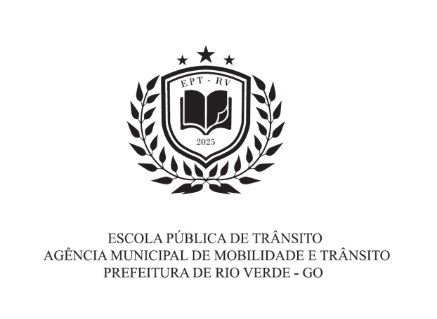

LEI COMPLEMENTAR Nº 421, DE 31 DE OUTUBRO DE 2025.

Institui e regulamenta a Escola Pública Municipal de Trânsito de Rio Verde – EPTRV.

**A CÂMARA MUNICIPAL DE RIO VERDE-GO APROVA E EU SANCIONO A SEGUINTE LEI:**

Art. 1º Fica instituída a Escola Pública Municipal de Trânsito de Rio Verde Goiás – EPTRV, nos termos dos arts. 24, inciso XXIII, e 74, §2º, da Lei nº 9.503, de 23 de setembro de 1997 (Código de Trânsito Brasileiro - CTB), e da Resolução nº 929, de 28 de março de 2022, do Conselho Nacional de Trânsito, destinada ao aperfeiçoamento, formação e treinamento em cursos voltados ao exercício da cidadania, à mobilidade urbana e à segurança viária.

Art. 2º A EPTRV fica vinculada à Agência Municipal de Mobilidade e Trânsito de Rio Verde – Goiás.

Art. 3º A direção da EPTRV será exercida por um membro da Estrutura Orgânica Complementar da Agência Municipal de Mobilidade e Trânsito (AMT), conforme Decreto regulamentar.

**CAPÍTULO I**

**DOS PRINCÍPIOS, FINALIDADE E FUNÇÕES DA ESCOLA PÚBLICA MUNICIPAL DE TRÂNSITO – EPTRV**

Art. 4º São princípios norteadores da EPTRV:

I - transformar a educação no trânsito em um processo contínuo de conscientização, promovendo mudanças comportamentais que resultem em um trânsito mais seguro, eficiente e harmonioso para crianças, jovens e adultos.

II - priorizar o desenvolvimento do convívio social no espaço público, promovendo princípios de equidade, de ética, visando uma melhor compreensão do sistema de trânsito com ênfase na segurança e no meio ambiente.

Art. 5º A EPTRV tem por finalidade promover ações e cursos voltados para o exercício da cidadania, mobilidade e segurança no trânsito objetivando:

I - formação de condutores de aplicativos;

II - formação e atualização de mototáxi e motofrete;

III - formação e atualização de taxistas;

IV - a direção defensiva;

V - a capacitação, aperfeiçoamento e atualização para servidores da Administração pública em atividades compreendidas na área da EPTRV;

VI - capacitação para cidadão de baixa renda, cadastrados no CadÚnico, em cursos de movimentação de cargas, tais como operação de empilhadeira, guindaste e equipamentos similares;

VII - cursos especializados previstos na legislação de trânsito em vigor, tais como: transporte de veículos de emergência, transporte de veículos escolares, movimentação e operação de produtos perigosos, transporte de cargas indivisíveis, transporte de passageiros, dentre outros cursos obrigatórios regulados pelo Conselho Nacional de Trânsito - CONTRAN, inclusive quando necessário através de credenciamento junto ao Departamento Estadual de Trânsito;

VIII - cursos destinados à educação de crianças, adolescentes, jovens e adultos, por meio de aulas teóricas e práticas sobre legislação, sinalização e comportamento no trânsito;

IX - curso de formação e atualização de Agentes de Trânsito;

X - demais cursos exigidos pelos órgãos pertencentes ao Sistema Nacional de Trânsito e regulamentações municipais de trânsito.

Parágrafo único. Os cursos e as capacitações poderão ser realizados presencialmente ou por meio de plataformas tecnológicas na modalidade de Ensino a Distância – EAD, conforme suas regulamentações.

Art. 6º Compete à EPTRV:

I - constituir quadro técnico de educadores de trânsito;

II - definir público-alvo, temas, estabelecer currículos, conteúdos programáticos e sistemas de avaliação a serem desenvolvidos em consonância com os objetivos e diretrizes da Política Nacional de Trânsito - PNT;

III - executar cursos conforme estabelecido em planos e programas de educação de trânsito do respectivo órgão ou entidade executivos de trânsito;

IV - elaborar seu projeto político pedagógico conforme os parâmetros estabelecidos e os objetivos e diretrizes da Política Nacional de Trânsito - PNT;

V - gerenciar dados e informações referentes aos cursos ministrados;

VI - disponibilizar material didático de apoio para os cursos;

VII - propor a realização de parcerias com outros órgãos, entidades, instituições e segmentos organizados da sociedade para a execução dos cursos;

VIII - incentivar e promover pesquisas e produção de conhecimento;

IX - promover e divulgar as atividades da EPTRV;

X - desenvolver atividade permanente de estudos e pesquisas voltadas para a educação de trânsito, inclusive organizando e mantendo biblioteca especializada; e

XI - executar avaliações periódicas das ações implementadas.

Art. 7º É função dos docentes instrutores:

I - assinar os certificados dos cursos ministrados pela EPTRV;

II - planejar e executar a grade de instruções do estágio de qualificação profissional, enfatizando a formação continuada;

III - valorizar o processo de ensino-aprendizagem, salientando uma abordagem que privilegie a construção do conhecimento, com ênfase nos aspectos conceituais e procedimentais;

IV - avaliar o desempenho acadêmico por meio de avaliações escritas e práticas;

V - registrar as atividades desenvolvidas pelos alunos nos cursos;

VI - encaminhar resultados dos cursos, estágios e avaliações teóricas e práticas para homologação e divulgação.

Parágrafo único. O certificado que atesta a capacitação do discente nos cursos ofertados pela EPTRV também será assinado pelo Presidente da Agência Municipal de Mobilidade e Trânsito e pelo Diretor da EPTRV.

**CAPÍTULO II**

**DA ESTRUTURA ORGANIZACIONAL**

Art. 8º A EPTRV fica organizada da seguinte forma:

I - Diretor da EPTRV;

II - Auxiliar Pedagógico;

III - corpo docente teórico;

IV - corpo docente prático;

V - corpo discente.

§ 1º O corpo docente teórico será composto por instrutores de conteúdo teórico e serão responsáveis por conduzir a instrução e planejar o conteúdo das aulas a serem ministradas.

§ 2º O corpo docente prático será composto por instrutores de conteúdo prático e serão responsáveis por conduzir a instrução e planejar o conteúdo das aulas a serem ministradas.

§ 3º O corpo discente será formado por alunos regularmente matriculados nos cursos oferecidos pela EPTRV.

§ 4º O exercício dos cargos de Diretor da EPTRV e Auxiliar Pedagógico não darão direito ao recebimento de qualquer remuneração ou gratificação.

**CAPÍTULO III**

**DA DIREÇÃO DA EPTRV**

Art. 9º Compete ao Diretor da EPTRV:

I - organizar o funcionamento geral e a utilização do seu espaço físico, submetendo as medidas adotadas à apreciação do Presidente da Agência Municipal de Mobilidade e Trânsito, quanto:

a) ao atendimento e gerenciamento de demandas, inclusive a criação de cursos;

b) aos turnos de funcionamento;

c) à distribuição das turmas por turnos.

II - decidir sobre as petições, recursos e processos de sua competência ou, quando for o caso, encaminhar no prazo legal ao setor competente;

III - coordenar e acompanhar as atividades da EPTRV;

IV - gerenciar a formação de turmas;

V - apurar eventual irregularidade e/ou solicitar a abertura de sindicâncias para o corpo docente;

VI - subscrever os documentos expedidos pela EPTRV;

VII - decidir sobre as justificativas apresentadas pelos discentes matriculados na EPTRV referentes à falta ao curso, bem como aquelas apresentadas pelos instrutores e demais servidores lotados na EPTRV;

VIII - designar professores, instrutores e demais servidores necessários para atuar junto aos alunos;

IX - aprovar, de acordo com as diretrizes estabelecidas, a programação das apresentações e calendário de eventos;

X - colaborar com a organização, planejamento e execução de concursos no âmbito do Município em assuntos relacionados ao trânsito;

XI - solicitar a aquisição dos materiais necessários ao funcionamento da EPTRV, bem como, para o aperfeiçoamento e qualificação do corpo docente;

XII - definir a periodicidade e convocar reuniões com o corpo docente;

XIII - elaborar o relatório de acompanhamento anual do funcionamento da EPTRV;

XIV - cumprir e fazer cumprir a legislação de trânsito, em conformidade com as leis e resoluções do Conselho Nacional de Trânsito (CONTRAN);

XV - promover a Educação para o Trânsito por meio de estratégias integradas de conscientização, formação e campanhas educativas.

Art. 10. O Auxiliar Pedagógico é responsável pela escrituração documentos, devendo garantir o fluxo da documentação relativa administrativo geral, competindo-lhe:

I - colaborar na execução do calendário ou cronograma da EPTRV;

II - controlar a frequência diária dos alunos, dos docentes e dos demais servidores lotados na EPTRV;

III - manter em ordem arquivos relativos aos alunos;

IV - controlar a destinação dos materiais, suprimentos e insumos da EPTRV;

V - designar docentes substitutos, quando ausentes os titulares;

VI - elaborar e publicar listagem de alunos aprovados e reprovados;

VII - manter atualizados os assentamentos individuais dos alunos;

VIII - executar todos os procedimentos concernentes ao ingresso dos alunos;

IX - confeccionar certificado e declaração de conclusão de curso;

X - acompanhar o desempenho dos alunos;

XI - manter atualizado o cadastro dos alunos;

XII - manter sigilo sobre os assuntos que assim devam ser tratados;

XIII - comunicar aos superiores as irregularidades eventualmente detectadas;

XIV - executar outras tarefas que forem determinadas.

Parágrafo único. A função de Auxiliar Pedagógico será exercida por servidor de cargo efetivo do Município de Rio Verde.

**CAPÍTULO IV**

**DO CORPO DOCENTE**

Art. 11. A docência será exercida preferencialmente por servidores efetivos do quadro de carreira da Agência Municipal de Mobilidade e Trânsito de Rio Verde, com formação específica e comprovada em áreas afins e correlatas à disciplina a ser ministrada.

§ 1º Poderá ser convidado ou contratado profissional devidamente qualificado na disciplina a ser ministrada.

§ 2º A atividade exercida nos termos do § 1º deste artigo não implicará vínculo empregatício com o Município ou com a EPTRV.

§ 3º Poderão compor a docência da EPTRV os servidores do município não pertencentes ao quadro de carreira da Agência Municipal de Mobilidade e Trânsito de Rio Verde.

SEÇÃO I

DA SELEÇÃO PARA O CORPO DOCENTE

Art. 12. A seleção do corpo docente será realizada por meio de processo seletivo interno simplificado, a ser analisado por uma banca composta pelo Presidente da Agência Municipal de Mobilidade e Trânsito, pelo Diretor da EPTRV, e o Auxiliar Pedagógico da EPTRV.

§ 1º Nos casos em que o Diretor da EPTRV tiver interesse em participar do processo seletivo, este não comporá a banca que o avaliará.

§ 2º O docente, para ministrar os cursos, deverá preencher um dos seguintes requisitos:

I - formação de nível superior com especialização em trânsito ou formação específica na área de trânsito, para as disciplinas relacionadas à legislação de trânsito;

II - formação de nível superior na área específica da disciplina a ser ministrada;

III - experiência mínima de 03 (três) anos no cargo de Agente Municipal de Trânsito para o docente que atuará nas aulas práticas operacionais;

IV - para servidores públicos do Município:

a) não ter sofrido penalidade disciplinar nos últimos 03 (três) anos que antecedem à data de publicação do edital do processo seletivo;

b) ter tido pontuação igual ou superior a 400 (quatrocentos) pontos nas últimas 02 (duas) avaliações de desempenho funcional imediatamente anteriores à data de publicação do edital.

§ 3º O regramento estabelecido no § 2º deste artigo poderá ser excepcionado na hipótese de que trata o § 1º do art. 11 desta lei desde que devidamente justificado.

§ 4º Para os efeitos desta Lei, considera-se formação específica na área de trânsito quaisquer cursos na área, como gestão em trânsito e transporte, mobilidade urbana, educação para o trânsito, instrutor de trânsito, entre outros.

Art. 13. O processo seletivo para instrução será realizado em duas etapas:

I - análise curricular;

II - análise de perfil e comprovação de habilidade pedagógica para a função.

§ 1º A análise curricular levará em consideração se o servidor tem formação e especializações na área para a qual a inscrição está sendo pleiteada, comprovada por meio de instituição reconhecida pelo Ministério da Educação e Cultura (MEC), ou empresa pedagógico-especializada com registro nos órgãos competentes.

§ 2º A análise de perfil e comprovação pedagógica será realizada mediante a ministração de aula para a banca avaliadora sobre o tema pelo qual a inscrição está sendo pleiteada.

§ 3º A forma de avaliação será especificada no edital do processo seletivo para o corpo docente.

§ 4º Encerrado o processo seletivo, as nomeações dos servidores que ministrarão a formação dar-se-ão por portaria do Presidente da Agência Municipal de Mobilidade e Trânsito de Rio Verde – Goiás.

SEÇÃO II

DOS DEVERES DO CORPO DOCENTE

Art. 14. Compete ao docente da EPTRV:

I - ministrar aulas às turmas e nos turnos indicados, cumprindo rigorosamente o plano de aula elaborado;

II - manter atualizado o registro de classe e demais registros necessários ao acompanhamento de desempenho do aluno;

III - apresentar, no prazo máximo de 10 (dez) dias, a média a ser atribuída ao aluno, após a execução de avaliações correntes, finais ou trabalhos executados pelo aluno;

IV - manter a ordem e a disciplina durante as aulas objetivando estabelecer clima harmônico na classe;

V - planejar a aula ou atividades de recuperação ou reforço, quando for o caso;

VI - analisar casos de aproveitamento insatisfatório e sugerir medida de correção;

VII - encaminhar ao Auxiliar Pedagógico da EPTRV a documentação referente aos alunos, quando solicitada;

VIII - participar de atividade extracurricular que concorra para o aperfeiçoamento individual e para o enriquecimento geral da EPTRV;

IX - levar ao conhecimento do diretor da EPTRV irregularidades detectadas ou relatadas por terceiros;

X - manter-se atualizado, buscando diversas formas de conhecimento a fim de repassar ao corpo discente;

XI - elaborar e aplicar avaliações escritas, de conceito, orais, práticas ou prático-orais, conforme estabelecido na regulamentação específica de cada curso;

XII - cumprir e zelar pelo cumprimento desta lei.

SEÇÃO III

DA GRATIFICAÇÃO POR ENCARGO DE INSTRUÇÃO

Art. 15. Fica instituída a Gratificação por Encargo de Instrução para os docentes da EPTRV, a ser concedida por hora-aula ministrada em cursos promovidos pela instituição, no valor de R$ 49,15 (quarenta e nove reais e quinze centavos) por hora-aula, sendo esse valor reajustado anualmente com base no percentual aplicado na reposição salarial anual dos servidores.

§ 1º Os servidores do Município de Rio Verde que compuserem o corpo docente, pertencentes ou não ao quadro da Agência Municipal de Mobilidade e Trânsito, farão jus à gratificação na forma do caput deste artigo.

§ 2º A gratificação não se incorporará à remuneração do servidor para qualquer efeito e não poderá ser utilizada como base de cálculo para quaisquer outras vantagens, inclusive para fins de cálculo de proventos de aposentadoria e pensões.

§ 3º As horas-aula referidas no caput, se desempenhadas durante a jornada de trabalho, deverão ser compensadas no mesmo mês da instrução, mediante prévia anuência da chefia imediata.

§ 4º Cada hora-aula corresponderá ao período de 50 (cinquenta) minutos.

§ 5º O valor da hora-aula estabelecido pelo caput deste artigo inclui a preparação das atividades docentes.

§ 6º Os docentes estão limitados a exercerem 40 (quarenta) horas-aulas por mês, desde que haja compatibilidade com sua jornada de trabalho.

**CAPÍTULO V**

**DO CORPO DISCENTE**

Art. 16. O corpo discente será composto por alunos regularmente matriculados, servidores da Administração Pública, crianças, jovens e adultos da comunidade, além de integrantes de outras corporações municipais.

Art. 17. Os alunos deverão ser submetidos a avaliações escritas, de conceito, orais, práticas ou prático-orais, conforme estabelecido na regulamentação específica de cada curso.

Art. 18. Os cursos propostos pela EPTRV seguirão as diretrizes do regimento interno, que disciplinará as penalidades e estabelecerá, dentre outros, as faltas disciplinares pedagógicas e a apuração, a classificação e a aplicação das penas.

Art. 19. Os discentes matriculados na EPTRV apenas poderão participar dos cursos por meio da assinatura de termo de compromisso.

**CAPÍTULO VI**

**DOS CURSOS**

Art. 20. Os cursos ministrados pela EPTRV serão um conjunto de disciplinas e regras com o objetivo de formar, atualizar, treinar, aperfeiçoar e especializar o corpo discente.

Art. 21. A organização dos cursos abrangerá a estrutura, o currículo, o plano de curso, as modalidades de ensino e o processo de avaliação.

Art. 22. Durante os cursos de formação, de treinamento ou de aperfeiçoamento, bem como nos estágios práticos, as aulas deverão conter conhecimentos básicos e específicos, com aulas práticas e teóricas, nas seguintes modalidades:

I - geral: conhecimentos científico-acadêmicos das ciências jurídicas, sociais, humanas, tecnológicas, psicológicas e suas aplicações no exercício das atividades relacionados ao trânsito;

II - especifico: conhecimentos específicos ao exercício das funções.

**CAPÍTULO VII**

**DA REALIZAÇÃO DE CONVÊNIOS E ACORDOS DE COOPERAÇÃO TÉCNICA**

Art. 23. O Município e a Agência Municipal de Mobilidade e Trânsito de Rio Verde – Goiás poderá, por meio da EPTRV, firmar convênios, parcerias e acordos de cooperação técnica com outros municípios visando a capacitação e atualização de Agentes Municipais de Trânsito, Guardas Municipais e demais profissionais que necessitem de formação na área de trânsito.

Parágrafo único. As despesas com a realização dos convênios, parcerias e acordos, serão custeadas pelo município interessado e regulamentadas conforme acordos celebrados.

Art. 24. Os recursos arrecadados com a celebração de convênios e outros instrumentos jurídicos com entes públicos ou entidades privadas integrarão a receita orçamentária do Município e serão destinados, prioritariamente, ao custeio das despesas decorrentes das atividades desenvolvidas pela Escola Pública Municipal de Trânsito.

**CAPÍTULO VIII**

**DO EMBLEMA DA ESCOLA PÚBLICA DE TRÂNSITO**

Art. 25. Fica criado o Emblema Oficial da Escola Pública de Trânsito de Rio Verde (EPTRV), conforme Anexo Único desta lei, com a finalidade de representar visualmente a identidade da escola e sua missão educacional no âmbito da segurança e da cidadania no trânsito.

Art. 26. O uso do Emblema Oficial será obrigatório nos documentos, materiais didáticos, certificados, uniformes e demais peças institucionais produzidas pela Escola Pública de Trânsito de Rio Verde.

Art. 27. É vedado o uso do Emblema Oficial por terceiros sem autorização expressa da autoridade competente da AMT, sob pena de sanções administrativas e legais cabíveis.

**CAPÍTULO IX**

**DISPOSIÇÕES GERAIS**

Art. 28. A Escola Pública Municipal de Trânsito de Rio Verde poderá organizar palestras, debates, seminários e outros eventos.

Art. 29. A Escola Pública Municipal de Trânsito de Rio Verde tem por finalidade as ações e cursos dispostas no art. 5º desta lei, sendo vedada a exploração de atividade econômica, nos termos do art. 173 da Constituição Federal.

Art. 30. As atribuições e competências de funcionamento previstas nesta lei poderão ser regulamentadas por decreto do Chefe do Poder Executivo.

Parágrafo único. O Presidente da Agência Municipal de Mobilidade e Trânsito poderá editar normas complementares para viabilizar o funcionamento da Escola Pública Municipal de Trânsito de Rio Verde.

Art. 31. Esta Lei entrará em vigor na data de sua publicação, revogadas as disposições em contrário.

Gabinete do Prefeito de Rio Verde, aos 31 de outubro de 2025.

wellington soares carrijo filho 

Prefeito de Rio Verde

vinícius fonsêca campos

Procurador-Geral

**ANEXO ÚNICO**

