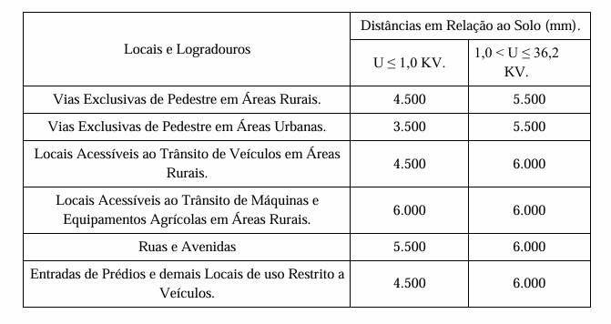

LEI Nº 7.436, DE 23 DE OUTUBRO DE 2023.

Dispõe sobre a padronização, alinhamento e identificação da fiação aérea no Município de Verde, e dá outras providências. 

**CONSOLIDADA COM A LEI:**

[Lei nº 7.724](https://legisla.casacivil.go.gov.br/pesquisa_legislacao/114234 "Abrir Lei Ordinária nº 7724, de 2025 em nova aba")/2025 ................................................... (31/10/2025)

**A CÂMARA MUNICIPAL DE RIO VERDE–GO APROVA E EU SANCIONO A SEGUINTE LEI:**

Art. 1º Fica a empresa concessionária ou permissionária de energia elétrica obrigada a observar o correto uso do espaço público de forma ordenada em relação ao alinhamento dos fios por ela utilizados e a retirada de todas as fiações e equipamentos não utilizados nos postes existentes no Município de Rio Verde.

Parágrafo único. Para efeitos desta lei, rede ou fiação são todos os produtos que utilizam cabeamento para levar ao mercado consumidor os serviços oferecidos.

I - Energia elétrica;

II - Telefonia fixa;

III - Banda larga;

IV - TV a cabo;

V - Demais redes não mencionadas ou correlatas que utilizem cabeamento aéreo.

Art. 2º A rede ou fiação aérea não deve comprometer a segurança das pessoas e instalações a qualquer espécie.

Art. 3º Deverão ser retirados os fios excedentes e demais equipamentos inutilizados, bem como alinhados os fios que são necessários na rede, atendido ao disposto no caput do art. 1º, no prazo máximo de 01 (um) ano, a partir da publicação desta lei, ressalvados os casos de emergência, em que as providências previstas neste artigo deverão ser realizadas no prazo de 24 (vinte e quatro) horas, a partir da constatação do risco ou do recebimento de notificação do órgão municipal competente.

Parágrafo único. Novas empresas e empresas notificadas terão de identificar e adequar os pontos necessários de acordo com a faixa de 500 mm para ocupação, respeitando as distâncias normativas de altura em relação ao solo para os locais de acesso a pedestre e também travessia de veículos, assim como o distanciamento da rede elétrica, conforme tabela do anexo I desta lei – NDU 009 CRITÉRIOS PARA COMPARTILHAMENTO DE INFRAESTRUTURA DA REDE ELÉTRICA DE DISTRIBUIÇÃO.

Art. 4º A empresa concessionária ou permissionária de energia elétrica deve fazer a manutenção, conservação, remoção, substituição, sem qualquer ônus para a administração pública municipal, de poste de concreto ou de madeira que está em estado precário, torto, inclinado ou em desuso.

§ 1º Em caso de substituição de poste, fica a empresa concessionária ou permissionária de energia elétrica obrigada a notificar as demais empresas que utilizam os postes como suporte de seus cabeamentos, a fim de que possam realizar o realinhamento dos cabos e demais componentes.

§ 2º A notificação de que trata o §1º do artigo 4º desta Lei, deverá ocorrer em 48 (quarenta e oito) horas da data da substituição do poste.

§ 3º Havendo a substituição do poste, as empresas devidamente notificadas têm o prazo de 10 (dez) dias para regularizar a situação de seus cabos e/ou componentes.

§ 4º A notificação de que se refere o §2º artigo não isenta a Distribuidora de energia elétrica de responsabilidade, apenas lhe assegura o direito de regresso na hipótese de não ser atendida a obrigação de regularização de que trata o caput deste artigo.

Art. 5º O compartilhamento da faixa de ocupação deve ser feito de forma ordenada e uniforme, de modo que a instalação de um ocupante não utilize pontos de fixação e nem invada a área destinada a outros, bem como o espaço de uso exclusivo das redes de energia elétrica e de iluminação pública.

Art. 6º Concomitantemente ao estabelecido no art. 2º desta lei, todas as fiações devem ser identificadas e instaladas separadamente com nome da ocupante no prazo de 01 (um) ano a partir da publicação desta lei, salvo quando o desenvolvimento tecnológico permitir compartilhamento.

Parágrafo único. Nas ruas arborizadas, os fios condutores de energia elétrica, telefônicos e demais ocupantes dos postes de energia elétrica deverão ser estendidos à distância razoáveis das árvores ou convenientemente isolados.

Art. 7º Os novos projetos de instalação que vierem a ser executados após a publicação desta lei deverão:

I - protocolar e preencher ficha de autorização no órgão municipal competente.

II - conter cabeamento identificado, atendendo ao disposto no art. 3º desta lei.

III - estar devidamente regularizado, conforme legislação vigente e conter autorização do Município.

Art. 7º-A Os fios das empresas de telefonia e de serviços de internet deverão ter selo de identificação da empresa que for responsável pela respectiva fiação.

(Inserido pela [Lei nº. 7.724](http://legisla.casacivil.go.gov.br/pesquisa_legislacao/114234), de 31 de outubro de 2025)

Parágrafo único. As empresas responsáveis deverão, ainda, até o dia 10 (dez) de cada mês, informar ao Município:

(Inserido pela [Lei nº. 7.724](http://legisla.casacivil.go.gov.br/pesquisa_legislacao/114234), de 31 de outubro de 2025)

I - todas as novas instalações realizadas no mês imediatamente anterior, com os respectivos endereços;

(Inserido pela [Lei nº. 7.724](http://legisla.casacivil.go.gov.br/pesquisa_legislacao/114234), de 31 de outubro de 2025)

II - todos os serviços que forem cancelados no mês imediatamente anterior, com os devidos endereços, e, no prazo de 30 (trinta) dias contados do cancelamento, promover a retirada dos fios dos serviços cancelados.

(Inserido pela [Lei nº. 7.724](http://legisla.casacivil.go.gov.br/pesquisa_legislacao/114234), de 31 de outubro de 2025)

Art. 8º Em caso de descumprimento será aplicada a seguinte penalização:

I - multa de R$ 7.500,00 (sete mil e quinhentos) reais à empresa concessionária ou permissionária por cada denúncia ou notificação de sua responsabilidade direta que, nos prazos definidos por esta lei, deixar de regularizar ou que deixar de notificar, nos casos que não forem de sua responsabilidade direta;

II - multa de R$ 7.500,00 (sete mil e quinhentos) reais à empresa que utiliza os postes da concessionária ou permissionária de energia elétrica para suporte de seus cabeamentos, se depois de notificada pela Distribuidora, não realizar a manutenção de seus fios e equipamentos dentro do prazo nesta lei estabelecido;

§ 1º A concessionária ou permissionária de energia elétrica responderá solidariamente à empresa que utiliza os seus postes como suporte de seus cabeamentos no caso do inciso II deste artigo.

§ 2º No caso de reincidência, a multa terá o seu valor dobrado.

§ 3º Será considerada reincidência a prática de mais de uma infração dentro de um período de 12 (doze) meses.

§ 4º Transcorrido o prazo de 30 (trinta) dias do art. 4º desta lei sem que tenha sido regularizada a não conformidade, incidirá multa de R$ 500,00 (quinhentos) reais, por dia de atraso, limitada a R$ 5.000,00 (cinco mil) reais por infração, em desfavor da concessionária ou permissionária e demais empresas infratoras, se o caso, sem prejuízo das multas estabelecidas nos incisos “I” e “II” deste artigo.

Art. 9º A fiscalização e aplicação da multa serão exercidos pelo órgão municipal cometente.

Art. 10. (VETADO).

Art. 11. Ficam revogadas a Leis Municipais nº 6.684/2017, 7.023/2019 e demais disposições em contrário.

Art. 12. Esta Lei entra em vigor na data de sua publicação.

Gabinete do Prefeito de Rio Verde, aos 23 de outubro de 2023.

PAULO FARIA DO VALE 

Prefeito de Rio Verde

FERNANDO COSTA BORGES

Procurador-Geral

**ANEXO I**

Tabela 3 da NDU-009 CRITÉRIOS PARA COMPARTILHAMENTO DE INFRAESTRUTURA DA REDE ELÉTRICA DE DISTRIBUIÇÃO.

