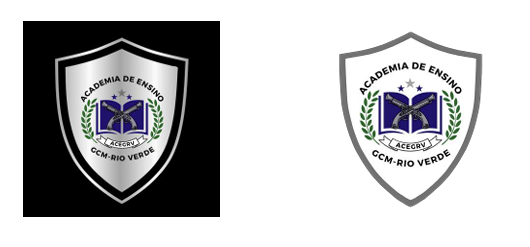

LEI COMPLEMENTAR Nº 355, DE 27 DE MAIO DE 2024.

Institui e regulamenta a Academia de Ensino da Guarda Civil de Rio Verde (ACEGRV) e dá outras providências.

**CONSOLIDADA COM As LEIs:**

[Lei complementar nº 369](https://legisla.casacivil.go.gov.br/pesquisa_legislacao/114399 "Abrir Lei Complementar nº 369, de 2024 em nova aba") ................................................... (16/12/2024)

[Lei complementar nº 414](https://legisla.casacivil.go.gov.br/pesquisa_legislacao/114400 "Abrir Lei Complementar nº 414, de 2025 em nova aba") ................................................... (31/10/2025)

**A CÂMARA MUNICIPAL DE RIO VERDE-GO APROVA E EU SANCIONO A SEGUINTE LEI:**

Art. 1º Fica instituída, nos termos do art. 12 da Lei Federal nº 13.022, de 8 de agosto de 2014, a Academia de Ensino da Guarda Civil de Rio Verde, órgão de aperfeiçoamento, formação e treinamento dos integrantes da Guarda Civil Municipal de Rio Verde Goiás, para quaisquer fins, com a sigla ACEGRV.

Art. 2º A ACEGRV ficará vinculada ao Gabinete do Presidente da Guarda Civil Municipal de Rio Verde - Goiás.

Art. 3º A coordenação da ACEGRV será exercida por membro efetivo do quadro de carreira da Guarda Civil Municipal de Rio Verde.

(Redação dada pela [Lei Complementar nº 369](https://legisla.casacivil.go.gov.br/pesquisa_legislacao/114399 "Abrir Lei Complementar nº 369, de 2024 em nova aba"), de 16 de dezembro de 2024)

~~Art. 3º A coordenação da ACEGRV será exercida preferencialmente por membro efetivo do quadro de carreira da Guarda Civil Municipal de Rio Verde.~~

Art. 4º A formação de novos servidores decorrentes de concursos públicos para o cargo de Guarda Civil Municipal ficará a cargo da Academia de Ensino da Guarda Civil de Rio Verde – Goiás, observado o que dispuser o edital.

**CAPÍTULO II**

**DOS PRINCÍPIOS, FINALIDADE E FUNÇÕES DA ACADEMIA DE ENSINO DA GUARDA CIVIL**

Art. 5º São princípios norteadores da ACEGRV:

I - proteção dos direitos fundamentais, do exercício da cidadania e das liberdades públicas;

II - garantia do exercício da cidadania, ética e valores morais;

III - compromisso com a evolução social da comunidade;

IV - formação continuada dos servidores da Guarda Civil Municipal.

Art. 6º A ACEGRV tem por finalidade promover a realização dos cursos de formação, atualização, especialização, qualificação e habilitação de Guardas Civis Municipais, objetivando:

I - a formação técnico-profissional e humanística do Guarda Civil Municipal, habilitando-o para o exercício de sua função;

II - a atualização e especialização de conhecimentos gerais e técnico-profissionais do Guarda Civil Municipal;

III - acompanhar o desempenho dos Guardas Civis Municipais, durante o período de estágio probatório;

IV - promover a reabilitação profissional dos Guardas Municipais afastados, capacitando-os pedagógica e psicologicamente para o retorno das funções;

V - promover o desenvolvimento da pesquisa científica e a análise estatística, com vistas a influenciar e subsidiar soluções no ensino e políticas públicas de segurança, cooperando com outras instituições de segurança pública, incluindo a participação social;

VI - promover o Estágio de Qualificação Profissional (EQP), que será realizado anualmente, com carga horária mínima de 80 horas, conforme previsto em legislação federal.

Art. 7º É função da ACEGRV e do docente instrutor:

I - assinar os certificados dos cursos ministrados pela ACEGRV;

II - produzir material didático para ensino e instrução, buscando a constante atualização, promovendo o estudo e indicações de novos equipamentos, conceitos e procedimentos pedagógicos operacionais;

III - planejar e executar a grade de instruções do estágio de qualificação profissional, enfatizando a formação continuada e promover a contínua adequação à matriz curricular nacional;

IV - valorizar o processo de ensino-aprendizagem, salientando uma abordagem que privilegie a construção do conhecimento, com ênfase nos aspectos conceituais e procedimentais;

V - avaliar o desempenho acadêmico por meio de avaliações escritas e práticas;

VI - registrar as atividades desenvolvidas pelos alunos nos cursos;

VII - encaminhar resultados dos cursos, estágios e avaliações teóricas e práticas para homologação e divulgação;

VIII - promover o desenvolvimento, a regulamentação e o aperfeiçoamento dos programas de atenção biopsicossocial voltados para o Guarda Municipal.

Parágrafo único. O certificado que atesta a capacitação do discente nos cursos ofertados pela ACEGRV será assinado pelo Presidente da Guarda Civil Municipal e pelo Inspetor da Academia de Ensino.

**TÍTULO II**

**DA ESTRUTURA ORGANIZACIONAL**

Art. 8º A ACEGRV fica organizada da seguinte forma:

a) Inspetor da Academia de Ensino;

b) Auxiliar Pedagógico;

c) Instrutoria de Armamento e Tiro;

d) Monitoria;

e) Corpo docente;

f) Corpo discente.

§ 1º O Inspetor da Academia de Ensino e Auxiliar Pedagógico são funções gratificadas nos termos da lei e comporão a unidade administrativa da ACEGRV.

§ 2º O Setor de Armamento e Tiro, subordinado ao Inspetor da Academia de Ensino e Auxiliar Pedagógico da ACEGRV, é integrado por instrutores de armamento e tiro, conforme prevê a Instrução Normativa 111- MJSP/PF, de 31 de janeiro de 2017, ou outra legislação que venha substituí-la.

§ 3º A Monitoria será composta por servidores do quadro de carreira da Guarda Civil Municipal para, quando solicitados, auxiliar os instrutores na condução das aulas.

§ 4º O corpo docente será composto por instrutores de conteúdo teórico e prático e serão responsáveis por conduzir a instrução e planejar o conteúdo das aulas a serem ministradas.

§ 5º O corpo discente será formado por alunos regularmente matriculados nos cursos oferecidos pela ACEGRV.

**TÍTULO III**

**DA DIREÇÃO E INSPETORIA DA ACEGRV**

Art. 9º Compete ao Inspetor da Academia de Ensino da ACEGRV:

I - organizar o funcionamento geral e a utilização do seu espaço físico, submetendo as medidas adotadas à apreciação do Presidente da Guarda Civil Municipal, quanto:

a) ao atendimento e gerenciamento de demandas, inclusive a criação de cursos;

b) aos turnos de funcionamento;

c) à distribuição das turmas por turnos.

II - decidir sobre as petições, recursos e processos de sua competência ou, quando for o caso, encaminhar no prazo legal ao setor competente;

III - coordenar e acompanhar as atividades da ACEGRV;

IV - gerenciar a formação de turmas;

V - apurar eventual irregularidade e/ou solicitar que a Corregedoria da GCMRV apure, aplicando, quando for o caso, a respectiva penalidade administrativa ao aluno;

VI - subscrever os documentos expedidos pela ACEGRV;

VII - decidir sobre as justificativas apresentadas pelos discentes lotados na ACEGRV referentes à falta ao curso, bem como aquelas apresentadas pelos instrutores e demais servidores lotados na ACEGRV;

VIII - designar professores, instrutores e demais servidores necessários para atuar junto aos alunos;

IX - aprovar, de acordo com as diretrizes estabelecidas, a programação das apresentações e calendário de eventos;

X - colaborar com a organização, planejamento e execução de concursos no âmbito da Guarda Civil Municipal;

XI - solicitar a aquisição dos materiais necessários ao funcionamento da ACEGRV, bem como, para o aperfeiçoamento e qualificação dos instrutores;

XII - definir a periodicidade e convocar reuniões com o corpo docente;

XIII - autorizar a saída de servidor, lotado na ACEGRV, durante o expediente;

XIV- cumprir e fazer cumprir esta legislação.

§ 1º O Inspetor da Academia de Ensino deverá ser um inspetor efetivo da Guarda Civil Municipal de Rio Verde, indicado pelo Presidente da Guarda Civil e nomeado pelo Chefe do Poder Executivo.

§ 2º O exercício da Inspetoria da Academia de Ensino não prejudica o exercício das atribuições regulares do cargo.

Art. 10. O Auxiliar Pedagógico é responsável pela escrituração e guarda dos documentos, devendo garantir o fluxo da documentação relativa ao processo administrativo geral, competindo-lhe:

I - colaborar na execução do calendário ou cronograma da ACEGRV;

II - controlar a frequência diária dos alunos, dos professores, dos instrutores e dos demais servidores lotados na ACEGRV;

III - manter em ordem arquivos relativos aos alunos;

IV - controlar a destinação dos materiais, suprimentos e insumos da ACEGRV;

V - designar professores e instrutores substitutos, quando ausentes os titulares;

VI - elaborar e publicar listagem de alunos aprovados e reprovados;

VII - manter atualizados os assentamentos individuais dos alunos;

VIII - executar todos os procedimentos concernentes ao ingresso dos alunos;

IX - confeccionar certificado e declaração de conclusão de curso;

X - acompanhar o desempenho dos alunos;

XI - manter atualizado o cadastro dos alunos;

XII - manter sigilo sobre os assuntos que assim devam ser tratados;

XIII - comunicar aos superiores as irregularidades eventualmente detectadas;

XIV - executar outras tarefas que forem determinadas.

Parágrafo único. A função de Auxiliar Pedagógico será exercida por servidor de cargo efetivo do Município de Rio Verde.

**TÍTULO IV**

**DA INSTRUTORIA DE ARMAMENTO E TIRO**

Art. 11. Os Instrutores de Armamento e Tiro da ACEGRV deverão ser possuidores de qualificação técnica expedida conforme legislação em vigor e instruções normativas da Polícia Federal.

§ 1º O currículo da disciplina de Armamento e Tiro, cursos complementares e Estágio de Qualificação Profissional (EQP) obedecerão a legislação vigente e as Instruções Normativas da Polícia Federal.

§ 2º A aplicação de testes de capacidade técnica para o manuseio da arma de fogo deverá ser realizada conforme Instruções Normativas da Polícia Federal em vigor.

**TÍTULO V**

**MONITORIA**

Art. 12. O Monitor é uma figura auxiliar cuja presença será necessária apenas nas ocasiões em que o instrutor precisar de apoio.

Parágrafo único. A monitoria será composta por servidores efetivos do quadro de carreira da Guarda Civil Municipal para, quando solicitados, auxiliar os instrutores na condução das aulas.

**TÍTULO VI**

**DO CORPO DOCENTE**

**CAPÍTULO I**

**DISPOSIÇÕES GERAIS**

Art. 13. A docência e instrução serão exercidas preferencialmente por servidores efetivos do quadro de carreira da Guarda Civil Municipal de Rio Verde, com formação específica e comprovada em áreas afins e correlatas à disciplina a ser ministrada.

§ 1º Poderá ser convidado e/ou contratado profissional devidamente qualificado na disciplina a ser ministrada para proceder à instrução.

§ 2º A atividade exercida nos termos do § 1º deste artigo não implicará vínculo empregatício com o Município ou com a ACEGRV.

§ 3º Poderão compor a docência da ACEGRV os servidores do município não pertencentes ao quadro de carreira da Guarda Civil Municipal de Rio Verde.

(Inserido pela [Lei Complementar nº 369](https://legisla.casacivil.go.gov.br/pesquisa_legislacao/114399 "Abrir Lei Complementar nº 369, de 2024 em nova aba"), de 16 de dezembro de 2024)

**CAPÍTULO II**

**DA SELEÇÃO PARA O CORPO DOCENTE**

Art. 14. A seleção do corpo docente será realizada por meio de processo seletivo interno simplificado, a ser analisado por uma banca composta pelo Presidente da Guarda Civil Municipal, Corregedor, Diretor Operacional, Inspetor da Academia de Ensino e o Auxiliar Pedagógico da ACEGRV.

§ 1º Nos casos em que o Inspetor da Academia de Ensino ou Auxiliar Pedagógico da ACEGRV tiver interesse em participar do processo seletivo, este não comporá a banca que o avaliará.

(Redação dada pela [Lei Complementar nº 414](https://legisla.casacivil.go.gov.br/pesquisa_legislacao/114400 "Abrir Lei Complementar nº 414, de 2025 em nova aba"), de 31 de outubro de 2025)

~~§ 1º Nos casos em que o Inspetor da Academia de Ensino tiver interesse em participar do processo seletivo, este não comporá a banca que o avaliará.~~

§ 2º A qualificação exigida para que os instrutores ministrem o curso serão as seguintes:

I - formação de nível superior em Direito, preferencialmente com especialização na área, para as disciplinas de legislação;

II - formação na área, naquelas disciplinas que envolvam treinamento físico ou conhecimentos específicos;

(Redação dada pela [Lei Complementar nº 369](https://legisla.casacivil.go.gov.br/pesquisa_legislacao/114399 "Abrir Lei Complementar nº 369, de 2024 em nova aba"), de 16 de dezembro de 2024)

~~II - formação na área, naquelas disciplinas que envolvam treinamento físico;~~

III - comportamento ótimo na última avaliação de desempenho naquelas disciplinas que envolvam atividades de rotinas e operacionais.

Art. 15. O processo seletivo para instrução será realizado em duas etapas:

a) análise Curricular;

b) análise de Perfil e comprovação de habilidade pedagógica para a função.

§ 1º A análise curricular levará em consideração se o Guarda Civil Municipal tem formação e especializações na área para a qual a inscrição está sendo pleiteada, comprovada por meio de instituição reconhecida pelo Ministério da Educação e Cultura (MEC), ou empresa pedagógico-especializada com registro nos órgãos competentes.

§ 2º A análise de perfil e comprovação pedagógica será realizada mediante a ministração de aula para a banca avaliadora sobre o tema pelo qual a inscrição está sendo pleiteada.

§ 3º A forma de avaliação será trazida no edital do processo de seleção do corpo docente.

§ 4º Encerrado o processo seletivo, as nomeações dos servidores que instruirão a formação dos Guardas Civis Municipais dar-se-ão por portaria do Presidente da Guarda Civil Municipal de Rio Verde - Goiás.

**CAPÍTULO III**

**DOS DEVERES DO CORPO DOCENTE**

Art. 16. Compete ao instrutor da ACEGRV:

I - ministrar aulas às turmas e nos turnos indicados, cumprindo rigorosamente o plano de aula elaborado;

II - manter atualizado o diário de classe e demais registros necessários ao acompanhamento do desempenho do aluno;

III - apresentar, no prazo máximo de 10 (dez) dias, a média a ser atribuída ao aluno, após a execução de avaliações correntes, finais ou trabalhos executados pelo aluno;

IV - manter a ordem e a disciplina durante as aulas objetivando estabelecer clima harmônico na classe;

V - planejar a aula ou atividades de recuperação ou reforço, quando for o caso;

VI - analisar casos de aproveitamento insatisfatório e sugerir medida de correção;

VII - encaminhar ao Auxiliar Pedagógico da ACEGRV a documentação referente aos alunos, quando solicitada;

VIII - participar de atividade extracurricular que concorra para o aperfeiçoamento individual e para o enriquecimento geral da ACEGRV;

IX - levar ao conhecimento do Inspetor da Academia de Ensino da ACEGRV irregularidades detectadas ou relatadas por terceiros;

X - estimular o pensamento reflexivo, articulado e crítico;

XI - fomentar a pesquisa científica, tecnológica e humanística;

XII - manter-se atualizado, buscando diversas formas de conhecimento a fim de repassar ao corpo discente;

XIII - cumprir e zelar pelo cumprimento desta Lei.

Art. 17. Os alunos deverão ser submetidos a avaliações escritas, de conceito, orais, práticas ou prático-orais, conforme estabelecido em edital que regulamentar o respectivo curso.

**CAPÍTULO IV**

**DA GRATIFICAÇÃO POR ENCARGO DE INSTRUÇÃO**

Art. 18. Fica instituída a Gratificação por Encargo de Instrução de docentes da ACEGRV, que será por hora aula ministrada pelo docente que atuar em cursos promovidos pela Academia de Ensino, sendo fixada nos seguintes valores:

I - instrutoria: R$ 46,24 (quarenta e seis reais e vinte e quatro centavos) por hora-aula;

II - monitoria: R$ 35,62 (trinta e cinco reais e sessenta e dois centavos) por hora-aula.

§ 1º Os instrutores servidores do Município de Rio Verde que comporem o corpo docente, pertencentes ou não ao quadro da Guarda Civil Municipal, farão jus à gratificação na forma do caput deste artigo.

§ 2º A gratificação não se incorporará à remuneração do servidor para qualquer efeito e não poderá ser utilizada como base de cálculo para quaisquer outras vantagens, inclusive para fins de cálculo de proventos de aposentadoria e pensões.

§ 3º As horas aula de que trata o caput, se desempenhadas durante a jornada de trabalho, deverão ser compensadas no mesmo mês da instrução, mediante prévia anuência da chefia imediata.

§ 4º Cada hora aula corresponderá ao período de 60 (sessenta) minutos.

§ 5º O valor da hora-aula estabelecido pelo caput deste artigo inclui a preparação das atividades docentes.

§ 6º O Instrutor e Monitor estão limitados a exercerem, por mês, 40 horas-aulas.

§ 7º O Presidente da Guarda Civil Municipal, o Corregedor, o Diretor Operacional, o Inspetor da Academia de Ensino e o Auxiliar Pedagógico da ACEGRV, ainda que ministrem alguma disciplina ou instrução, não farão jus ao recebimento da gratificação pelo encargo de instrução.

(Inserido pela [Lei Complementar nº 414](https://legisla.casacivil.go.gov.br/pesquisa_legislacao/114400 "Abrir Lei Complementar nº 414, de 2025 em nova aba"), de 31 de outubro de 2025)

**TÍTULO VII**

**DO CORPO DISCENTE**

Art. 19. O corpo discente é formado por alunos regularmente matriculados, podendo ser composto por integrantes do quadro técnico da corporação, outros servidores da Administração Pública, candidatos ao ingresso ou ascensão de classe na carreira da Guarda Civil Municipal, integrantes de outras corporações ou de outras Guardas Civis Municipais.

(Redação dada pela [Lei Complementar nº 369](https://legisla.casacivil.go.gov.br/pesquisa_legislacao/114399 "Abrir Lei Complementar nº 369, de 2024 em nova aba"), de 16 de dezembro de 2024)

~~Art. 19. O corpo discente é formado por alunos regularmente matriculados, podendo ser composto por integrantes do quadro técnico da corporação, outros servidores da Administração Pública, candidatos ao ingresso ou ascensão de classe na carreira da Guarda Civil Municipal, integrantes de outras corporações ou de outras Guardas Civis Municipais ou membros da comunidade.~~

Art. 19-A. Os cursos propostos pela ACEGRV e o edital do Curso de Formação seguirão as diretrizes do regimento interno, que disciplinará as penalidades e estabelecerá, dentre outros, as faltas disciplinares pedagógicas e a apuração, a classificação e a aplicação das penas.

(Inserido pela [Lei Complementar nº 369](https://legisla.casacivil.go.gov.br/pesquisa_legislacao/114399 "Abrir Lei Complementar nº 369, de 2024 em nova aba"), de 16 de dezembro de 2024)

Art. 19-B. Os discentes de outros municípios matriculados na ACEGRV apenas poderão participar dos cursos por meio da assinatura de termo de compromisso.

(Inserido pela [Lei Complementar nº 369](https://legisla.casacivil.go.gov.br/pesquisa_legislacao/114399 "Abrir Lei Complementar nº 369, de 2024 em nova aba"), de 16 de dezembro de 2024)

**TÍTULO VIII**

**DOS CURSOS**

Art. 20. Os cursos ministrados pela ACEGRV serão um conjunto de disciplinas e regras com o objetivo de formar, treinar, aperfeiçoar e especializar o corpo discente.

Art. 21. A organização dos cursos abrangerá a estrutura, o currículo, o plano de curso, as modalidades de ensino e o processo de avaliação.

Art. 22. Durante os cursos de formação, de treinamento ou de aperfeiçoamento, bem como nos estágios, as aulas deverão conter conhecimentos básicos e específicos, com aulas práticas e teóricas, nas seguintes modalidades:

I - geral: conhecimentos científico-acadêmicos das ciências jurídicas, sociais, humanas, tecnológicas, psicológicas e suas aplicações no exercício das atividades de Guarda Civil Municipal;

II - Guarda Civil Municipal: conhecimentos específicos ao exercício das funções, sendo:

a) estratégica: capacitação para a gestão, em atividade de comando, dos Guardas Civis Municipais;

b) tática: capacitação do Guarda Civil Municipal no emprego combinado de forças para o desempenho da função.

**TÍTULO IX**

**DO CURSO DE FORMAÇÃO PROFISSIONAL A SER MINISTRADO PELA ACEGRV**

Art. 23. As diretrizes gerais da ACEGRV se harmonizam com as prescrições gerais fixadas no edital e nas respectivas publicações que regem o concurso público para o cargo de Guarda Civil Municipal de Rio Verde.

Art. 24. O Curso de Formação da Guarda Civil Municipal tem como objetivos:

a) o desenvolvimento de atributos ligados ao respeito à ordem e a hierarquia;

b) o desenvolvimento de atributos que compreendem o exercício das atividades do Guarda Municipal de Rio Verde, ligados à prática da cidadania, ética e respeito à lei, autoconhecimento e sentimento de confiança em suas capacidades cognitiva, emocional, física, ética e inter-relacional;

c) a capacitação do candidato-aluno para o desempenho de suas atividades, com observância nas disposições contidas na Lei 13.022/2014, na Lei Complementar 88/17, no Estatuto dos Servidores do Município e demais leis e normas que regem a atividade da Guarda Civil Municipal.

Art. 25. O Curso de Formação para o cargo de Guarda Civil Municipal será oferecido de acordo com plano de aula fundamentado na Matriz Curricular Nacional de Guardas Municipais da Secretaria Nacional de Segurança Pública (SENASP), abrangendo disciplinas teóricas e práticas e ciclo de palestras.

Parágrafo único. A Matriz Curricular referente ao Curso de Formação da Guarda Civil Municipal será elaborada pela Guarda Civil Municipal e aprovado por Decreto do Chefe do Poder Executivo.

Art. 26. As atividades do Curso de Formação da Guarda Civil Municipal de Rio Verde poderão ser ministradas em qualquer dia da semana, inclusive sábados, domingos e feriados e nos turnos matutino, vespertino e noturno.

Parágrafo único. As datas referentes ao início e término do Curso de Formação Profissional da Guarda Civil Municipal será oportunamente publicado pela banca do concurso.

Art. 27. As normativas específicas referentes ao Curso de Formação serão estabelecidas em edital elaborado pela banca organizadora do concurso.

**TÍTULO X**

**DA REALIZAÇÃO DE CONVÊNIOS E ACORDOS DE COOPERAÇÃO TÉCNICA**

Art. 28. O Município poderá, por meio da ACEGRV, firmar convênios, parcerias e acordos de cooperação técnica com outros municípios visando a capacitação dos integrantes das Guardas Municipais dos respectivos municípios.

Parágrafo único. As despesas com a realização dos convênios, parcerias e acordos, serão custeadas pelo município interessado e regulamentadas conforme acordos celebrados.

Art. 29. Os recursos arrecadados com a celebração de convênios e outros instrumentos jurídicos com entes públicos ou entidades privadas integrarão a receita orçamentária da Guarda Civil Municipal e serão destinados, prioritariamente, ao custeio das despesas decorrentes das atividades desenvolvidas pela Academia de Ensino.

**TÍTULO X-A**

**SOBRE O BRASÃO DA ACADEMIA DE ENSINO**

(Inserido pela [Lei Complementar nº 369](https://legisla.casacivil.go.gov.br/pesquisa_legislacao/114399 "Abrir Lei Complementar nº 369, de 2024 em nova aba"), de 16 de dezembro de 2024)

Art. 29-A. Fica instituído o Brasão como símbolo da Academia de Ensino da Guarda Civil de Rio Verde, conforme Anexo Único desta lei, atendendo às seguintes disposições:

(Inserido pela [Lei Complementar nº 369](https://legisla.casacivil.go.gov.br/pesquisa_legislacao/114399 "Abrir Lei Complementar nº 369, de 2024 em nova aba"), de 16 de dezembro de 2024)

I - o escudo simboliza a proteção e a defesa;

(Inserido pela [Lei Complementar nº 369](https://legisla.casacivil.go.gov.br/pesquisa_legislacao/114399 "Abrir Lei Complementar nº 369, de 2024 em nova aba"), de 16 de dezembro de 2024)

II - as armas simbolizam a força e a prontidão;

(Inserido pela [Lei Complementar nº 369](https://legisla.casacivil.go.gov.br/pesquisa_legislacao/114399 "Abrir Lei Complementar nº 369, de 2024 em nova aba"), de 16 de dezembro de 2024)

III - os ramos de louros são tradicionalmente associados à vitória e ao reconhecimento;

(Inserido pela [Lei Complementar nº 369](https://legisla.casacivil.go.gov.br/pesquisa_legislacao/114399 "Abrir Lei Complementar nº 369, de 2024 em nova aba"), de 16 de dezembro de 2024)

IV - o livro simboliza o conhecimento e a educação, essenciais para a formação e o desenvolvimento dos integrantes da Guarda Civil Municipal;

(Inserido pela [Lei Complementar nº 369](https://legisla.casacivil.go.gov.br/pesquisa_legislacao/114399 "Abrir Lei Complementar nº 369, de 2024 em nova aba"), de 16 de dezembro de 2024)

V - as três estrelas representam os princípios fundamentais que guiam a atuação da Guarda Civil Municipal: Disciplina, Compromisso e Excelência.

(Inserido pela [Lei Complementar nº 369](https://legisla.casacivil.go.gov.br/pesquisa_legislacao/114399 "Abrir Lei Complementar nº 369, de 2024 em nova aba"), de 16 de dezembro de 2024)

Art. 29-B. É obrigatório o uso do Brasão da Academia de Ensino da Guarda Civil de Rio Verde:

(Inserido pela [Lei Complementar nº 369](https://legisla.casacivil.go.gov.br/pesquisa_legislacao/114399 "Abrir Lei Complementar nº 369, de 2024 em nova aba"), de 16 de dezembro de 2024)

I - nos uniformes do corpo docente, discente e dos funcionários da área administrativa e de limpeza, conforme regulamento;

(Redação dada pela [Lei Complementar nº 414](https://legisla.casacivil.go.gov.br/pesquisa_legislacao/114400 "Abrir Lei Complementar nº 414, de 2025 em nova aba"), de 31 de outubro de 2025)

~~I - nos uniformes do corpo docente, discente e dos funcionários da área administrativa e de limpeza; (Inserido pela [Lei Complementar nº 369](https://legisla.casacivil.go.gov.br/pesquisa_legislacao/114399 "Abrir Lei Complementar nº 369, de 2024 em nova aba"), de 16 de dezembro de 2024)~~

II - nos papéis de expedientes e em todas as publicações oficiais, juntamente com o Brasão do Município.

(Inserido pela [Lei Complementar nº 369](https://legisla.casacivil.go.gov.br/pesquisa_legislacao/114399 "Abrir Lei Complementar nº 369, de 2024 em nova aba"), de 16 de dezembro de 2024)

Parágrafo único. No caso do inciso II deste artigo, não é permitido que o Brasão da Academia de Ensino seja maior que o Brasão do Município, nem deve ser posicionado no lado esquerdo da folha.

(Inserido pela [Lei Complementar nº 369](https://legisla.casacivil.go.gov.br/pesquisa_legislacao/114399 "Abrir Lei Complementar nº 369, de 2024 em nova aba"), de 16 de dezembro de 2024)

Art. 29-C. É vedado o uso do Brasão da Academia de Ensino sempre que não se revestir da forma, ou não se apresentar do modo prescrito no art. 29-A desta lei.

(Inserido pela [Lei Complementar nº 369](https://legisla.casacivil.go.gov.br/pesquisa_legislacao/114399 "Abrir Lei Complementar nº 369, de 2024 em nova aba"), de 16 de dezembro de 2024)

Art. 29-D. É vedado aos discentes e docentes apresentar ou tratar com desrespeito o Brasão da Academia de Ensino da Guarda Civil de Rio Verde.

(Inserido pela [Lei Complementar nº 369](https://legisla.casacivil.go.gov.br/pesquisa_legislacao/114399 "Abrir Lei Complementar nº 369, de 2024 em nova aba"), de 16 de dezembro de 2024)

**TÍTULO XI**

**DISPOSIÇÕES GERAIS**

Art. 30. A Academia de Ensino da Guarda Civil de Rio Verde poderá organizar palestras, debates, seminários e outros eventos.

Art. 31. Esta Lei entra em vigor na data de sua publicação, revogadas as disposições em contrário.

Gabinete do Prefeito de Rio Verde, aos 27 de maio de 2024.

PAULO FARIA DO VALE

Prefeito de Rio Verde

VINÍCIUS FONSÊCA CAMPOS

Procurador-Geral

VALMIR BORGES DA SILVA FILHO

Presidente da Guarda Civil Municipal

**ANEXO ÚNICO**

**BRASÃO DA ACADEMIA DE ENSINO DA GCM-RV**

(Inserido pela [Lei Complementar nº 369](https://legisla.casacivil.go.gov.br/pesquisa_legislacao/114399 "Abrir Lei Complementar nº 369, de 2024 em nova aba"), de 16 de dezembro de 2024)

**1\. Escudo**

O escudo simboliza a proteção e a defesa, valores fundamentais da Guarda Civil Municipal. Representa a responsabilidade de salvaguardar a comunidade, mantendo a ordem e garantindo a segurança pública. O escudo também remete à tradição e à honra, enfatizando o compromisso com a justiça e a integridade no exercício das funções.

**2\. Armas**

As armas no brasão simbolizam a força e a prontidão da Guarda Civil Municipal para agir em defesa da sociedade. Elas representam a capacidade de resposta e a disposição para enfrentar ameaças, garantindo a manutenção da lei e da ordem. As armas também evocam o treinamento e a disciplina necessários para o uso legítimo da força.

**3\. Ramos de Louros**

Os ramos de louros são tradicionalmente associados à vitória e ao reconhecimento. No contexto da Guarda Civil Municipal, eles representam a honra e o respeito conquistados por meio do serviço dedicado à comunidade. Os louros também simbolizam a excelência no cumprimento do dever, refletindo o esforço contínuo para alcançar altos padrões de conduta e profissionalismo.

**4\. Livro**

O livro simboliza o conhecimento e a educação, essenciais para a formação e o desenvolvimento dos integrantes da Guarda Civil Municipal. Representa a importância do aprendizado contínuo e da atualização profissional, destacando o compromisso com a capacitação e a preparação para enfrentar os desafios do serviço público. O livro também reflete a base legal e ética que orienta as ações da corporação.

**5\. Três Estrelas**

As três estrelas representam os princípios fundamentais que guiam a atuação da Guarda Civil Municipal: Disciplina, Compromisso e Excelência. Cada estrela simboliza um desses valores, destacando a importância de cada um para a construção de uma instituição sólida e respeitada. As estrelas também podem refletir o compromisso com a comunidade, o estado e a nação, reforçando o papel da Guarda Civil como defensora dos direitos e da paz social.
