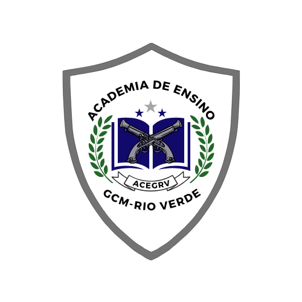

LEI COMPLEMENTAR Nº 369, DE 16 DE DEZEMBRO DE 2024.

Altera a [Lei Complementar nº 355](https://legisla.casacivil.go.gov.br/pesquisa_legislacao/114398 "Abrir Lei Complementar nº 355, de 2024 em nova aba"), de 27 de maio de 2024, que institui e regulamenta a Academia de Ensino da Guarda Civil de Rio Verde (ACEGRV).

**A CÂMARA MUNICIPAL DE RIO VERDE-GO APROVA E EU SANCIONO A SEGUINTE LEI:**

Art. 1º A [Lei Complementar nº 355](https://legisla.casacivil.go.gov.br/pesquisa_legislacao/114398 "Abrir Lei Complementar nº 355, de 2024 em nova aba"), de 27 de maio de 2024, passa a vigorar com as seguintes alterações:

“Art. 3º A coordenação da ACEGRV será exercida por membro efetivo do quadro de carreira da Guarda Civil Municipal de Rio Verde.” (NR)

“Art. 13. ...................................................................................................

.................................................................................................................

§ 3º Poderão compor a docência da ACEGRV os servidores do município não pertencentes ao quadro de carreira da Guarda Civil Municipal de Rio Verde.” (NR)

“Art. 14. ...................................................................................................

.................................................................................................................

§ 2º ..........................................................................................................

.................................................................................................................

II - formação na área, naquelas disciplinas que envolvam treinamento físico ou conhecimentos específicos;

.................................................................................................................” (NR)

“Art. 19. O corpo discente é formado por alunos regularmente matriculados, podendo ser composto por integrantes do quadro técnico da corporação, outros servidores da Administração Pública, candidatos ao ingresso ou ascensão de classe na carreira da Guarda Civil Municipal, integrantes de outras corporações ou de outras Guardas Civis Municipais.” (NR)

“Art. 19-A. Os cursos propostos pela ACEGRV e o edital do Curso de Formação seguirão as diretrizes do regimento interno, que disciplinará as penalidades e estabelecerá, dentre outros, as faltas disciplinares pedagógicas e a apuração, a classificação e a aplicação das penas.”

“Art. 19-B. Os discentes de outros municípios matriculados na ACEGRV apenas poderão participar dos cursos por meio da assinatura de termo de compromisso.”

**“TÍTULO X-A**

**SOBRE O BRASÃO DA ACADEMIA DE ENSINO**

Art. 29-A. Fica instituído o Brasão como símbolo da Academia de Ensino da Guarda Civil de Rio Verde, conforme Anexo Único desta lei, atendendo às seguintes disposições:

I - o escudo simboliza a proteção e a defesa;

II - as armas simbolizam a força e a prontidão;

III - os ramos de louros são tradicionalmente associados à vitória e ao reconhecimento;

IV - o livro simboliza o conhecimento e a educação, essenciais para a formação e o desenvolvimento dos integrantes da Guarda Civil Municipal;

V - as três estrelas representam os princípios fundamentais que guiam a atuação da Guarda Civil Municipal: Disciplina, Compromisso e Excelência.

Art. 29-B. É obrigatório o uso do Brasão da Academia de Ensino da Guarda Civil de Rio Verde:

I - nos uniformes do corpo docente, discente e dos funcionários da área administrativa e de limpeza;

II - nos papéis de expedientes e em todas as publicações oficiais, juntamente com o Brasão do Município.

Parágrafo único. No caso do inciso II deste artigo, não é permitido que o Brasão da Academia de Ensino seja maior que o Brasão do Município, nem deve ser posicionado no lado esquerdo da folha.

Art. 29-C. É vedado o uso do Brasão da Academia de Ensino sempre que não se revestir da forma, ou não se apresentar do modo prescrito no art. 29-A desta lei.

Art. 29-D. É vedado aos discentes e docentes apresentar ou tratar com desrespeito o Brasão da Academia de Ensino da Guarda Civil de Rio Verde.”

Art. 2º O Anexo Único desta lei, com a representação do brasão da Academia de Ensino da Guarda Civil de Rio Verde, passa a integrar a [Lei Complementar nº 355](https://legisla.casacivil.go.gov.br/pesquisa_legislacao/114398 "Abrir Lei Complementar nº 355, de 2024 em nova aba"), de 27 de maio de 2024, como seu Anexo Único.

Art. 3º Esta lei entrará em vigor na data de sua publicação.

Gabinete do Prefeito de Rio Verde, aos 16 de dezembro de 2024.

PAULO FARIA DO VALE

Prefeito de Rio Verde

VINÍCIUS FONSÊCA CAMPOS

Procurador-Geral

VALMIR BORGES DA SILVA FILHO

Presidente da Guarda Civil Municipal

(Inclusão na [Lei Complementar nº 355](https://legisla.casacivil.go.gov.br/pesquisa_legislacao/114398 "Abrir Lei Complementar nº 355, de 2024 em nova aba"), de 27 de maio de 2024)

**“ANEXO ÚNICO**

**BRASÃO DA ACADEMIA DE ENSINO DA GCM-RV**

**1\. Escudo**

O escudo simboliza a proteção e a defesa, valores fundamentais da Guarda Civil Municipal. Representa a responsabilidade de salvaguardar a comunidade, mantendo a ordem e garantindo a segurança pública. O escudo também remete à tradição e à honra, enfatizando o compromisso com a justiça e a integridade no exercício das funções.

**2\. Armas**

As armas no brasão simbolizam a força e a prontidão da Guarda Civil Municipal para agir em defesa da sociedade. Elas representam a capacidade de resposta e a disposição para enfrentar ameaças, garantindo a manutenção da lei e da ordem. As armas também evocam o treinamento e a disciplina necessários para o uso legítimo da força.

**3\. Ramos de Louros**

Os ramos de louros são tradicionalmente associados à vitória e ao reconhecimento. No contexto da Guarda Civil Municipal, eles representam a honra e o respeito conquistados por meio do serviço dedicado à comunidade. Os louros também simbolizam a excelência no cumprimento do dever, refletindo o esforço contínuo para alcançar altos padrões de conduta e profissionalismo.

**4\. Livro**

O livro simboliza o conhecimento e a educação, essenciais para a formação e o desenvolvimento dos integrantes da Guarda Civil Municipal. Representa a importância do aprendizado contínuo e da atualização profissional, destacando o compromisso com a capacitação e a preparação para enfrentar os desafios do serviço público. O livro também reflete a base legal e ética que orienta as ações da corporação.

**5\. Três Estrelas**

As três estrelas representam os princípios fundamentais que guiam a atuação da Guarda Civil Municipal: Disciplina, Compromisso e Excelência. Cada estrela simboliza um desses valores, destacando a importância de cada um para a construção de uma instituição sólida e respeitada. As estrelas também podem refletir o compromisso com a comunidade, o estado e a nação, reforçando o papel da Guarda Civil como defensora dos direitos e da paz social.”
