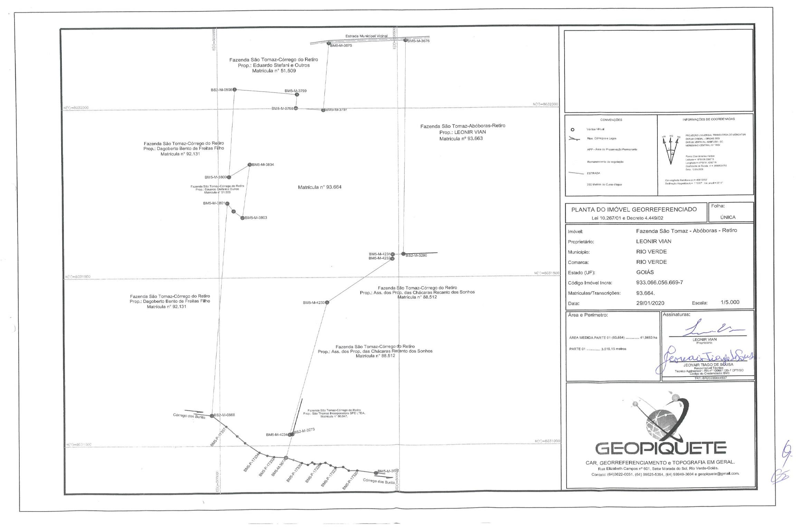
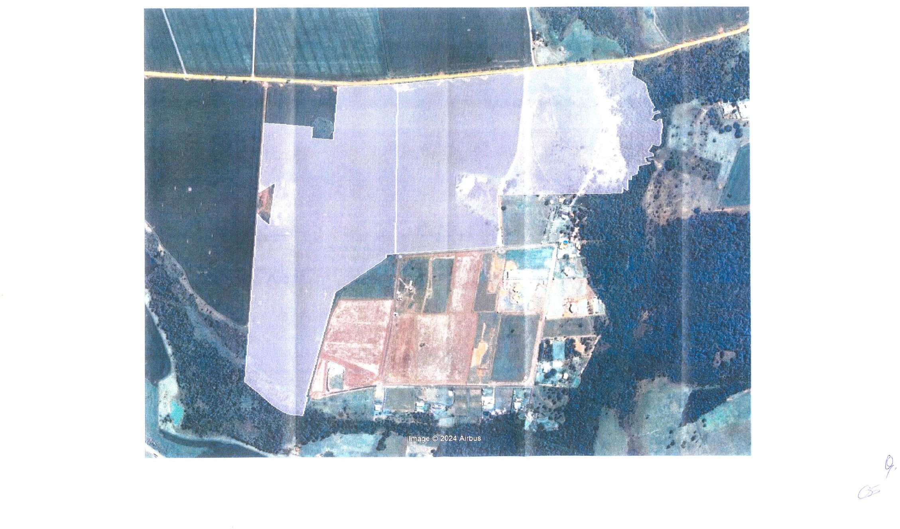
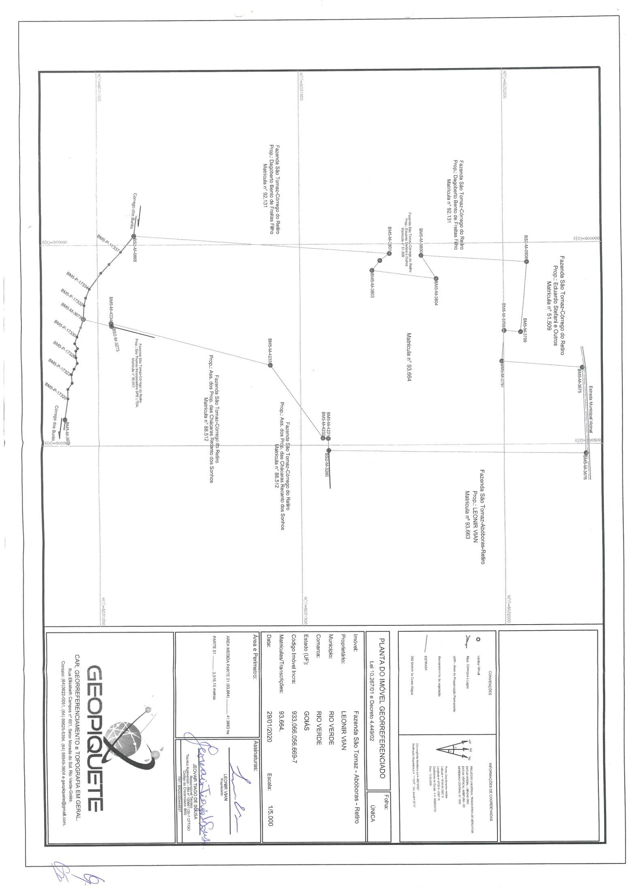

LEI COMPLEMENTAR Nº 342, DE 25 DE MARÇO DE 2024.

Cria Zona Urbana Específica para implantação de condomínio de lotes - Fazenda São Tomaz - Abóboras "Retiro", inscrita na matrícula do Cartório de Registro de Imóveis nº 93.664.

(Redação dada pela [Lei Complementar nº 394](https://legisla.casacivil.go.gov.br/pesquisa_legislacao/114414 "Abrir Lei Complementar nº 394, de 2025 em nova aba"), de 21 de agosto de 2025)

~~Cria Zona Urbana Específica para implantação de sítios ou chácaras de recreio na modalidade de condomínio de lotes - Fazenda São Tomaz - Abóboras "Retiro", inscrita na matrícula do Cartório de Registro de Imóveis nº 93.664.~~

**CONSOLIDADA COM A LEI:**

[LEI COMPLEMENTAR nº 394](https://legisla.casacivil.go.gov.br/pesquisa_legislacao/114414).....................................................21/08/2025

**A CÂMARA MUNICIPAL DE RIO VERDE-GO APROVA E EU SANCIONO A SEGUINTE LEI:**

Art. 1º Fica caracterizada como Zona Urbana Específica, o imóvel rural transcrito no Cartório de Registro de Imóveis - CRI local na matrícula nº 93.664, com área total de 41,9663 hectares, denominado de Fazenda São Tomaz - Abóboras - Retiro, neste Município, cuja destinação será a implantação de condomínio de lotes, com fundamento na Lei Complementar Municipal nº 6.167, de 18 de junho de 2012, delimitado pelas seguintes coordenadas geográficas:

(Redação dada pela [Lei Complementar nº 394](https://legisla.casacivil.go.gov.br/pesquisa_legislacao/114414 "Abrir Lei Complementar nº 394, de 2025 em nova aba"), de 21 de agosto de 2025)

~~Art. 1º Fica caracterizada como Zona Urbana Específica, o imóvel rural transcrito no Cartório de Registro de Imóveis – CRI local na matrícula nº 93.664, com área total de 41,9663 hectares, denominado de Fazenda São Tomaz - Abóboras - Retiro, neste Município, cuja destinação será a implantação de sítios ou chácaras de recreio na modalidade de condomínio de lotes, com fundamento na Lei Complementar Municipal nº 208, de 06 de maio de 2021, delimitado pelas seguintes coordenadas geográficas:~~

"Inicia-se a descrição deste imóvel no vértice BM5-M-3676, (Longitude: 50°59'42.228", Latitude: -17°47'51.557" e Altitude 745.26 m), deste segue confrontando com CNS: 02.612-0, Mat. 28.636, Leonir Vian no azimute 180°51'32" e distância de 632,764 m até o vértice BS2-M-3280, (Longitude: -50°59'42.550", Latitude: -17°48'12.134" e Altitude 738.77 m); deste segue confrontando com CNS: 02.612, Mat. 88.512, Ass. dos Prop. das Chácaras Recanto dos Sonhos no azimute 267°21'39" e distância 31,372 m até o vértice BM5- M-4231, (Longitude: -50°59'43.614", Latitude: -17°48′12.181" e Altitude 742.82 m); no azimute 184°03'12" e distância 12,916 m até o vértice BM5-M-4232, (Longitude:- 50°59'43.645", Latitude: -17°48'12.600" e Altitude 742.77 m); no azimute 234°47′32′′ e distância 223,031 m até o vértice BM5-M-4233, (Longitude: -50°59'49.832", Latitude: - 17°48'16.782" e Altitude 744.82 m); no azimute 195°05'09" e distância 407,393 m até o vértice 

BM5-M-4234, (Longitude: -50°59'53.432", Latitude: -17°48′29.575" e Altitude 726.99 m); no azimute 80°19′22" e distância 7,500 m até o vértice BS2-M-3273, (Longitude: -50°59'53.181", Latitude: -17°48'29.534" e Altitude 722.61 m); deste segue confrontando com CNS: 02.612- 0, Mat. 28.649, Leonir Vian parte 2 no azimute 194°41'41" e distância 72,220 m até o vértice BM5-M-3673, (Longitude: -50°59'53.803", Latitude: -17°48'31.806" e Altitude 717.15 m); deste segue confrontando com margem esquerda do Córrego Buriti, a montante no azimute 273°08'48" e distância 34,158 m até o vértice BM5-P-17332, (Longitude: -50°59'54.961", Latitude: -17°48'31.745" e Altitude 717.45 m); no azimute 282°40'52" e distância 19,050 m até o vértice BM5-P-17333, (Longitude: -50°59'55.592", Latitude: -17°48'31.609" e Altitude 716.79 m); no azimute 293°28'16" e distância 23,856 m até o vértice BM5-P-17334, (Longitude: -50°59'56.335", Latitude: -17°48'31.300" e Altitude 716.99 m); no azimute 306°30'54" e distância 48,521 m até o vértice BM5-P-17335, (Longitude: -50°59'57.659", Latitude: -17°48'30.361" e Altitude 719.92 m); no azimute 314°11'16" e distância 29,821 m até o vértice BM5-P-17336, (Longitude: -50°59′58.385", Latitude: -17°48′29.685" e Altitude 718.85 m); no azimute 313°18'47" e distância 41,775 m até o vértice BM5-P-17337, (Longitude: -50°59'59.417", Latitude: -17°48′28.753" e Altitude 719.79 m); no azimute 310°12'22" e distância 51,870 m até o vértice BS2-M-0868, (Longitude: -51°00'00.762", Latitude: -17°48′27.664" e Altitude 691.02 m); deste segue confrontando com CNS: 02.612-0, Mat. 92.131, Dagoberto Bento de Freitas Filho no azimute 4°14'17" e distância 631,741 m até o vértice BM5-M-3801, (Longitude: -50°59'59.177", Latitude: -17°48'07.174" e Altitude 751.01 m); deste segue confrontando com CNS: 02.612-0, Mat. 51.909, Eduardo Stefani e outros. no azimute 143°24'36" e distância 29,104 m até o vértice BM5-M-3802, (Longitude: - 50°59'58.588", Latitude: -17°48'07.934" e Altitude 750.51 m); no azimute 129°02′38′′ e distância 31,288 m até o vértice BM5-M-3803, (Longitude: -50°59'57.763", Latitude: - 17°48'08.575" e Altitude 750.18 m); no azimute 7°38'37" e distância 158,776 m até o vértice BM5-M-3804, (Longitude: -50°59'57.046", Latitude: -17°48'03.457" e Altitude 752.25 m); no azimute 237°47'09" e distância 67,887 m até o vértice BM5-M-3800, (Longitude: -50°59′58.996", Latitude: -17°48'04.634" e Altitude 752.31 m); deste segue confrontando com CNS: 02.612-0, Mat. 92.131, Dagoberto Bento de Freitas Filho no azimute 3°59'36" e distância 259,277 m até o vértice BS2-M-0908, (Longitude: -50°59'58.383", Latitude: -17°47'56.222" e Altitude 754.00 m); deste segue confrontando com CNS: 02.612- 0, Mat. 51.509, Eduardo Stefani e outros, no azimute 95°11'55" e distância 173,406 m até o vértice BM5-M-3799, (Longitude: -50°59′52.520", Latitude: -17°47'56.733" e Altitude 751.65 m); no azimute 185°12′52" e distância 40,508 m até o vértice BM5-M-3798, (Longitude: - 50°59'52.645", Latitude: -17°47'58.045" e Altitude 751.50 m); no azimute 94°34'57" e distância 76,591 m até o vértice BM5-M-3797, (Longitude: -50°59'50.053", Latitude: - 17°47'58.244" e Altitude 750.07 m); no azimute 5°00′37′′ e distância 197,970 m até o vértice BM5-M-3675, (Longitude: -50°59'49.466", Latitude: -17°47′51.830" e Altitude 749.91 m); deste segue confrontando com estrada municipal vicinal no azimute 87°44'43" e distância 213,360 m até o vértice BM5-M-3676, ponto inicial da descrição deste imóvel".

Art. 2º A Zona Urbana Específica de que trata esta Lei está representada nos Anexos que a acompanham, constituindo parte integrante obrigatória desta Lei.

Art. 3º Esta Lei entrará em vigor na data de sua publicação.

Gabinete do Prefeito de Rio Verde, aos 25 de março de 2024.

PAULO FARIA DO VALE

Prefeito de Rio Verde

FERNANDO COSTA BORGES

Procurador-Geral

**ANEXO I**

**FAZENDA SÃO TOMAZ ABÓBORAS “RETIRO”**

**MAPA DO PERÍMETRO**

**ANEXO II**

**FAZENDA SÃO TOMAZ ABÓBORAS “RETIRO”**

**CROQUI DA ÁREA EM IMAGEM SATÉLITE**

