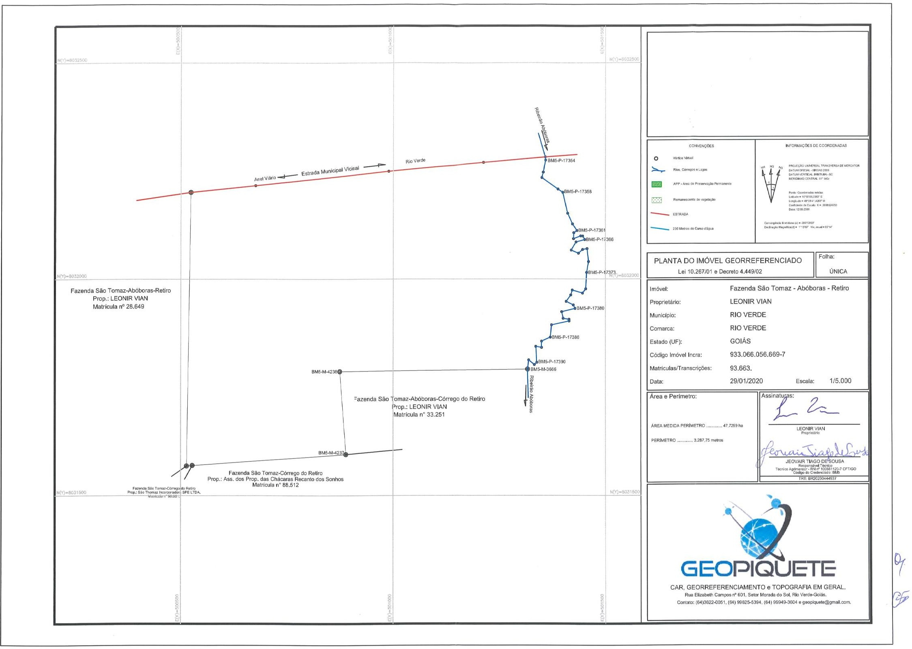
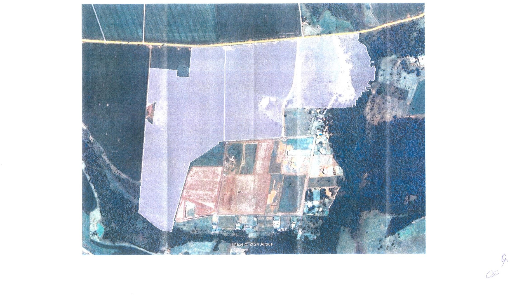

LEI COMPLEMENTAR N° 341, DE 25 DE MARÇO DE 2024.

Cria Zona Urbana Específica para implantação de condomínio de lotes - Fazenda São Tomaz - Abóboras "Retiro", inscrita na matrícula do Cartório de Registro de Imóveis nº 93.663.

(Redação dada pela [Lei Complementar nº 394](https://legisla.casacivil.go.gov.br/pesquisa_legislacao/114414 "Abrir Lei Complementar nº 394, de 2025 em nova aba"), de 21 de agosto de 2025)

~~Cria Zona Urbana Específica para implantação de sítios ou chácaras de recreio na modalidade de condomínio de lotes - Fazenda São Tomaz - Abóboras “Retiro”, inscrita na matrícula do Cartório de Registro de Imóveis nº 93.663.~~

 **CONSOLIDADA COM A LEI:**

[Lei complementar nº 394](https://legisla.casacivil.go.gov.br/pesquisa_legislacao/114414) .............................................. (21/08/2025)

 **A CÂMARA MUNICIPAL DE RIO VERDE-GO APROVA E EU SANCIONO A SEGUINTE LEI:**

Art. 1º Fica caracterizada como Zona Urbana Específica, o imóvel rural transcrito no Cartório de Registro de Imóveis - CRI local, objeto da matrícula nº 93.663, com área total de 47,7229 hectares, denominado de Fazenda São Tomaz - Abóboras - Retiro, neste Município, cuja destinação será a implantação de condomínio de lotes, com fundamento na Lei Complementar Municipal nº 6.167, de 18 de junho de 2012, delimitado pelas seguintes coordenadas geográficas:

(Redação dada pela [Lei Complementar nº 394](https://legisla.casacivil.go.gov.br/pesquisa_legislacao/114414 "Abrir Lei Complementar nº 394, de 2025 em nova aba"), de 21 de agosto de 2025)

~~Art. 1º Fica caracterizada como Zona Urbana Específica, o imóvel rural transcrito no Cartório de Registro de Imóveis – CRI local, objeto da matrícula nº 93.663, com área total de 47,7229 hectares, denominado de Fazenda São Tomaz - Abóboras - Retiro, neste Município, cuja destinação será a implantação de sítios ou chácaras de recreio na modalidade de condomínio de lotes, com fundamento na Lei Complementar Municipal nº 208, de 06 de maio de 2021, delimitado pelas seguintes coordenadas geográficas:~~

“Inicia-se a descrição deste imóvel no vértice BM5-P-17353, (Longitude: - 50°59'13.864", Latitude: -17°47'48.922" e Altitude 712.26 m), deste segue confrontando com margem direita do Ribeirão Abóboras, a jusante no azimute 174°29'16" e distância de 7,352 m até o vértice BM5-P-17354, (Longitude: -50°59'13.840", Latitude: -17°47'49.160" e Altitude 711.43 m); no azimute 191°21'01" e distância 28,287 m até o vértice BM5-P-17355, (Longitude: -50°59'14.029", Latitude: -17°47'50.062" e Altitude 710.94 m); no azimute 194°09'44" e distância 13,002 m até o vértice BM5-P-17356, (Longitude: -50°59'14.137", Latitude: 17°47'50.472" e Altitude 712.26 m); no azimute 124°33'51" e distância 46,176 m até o vértice BM5-P-17357, (Longitude: -50°59'12.846", Latitude: -17°47'51.324" e Altitude 711.50 m); no azimute 123°24'08" e distância 13,795 m até o vértice BM5-P-17358, (Longitude: -50°59'12.455", Latitude: -17°47'51.571" e Altitude 710.34 m); no azimute 166°43'14" e distância 49,884 m até o vértice BM5-P-17359, (Longitude: -50°59'12.066", Latitude: -17°47'53.150" e Altitude 711.37 m); no azimute 155°16'01" e distância 27,387 m até o vértice BM5-P-17360, (Longitude: -50°59'11.677", Latitude: -17°47'53.959" e Altitude 715.36 m); no azimute 145°30'38" e distância 18,466 m até o vértice BM5-P-17361, (Longitude: -50°59'11.322", Latitude: -17°47'54.454" e Altitude 711.56 m); no azimute 235°32'25" e distância 8,968 m até o vértice BM5-P-17362, (Longitude: -50°59'11.573", Latitude: -17°47'54.619" e Altitude 715.61 m); no azimute 182°41'13" e distância 13,821 m até o vértice BM5-P-17363, (Longitude: -50°59'11.595", Latitude: -17°47'55.068" e Altitude 711.48 m); no azimute 69°44'14" e distância 18,023 m até o vértice BM5-P-17364, (Longitude: -50°59'11.021", Latitude: -17°47'54.865" e Altitude 709.19 m); no azimute 93°53'35" e distância 4,989 m até o vértice BM5-P-17365, (Longitude: -50°59'10.852", Latitude: -17°47'54.876" e Altitude 712.46 m); no azimute 150°23'18" e distância 9,301 m até o vértice BM5-P-17366, (Longitude: -50°59'10.696", Latitude: -17°47'55.139" e Altitude 709.54 m); no azimute 255°09'11" e distância 21,362 m até o vértice BM5-P-17367, (Longitude: -50°59'11.397", Latitude: -17°47'55.317" e Altitude 711.12 m); no azimute 211°12'22" e distância 22,001 m até o vértice BM5-P-17368, (Longitude: -50°59'11.784", Latitude: -17°47'55.929" e Altitude 713.07 m); no azimute 113°12'26" e distância 18,492 m até o vértice BM5-P-17369, (Longitude: -50°59'11.207", Latitude: -17°47'56.166" e Altitude 709.41 m); no azimute 49°34'57" e distância 13,231 m até o vértice BM5-P-17370, (Longitude: -50°59'10.865", Latitude: -17°47'55.887" e Altitude 711.99 m); no azimute 79°15'08" e distância 10,553 m até o vértice BM5-P-17371, (Longitude: -50°59'10.513", Latitude: - 17°47'55.823" e Altitude 709.50 m); no azimute 173°52'05" e distância 30,058 m até o vértice BM5-P-17372, (Longitude: -50°59'10.404", Latitude: -17°47'56.795" e Altitude 709.47 m); no azimute 189°33'57" e distância 25,351 m até o vértice BM5-P-17373, (Longitude: - 50°59'10.547", Latitude: -17°47'57.608" e Altitude 709.66 m); no azimute 183°22'25" e distância 38,038 m até o vértice BM5-P-17374, (Longitude: 50°59'10.623", Latitude: - 17°47'58.843" e Altitude 708.19 m); no azimute 216°23'35" e distância 12,262 m até o vértice BM5-P-17375, (Longitude: -50°59'10.870", Latitude: -17°47'59.164" e Altitude 712.77 m); no azimute 286°08'27" e distância 25,327 m até o vértice BM5-P-17376, (Longitude: - 50°59'11.696", Latitude: -17°47'58.935" e Altitude 768.53 m); no azimute 196°43'00" e distância 11,878 m até o vértice BM5-P-17377, (Longitude: -50°59'11.812", Latitude: - 17°47'59.305" e Altitude 709.27 m); no azimute 215°52'59" e distância 18,444 m até o vértice BM5-P-17378, (Longitude: -50°59'12.179", Latitude: -17°47'59.791" e Altitude 709.88 m); no azimute 116°18'33" e distância 18,664 m até o vértice BM5-P-17379, (Longitude: - 50°59'11.611", Latitude: -17°48'00.060" e Altitude 708.71 m); no azimute 153°13'32" e distância 9,022 m até o vértice BM5-P-17380, (Longitude: -50°59'11.473", Latitude: - 17°48'00.322" e Altitude 708.26 m); no azimute 256°25'46" e distância 32,239 m até o vértice BM5-P-17381, (Longitude: -50°59'12.537", Latitude: -17°48'00.568" e Altitude 708.60 m); no azimute 167°44'09" e distância 15,669 m até o vértice BM5-P-17382, (Longitude: - 50°59'12.424", Latitude: -17°48'01.066" e Altitude 706.38 m); no azimute 98°56'02" e distância 13,864 m até o vértice BM5-P-17383, (Longitude: -50°59'11.959", Latitude: -17°48'01.136" e Altitude 707.44 m); no azimute 178°43'58" e distância 4,028 m até o vértice BM5-P-17384, (Longitude: -50°59'11.956", Latitude: -17°48'01.267" e Altitude 707.02 m); no azimute 257°40'33" e distância 42,209 m até o vértice BM5-P-17385, (Longitude: -50°59'13.356", Latitude: -17°48'01.560" e Altitude 707.76 m); no azimute 185°57'34" e distância 28,658 m até o vértice BM5-P-17386, (Longitude: -50°59'13.457", Latitude: -17°48'02.487" e Altitude 711.43 m); no azimute 246°00'32" e distância 22,536 m até o vértice BM5-P-17387, (Longitude: -50°59'14.156", Latitude: -17°48'02.785" e Altitude 707.25 m); no azimute 180°20'48" e distância 14,544 m até o vértice BM5-P-17388, (Longitude: -50°59'14.159", Latitude: -17°48'03.258" e Altitude 706.80 m); no azimute 280°33'54" e distância 13,753 m até o vértice BM5-P-17389, (Longitude: -50°59'14.618", Latitude: -17°48'03.176" e Altitude 709.10 m); no azimute 176°23'15" e distância 36,940 m até o vértice BM5-P-17390, (Longitude: -50°59'14.539", Latitude: -17°48'04.375" e Altitude 708.42 m); no azimute 227°49'24" e distância 7,831 m até o vértice BM5-P-17391, (Longitude: -50°59'14.736", Latitude: -17°48'04.546" e Altitude 708.22 m); no azimute 309°15'15" e distância 17,154 m até o vértice BM5-P-17392, (Longitude: -50°59'15.187", Latitude: -17°48'04.193" e Altitude 708.90 m); no azimute 186°59'13" e distância 21,312 m até o vértice BM5-

I – M-3666, (Longitude: -50°59'15.275", Latitude: -17°48'04.881" e Altitude 709.88 m); deste segue confrontando com CNS: 02.612-0, Mat. 33.251, Leonir Vian no azimute 269°20'51" e distância 443,195 m até o vértice BM5-

II – M-4238, (Longitude: -50°59'30.321", Latitude: -17°48'05.045" e Altitude 719.74 m); no azimute 175°44'43" e distância 192,147 m até o vértice BM5-

III – M-4237, (Longitude: -50°59'29.837", Latitude: -17°48'11.277" e Altitude 721.48 m); deste segue confrontando com CNS: 02.612-0, Mat. 88.512, Ass. dos Prop. das Chácaras Recanto dos Sonhos no azimute 266°02'13" e distância 362,176 m até o vértice BS2-

IV – M-3281, (Longitude: - 50°59'42.104", Latitude: -17°48'12.091" e Altitude 737.45 m); deste segue confrontando com CNS: 02.612-0, Mat. 90.051, São Thomaz Incorporadora SPE Ltda., no azimute 264°15'00" e distância 13,203 m até o vértice BS2-

V – M-3280, (Longitude: -50°59'42.550", Latitude: - 17°48'12.134" e Altitude 738.77 m); deste segue confrontando com CNS: 02.612-0, Mat. 28.649, Leonir Vian no azimute 0°51'32" e distância 632,764 m até o vértice BM5-

VI – M-3676, (Longitude: -50°59'42.228", Latitude: -17°47'51.557" e Altitude 745.26 m);

MI – deste segue confrontando com estrada municipal vicinal no azimute 84º10'22" e distância 152,628 m até o vértice BM5-P-17393, (Longitude: -50°59'37.073", Latitude: -17°47'51.053" e Altitude 740.95 m); no azimute 84°03'28" e distância 316,278 m até o vértice BM5-P-17394, (Longitude: - 50°59'26.393", Latitude: -17°47'49.988" e Altitude 725.30 m); no azimute 84°49'42" e distância 224,091 m até o vértice BM5-P-17395, (Longitude: -50°59'18.816", Latitude: - 17°47'49.331" e Altitude 715.68 m); no azimute 85°02'31" e distância 117,759 m até o vértice BM5-P-17396, (Longitude: -50°59'14.833", Latitude: -17°47'49.000" e Altitude 712.67 m); no azimute 85°11'54" e distância 28,643 m até o vértice BM5-P-17353, ponto inicial da descrição deste imóvel”.

Art. 2º A Zona Urbana Específica de que trata esta Lei está representada nos Anexos que a acompanham, constituindo parte integrante e obrigatória desta Lei.

Art. 3º Esta Lei entrará em vigor na data de sua publicação.

Gabinete do Prefeito de Rio Verde, aos 25 de março de 2024.

PAULO FARIA DO VALE

Prefeito de Rio Verde

VINÍCIUS FONSÊCA CAMPOS

Procurador-Geral

**ANEXO I**

**FAZENDA SÃO TOMAZ ABÓBORAS “RETIRO”**

**MAPA DO PERÍMETRO**

**ANEXO II**

**FAZENDA SÃO TOMAZ ABÓBORAS “RETIRO”**

**CROQUI DA ÁREA EM IMAGEM SATÉLITE**

