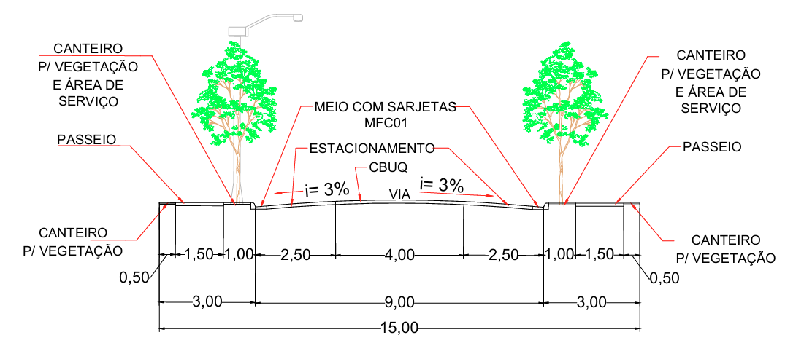
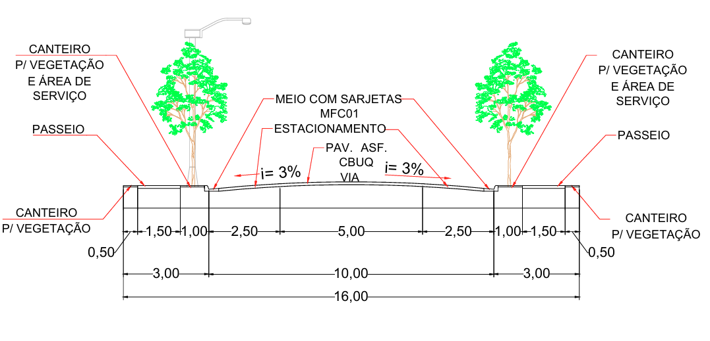
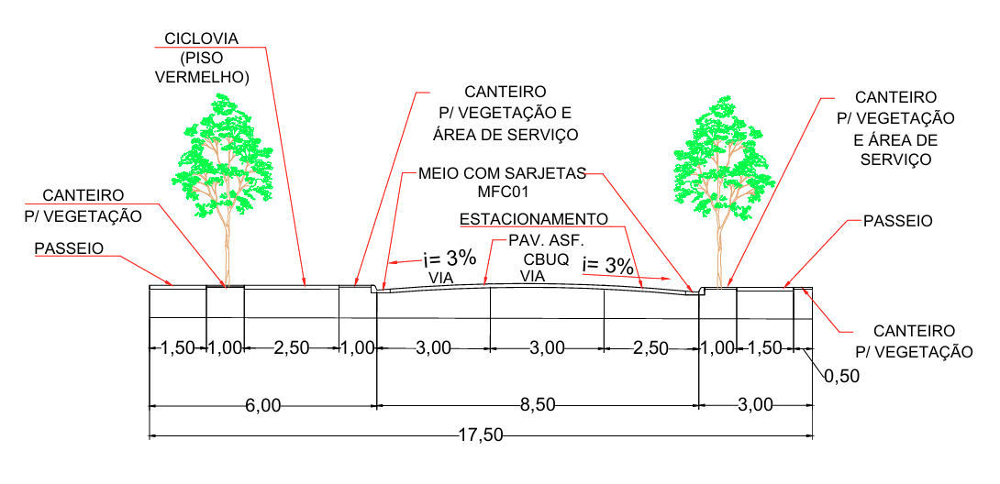
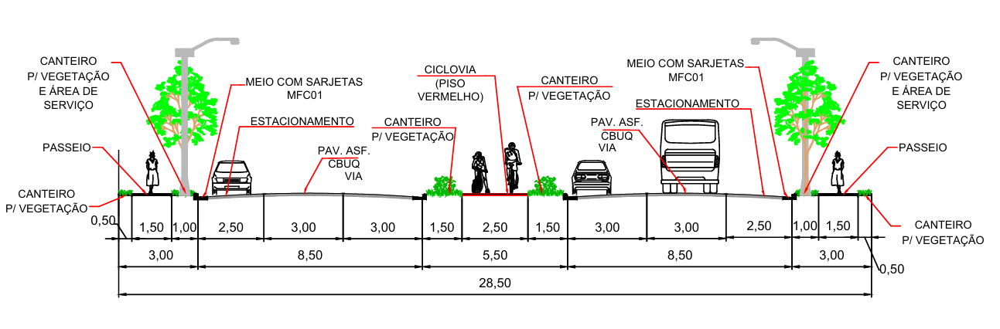
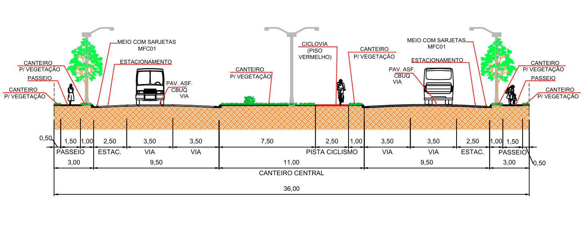
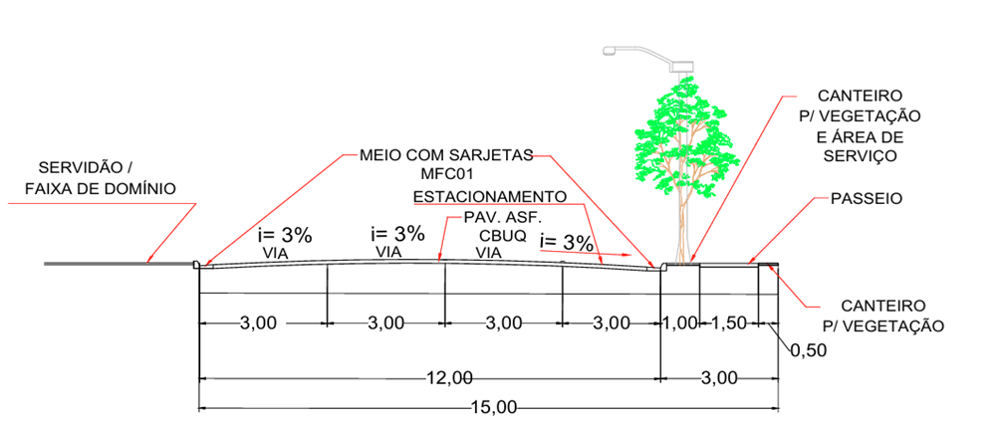

LEI COMPLEMENTAR N. º 3.633 DE 4 DE MARÇO DE 1998.

Dispõe sobre o parcelamento do solo para fins urbanos e dá outras providências.

CONSOLIDADA COM AS LEIS:

Lei nº. 3.717/1998 .............................................................. 19/10/1998

Lei nº. 4.224/2001 .............................................................. 14/12/2001

Lei Complementar nº. 5.169/2006 ...................................... 15/08/2006

Lei Complementar nº. 5.404/2008 ...................................... 04/03/2008

Lei Complementar nº. 5.483/2008 ...................................... 29/10/2008

Lei Complementar nº. 5.504/2008 ...................................... 07/11/2008

Lei nº. 5.520/2008 ............................................................... 18/12/2008

Lei Complementar nº. 5.655/2009 ...................................... 28/09/2009

Lei Complementar nº. 5.769/2010 ...................................... 10/05/2010

Lei Complementar nº. 5.819/2010 ...................................... 27/08/2010

Lei Complementar nº. 6.047/2011 ...................................... 01/12/2011

Lei Complementar nº. 6.273/2013 ...................................... 10/06/2013

Lei Complementar nº. 03/2014 ........................................... 25/03/2014

Lei Complementar nº. 48/2016 ........................................... 22/03/2016

Lei Complementar nº. 69/2017 ........................................... 04/05/2017

Lei Complementar nº. 81/2017 ........................................... 28/04/2017

Lei Complementar nº. 105/2017 ......................................... 13/12/2017

Lei Complementar nº. 118/2018 ......................................... 26/03/2018

Lei Complementar nº. 122/2018 ......................................... 02/05/2018

Lei Complementar nº. 131/2018 ......................................... 05/07/2018

Lei Complementar nº. 194/2020...........................................21/12/2020

Lei Complementar nº. 205/2021 ......................................... 06/05/2021

Lei Complementar nº. 220/2021 ......................................... 01/09/2021

Lei Complementar nº. 245/2022 ......................................... 27/05/2022

Lei Complementar nº. 317/2023 ......................................... 16/10/2023

Lei Complementar nº. 363/2024 ......................................... 24/06/2024

Lei Complementar nº. 373/2025 ......................................... 07/01/2025

Lei Complementar nº. 392/2025 ......................................... 25/08/2025

Lei Complementar nº. 419/2025 ......................................... 31/10/2025

Lei Complementar nº. 442/2026 ......................................... 19/02/2026

Lei Complementar nº. 447/2026 ......................................... 19/02/2026

LISTA DE APÊNDICES:

APÊNDICE I - Lei nº 4218/2001..............................................14/12/2001

APÊNDICE II - Lei Complementar nº 5671/2009....................28/09/2009

**A CÂMARA MUNICIPAL DE RIO VERDE - GO APROVA E EU SANCIONO A SEGUINTE LEI:**

**CAPÍTULO I**

**DAS DISPOSIÇÕES PRELIMINARES**

Art. 1º A presente Lei se destina a disciplinar os projetos de loteamento, desmembramento e remembramento do solo para fins urbanos do município de Rio Verde, sendo elaborada nos termos da Lei Federal N. 6.766/79 e demais disposições sobre a matéria, complementadas pelas normas específicas de competência do Município.

Parágrafo Único. O disposto na presente Lei obriga não só os loteamentos, desmembramentos e remembramentos realizados para venda ou melhor aproveitamento de imóveis, como também os efetivados em inventários, por decisão amigável ou judicial, para extinção de comunhão de bens ou qualquer outro título.

Art. 2º O Parcelamento do Solo poderá ser feito mediante loteamento, desmembramento ou remembramento, observadas as disposições desta Lei.

**CAPÍTULO II**

**DAS DEFINIÇÕES**

Art. 3º Para efeito de aplicação da presente Lei, são adotadas as seguintes definições:

I - área Total do Parcelamento: é a área que o loteamento, desmembramento ou remembramento abrange.

II - área de Domínio Público: é a área ocupada pelas vias de circulação, ruas, avenidas, praças, jardins, parques e áreas de preservação e bosques. Estas áreas não poderão ter seu acesso restrito.

III - área Total dos Lotes: é a resultante da diferença entre a área do parcelamento e a área de domínio público.

IV - arruamento: é o ato de abrir via ou logradouro destinado à circulação ou utilização pública.

V - degradação da Qualidade Ambiental: é a alteração das propriedades físicas, químicas ou biológicas do meio ambiente, causada por qualquer forma de energia ou substâncias sólidas, líquidas ou gasosas, ou a combinação de elementos produzidos por atividades humanas ou delas decorrentes, em níveis capazes de direta ou indiretamente:

a) prejudicar a saúde, a segurança e o bem-estar da população;

b) criar condições adversas as atividades sociais e econômicas, e ocasionar danos relevantes à flora, à fauna e outros recursos naturais.

VI - desmembramento: é a subdivisão de áreas em lotes com aproveitamento do sistema viário existente e registrado desde que não implique na abertura de novas vias e logradouros públicos, nem no prolongamento, modificação ou ampliação dos já existentes.

VII - equipamentos Comunitários: são os equipamentos públicos de educação, cultura, saúde, lazer, segurança, assistência social, esporte, associativismo e similares, quando pertencentes ao poder público.

VIII - equipamentos Urbanos: são os equipamentos públicos de abastecimento de água, esgoto, energia elétrica, coleta de água pluvial, rede telefônica e gás canalizado, transporte coletivo, coleta de lixo, estações de abastecimento e de tratamento de efluentes domésticos e industriais.

IX - faixa Não Edificável: área do terreno onde não será permitida qualquer construção.

X - loteamento: é a subdivisão de áreas em lotes, com a abertura ou efetivação de novas vias de circulação, de logradouros públicos, prolongamento ou modificação das vias existentes.

XI - remembramento: é a fusão de lotes com aproveitamento do sistema viário existente.

XII - via de circulação: é a via destinada a circulação de veículos e pedestres;

XIII - loteamento vizinho: é aquele contíguo e que esteja com, no mínimo, 60% (sessenta por cento) de seus lotes edificados.

(Redação dada pela Lei Complementar nº 447, de 19 de fevereiro de 2026)

~~XIII - loteamento Vizinho: é aquele considerado ocupado em 60% (sessenta por cento) de suas unidades, quer seja pela posse direta ou indireta dos adquirentes, independentemente de efetiva edificação, em consonância com o parágrafo único, art. 148, da Lei Municipal Complementar n. 5.318, de 06 de setembro de 2007. (Inserido pela Lei Complementar nº. 48, de 22 de março de 2016)~~

**CAPÍTULO III**

**DAS ÁREAS PARCELÁVEIS E NÃO PARCELÁVEIS**

Art. 4º Somente será admitido o parcelamento do solo para fins urbanos em Zona Urbana devidamente definida em Lei Municipal de Perímetro Urbano.

Parágrafo Único. Na Zona de Atividades Rurais - ZAR só será admitido o parcelamento com a prévia anuência da Prefeitura Municipal e aprovação do Órgão Federal Competente, ou dos órgãos Estadual e Federal de controle do meio ambiente, conforme Legislação Federal.

Art. 4º - A Para que sejam aprovados novos loteamentos, a área a parcelar só poderá se distanciar em, no máximo, 1.000 m (mil metros) do perímetro do loteamento vizinho, definido no art. 3º, inciso XIII desta Lei, desde que interligados por via de acesso pavimentada.

(Redação dada pela Lei Complementar nº 447, de 19 de fevereiro de 2026)

~~Art. 4º - A Para que sejam aprovados novos loteamentos, a área a parcelar só poderá se distanciar em, no máximo, 2.000 (dois mil metros) do perímetro do Loteamento Vizinho definido no art. 3°, inciso XIII, desta Lei, desde que estejam interligados por vias de acesso pavimentada. (Inserido pela Lei Complementar nº. 48, de 22 março de 2016)~~

Parágrafo único. Não se aplica o regramento disposto no caput deste artigo aos loteamentos fechados, condomínios de lotes fechados, conjuntos residenciais fechados e loteamentos abertos integrantes de programas habitacionais dos governos federal, estadual e municipal.

(Inserido pela Lei Complementar nº 447, de 19 de fevereiro de 2026)

Art. 5º Não será permitido o parcelamento do solo:

I - em terrenos alagadiços e sujeitos a inundações, antes de tomadas as medidas saneadoras e assegurado o escoamento das águas;

II - nas nascentes, mesmo os chamados "olhos d'água", seja qual for a sua situação topográfica;

III - em terrenos que tenham sido aterrados com material nocivo a saúde pública, sem o prévio saneamento;

IV - nas partes do terreno com declividade igual ou superior a 30% (trinta por cento), salvo esta irregularidade seja corrigida sem danos ao meio ambiente;

V - em terrenos onde as condições geológicas não aconselham a edificação podendo a Prefeitura Municipal exigir laudo técnico e sondagem sempre que achar necessário;

VI - em terrenos situados em fundos de vale essenciais para o escoamento natural das águas;

(Redação dada pela Lei Complementar n. 194/2021)

~~VI- em terrenos situados em fundos de vale essenciais para o escoamento natural das águas e abastecimento público, a critério do Órgão Estadual Competente e anuência da Prefeitura Municipal;~~

VII - em terrenos onde exista degradação da qualidade ambiental até sua correção;

VIII - em faixas de 15,00m (quinze metros) para cada lado das redes de alta tensão, salvo maiores exigências dos órgãos competentes;

IX - em terrenos onde for necessária a sua preservação para o sistema de controle da erosão urbana;

X - em áreas consideradas prioritárias localizadas nas bacias hidrográficas que servem ao abastecimento público de água da sede do Município de Rio Verde-GO.

(Redação dada pela Lei Complementar n. 194/2021)

~~X- a área correspondente à faixa não edificável de proteção deverá ser cedida a Prefeitura Municipal no ato da aprovação do loteamento, sem ônus para a Prefeitura.~~

**CAPÍTULO IV**

**DOS REQUISITOS URBANÍSTICOS**

Art. 6º Os loteamentos deverão atender os seguintes requisitos:

I - só poderão ser loteadas áreas com acesso direto à via pública em boas condições de trafegabilidade a critério da Prefeitura Municipal;

II - o proprietário cederá ao Município, sem ônus para este, uma porcentagem de no mínimo 35% (trinta e cinco por cento) da área a lotear, sendo 15% (quinze por cento) destinado à implantação de equipamentos urbanos e área verde, cujas localizações serão aprovadas pelo setor competente do Município, dos quais, 5% (cinco por cento), no mínimo, destinados à implantação de área verde e 7% (sete por cento), no mínimo, destinados à implantação de equipamentos urbanos e comunitários, salvo loteamentos destinados ao uso industrial, cujos lotes forem maiores que 15.000,00 m² (quinze mil metros quadrados), caso em que a percentagem poderá ser reduzida a critério do Conselho Municipal da Cidade - CONCIDADE. As áreas destinadas a equipamentos urbanos não poderão apresentar características que dificultem ou onerem edificações.

(Redação dada pela Lei Complementar nº. 81, de 28 de abril de 2017)

~~II- O proprietário cederá à Prefeitura Municipal, sem ônus para esta, uma percentagem de no mínimo 35% (trinta e cinco por cento) da área a lotear, que correspondem às áreas destinadas a sistema de circulação, a implantação de equipamentos urbanos e comunitários, bem como à espaços livres de uso público, salvo loteamentos destinados ao uso industrial cujos os lotes forem maiores que 15.000,00m2 (quinze mil metros quadrados), caso em que a percentagem poderá ser reduzida a critério do Conselho Municipal de Urbanismo - CMU;~~

~~II- o proprietário cederá à Prefeitura Municipal, sem ônus para esta, uma percentagem de, no mínimo, 35% (trinta e cinco por cento) da área a lotear, que correspondem às áreas destinadas ao sistema de circulação, à implantação de equipamentos urbanos e comunitários, bem como à espaços livres de uso público, salvo loteamentos destinados ao uso industrial, cujos lotes forem maiores que 15.000,00 m2 (quinze mil metros quadrados), caso em que a percentagem poderá ser reduzida a critério do Conselho Municipal da Cidade CONCIDADE-RV; (Redação dada pela Lei Complementar n. º 5.769, de 10 de maio de 2010)~~

~~II- o proprietário cederá à Prefeitura Municipal, sem ônus para esta, uma percentagem de, no mínimo, 35% (trinta e cinco por cento) da área a lotear, que correspondem às áreas destinadas ao sistema de circulação, à implantação de equipamentos urbanos e comunitários, bem como à espaços livres de uso público, salvo loteamentos destinados ao uso industrial, cujos lotes forem maiores que 15.000,00 m2 (quinze mil metros quadrados), caso em que a percentagem poderá ser reduzida a critério do Sistema Municipal de Planejamento; (Redação dada pela Lei Complementar n. º 5.819, de 27 de agosto de 2010)~~

~~II- o proprietário cederá ao Município, sem ônus para este, uma percentagem de no mínimo 35% (trinta e cinco por cento) da área a lotear, sendo 7% (sete por cento) destinado à implantação de equipamentos urbanos e comunitários, 5% à implantação de área verde, salvo loteamentos destinados ao uso industrial cujos os lotes forem maiores que 15.000,00m2 (quinze mil metros quadrados), caso em que a percentagem poderá ser reduzida a critério do Conselho Municipal da Cidade CONCIDADE; (Redação dada pela Lei Complementar nº. 6.273, de 10 de junho de 2013)~~

III - as vias de loteamento deverão articular-se com as vias adjacentes oficiais existentes ou projetadas e adequar-se com a topografia local;

IV - a hierarquia das vias deverá respeitar o sistema viário ou a definição pelo órgão competente da Prefeitura Municipal;

V - todo projeto de loteamento deverá incorporar no seu traçado viário os trechos que a Prefeitura Municipal indicar, para assegurar a continuidade do sistema viário geral da cidade;

a) vias locais: são as vias internas dos bairros, com até 600m de comprimento, não interligando o bairro a que pertence a outro.

(Redação dada pela Lei Complementar nº. 131, de 5 de julho de 2018)

| Largura total (metros) | Calçada (metros) | Pista (metros) | Calçada (metros) |
| --- | --- | --- | --- |
| 15,00 | 3,00 | 9,00 | 3,00 |

(Inserido pela Lei Complementar nº 392, de 25 de agosto de 2025)

(Redação dada pela Lei Complementar nº 392, de 25 de agosto de 2025)

b) vias coletoras I: são as primeiras vias paralelas a ambos os lados das vias arteriais, com continuação em bairros adjacentes, independentemente do comprimento.

(Redação dada pela Lei Complementar nº. 131, de 5 de julho de 2018)

| Largura total (metros) | Calçada (metros) | Pista (metros) | Calçada (metros) |
| --- | --- | --- | --- |
| 16,00 | 3,00 | 10,00 | 3,00 |

(Inserido pela Lei Complementar nº 392, de 25 de agosto de 2025)

~~VI- os projetos das vias de circulação de loteamento deverão obedecer as dimensões mínimas estabelecidas na tabela abaixo, ou salvo quando determinada maior largura em função de prolongamentos de vias existentes no sistema viário:~~

| ~~Extensão~~ | ~~Total (m)~~ | ~~Passeio esquerda (m)~~ | ~~Pista (m)~~ | ~~Passeio Dir. (m)~~ |
| --- | --- | --- | --- | --- |
| ~~50m a 300 m~~ | ~~12~~ | ~~2~~ | ~~8~~ | ~~2~~ |
| ~~300m a 800m~~ | ~~15~~ | ~~2,5~~ | ~~10~~ | ~~2,5~~ |
| ~~\> 800m~~ | ~~18~~ | ~~3~~ | ~~12~~ | ~~3~~ |

~~VI- os projetos das vias de circulação de loteamento deverão obedecer às dimensões mínimas estabelecidas na tabela abaixo, ou salvo quando determinada maior largura em função de prolongamentos de vias existentes no sistema viário: (Redação dada pela Lei Complementar nº. 6.273, de 10 de junho de 2013)~~ 

~~a) vias de circulação de pista simples: (Inserido pela Lei Complementar nº. 6.273, de 10 de junho de 2013)~~

| ~~Extensão~~ | ~~Total (m)~~ | ~~Passeio esquerda (m)~~ | ~~Pista (m)~~ | ~~Passeio Dir. (m)~~ |
| --- | --- | --- | --- | --- |
| ~~Vias de até 800 m~~ | ~~15,00~~ | ~~2,50~~ | ~~10,00~~ | ~~2,50~~ |
| ~~Vias > 800m~~ | ~~18,00~~ | ~~3,00~~ | ~~12,00~~ | ~~3,00~~ |

~~b) vias de circulação de pista dupla: (Inserido pela Lei Complementar nº. 6.273, de 10 de junho de 2013)~~

|   | ~~Total (m)~~ | ~~Passeio esquerda (m)~~ | ~~Pista (m)~~ | ~~Passeio Dir. (m)~~ |
| --- | --- | --- | --- | --- |
| ~~Canteiro Central~~ | ~~30,00~~ | ~~3,00~~ | ~~9,00~~ | ~~6,00~~ |

~~VI- os projetos das vias de circulação de loteamentos deverão obedecer às dimensões totais mínimas estabelecidas abaixo, a fim de que se dê cumprimento às diretrizes traçadas pelo planejamento urbano, dentre as quais, articulação com outras vias e favorecimento da mobilidade urbana e serão classificadas conforme disposições do art. 65 da Lei Complementar n. 5.318, de 10.09.2007, que dispõe sobre o Plano Diretor e o processo de planejamento do Município e art. 60, I, da Lei n. 9.503, de 23.09.1997, que institui o Código de Trânsito Brasileiro: (Redação dada pela Lei Complementar n.º 81, de 28 de abril de 2017)~~

~~a) vias de circulação de pista simples: 18,00 m; (Redação dada pela Lei Complementar n.º 81, de 28 de abril de 2017)~~

~~b) vias de circulação de pista dupla: 36,00 m. (Redação dada pela Lei Complementar n.º 81, de 28 de abril de 2017)~~

~~VI - os projetos das vias de circulação de loteamentos deverão obedecer às dimensões totais mínimas nas alíneas abaixo, a fim de que se dê cumprimento às diretrizes traçadas pelo planejamento urbano, dentre as quais, articulação com outras vias e favorecimento da mobilidade urbana e serão classificadas como vias arteriais e demais, conforme disposições do art. 65 da Lei Complementar n.º 5.318, de 10 de novembro de 2007, que dispõe sobre o Plano Diretor e o processo de planejamento do Município e art. 60, I, da Lei n. º 9.503, de 23 de setembro de 1997, que institui o Código de Trânsito Brasileiro: (Redação dada pela Lei Complementar nº. 131, de 5 de julho de 2018)~~

(Redação dada pela Lei Complementar nº 392, de 25 de agosto de 2025)

c) vias coletoras II: são as primeiras vias paralelas a ambos os lados das vias expressas, faixas de servidão de linhas de alta tensão e vias arteriais II.

(Inserido pela Lei Complementar nº. 131, de 5 de julho de 2018)

| Largura total (metros) | Calçada (metros) | Pista (metros) | Calçada (metros) |
| --- | --- | --- | --- |
| 17,50 | 6,00 | 8,50 | 3,00 |

(Inserido pela Lei Complementar nº 392, de 25 de agosto de 2025)

(Redação dada pela Lei Complementar nº 392, de 25 de agosto de 2025)

d) Alamedas: são vias que margeiam Áreas de Preservação Permanente – APP’s.

(Inserido pela Lei Complementar n. º 131, de 5 de julho de 2018)

| Largura total (metros) | Calçada (metros) | Pista (metros) | Calçada (metros) |
| --- | --- | --- | --- |
| 17,50 | 6,00 | 8,50 | 3,00 |

(Inserido pela Lei Complementar nº 392, de 25 de agosto de 2025)

(Redação dada pela Lei Complementar nº 392, de 25 de agosto de 2025)

e) vias arteriais I: são vias que se articulam com vias locais, ligando bairros de uma mesma região, direcionando o fluxo de tráfego para a via arterial II, apresentando ainda as seguintes condições:

(Inserido pela Lei Complementar nº. 131, de 5 de julho de 2018)

1\. cada bairro deverá contar com, no mínimo, uma via arterial I, perpendicular e/ou paralela à via arterial II, exceto se ocorrer o cruzamento de duas vias arteriais II;

(Inserido pela Lei Complementar nº. 131, de 5 de julho de 2018)

2\. estará a aproximadamente a 500 m (quinhentos metros) de outra via da mesma categoria, no sentido paralelo.

(Inserido pela Lei Complementar nº. 131, de 5 de julho de 2018)

| Largura total (metros) | Calçada (metros) | Pista esquerda (metros) | Canteiro central/ciclovia (metros) | Pista direita (metros) | Calçada (metros) |
| --- | --- | --- | --- | --- | --- |
| 28,50 | 3,00 | 8,50 | 5,50 | 8,50 | 3,00 |

(Inserido pela Lei Complementar nº 392, de 25 de agosto de 2025)

(Redação dada pela Lei Complementar nº 392, de 25 de agosto de 2025)

f) vias arteriais II: são vias que interligam bairros, articulando-se com outras de igual característica e estará de 500 m (quinhentos metros) a 1000 m (mil metros) de distância de outra da mesma no sentido paralelo, dependendo da configuração do bairro.

(Inserido pela Lei Complementar nº. 131, de 5 de julho de 2018)

| Largura total (metros) | Calçada (metros) | Pista esquerda (metros) | Canteiro central/ciclovia (metros) | Pista direita (metros) | Calçada (metros) |
| --- | --- | --- | --- | --- | --- |
| 36,00 | 3,00 | 9,50 | 11,00 | 9,50 | 3,00 |

(Inserido pela Lei Complementar nº 392, de 25 de agosto de 2025)

(Redação dada pela Lei Complementar nº 392, de 25 de agosto de 2025)

~~Parágrafo único. As vias de circulação quando destinadas exclusivamente a pedestres, deverão ter largura mínima de 5% (cinco por cento) do comprimento total e nunca inferior a 3,00m (três metros);~~

(Revogado pela Lei nº. 5.520, de 18 de dezembro de 2008) (Vide §3º deste artigo)

VII - as ruas sem saída não poderão ultrapassar 250,00m (duzentos e cinquenta metros) de comprimento devendo obrigatoriamente, ter no seu final, bolsão de retorno com diâmetro mínimo inscrito de 24,00m (vinte e quatro metros), com raio de 12m (doze metros);

(Redação dada pela Lei Complementar nº. 131 de 5 de julho de 2018)

~~VII- as ruas sem saída não poderão ultrapassar 100,00m (cem metros) de comprimento devendo obrigatoriamente, ter no seu final, bolsão de retorno com diâmetro mínimo inscrito de 12,00m (doze metros);~~

VIII - a rampa máxima da pista de rolamento será 10% (dez porcento). A critério da Prefeitura Municipal a declividade poderá ser aumentada, conforme estudos realizados através da Secretaria competente;

IX - todas as vias públicas constantes do loteamento deverão ser construídas pelo proprietário recebendo, no mínimo, rede de distribuição de energia elétrica e iluminação pública, de drenagem de águas pluviais (captação e lançamento), de água tratada, conforme diretrizes estabelecidas pela concessionária do serviço no Município ou quem venha lhe substituir, de coleta de esgotos com lançamento até a estação de tratamento (ETE) identificada através de laudo técnico, pavimentação asfáltica, meio-fio com sarjetas e demarcação das quadras e lotes com marcos de concreto, todos estes serviços especificados tecnicamente em regulamento, a ser aprovado através de decreto do Poder Executivo.

(Redação dada pela Lei Complementar nº. 245, de 27 de maio de 2022)

~~IX- todas as vias públicas constantes do loteamento deverão ser construídas pelo proprietário recebendo, no mínimo, rede de distribuição de energia elétrica, meio-fio e a marcação das quadrados e lotes com marcos de concreto.~~

~~IX- todas as vias públicas constantes do loteamento deverão ser construídas pelo proprietário recebendo, no mínimo, rede de distribuição de energia elétrica e iluminação pública, de drenagem de águas pluviais (captação e lançamento), de água tratada, conforme diretrizes estabelecidas pela concessionária do serviço no Município ou quem venha lhe substituir, de coleta de esgotos com lançamento até a estação de tratamento (ETE) identificada através de laudo técnico, pavimentação asfáltica, meio-fio com sarjetas e demarcação das quadras e lotes com marcos de concreto, todos estes serviços especificados tecnicamente em regulamento, a ser aprovado através de decreto do Poder Executivo; (Redação dada pela Lei Complementar nº. 5.655, de 28 de setembro de 2009)~~

~~IX – todas as vias públicas constantes do loteamento deverão ser construídas pelo proprietário recebendo, no mínimo, rede de distribuição de energia elétrica, meio-fio e a marcação das quadrados e lotes com marcos de concreto. (Redação dada pela Lei Complementar nº. 131, de 5 de julho de 2018)~~

X - os parcelamentos situados ao longo das Rodovias Federais, Estaduais ou Municipais deverão conter ruas marginais paralelas à faixa de domínio das referidas estradas com largura mínima de 15,00m (quinze metros), conforme dimensões mínimas estabelecidas na tabela e no perfil de via abaixo:

(Redação dada pela Lei Complementar nº 392, de 25 de agosto de 2025)

~~X- os parcelamentos situados ao longo das Rodovias Federais, Estaduais ou Municipais, deverão conter ruas marginais paralelas à faixa de domínio das referidas estradas com largura mínima de 10,00m (dez metros);~~

~~X- os parcelamentos situados ao longo das Rodovias Federais, Estaduais ou Municipais, deverão conter ruas marginais paralelas à faixa de domínio das referidas estradas com largura mínima de 15,00m (quinze metros); (Redação dada pela Lei Complementar nº. 6.273, de 10 de junho de 2013)~~

~~X - os parcelamentos situados ao longo das Rodovias Federais, Estaduais ou Municipais, deverão conter ruas marginais paralelas à faixa de domínio das referidas estradas com largura mínima de 17,50m (dezessete metros e cinquenta centímetros); (Redação dada pela Lei Complementar nº. 131 de 5 de julho de 2018)~~

| Largura total (metros) | Pista (metros) | Calçada (metros) |
| --- | --- | --- |
| 15,00 | 12,00 | 3,00 |

(Inserido pela Lei Complementar nº 392, de 25 de agosto de 2025)

(Redação dada pela Lei Complementar nº 392, de 25 de agosto de 2025)

XI - as áreas mínimas dos lotes bem como as testadas, válidas para lotes em novos loteamentos e para desmembramentos e remembramentos, são estipuladas em função das Zonas, na Lei de Uso e Ocupação do Solo Urbano - Zoneamento, Tabela I.

~~XII- a Prefeitura Municipal, através de resolução própria do Conselho Municipal de Urbanismo, poderá aprovar novos loteamentos cujos lotes possuam área mínima de 200,00m2 (duzentos metros quadrados) e testada de 10,00m (dez metros) mantidos os demais parâmetros previstos nesta Lei, desde que o referido loteamento se destine a edificação de conjuntos habitacionais de interesse social, previamente aprovados pelos órgãos públicos competentes.~~

~~XII- a Prefeitura Municipal, através de resolução própria do Conselho Municipal de Urbanismo, poderá aprovar novos loteamentos cujos lotes possuam área mínima de 250,00 m2 (duzentos e cinquenta metros quadrados) e testada de 10,00 m (dez metros), mantidos os demais parâmetros previstos nesta Lei, desde que o referido loteamento se destine à edificação de conjuntos habitacionais de interesse social ou de moradias populares, ficando proibidos quaisquer desmembramentos. (Redação dada pela Lei Complementar nº. 5.169, de 15 de agosto de 2006)~~

~~XII- a Prefeitura Municipal de Rio Verde, através de resolução própria da Coordenadoria Municipal de Desenvolvimento Urbano, poderá aprovar novos loteamentos, considerados especiais, cujos lotes possuam área maior que 250,00 m2 (duzentos e cinquenta metros quadrados) e menor que 360,00 m2 (trezentos e sessenta metros quadrados), testada mínima de 10,00 m (dez metros) e quadras com comprimento máximo de 250 m (duzentos e cinquenta metros), desde que o referido loteamento se destine à edificação de conjuntos habitacionais de interesse social. (Redação dada pela Lei Complementar nº. 5.504, de 07 de novembro de 2008)~~

~~XII- a Prefeitura Municipal de Rio Verde, através de resolução própria da Coordenadoria Municipal de Desenvolvimento Urbano, poderá aprovar novos loteamentos, considerados especiais, cujos lotes possuam área maior que 250,00 m2 (duzentos e cinquenta metros quadrados) e menor que 360,00 m2 (trezentos e sessenta metros quadrados), testada mínima de 10,00 m (dez metros) e quadras com comprimento máximo de 250 m (duzentos e cinquenta metros), desde que, atendidos os demais parâmetros desta lei, sejam acrescidos de equipamentos comunitários, sob a responsabilidade do loteador, em conformidade com os estudos de necessidades elaborados pela Coordenadoria Municipal de Desenvolvimento Urbano. (Redação dada pela Lei Complementar nº. 5.520, de 18 de dezembro de 2008)~~

~~XII- o Município de Rio Verde, através de resolução própria do Sistema Municipal de Planejamento, poderá aprovar novos loteamentos, considerados especiais, cujos lotes possuam área maior que 250,00 m2 (duzentos e cinquenta metros quadrados) e menor que 360,00 m2 (trezentos e sessenta metros quadrados) e quadras com comprimento máximo de 250 m (duzentos e cinquenta metros), desde que atendidos os demais parâmetros desta lei e, mediante a concessão de outorga onerosa do direito de parcelar, com a prestação de contrapartida a ser oferecida em lotes, cujo produto de alienação  pode ser utilizado em outras áreas do Município, com o objetivo de promover a: (Redação dada pela Lei Complementar nº. 5.769, de 10 de maio de 2010)~~

~~XII- o Município de Rio Verde, através de resolução própria do Sistema Municipal de Planejamento, poderá aprovar novos loteamentos, considerados especiais, cujos lotes possuam área maior que 250,00 m2 (duzentos e cinquenta metros quadrados) e menor que 360,00 m2 (trezentos e sessenta metros quadrados) e quadras com comprimento máximo de 250 m (duzentos e cinquenta metros), desde que atendidos os demais parâmetros desta lei e, mediante a concessão de outorga onerosa do direito de parcelar, com a prestação de contrapartida a ser oferecida em lotes, na forma expressa no § 4° deste artigo: (Redação dada pela Lei Complementar nº. 5.819, de 27 de agosto de 2010)~~

~~XII - o município de Rio Verde, através de resolução própria do Sistema Municipal de Planejamento, poderá aprovar novos loteamentos, considerados especiais, cujos lotes possuam área maior que 180,00 m2 (cento e oitenta metros quadrados) e menor que 360,00 m2 (trezentos e sessenta metros quadrados) e quadras com comprimento máximo de 250 m (duzentos e cinquenta metros), desde que atendidos os demais parâmetros desta lei, e mediante a concessão de outorga onerosa do direito de parcelar, com a prestação de contrapartida a ser oferecida em lotes, cujo produto de alienação pode ser utilizado em outras áreas do Município, com o objetivo de promover a: (Redação dada pela Lei Complementar nº. 118, de 27 de março de 2018)~~

XII - o Município de Rio Verde, através de resolução própria do Sistema Municipal de Planejamento, poderá aprovar novos loteamentos, considerados especiais, cujos lotes possuam área igual ou maior que 125,00 m2 (cento e vinte e cinco metros quadrados) e menor que 360,00 m2 (trezentos e sessenta metros quadrados) e quadras com comprimento máximo de 250 m (duzentos e cinquenta metros), desde que atendidos os demais parâmetros desta lei, e mediante a concessão de outorga onerosa do direito de parcelar, com a prestação de contrapartida a ser oferecida em lotes, cujo produto de alienação pode ser utilizado em outras áreas do Município, com o objetivo de promover a:

(Redação dada pela Lei Complementar nº 392, de 25 de agosto de 2025)

a) regularização fundiária;

(Inserido pela Lei Complementar nº. 5.769, de 10 de maio de 2010)

b) execução de programas e projetos habitacionais de interesse social;

(Inserido pela Lei Complementar nº. 5.769, de 10 de maio de 2010)

c) constituição de reserva fundiária;

(Inserido pela Lei Complementar nº. 5.769, de 10 de maio de 2010)

d) ordenamento e direcionamento da expansão urbana;

(Inserido pela Lei Complementar nº. 5.769, de 10 de maio de 2010)

e) implantação de equipamentos urbanos e comunitários;

(Redação dada pela Lei Complementar nº. 118, de 26 de março de 2018)

~~e) implantação de equipamentos urbanos e comunitários; (Inserido pela Lei Complementar nº. 5.769, de 10 de maio de 2010)~~

~~e) implantação e recuperação de equipamentos urbanos e comunitários; (Redação dada pela Lei Complementar nº. 69, de 4 de maio de 2017)~~

f) criação de espaços públicos de lazer e áreas verdes;

(Inserido pela Lei Complementar nº. 5.769, de 10 de maio de 2010)

g) criação de unidades de conservação ou proteção de outras áreas de interesse ambiental;

(Inserido pela Lei Complementar nº. 5.769, de 10 de maio de 2010)

h) proteção de áreas de interesse histórico, cultural ou paisagístico.

(Inserido pela Lei Complementar nº. 5.769, de 10 de maio de 2010)

Parágrafo Único – Serão tratados como loteamentos especiais aqueles que, atendidos os demais parâmetros desta Lei, sejam acrescidos de equipamentos comunitários, sob a responsabilidade do loteador, em conformidade com os estudos de necessidades elaborados pela Coordenadoria Municipal de Desenvolvimento Urbano.

(Inserido pela Lei Complementar nº. 5.504, de 07 de novembro de 2008)

~~XIII- O comprimento máximo das quadras não poderá exceder a 200,00 m (duzentos metros);~~

XIII - O comprimento máximo das quadras não poderá exceder a 200,00 m (duzentos metros), ressalvada a hipótese prevista no inciso XII deste artigo.

(Redação dada pela Lei Complementar nº. 5.520, de 18 de dezembro de 2008)

§ 1º A Prefeitura Municipal exigirá para a aprovação do loteamento a reserva de faixa não edificável, quando conveniente e necessário na frente, lado ou fundo do lote para rede de água e esgoto e outros equipamentos urbanos;

§ 2º Os lotes de esquina terão suas áreas mínimas acrescidas em 30% (trinta por cento) em relação ao mínimo exigido para sua respectiva zona. O mesmo ocorrerá com a testada mínima que terá sua dimensão acrescida do mesmo percentual.

§ 3º As vias de circulação quando destinadas exclusivamente a pedestres, deverão ter largura mínima de 5% (cinco por cento) do comprimento total e nunca inferior a 3,00 m (três metros).

(Redação dada pela Lei Complementar nº. 48, de 22 de março de 2016)

§ 4º A outorga onerosa do direito de parcelar será concedida mediante o pagamento, pelo loteador, de contrapartida financeira, de acordo com o resultado da aplicação da seguinte fórmula:

(Redação dada pela Lei Complementar nº. 118, de 26 de março de 2018)

NL (1) – NL (2): 2 = contrapartida a ser recolhida aos cofres do Município.

(Redação dada pela Lei Complementar nº 392, de 25 de agosto de 2025)

NL (1) = área somada dos lotes com metragem abaixo de 360,00 m² (trezentos e sessenta metros quadrados), porém, com metragem mínima de 125,00 m² (cento e vinte e cinco metros quadrados).

(Redação dada pela Lei Complementar nº 392, de 25 de agosto de 2025)

NL (2) = área somada dos lotes com metragem igual ou superior a 360,00 m² (trezentos e sessenta metros quadrados).

(Redação dada pela Lei Complementar nº 392, de 25 de agosto de 2025)

~~§ 3º Para efeito de aplicação do Parágrafo Único do art. 148 da Lei Complementar nº. 5.318/2007, os loteamentos vizinhos são considerados ocupados pela posse direta ou indireta dos adquirentes dos lotes, independente de efetiva edificação. (Inserido pela Lei Complementar nº. 5.404, de 04 de março de 2008)~~

~~§ 3º As vias de circulação quando destinadas exclusivamente a pedestres, deverão ter largura mínima de 5% (cinco por cento) do comprimento total e nunca inferior a 3,00 m (três metros). (Redação dada pela Lei nº. 5.520, de 18 de dezembro de 2008)~~

~~§ 3º Para efeito de aplicação do Parágrafo Único do art. 148 da Lei Complementar nº. 5.318/2007, os loteamentos vizinhos são considerados ocupados pela direta dos lotes, com a efetiva edificação. (Redação dada pela Lei Complementar nº. 6.047, de 1º de dezembro de 2011)~~

~~§ 3º Para efeito de aplicação do Parágrafo Único do art. 148 da Lei Complementar nº. 5.318/2007, os loteamentos vizinhos são considerados ocupados pela posse direta ou indireta dos adquirentes dos lotes, independentemente da efetiva edificação. (Redação dada pela Lei Complementar nº. 03, de 25 de março de 2014)~~

~~§ 4º A outorga onerosa do direito de parcelar será concedida mediante o pagamento, pelo loteador, de contrapartida financeira, correspondente em reserva fundiária (lotes), de acordo com o resultado da aplicação da seguinte fórmula: (Inserido pela Lei Complementar nº. 5.769, de 10 de maio de 2010)~~

~~NL (1) – NL (2): 2 = contrapartida a ser depositada em espécie, a título de caução, junto ao Fundo Municipal de Habitação de Interesse Social, enquanto não ocorrer a transferência do domínio dos lotes dados em pagamento da outorga onerosa do direito de parcelar: (Inserido pela Lei Complementar nº. 5.769, de 10 de maio de 2010)~~

~~NL (1) = Número de lotes estimados na metragem proposta, abaixo de 360,00 m2 (trezentos e sessenta metros quadrados), porém, com metragem mínima de 250,00 m2 (duzentos e cinquenta metros quadrados) (Inserido pela Lei Complementar nº. 5.769, de 10 de maio de 2010)~~

~~NL (2) = Número de lotes possíveis na metragem de 360 m2 (trezentos e sessenta metros quadrados) (Inserido pela Lei Complementar nº. 5.769, de 10 de maio de 2010)~~

~~§ 4º A outorga onerosa do direito de parcelar será concedida mediante o pagamento, pelo loteador, de contrapartida financeira, de acordo com o resultado da aplicação da seguinte fórmula: (Redação dada pela Lei Complementar nº 5.819/2010 de 27 de agosto de 2010)~~

~~NL (1) – NL (2): 2 = contrapartida a ser recolhida aos cofres do Município. (Redação dada pela Lei Complementar nº 5.819/2010 de 27 de agosto de 2010)~~

~~NL (1) = Número de lotes estimados na metragem proposta, abaixo de 360,00 m2 (trezentos e sessenta metros quadrados), porém, com metragem mínima de 250,00 m2 (duzentos e cinquenta metros quadrados) (Redação dada pela Lei Complementar nº 5.819/2010 de 27 de agosto de 2010)~~

~~NL (2) = Número de lotes possíveis na metragem de 360 m2 (trezentos e sessenta metros quadrados). (Redação dada pela Lei Complementar nº 5.819/2010 de 27 de agosto de 2010)~~

~~NL (1) – NL (2): 2 = contrapartida a ser recolhida aos cofres do Município. (Redação dada pela Lei Complementar nº. 118, de 26 de março de 2018)~~

~~NL (1) = Número de lotes estimados na metragem proposta, abaixo de 360,00 m2 (trezentos e sessenta metros quadrados), porém, com metragem mínima de 180,00 m2 (cento e oitenta metros quadrados). (Redação dada pela Lei Complementar nº. 118, de 26 de março de 2018)~~

~~NL (2) = Número de lotes possíveis na metragem de 360 m2 (trezentos e sessenta metros quadrados). (Redação dada pela Lei Complementar nº. 118, de 26 de março de 2018)~~

§ 5º Os recursos auferidos com a contrapartida a que se refere o § 4º deste artigo, serão utilizados da seguinte forma:

(Redação dada pela Lei Complementar nº. 69, de 4 de maio de 2017)

~~§ 5º Os recursos auferidos com a contrapartida a que se refere o § 40 deste artigo serão administrados pelo Município, através do Fundo Municipal de Habitação de Interesse Social, com prévia aprovação de seu Conselho Gestor. (Redação dada pela Lei Complementar n. º 5.769, de 10 de maio de 2010)~~

I - quando destinados ao cumprimento dos encargos previstos nas alíneas a, b e c do inciso XII, deste artigo, serão administrados pelo Município mediante o Fundo Municipal de Habitação e Interesse Social, com prévia aprovação de seu Conselho Gestor;

(Inserido pela Lei Complementar nº. 69, de 4 de maio de 2017)

II - quando destinados ao cumprimento dos encargos previstos nas alíneas d, e, e f, do inciso XII, deste artigo serão administrados pelo Município mediante a Secretaria Municipal de Obras;

(Inserido pela Lei Complementar nº. 69, de 4 de maio de 2017)

III - quando destinados ao cumprimento dos encargos previstos na alínea g, do inciso XII, deste artigo, será administrado pelo Fundo Municipal do Meio Ambiente;

(Inserido pela Lei Complementar nº. 69, de 4 de maio de 2017)

IV - quando destinados ao cumprimento dos encargos previstos na alínea h, do inciso XII, deste artigo, será administrado pelo Fundo Municipal de Cultura;

(Inserido pela Lei Complementar nº. 69, de 4 de maio de 2017)

§ 6º A área verde a que se refere o inciso II deste artigo obedecerá aos parâmetros fixados na Lei Complementar n. 5.318/2007, de 06 de setembro de 2007, que dispõe sobre o Plano Diretor e processo de planejamento do Município, ficando vedada para o efeito de cumprimento do percentual de 5% (cinco por cento) a inclusão dos canteiros centrais das vias de circulação, as rótulas viárias ou similares e as áreas localizadas entre os passeios e o alinhamento dos lotes.

(Inserido pela Lei Complementar nº. 6.273, de 10 de junho de 2013)

§ 7º As áreas de que trata o Inciso X ficam declaradas não edificantes, e deverão ser utilizadas para implantação de vias de tráfego e seus acessos e transposições deverão ser aprovados pelos órgãos ou concessionários responsáveis.

(Inserido pela Lei Complementar nº. 6.273, de 10 de junho de 2013)

§ 8° Estarão dispensados do pagamento da outorga onerosa de que trata o § 4º deste artigo, os loteadores que destinarem até 70% (setenta por cento) da área loteada como imóveis que tenham por finalidade habitações de interesse social, com dimensão mínima de 125,00 m² (cento e vinte e cinco metros quadrados), respeitada a testada mínima de 6,50 m (seis metros e cinquenta centímetros).

(Redação dada pela Lei Complementar nº 419, de 31 de outubro de 2025)

~~§ 8º Estarão dispensados do pagamento da outorga onerosa de que trata o § 40 deste artigo, os loteadores que destinarem até 25% (vinte e cinco por cento) do número total de lotes como imóveis que tenham por finalidade habitações de interesse social, com dimensão mínima de 250 m2 (duzentos e cinquenta metros quadrados), respeitada a testada mínima de 10 m2 (dez metros quadrados). (Inserido pela Lei Complementar nº. 03, de 25 de março de 2014)~~

~~§ 8º Estarão dispensados do pagamento da outorga onerosa de que trata o § 40 deste artigo, os loteadores que destinarem até 50% (cinquenta por cento) do número total de lotes como imóveis que tenham por finalidade habitações de interesse social, com dimensão mínima de 180,00 m2 (cento e oitenta metros quadrados), respeitada a testada mínima de 7,5 m2 (sete metros quadrados e cinco centésimos de metros quadrados. (Redação dada pela Lei Complementar nº. 118, de 26 de março de 2018)~~

~~§ 8º Estarão dispensados do pagamento da outorga onerosa de que trata o § 40 deste artigo, os loteadores que destinarem até 50% (cinquenta por cento) do número total de lotes como imóveis que tenham por finalidade habitações de interesse social, com dimensão mínima de 180,00 m2 (cento e oitenta metros quadrados), respeitada a testada mínima de 7,50 m (sete metros e cinquenta centímetros). (Redação dada pela Lei Complementar nº. 122, de 02 de maio de 2018)~~

~~§ 8° Estarão dispensados do pagamento da outorga onerosa de que trata o § 4º deste artigo, os loteadores que destinarem até 70% (setenta por cento) do número total de lotes como imóveis que tenham por finalidade habitações de interesse social, com dimensão mínima de 125,00 m² (cento e vinte e cinco metros quadrados), respeitada a testada mínima de 6,50 m (seis metros e cinquenta centímetros). (Redação dada pela Lei Complementar nº. 373, de 07 de janeiro de 2025)~~

§ 9º As pistas, passeios públicos e canteiros centrais, estes, no caso de vias de circulação de pista dupla, serão dimensionados levando-se em conta a classificação a que se refere o inciso VI deste artigo.

(Inserido pela Lei Complementar nº. 81, de 28 de abril de 2017)

§ 10. Os loteamentos e conjuntos habitacionais de interesse social implantados pelo Poder Público na Zona Especial de Interesse Social destinarão 5% (cinco por cento) de sua área para área verde e 7% (sete por cento) para a implantação de equipamentos urbanos e comunitários, dispensada esta última caso o entorno já os possua.

(Inserido pela Lei Complementar nº. 205, de 6 de maio de 2021)

§ 11. As quadras dos loteamentos e conjuntos habitacionais de interesse social implantados pelo Poder Público na Zona Especial de Interesse Social poderão apresentar comprimento maior que 200 m (duzentos metros), limitado, porém, à fluidez e segurança do trânsito.

(Inserido pela Lei Complementar nº. 205, de 6 de maio de 2021)

§ 12. As vias em que se prevalecer o parcelamento de lotes com área inferior a 360,00 m2 (trezentos e sessenta metros quadrados) serão obrigatoriamente zoneadas como Zona Residencial I - ZR-I, podendo ser estabelecidas restrições construtivas, a serem definidas por norma regulamentar, a fim de preservar a fluidez do trânsito e a disponibilidade de estacionamento nas vias públicas.

(Inserido pela Lei Complementar nº. 373, de 07 de janeiro de 2025)

§ 13. Lotes com área inferior a 360m2 (trezentos e sessenta metros quadrados) não poderão ser situados em avenidas ou vias de acesso, vedado o posterior o desmembramento.

(Inserido pela Lei Complementar nº. 373, de 07 de janeiro de 2025)

§ 14. As ruas marginais previstas no inciso X deste artigo também serão adotadas paralelamente às faixas de servidão destinadas à implantação de redes de subtransmissão e transmissão de energia elétrica (rede de alta tensão).

(Inserido pela Lei Complementar nº 392, de 25 de agosto de 2025)

Art.6º-A A contrapartida financeira em razão da concessão de outorga onerosa do direito de parcelar, de que trata o inciso XII, do artigo 6º, poderá ser substituída por obras a serem construídas e/ou recuperadas pelo empreendedor, a requerimento deste, em terrenos públicos.

(Inserido pela Lei Complementar nº. 69, de 4 de maio de 2017)

Parágrafo único. A substituição da contrapartida financeira por execução de obra pública pelo empreendedor poderá ocorrer desde que:

(Inserido pela Lei Complementar nº. 69, de 4 de maio de 2017)

I - o órgão municipal responsável pelo desenvolvimento urbano comprove a conveniência e interesse público, indicando o imóvel público onde deverá ser edificada ou recuperada a obra, fornecendo ao empreendedor o respectivo projeto, cuja execução ocorrerá às expensas deste, sendo fiscalizado pelo mesmo órgão municipal;

(Inserido pela Lei Complementar nº. 69, de 4 de maio de 2017)

II - o empreendedor apresente garantia real representada por imóveis cuja avaliação coincida com o valor da obra a ser executada, liberada somente após a conclusão desta;

(Inserido pela Lei Complementar nº. 69, de 4 de maio de 2017)

III - o empreendedor arque com os custos excedentes em razão da execução da obra, caso não consiga executá-la nos valores a que se refere o inciso anterior.

(Inserido pela Lei Complementar nº. 69, de 4 de maio de 2017)

Art.6º-B Recebido o projeto de Loteamento, nos termos desta Lei e demais legislação estadual e federal aplicáveis à espécie, o órgão municipal responsável pelo desenvolvimento urbano emitirá relatório atestando a conveniência e interesse público da substituição da contrapartida financeira da outorga onerosa do direito de parcelar, sujeito à aprovação do Poder Executivo Municipal, o qual deverá conter;

(Inserido pela Lei Complementar nº. 69, de 4 de maio de 2017)

I - obrigatoriamente, a indicação do imóvel público onde se propõe seja edificada a obra e estar acompanhado do respectivo projeto de execução.

(Inserido pela Lei Complementar nº. 69, de 4 de maio de 2017)

II - A obrigação de executar a obra pública determinada pelo Município, às suas   expensas e conforme o cronograma constante do respectivo projeto aprovado pelos órgãos municipais competentes;

(Inserido pela Lei Complementar nº. 69, de 4 de maio de 2017)

III - a indicação da garantia real nos termos do inciso II, parágrafo único, do art. 6º-A;

(Inserido pela Lei Complementar nº. 69, de 4 de maio de 2017)

IV - a indicação de arcar com multa em caso de descumprimento de qualquer das obrigações assumidas no Termo de Compromisso, sem prejuízo da execução judicial;

(Inserido pela Lei Complementar nº. 69, de 4 de maio de 2017)

V - a obrigação de submeter o Loteamento a registro no Cartório de Registro de Imóveis local no prazo de 180 (cento e oitenta) dias contados da aprovação do respectivo projeto pelo Município, nos termos desta Lei.

(Inserido pela Lei Complementar nº. 69, de 4 de maio de 2017)

Art. 6°-C Havendo interesse público em área privada, o Município poderá, ao invés de promover a sua desapropriação, propor ao proprietário a doação da área com o encargo de servir como antecipação de parte de área institucional, área verde e sistema viário, conforme o caso, em futuro parcelamento do solo.

(Inserido pela Lei Complementar nº. 220, de 1º de setembro de 2021)

§ 1º A área doada na forma deste artigo será compensada proporcionalmente quando da implantação do empreendimento.

(Inserido pela Lei Complementar nº. 220, de 1º de setembro de 2021)

§ 2º Caso o proprietário não promova ou desista do parcelamento do solo, ficará a doação consolidada no patrimônio público municipal, sem reversão de domínio ou pagamento de qualquer indenização por parte do Município.

(Inserido pela Lei Complementar nº. 220, de 1º de setembro de 2021)

§ 3º A antecipação da doação da área conforme este artigo não desobriga o doador a providenciar, oportunamente, todas as licenças urbanísticas e ambientais, bem como pagamento de taxas, impostos e encargos para a aprovação do futuro parcelamento do solo.

(Inserido pela Lei Complementar nº. 220, de 1º de setembro de 2021)

Art. 6º-D Fica instituído o regime especial para loteamentos destinado a habitações de interesse social, assim considerados aqueles comprovadamente vinculados a programas e projetos habitacionais públicos ou de entidades autorizadas pelo poder público, como exceção aos demais parâmetros desta lei.

(Inserido pela Lei Complementar nº 419, de 31 de outubro de 2025)

§ 1º Para os loteamentos de que trata o caput deste artigo, a outorga onerosa será exigida somente quando mais de 95% (noventa e cinco por cento) da área loteada total do empreendimento for composta por unidades com área inferior a 250,00 m² (duzentos e cinquenta metros quadrados) e igual ou superior a 125,00 m² (cento e vinte e cinco metros quadrados), respeitada a testada mínima de 6,50 m (seis metros e cinquenta centímetros).

(Inserido pela Lei Complementar nº 419, de 31 de outubro de 2025)

§ 2º Os lotes situados em frente a avenidas deverão ter área mínima de 250,00 m² (duzentos e cinquenta metros quadrados), vedado o posterior desmembramento.

(Inserido pela Lei Complementar nº 419, de 31 de outubro de 2025)

§ 3º A aprovação de projetos nos termos deste artigo dependerá de análise e parecer favorável do Comitê Interno de Desenvolvimento Urbano, que deverá ponderar a demanda habitacional do município e a adequação da infraestrutura da região.

(Inserido pela Lei Complementar nº 419, de 31 de outubro de 2025)

       **CAPÍTULO V

       DA CONSULTA PRÉVIA**

Art. 7º O interessado em elaborar projeto de loteamento deverá solicitar à Prefeitura Municipal, em consulta prévia, a viabilidade do mesmo e as diretrizes para Uso e Ocupação do Solo Urbano e Sistema Viário, apresentando para este fim os seguintes elementos:

I - requerimento assinado pelo proprietário da área ou seu representante legal;

II - planta planialtimétrica da área a ser loteada, na escala mínima de 1 : 2.000 (um por dois mil), assinada pelo responsável técnico e pelo proprietário ou seu representante, indicando:

III - divisas da propriedade perfeitamente definidas;

IV - localização dos cursos d'água, áreas sujeitas a inundações, bosques, árvores de grande porte e construções existentes;

V -  arruamentos contíguos a todo o perímetro, a localização de vias de comunicação, das áreas livres, dos equipamentos urbanos e comunitários existentes no local ou em suas adjacências num raio de um quilometro com as respectivas distâncias da área a ser loteada;

VI - esquema do loteamento pretendido, onde deverá constar a estrutura viária básica e as dimensões mínimas dos lotes e quadras;

VII - o tipo de uso predominante a que o loteamento se destina;

VIII - planta de situação da área a ser loteada, na escala 1:10.000 (um por dez mil), com indicação do Norte Magnético, da área total e dimensões dos terrenos e seus principais pontos de referência.

IX - Análise de Viabilidade Técnica e Operacional – AVTO, de atendimento ao empreendimento, previamente aprovada pelas prestadoras de serviços de abastecimento de água e esgotamento sanitário.

(Inserido pela Lei Complementar nº 442, de 19 de fevereiro de 2026)

Parágrafo único. As pranchas de desenho devem obedecer a normatização estabelecida pela Associação Brasileira de Normas Técnicas - ABNT.

Art. 8º Havendo viabilidade de implantação, a Prefeitura Municipal, de acordo com as diretrizes de Planejamento do Município e demais Legislações Superiores, após consulta aos órgãos setoriais responsáveis pelos serviços e equipamentos urbanos, indicará na planta apresentada na Consulta Prévia:

I - As vias de circulação existentes ou projetadas que compõem o sistema viário da Cidade e do Município, relacionadas com o loteamento pretendido, a serem respeitadas;

II - A fixação da zona ou zonas de uso predominantemente de acordo com a Lei de Uso e Ocupação do Solo Urbano - Zoneamento;

III - Localização aproximada dos terrenos destinados a equipamentos urbanos e comunitários das áreas livres de uso público e das áreas verdes;

IV - As faixas sanitárias do terreno para escoamento de águas pluviais e outras faixas não edificáveis;

V - Relação dos equipamentos urbanos que deverão ser projetados e executados pelo interessado;

§ 1º As diretrizes expedidas vigorarão pelo prazo máximo de um ano, após o qual deverá ser solicitada nova Consulta Prévia;

§ 2º A aceitação da Consulta Prévia não implica em aprovação da proposta do loteamento.

§ 3º O prazo máximo para estudos e fornecimento das diretrizes será de 30 (trinta) dias, neles não sendo computado o tempo dispendido na prestação de esclarecimentos pela parte interessada.

       **CAPÍTULO VI

       DO PROJETO DE LOTEAMENTO**

Art. 9º Cumpridas as etapas do Capítulo anterior e havendo viabilidade da implantação do loteamento, o interessado apresentará o Projeto de Loteamento, de acordo com as diretrizes definidas pela Prefeitura Municipal, composto de:

§ 1º Planta de Situação da área a ser loteada, na escala exigida pelo inciso IV do Art.7º, com as seguintes informações:

I - Orientação magnética e verdadeira;

II - Equipamentos públicos e comunitários existentes num raio de um quilometro.

§ 2º Os desenhos do Projeto de Loteamento, na escala 1:500 (um por quinhentos), com as seguintes informações:

I - orientação magnética e verdadeira;

II - subdivisão das quadras em lotes, com as respectivas dimensões e numerações;

III - dimensões lineares e angulares do Projeto, com raios, cordas, pontos de tangência e ângulos centrais das vias e cotas do Projeto;

IV - sistema de vias com respectivas larguras;

V- curvas de nível, atuais e projetadas, com equidistância de 1,00m (um metro);

VI - perfis Longitudinais e Transversais de todas as vias de circulação. Os perfis longitudinais e transversais serão apresentados na escala 1:500 (um por quinhentos).

VII - indicação dos marcos de alinhamento e nivelamento localizados nos ângulos de curvas e vias projetadas;

VIII - a indicação das áreas que perfazem, no mínimo 35% (trinta e cinco por cento) da área total loteada e que passarão ao domínio do Município, e outras informações, em resumo, sendo:

a) Área total do parcelamento; 

b) Área total dos lotes;

c) Área pública, a saber: Área destinada a circulação, Áreas Verdes, Áreas destinadas a equipamentos comunitários, Praças e Jardins;

IX - Delimitar Área de Preservação Permanente - APP.

(Inserido pela Lei Complementar nº. 81, de 28 de abril de 2017)

§ 3º As escalas citadas acima, poderão ser alteradas em função do tamanho e topografia da gleba a ser loteada, a pedido do interessado, com anuência da Secretaria Municipal competente;

§ 4º Memorial Descritivo, contendo obrigatoriamente:

I - Denominação do Loteamento;

II - a descrição sucinta do loteamento com suas características;

III - as condições urbanísticas do loteamento e as limitações que incidem sobre os lotes e suas construções, além daquelas constantes das diretrizes fixadas;

IV - indicação das áreas que passarão ao domínio do município no ato do registro do loteamento;

V - a enumeração dos equipamentos urbanos, comunitários e dos serviços públicos e de utilidade pública, já existentes no loteamento e adjacências, e dos que serão implantados;

VI - limites e confrontações, área total do loteamento, área total dos lotes, área total da área pública, descriminando as áreas de sistema viário, área das praças e demais espaços destinados a equipamentos comunitários e total das áreas de utilidade pública com suas respectivas percentagens.

§ 5º Deverão, ainda, fazer parte do projeto de loteamento, as seguintes peças gráficas, referentes a obras de infraestrutura exigidas, que deverão ser previamente aprovadas pelos órgãos competentes:

I - anteprojeto da rede de distribuição de energia elétrica e iluminação pública;

II - anteprojeto do sistema de abastecimento de água e do sistema de esgotamento sanitário.

(Inserido pela Lei Complementar nº 442, de 19 de fevereiro de 2026)

§ 6º As pranchas devem obedecer às características indicadas pela ABNT (Associação Brasileira de Normas Técnicas).

§ 7º Todas as peças do Projeto deverão ser assinadas pelo requerente e pelo responsável técnico devendo o último mencionar o número do seu registro junto ao Conselho Regional de Engenharia, Arquitetura e Agronomia - CREA.

§ 8º Deverá ainda apresentar modelo de Contrato de Compra e Venda a ser utilizado de acordo com a Lei Federal e demais cláusulas que especifiquem:

I - compromisso do loteador quanto a execução das obras de infraestrutura, enumerando-as;

II - o prazo de execução da infraestrutura constante nesta Lei conforme Art. 17, Inciso VI, §2º;

III - a condição de que os lotes somente poderão receber construções após a execução das obras referidas no inciso IX do art. 6º desta lei e, quando aplicável, após o respectivo recebimento e início de operação pelas prestadoras de serviços de abastecimento de água, esgotamento sanitário, drenagem urbana e de fornecimento de energia elétrica;

(Redação dada pela Lei Complementar nº 442, de 19 de fevereiro de 2026)

~~III - a condição de que os lotes só poderão receber construções depois de executadas as obras previstas no Inciso IX do Art. 6 desta Lei;~~

IV - a possibilidade de suspensão do pagamento das prestações pelo comprador, vencido o prazo e não executadas as obras, que passará a depositá-las, em juízo, mensalmente, de acordo com a Lei Federal;

V - o enquadramento do lote no Mapa de Zoneamento de Uso e Ocupação do Solo Urbano, definindo a zona de uso e os parâmetros urbanísticos incidentes.

§ 9º Documentos relativos à área de parcelamento a serem anexados ao Projeto de Loteamento:

I - Título de Propriedade;

II - Certidões Negativas de Tributos Municipais;

III - Certidão Negativa de Ônus do Cartório do Registro de Imóveis.

§ 10 O prazo máximo para aprovação do projeto de loteamento, após cumpridas pelo interessado todas as exigências do Município será de 90 (noventa) dias.

(Redação dada pela Lei Complementar nº. 105, de 13 de dezembro de 2017)

~~§ 10 O prazo máximo para aprovação do Projeto de Loteamento, após cumpridas pelo interessado todas as exigências da Prefeitura Municipal, será de 60 (sessenta) dias.~~

       

       **CAPÍTULO VII

       DO PROJETO DE DESMEMBRAMENTO-REMEMBRAMENTO E APROVAÇÀO**

Art. 10. O pedido de desmembramento e remembramento será feito mediante requerimento do interessado à Prefeitura Municipal, acompanhado de Título de Propriedade, Certidão Negativa de Tributos Municipais e da Planta do Imóvel a ser desmembrado ou remembrado na escala 1:500 (um por quinhentos), contendo as seguintes indicações:

I - Situação do Imóvel, com as vias existentes e loteamento próximo;

II - Tipo de uso predominante no local;

III - Área de testadas mínimas, determinadas por esta Lei válida para a(s) zona(s) na qual está inserido o imóvel;

IV - Divisão ou agrupamento de lotes pretendido, com respectivas áreas;

V - Dimensões lineares e angulares;

VI - Perfis do terreno;

VII - Indicação das edificações existentes;

VIII - Anotação de Responsabilidade Técnica - ART no Conselho Regional de Engenharia, Arquitetura e Agronomia - CREA.

Parágrafo único. Todas as peças gráficas e demais documentos exigidos terão a(s) assinatura(s) do(s) responsável(eis) e deverão estar dentro das especificações da Associação Brasileira de Normas Técnicas - ABNT.

Art. 10-A. Quando se tratar de desmembramento/remembramento destinado à implantação de indústria ou comércio, desde que o lote faça frente para rodovia oficial ou anel viário, situada dentro ou fora do perímetro urbano, a porção destinada às finalidades descritas no presente parágrafo será automaticamente tida como integrante da Zona Urbana, inclusive para fins tributários, à exceção do remanescente, que continuará na condição de imóvel rural.

(Inserido pela Lei Complementar nº. 317, de 16 de outubro de 2023)

§1° O projeto a ser apresentado junto a Superintendência de Desenvolvimento Urbano - SUDERV deverá atender às seguintes exigências:

(Inserido pela Lei Complementar nº. 317, de 16 de outubro de 2023)

I - prever sistema viário com, no mínimo, via marginal medindo 17,50m (dezessete vírgula cinquenta metros) e baia de desaceleração de forma a atender à demanda do aumento do fluxo de veículos e garantir a segurança dos motoristas e pedestres que venham a transitar pelo local, de acordo com a lei vigente, cujos custos de implantação serão de responsabilidade do requerente;

(Inserido pela Lei Complementar nº. 317, de 16 de outubro de 2023)

II - A cada 250,00m (duzentos e cinquenta metros) de comprimento deverá haver uma faixa com 17,50m (dezessete vírgula cinquenta metros) de largura destinada ao acesso às áreas remanescentes, assim como deverão ser mantidas as servidões de passagem já existentes nos imóveis objeto de desmembramento, salvo se novas vias de acesso com idêntico fim de servidão de passagem ficarem previstas no projeto e executadas às expensas do requerente;

(Inserido pela Lei Complementar nº. 317, de 16 de outubro de 2023)

III - na matrícula da área e no projeto de implantação do empreendimento deverá constar o percentual de área destinada ao sistema viário, quando couber, e a expressão "esta gleba não reservou áreas públicas";

(Inserido pela Lei Complementar nº. 317, de 16 de outubro de 2023)

IV - a mudança do empreendimento para outro uso deverá ser feita mediante projeto de parcelamento do solo e o proprietário deverá transferir as áreas públicas, conforme consta no artigo 9º, inciso VIII desta Lei.

(Inserido pela Lei Complementar nº. 317, de 16 de outubro de 2023)

§ 2° Para os casos previstos no inciso I deste artigo, a área utilizada para a implantação da via marginal poderá ser considerada no cálculo do percentual de (35% (trinta e cinco por cento) exigido de área a ser transferida para o Município.  

(Inserido pela Lei Complementar nº. 317, de 16 de outubro de 2023)

§ 3° A garantia de execução da infraestrutura deverá ser feita na forma do artigo 19.

(Inserido pela Lei Complementar nº. 317, de 16 de outubro de 2023)

§ 4° Se ficar constatada pela Superintendência de Planejamento e Mobilidade Urbana - SUPLAM a dispensa da execução imediata da via marginal, deverá constar no projeto de desmembramento a sua delimitação como área destinada a implantação futura de Via Marginal, que será transferida ao Município, em ato contínuo à licença de desmembramento.

(Inserido pela Lei Complementar nº. 317, de 16 de outubro de 2023)

§ 5° Nos casos de tratamentos viários nas rodovias ou anel viário para acessar o empreendimento, o projeto das obras viárias deverá ser aprovado e liberado pelo Departamento Nacional de Infraestrutura de Transportes - DNIT ou Departamento de Estradas de Rodagem - DER e/ou GOINFRA, conforme o caso, antes da aprovação do projeto pelo órgão municipal de planejamento urbano.

(Inserido pela Lei Complementar nº. 317, de 16 de outubro de 2023) 

§ 6° As edificações a serem implantadas nas áreas desmembradas deverão atender aos índices urbanísticos da zona na qual a gleba estiver inserida.

(Inserido pela Lei Complementar nº. 317, de 16 de outubro de 2023)

Art. 11. Após examinada e aceita a documentação, será concedida "Licença de Desmembramento e Remembramento" para averbação no Registro de Imóveis.

Parágrafo único: Somente após a averbação, dos novos lotes no Registro de Imóveis, o Município Poderá conceder licença para construção ou edificação nos mesmos.

Art. 12. A aprovação do Projeto a que se refere o artigo anterior só poderá ser permitida quando:

I - Os lotes desmembrados e/ou remembrados tiverem as dimensões mínimas para a respectiva zona, conforme Lei de Uso e Ocupação do Solo Urbano - Zoneamento;

II - A parte restante do lote ainda que edificado, compreender uma porção que possa constituir lote independente, observadas as dimensões mínimas previstas em Lei;

III - Respeitados os índices previstos na Lei de Uso e Ocupação do Solo Urbano, da zona em que se situam.

Art. 13. O prazo máximo para aprovação do Projeto, após cumpridas todas as exigências pelo interessado, será de 30 (trinta) dias.

       

       **CAPÍTULO VIII

       DA APROVAÇÃO E DO REGISTRO DE LOTEAMENTO**

Art. 14. Recebido o Projeto de Loteamento, com todos os elementos e de acordo com as exigências desta Lei, a Prefeitura Municipal procederá:

I - Exame de exatidão da Consulta Prévia com o Projeto de Loteamento;

II - Exame de todos os elementos apresentados, conforme exigências constantes no Capítulo VI.

§ 1º A Prefeitura Municipal poderá exigir as modificações que se façam necessárias;

~~§ 2º A Prefeitura Municipal disporá de 90 (noventa) dias para pronunciar-se, ouvidas as autoridades competentes, inclusive as sanitárias, ambientais, no que lhes disser respeito, importando o silêncio na aprovação, desde que o projeto satisfaça as exigências e não prejudique o interesse público.~~

(Revogado pela Lei Complementar nº. 105, de 13 de dezembro de 2017)

Art. 15. Aprovado o Projeto de Loteamento e deferido o processo, a Prefeitura baixará Decreto de Aprovação de Loteamento e expedirá o Alvará de Loteamento.

Parágrafo único. No Decreto de Aprovação de Loteamento deverão constar as condições em que o Loteamento é autorizado e as obras a serem realizadas, o prazo de execução, bem como a indicação das áreas que passarão a integrar o domínio do Município no ato do seu Registro.

Art. 16. O loteador deverá apresentar à Prefeitura Municipal antes da liberação do Alvará de Loteamento, os seguintes projetos de execução, previamente aprovado pelos órgãos competentes, sob pena de caducar a aprovação do projeto de loteamento.

I - o projeto de rede de distribuição de energia elétrica e iluminação pública;

II - projeto detalhado de arruamento, incluindo planta com dimensões angulares e lineares dos traçados, perfis longitudinais e transversais e detalhes dos meios-fios e sarjetas;

III - projeto detalhado da rede de abastecimento público e do sistema de esgotamento sanitário.

(Inserido pela Lei Complementar nº 442, de 19 de fevereiro de 2026)

Art. 17. No ato de recebimento do Alvará de Loteamento e da cópia do projeto aprovado pela Prefeitura, o interessado assinará um de Compromisso no qual se obrigará a:

I - executar as obras de infraestrutura referidas no inciso IX do Art. 6 desta Lei, conforme cronograma observando o prazo máximo disposto no §2º deste artigo;

II - executar as obras de consolidação e arrimo para a boa conservação das vias de circulação, pontilhões e bueiros necessários, sempre que as obras mencionadas forem consideradas indispensáveis à vista das condições viárias, de segurança e sanitárias do terreno a arruar;

III - facilitar a fiscalização permanente da Prefeitura durante a execução das obras e serviços;

IV - não efetuar venda de lotes antes da apresentação dos projetos definitivos da infraestrutura e da assinatura da caução, a que se refere o Art. 19 para garantia da execução das obras;

V - não outorgar qualquer escritura de venda de lotes antes de concluídas as obras prevista nos Incisos I e II deste Artigo e de cumpridas as demais obrigações exigidas por esta Lei ou assumidas no Termo de Compromisso;

VI - utilizar modelo de Contrato de Compra e Venda, conforme exigência do §8º do Art. 9º desta Lei.

§ 1º As obras que constam no presente Artigo deverão ser previamente aprovadas pelos órgãos competentes.

§ 2º O prazo para execução das obras e serviços a que se referem os incisos I e II deste artigo será ajustado entre o loteador e o Município, quando da aprovação do loteamento, não podendo ser superior a 4 (quatro) anos, prorrogáveis por mais 4 (quatro) anos.

(Redação dada pela Lei Complementar nº 392, de 25 de agosto de 2025)

~~§2º O prazo para execução das obras e serviços a que se referem os Incisos I e II deste Artigo será combinado, entre o loteador e Prefeitura, quando da aprovação do Projeto de Loteamento, não podendo ser este prazo superior a 2 (dois) anos.~~

~~§ 2° O prazo para execução das obras e serviços a que se referem os incisos I e II deste artigo será combinado entre o loteador e o Município quando da aprovação do loteamento, não podendo ser superior a 4 (quatro) anos. (Redação dada pela Lei Complementar nº. 105, de 13 de dezembro de 2017)~~

Art. 18. No Termo de Compromisso deverão constar especificamente as obras e serviços que o loteador é obrigado a executar e prazo fixado para a sua execução.

Art. 18-A. Fica o empreendedor loteador obrigado a informar à prestadora dos serviços de abastecimento público e de esgotamento sanitário o início e o cronograma de execução das obras, conforme o projeto aprovado.

(Inserido pela Lei Complementar nº 442, de 19 de fevereiro de 2026)

Parágrafo único. O descumprimento das obrigações previstas no caput deste artigo ou a execução dos sistemas em desacordo com a AVTO ou com o projeto aprovado ensejará o embargo do empreendimento e a retenção das garantias dadas para sua aprovação.

(Inserido pela Lei Complementar nº 442, de 19 de fevereiro de 2026)

Art. 19. Antes da aprovação do loteamento, o loteador deverá garantir a execução das obras e serviços de infraestrutura, em valor correspondente ao custo dos serviços e obras, podendo se valer de:

(Redação dada pela Lei Complementar nº. 131 de 5 de julho de 2018)

~~Art. 19. Para fins de garantia da execução das obras e serviços de infraestrutura urbana exigida para o loteamento, antes da sua aprovação, ficará caucionado um percentual da área total do loteamento, cujo valor corresponda ao custo dos serviços e obras.~~

I - caução real, em percentual da área total do loteamento;

(Inserido pela Lei Complementar nº. 131 de 5 de julho de 2018)

II - pecúnia;

(Inserido pela Lei Complementar nº. 131 de 5 de julho de 2018)

III - fiança bancária;

(Inserido pela Lei Complementar nº. 131 de 5 de julho de 2018)

IV - seguro.

(Inserido pela Lei Complementar nº. 131 de 5 de julho de 2018)

~~Parágrafo Único: O valor dos lotes será calculado, para efeito deste Artigo, pelo preço da área sem considerar as benfeitorias previstas no projeto aprovado.~~

~~I- A Prefeitura poderá liberar proporcionalmente a garantia da execução, a medida que os serviços e obras forem concluídos;~~

~~II- Concluídos todos os serviços e obras de infraestrutura exigidos para o loteamento, a Prefeitura liberará as garantias de sua execução.~~

§ 1º A caução real será devidamente averbada no Cartório de registro de imóveis com o valor dos lotes calculados pelo preço da área, sem considerar as benfeitorias previstas no projeto aprovado.

(Inserido pela Lei Complementar nº. 131 de 5 de julho de 2018)

§ 2º A garantia prestada através de seguro será estabelecida nos termos da legislação vigente, observando-se as normas da Superintendência de Seguros Privados – SUSEP, devendo a apólice do seguro discriminar detalhadamente as obrigações do loteador-tomador, com consulta prévia ao Comitê Interno de Desenvolvimento Urbano, criado pelo Decreto n. 451-I, DE 09.02.2017, para análise da opção feita

(Inserido pela Lei Complementar nº. 131 de 5 de julho de 2018) 

§ 3º O valor a ser apurado referente aos serviços de que trata o caput deste artigo será estabelecido por laudo técnico elaborado pelo órgão municipal de planejamento urbano, do qual constarão planilhas detalhadas especificando unidades de medida, quantidades, preços unitários e globais das obras a serem executadas, segundo valores atualizados do mercado.

(Inserido pela Lei Complementar nº. 131 de 5 de julho de 2018)

Art.19-A. Os loteadores, cujos loteamentos se encontrem em andamento no momento da publicação desta lei poderão substituir a caução já oferecida podendo se valer das opções estabelecidas no artigo 19 desta Lei, desde que avaliada em consulta prévia junto ao Comitê Interno de Desenvolvimento Urbano.

(Inserido pela Lei Complementar nº. 131 de 5 de julho de 2018)

Art. 20. Após a aprovação do projeto definitivo, o loteador deverá submeter o loteamento ao Registro de Imóveis, apresentando, além dos documentos exigidos por aquele órgão, os seguintes:

I - Cópia do ato de aprovação do loteamento;

II - Cópia do Termo de Compromisso e Cronograma de Execução das obras exigidas;

III - Exemplar do Modelo de Contrato de Compra e Venda.

§ 1º No ato do registro do Projeto de Loteamento, o loteador transferirá ao Município, mediante Escritura Pública e sem qualquer ônus ou encargo para este, o domínio das vias de circulação e das demais áreas, conforme Inciso II do Art. 6 desta Lei.

§ 2º O prazo máximo para que o loteamento seja submetido ao Registro de Imóveis e de 180 (cento e oitenta) dias, contados a partir da aprovação do Projeto.

Art. 21. Uma vez realizadas todas as obras e serviços exigidos para o loteamento, o loteador ou seu representante legal requererá à Prefeitura que seja feita a vistoria através do seu órgão competente.

§ 1º O requerimento do interessado deverá ser acompanhado de uma planta retificada do loteamento (de que trata o Art. 14, §2º), que será considerada oficial para todos os efeitos.

§ 2º Após a vistoria a Prefeitura expedirá um Laudo de Vistoria e caso todas as obras estejam de acordo com as exigências Municipais baixará também Decreto de Aprovação de Implantação do Traçado e Infraestrutura de Loteamento.

§ 3º O loteamento poderá ser liberado em etapas, desde que a parcela em questão esteja implantada e em perfeito funcionamento toda a infraestrutura exigida por esta Lei.

Art. 22. Esgotados os prazos previstos, caso não tenham sido realizados as obras e serviços de infraestrutura exigidos para o loteamento, o Município executá-los-á e promoverá ação competente para se ressarcir dos custos, executando a garantia prestado pelo loteador, na forma do art. 19, desta Lei.

(Redação dada pela Lei Complementar nº. 131 de 5 de julho de 2018)

~~Art. 22. Esgotados os prazos previstos, caso não tenham sido realizadas as obras e os serviços exigidos para o loteamento, a Prefeitura Municipal executá-los-á e promoverá ação competente para adjudicar ao seu patrimônio os lotes caucionados na forma do Art. 19 do que se constituirão em bem público do Município.~~ 

Parágrafo único. Ocorrendo a hipótese prevista no caput deste artigo, tendo o loteador optado pela prestação de caução real, O Município promoverá ação para adjudicar ao seu patrimônio os lotes caucionados.

(Inserido pela Lei Complementar nº. 131 de 5 de julho de 2018)

Art. 23. Qualquer alteração ou cancelamento parcial do loteamento registrado dependerá de acordo entre o loteador e os adquirentes de lotes atingidos pela alteração, bem como a aprovação da Prefeitura Municipal e deverão ser averbados no Registro de Imóveis, em complemento ao projeto original;

§ 1º Em se tratando de simples alteração de perfis, o interessado apresentará novas plantas, de conformidade com o disposto na Lei, para que seja feita a anotação de modificação no Alvará de Loteamento pela Prefeitura Municipal.

§ 2º Quando houver mudança substancial do plano, o projeto será examinado no todo ou na parte alterada, observando as disposições desta Lei e aquelas constantes do Alvará ou do Decreto de Aprovação expedindo-se então o novo Alvará e baixando-se novo Decreto.

Art. 24. A aprovação do projeto de arruamento, loteamento ou desmembramento não implica em nenhuma responsabilidade por parte da Prefeitura Municipal, quanto a eventuais divergências referentes a dimensões de quadras ou lotes, quanto ao direito de terceiros em relação a área arruada, loteada ou desmembrada, nem para quaisquer indenizações decorrentes de traçados que não obedeçam os arruamentos de plantas limítrofes mais antigas ou as disposições legais aplicáveis.

       **CAPÍTULO IX

       DAS DISPOSIÇÕES PENAIS**

Art. 25. Fica sujeito a cassação do Alvará Embargo Administrativo da obra e aplicação de multa, todo aquele, que a partir da data de publicação desta Lei:

I - der início de qualquer modo, ou efetuar loteamento, desmembramento ou arruamento do solo para fins urbanos sem autorização da Prefeitura Municipal ou em desacordo com as disposições desta Lei, ou ainda das normas Federais e Estaduais pertinentes;

II - der início de qualquer modo ou efetuar loteamento, desmembramento ou arruamento do solo para fins urbanos sem observância das determinações do projeto aprovado e do ato administrativo de licença;

III - registrar loteamento ou desmembramento não aprovado pelos órgãos competentes, registrar o compromisso de compra e venda, a cessão ou promessa de cessão de direitos ou efetuar registro de contrato de venda de loteamento ou desmembramento não aprovado.

§ 1º A multa a que se refere este artigo corresponderá:

(Redação dada pela Lei nº. 4.224, de 14 de dezembro de 2001)

~~§1º A multa a que se refere este artigo corresponderá ao valor de 1.200 (um mil e duzentos) a 12.000 (doze mil) UFIR (Unidade Fiscal de Referência).~~

a) na hipótese do inciso I (um) R$ 15.000,00 (quinze mil reais);

(Inserido pela Lei nº. 4.224, de 14 de dezembro de 2001)

b) na hipótese do inciso II (dois) R$ 12.000,00 (doze mil reais);

(Inserido pela Lei nº. 4.224, de 14 de dezembro de 2001)

c) na hipótese do inciso III (três) R$ 8.000,00 (oito mil reais).

(Inserido pela Lei nº. 4.224, de 14 de dezembro de 2001)

§ 2º O pagamento da multa não eximirá o responsável das demais cominações legais, nem sana a infração, ficando o infrator na obrigação de legalizar as obras de acordo com as disposições vigentes. 

§ 3º A reincidência específica da infração acarretará, ao responsável pela obra, multa no valor do dobro da inicial, além da suspensão de sua licença para o exercício de suas atividades, no Município, pelo prazo de 2 (dois) anos.

§ 4º Além das multas previstas no § 1º deste artigo, por infrações a outros dispositivos desta Lei, o infrator será punido com as seguintes multas:

(Inserido pela Lei nº. 4.224, de 14 de dezembro de 2001)

a) R$ 200,00 (duzentos reais) por infração aos artigos 10, I e VIII e Parágrafo Único e 18;

(Inserido pela Lei nº. 4.224, de 14 de dezembro de 2001)

b) R$ 300,00 (trezentos reais) por infração ao artigo 16, I e II;

(Inserido pela Lei nº. 4.224, de 14 de dezembro de 2001)

c) R$ 500,00 (quinhentos reais) por infração aos artigos 4º, Parágrafo Único – 5º, I a X – 6º, I a XIII, Parágrafo Único – 19, I e II e 23, §§ 1º e 2º;

(Inserido pela Lei nº. 4.224, de 14 de dezembro de 2001)

d) R$ 1.000,00 (mil reais) por infração aos artigos 9º, §§ 1º a 10 – 20, I a III, §§ 1º e 2º e 21, §§ 1º a 3º;

(Inserido pela Lei nº. 4.224, de 14 de dezembro de 2001)

e) R$ 2.000,00 (dois mil reais) por infração ao artigo 17, I a VI, §§ 1º e 2º.

(Inserido pela Lei nº. 4.224, de 14 de dezembro de 2001)

§ 5º O proprietário do loteamento ou a empresa loteadora são responsáveis pelas infrações praticadas por seus representantes, ou outras pessoas que por eles agirem e ainda os servidores e autoridades encarregadas da execução das leis que, tendo conhecimento da infração contra o infrator.

(Inserido pela Lei nº. 4.224, de 14 de dezembro de 2001)

§ 6º Sobre a responsabilidade prevista no Parágrafo anterior aplicam-se subsidiariamente as disposições contidas no Código de Obras.

(Inserido pela Lei nº. 4.224, de 14 de dezembro de 2001)

§ 7º O valor da multa aplicada ao infrator está sujeita a juros de mora e correção monetária, contados da data do vencimento.

(Inserido pela Lei nº. 4.224, de 14 de dezembro de 2001)

§ 8º O Auto de Infração será lavrado por servidor municipal incumbido de promover a fiscalização de obras e loteamentos, quando do exercício regular de suas funções constatarem violação das leis e outras normas pertinentes, ou quando tomarem conhecimento do ilícito através de autoridades, servidor municipal ou por outras pessoas.

(Inserido pela Lei nº. 4.224, de 14 de dezembro de 2001)

§ 9º Na lavratura o Auto de Infração será observada as exigências contidas no Código de Obras, inclusive quanto à denúncia, recusa de assinatura, intimação, local de protocola-lo, a autoridade julgadora, requisitos essenciais que dele devem conter, julgamento, prazos, fundamentação da exigência, anexação de documentos e rito do processo.

(Inserido pela Lei nº. 4.224, de 14 de dezembro de 2001)

§ 10. As multas estabelecidas neste artigo serão corrigidas anualmente com base no índice de correção adotado pelo Município e passarão a integrar a Lei Complementar n. 5.727, de 11.12.2009, Código Tributário Municipal.

(Redação dada pela Lei Complementar nº. 105, de 13 de dezembro de 2017)

~~§ 10 Os valores das multas estabelecidas neste artigo serão corrigidos no início do mês de janeiro e de julho de cada ano, por ato do Prefeito com base no índice de correção monetária adotado pelo Município, entretanto, se no decurso do semestre a inflação for superior a 5% a atualização deverá ser feita no mês seguinte ao da ocorrência do fato. (Inserido pela Lei nº. 4.224, de 14 de dezembro de 2001)~~

Art. 26. Tão logo chegue ao conhecimento da Prefeitura Municipal, após a publicação desta Lei, a existência de arruamento, loteamento ou desmembramento de terreno, construídos sem autorização municipal, o responsável pela irregularidade será notificado pela Prefeitura Municipal para pagamento da multa prevista e terá o prazo de 90 (noventa) dias para regularizar a situação do imóvel, ficando proibida a continuação dos trabalhos.

Parágrafo Único. Não cumpridas as exigências constantes da Notificação de Embargo será lavrado o Auto de Infração podendo ser solicitado, se necessário, o auxílio das autoridades judiciais e policiais do Estado.

       **CAPÍTULO X

       DAS DISPOSIÇÕES FINAIS**

Art. 27. Os loteamentos e desmembramentos de terrenos efetuados sem aprovação da Prefeitura, inscritos ou não no Registro de Imóveis, em época anterior a presente lei e cujos lotes já tenham sido alienados ou compromissados a terceiros, no todo ou em parte, serão examinados por comissão específica a ser designada pelo Prefeito Municipal.

§ 1º A aprovação de loteamento e/ou desmembramento será feita mediante decreto do Prefeito Municipal, baseado no relatório da comissão específica a que se refere o caput deste artigo e o parecer do Conselho Municipal da Cidade – CONCIDADE-RV.

(Redação dada pela Lei Complementar nº. 5.769, de 10 de maio de 2010)

~~§1º A aprovação de loteamento e/ou desmembramento, será feita mediante Decreto do Prefeito Municipal, baseado no relatório da comissão específica, a que se refere o "caput" deste Artigo e o parecer do Conselho Municipal de Urbanismo.~~

§ 2º A aprovação estará condicionada ao pagamento da multa prevista no Capítulo IX desta Lei, à cessão de áreas para fins de utilidade pública, ou o correspondente em dinheiro, à época das primeiras alienações. 

§ 3º No Decreto citado no §1º deste Artigo, deverão constar as condições e justificativas que levam a Prefeitura a aprovar esses loteamentos e desmembramentos irregulares.

§ 4º Caso a Comissão Específica constate que o loteamento ou desmembramento não possua condições de ser aprovado encaminhará expediente ao Prefeito solicitando que a Procuradoria Jurídica do Município seja autorizada a pleitear a anulação do processo de aprovação do mesmo, caso tenha sido registrado junto ao Registro de Imóveis.

Art. 28. Nos casos em que a presente Lei for omissa, aplicar-se-ão os dispositivos da Lei Federal N. 6.766 de 19 de dezembro de 1979, e no que couber o disposto no Código Civil Brasileiro vigente.

Art. 29. Revogadas disposições em contrário, notadamente as Leis n. 1.748, de 05.09.1980; 1.711, de 20.02.1981; 1.809, de 11.12.1981; 2.197, de 12.05.1987; 2.358 de 17.08.1988, esta Lei entrará em vigor 90 (noventa) dias após a data de sua publicação, à exceção no tocante a desmembramento de lotes urbanos, assim entendida a subdivisão de lote originário de loteamento ou desmembramento regularmente inscrito, cujo prazo para realização nos moldes da Lei Federal nº 6.766, de 19.12.79, fica dilatado até 31 de dezembro de 1988.

(Redação dada pela Lei nº. 3.717, de 19 de outubro de 1998).

~~Art. 29. Esta Lei entrará em vigor 90 (noventa) dias após a data de sua publicação revogando a Lei N. 1.748 de 05/09/1980, Lei N. 1.771 de 20/02/1981, Lei N. 1.809 de 11/12/1981, Lei N. 2.197 de 12/05/1987, Lei N.2.358 de 17/08/1988 e demais disposições em contrário.~~

Gabinete do Prefeito Municipal, aos 04 de março de 1998, ano do Sesquicentenário de Rio Verde.

nelci silva spadoni

Prefeita de Rio Verde

vanderval lima ferreira

Secretário Geral

 APÊNDICE I

LEI Nº. 4.218, DE 14 DE DEZEMBRO DE 2001.

Dispõe sobre o uso e ocupação das áreas situadas nas faixas de segurança das linhas de transmissão de energia elétrica de alta tensão e dá outras providências.

**A CÂMARA MUNICIPAL DE RIO VERDE-GO APROVA E EU SANCIONO A SEGUINTE LEI:**

Art. 1º Nas áreas de terras situadas nas faixas de segurança das linhas de transmissão de energia elétrica de alta tensão, submetidas a regime de servidão administrativa e desapropriadas, é proibido o seu uso para habitação, comércio e indústria, bem como para recreação, esporte, lazer e quaisquer outras atividades que impliquem concentração de pessoas.

Art. 2º É proibido também o uso das áreas mencionadas no artigo anterior para qualquer outro fim que implique modificação do perfil do terreno em prejuízo da estabilidade das estruturas da linha de transmissão ou alterem a altura cabo/solo entre as torres.

Art. 3º O uso das áreas objeto desta lei para fins não mencionados nos artigos anteriores somente poderá ser permitido mediante parecer favorável da empresa concessionária dos serviços de energia elétrica.

Art. 4º Em caso de parcelamento, por loteamento ou desmembramento, de terrenos atingidos por faixa de segurança de linha de transmissão de energia elétrica ou de alta tensão, poderá a área abrangida ser utilizada para arruamento, desde que observadas as normas técnicas estabelecidas pela empresa concessionária dos serviços de energia elétrica, à qual será apresentado o projeto de parcelamento para prévia análise e aprovação.

Art. 5º A infração ao disposto nesta lei implica as sanções previstas no Plano Diretor do Município.

Art. 6º Esta Lei entrará em vigor na data de sua publicação, revogadas as disposições em contrário.

Gabinete do Prefeito de Rio Verde, aos 14 de dezembro de 2001.

paulo roberto cunha

Prefeito de Rio Verde

lélio vieira guimarães

Secretário de Obra

APÊNDICE II

LEI Nº. 5.671, DE 28 DE SETEMBRO DE 2009

Proíbe a entrega de vias recém pavimentadas ou recapeadas ao trânsito, sem as respectivas sinalizações.

**A CÂMARA MUNICIPAL DE RIO VERDE-GO APROVA E EU SANCIONO A SEGUINTE LEI:**

Art.1º Em cumprimento ao art. 88 da Lei Federal n. 9.503/97 (Código de Trânsito Brasileiro), fica proibida a entrega de vias pavimentadas após sua construção, ou reaberta ao trânsito após a realização de obras ou de manutenção, enquanto não estiver devidamente sinalizada, vertical e horizontalmente, de forma a garantir as condições adequadas de segurança na circulação.

§ 1º O cumprimento do artigo acima deverá ser aplicado aos serviços de recapeamento efetuado pelo Poder Público, à pavimentação nos novos loteamentos e ao asfaltamento nos bairros periféricos:

I - nas vias recém pavimentadas dos novos loteamentos, a sinalização vertical e horizontal será executada às expensas dos respectivos empreendedores de parcelamento do solo, a partir de projeto previamente aprovado pela Superintendência Municipal de Trânsito.

§ 2º Nas vias ou trechos de vias em obras, deverá ser afixada sinalização específica e adequada.

Art. 2º Esta Lei entrará em vigor na data de sua publicação, revogando as disposições em contrário.

Gabinete do Prefeito de Rio Verde, aos 28 de setembro de 2009.

juraci martins de oliveira

Prefeito de Rio Verde

rildo mourão ferreira

Procurador-Geral

luiz carlos sabino

Secretário de Obras

heuler abreu cruvinel

Secretário de Governo

geron mesquita mendonça

Secretário de Articulação Política

walter honório da silva

Superintendente Municipal de Trânsito
