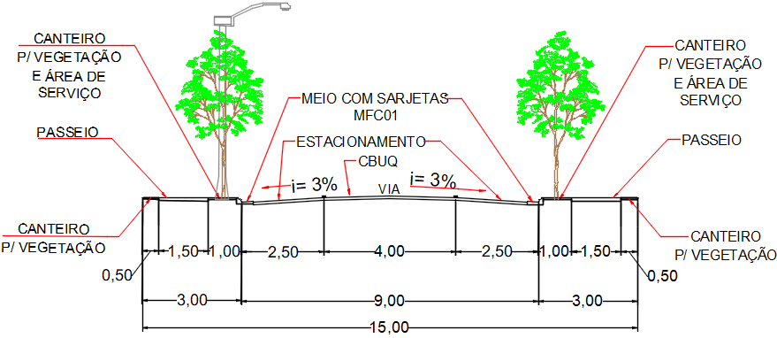
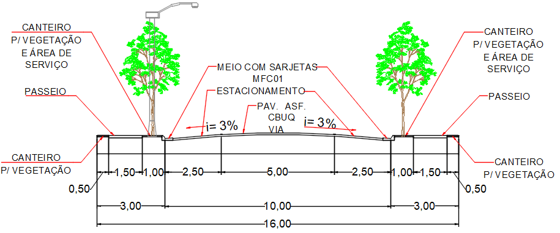
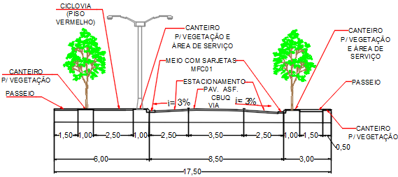
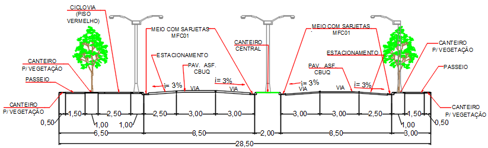
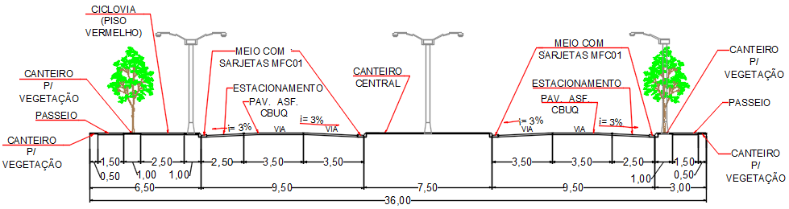

LEI COMPLEMENTAR Nº 131, DE 05 DE JULHO DE 2018.

Altera a Lei Complementar n. 3.633/1998.

**A CÂMARA MUNICIPAL DE RIO VERDE-GO APROVA E EU SANCIONO A SEGUINTE LEI:**

Art. 1º Esta Lei altera a Lei Complementar n. 3.633, de 03 de março de 1998, que “Dispõe sobre o parcelamento do solo para fins urbanos e dá outras providências” passando a vigorar com a seguinte redação:

“Art. 6º  Os loteamentos deverão atender os seguintes requisitos:

...................................................................................................

VI - Os projetos das vias de circulação de loteamentos deverão obedecer às dimensões totais mínimas nas alíneas abaixo, a fim de que se dê cumprimento às diretrizes traçadas pelo planejamento urbano, dentre as quais, articulação com outras vias e favorecimento da mobilidade urbana e serão classificadas como vias arteriais e demais, conforme disposições do art. 65 da Lei Complementar n. 5.318, de 10.09.2007, que dispõe sobre o Plano Diretor e o processo de planejamento do Município e art. 60, I, da Lei n. 9.503, de 23.09.1997, que institui o Código de Trânsito Brasileiro:

a) vias locais: são as vias internas dos bairros, com até 600m de comprimento, não interligando o bairro a que pertence a outro.

PERFIL DA VIA LOCAL

b) vias coletoras I: são as primeiras vias paralelas a ambos os lados das vias arteriais, com continuação em bairros adjacentes, independentemente do comprimento.

PERFIL DA VIA COLETORA I

c) vias coletoras II: são as primeiras vias paralelas a ambos os lados das vias expressas, faixas de servidão de linhas de alta tensão e vias arteriais II.

PERFIL DA VIA COLETORA II 

d) Alamedas: são vias que margeiam Áreas de Preservação Permanente – APPs.

PERFIL DA ALAMEDA

e) vias arteriais I: são vias que se articulam com vias locais, ligando bairros de uma mesma região,  direcionando o fluxo de tráfego para a via arterial II, apresentando ainda as seguintes condições:

1\. cada bairro deverá contar com, no mínimo, uma via arterial I, perpendicular e/ou paralela à via arterial II, exceto se ocorrer o cruzamento de duas vias arteriais II;

2\. estará a aproximadamente a 500 m (quinhentos metros) de outra via da mesma categoria, no sentido paralelo.  

PERFIL DA VIA ARTERIAL I

f) vias arteriais II: são vias que interligam bairros, articulando-se com outras de igual característica e estará de 500 m (quinhentos metros) a 1000 m (mil metros) de distância de outra da mesma no sentido paralelo , dependendo da configuração do bairro.

PERFIL DA VIA ARTERIAL II

VII - As ruas sem saída não poderão ultrapassar 250,00m (duzentos e cinquenta metros) de comprimento devendo obrigatoriamente, ter no seu final, bolsão de retorno com diâmetro mínimo inscrito de 24,00m (vinte e quatro metros), com raio de 12m (doze metros);

VIII - A rampa máxima da pista de rolamento será 10% (dez por cento). A critério da Prefeitura Municipal a declividade poderá ser aumentada, conforme estudos realizados através da Secretaria competente;

IX - Todas as vias públicas constantes do loteamento deverão ser construídas pelo proprietário recebendo, no mínimo, rede de distribuição de energia elétrica, meio-fio e a marcação das quadrados e lotes com marcos de concreto.

X - Os parcelamentos situados ao longo das Rodovias Federais, Estaduais ou Municipais, deverão conter ruas marginais paralelas à faixa de domínio das referidas estradas com largura mínima de 17,50m (dezessete metros e cinquenta centímetros);

.................................................................................................”

“Art. 19. Antes da aprovação do loteamento, o loteador deverá garantir a execução das obras e serviços de infraestrutura, em valor correspondente ao custo dos serviços e obras, podendo se valer de:

I – caução real, em percentual da área total do loteamento;

II – pecúnia;

III – fiança bancária;

IV – seguro.

§ 1º A caução real será devidamente averbada no Cartório de registro de imóveis com o valor dos lotes calculados pelo preço da área, sem considerar as benfeitorias previstas no projeto aprovado.

§ 2º A garantia prestada através de seguro será estabelecida nos termos da legislação vigente, observando-se as normas da Superintendência de Seguros Privados – SUSEP, devendo a apólice do seguro discriminar detalhadamente as obrigações do loteador-tomador, com consulta prévia ao Comitê Interno de Desenvolvimento Urbano, criado pelo Decreto n. 451-I, DE 09.02.2017, para análise da opção feita 

§ 3º O valor a ser apurado referente aos serviços de que trata o caput deste artigo será estabelecido por laudo técnico elaborado pelo órgão municipal de planejamento urbano, do qual constarão planilhas detalhadas especificando unidades de medida, quantidades, preços unitários e globais das obras a serem executadas, segundo valores atualizados do mercado.”

“Art. 19-A. Os loteadores, cujos loteamentos se encontrem em andamento no momento da publicação desta lei poderão substituir a caução já oferecida podendo se valer das opções estabelecidas no artigo 19 desta Lei, desde que avaliada em consulta prévia junto ao Comitê Interno de Desenvolvimento Urbano.”

“Art. 22. Esgotados os prazos previstos, caso não tenham sido realizados as obras e serviços de infraestrutura exigidos para o loteamento, o Município executá-los-á e promoverá ação competente para se ressarcir dos custos, executando a garantia prestado pelo loteador, na forma do art. 19, desta Lei.

Parágrafo único. Ocorrendo a hipótese prevista no caput deste artigo, tendo o loteador optado pela prestação de caução real, O Município promoverá ação para adjudicar ao seu patrimônio os lotes caucionados.”

.................................................................................................”

Art. 2º Esta Lei entrará em vigor na data de sua publicação.

Gabinete do Prefeito de Rio Verde, aos 05 dias do mês de julho de 2018.

PAULO FARIA DO VALE

Prefeito de Rio Verde

VINÍCIUS FONSÊCA CAMPOS

Procurador-Geral
