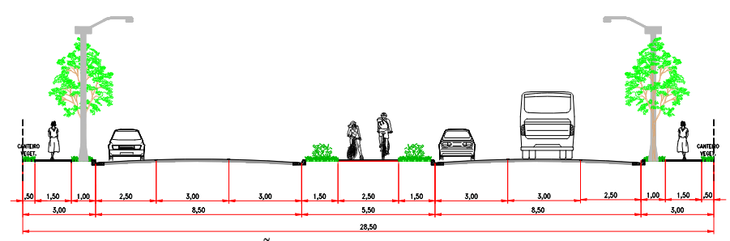
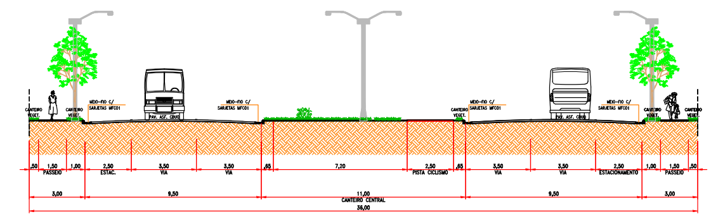

LEI COMPLEMENTAR Nº 363, DE 24 DE JUNHO DE 2024.

Altera a Lei Complementar nº 3.633, de 04 de março de 1998, que dispõe sobre o parcelamento do solo para fins urbanos.

**A CÂMARA MUNICIPAL DE RIO VERDE-GO APROVA E EU SANCIONO A SEGUINTE LEI:**

Art. 1º O art. 6º da Lei Complementar nº 3.633, de 04 de março de 1998, passa a vigorar com as seguintes alterações:

“Art. 6º. .....................................................................................

...................................................................................................

VI - ............................................................................................

...................................................................................................

e) ...............................................................................................

...................................................................................................

PERFIL DA VIA ARTERIAL I

f) .................................................................................................

PERFIL DA VIA ARTERIAL II

...................................................................................................” (NR)

Art. 2º Esta lei entrará em vigor na data de sua publicação.

Gabinete do Prefeito de Rio Verde, aos 24 de junho de 2024. 

PAULO FARIA DO VALE

Prefeito de Rio Verde

VINÍCIUS FONSÊCA CAMPOS

Procurador-Geral
