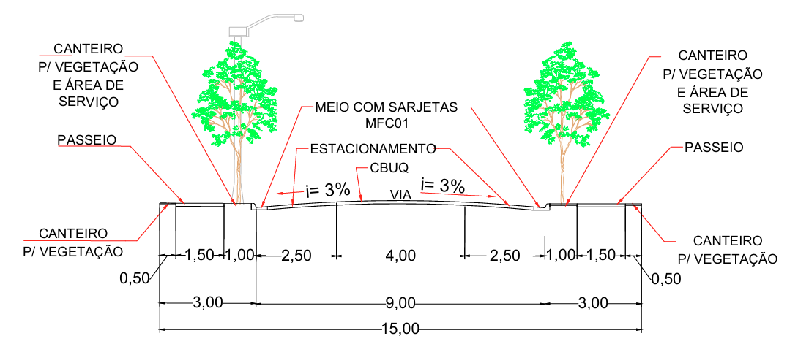
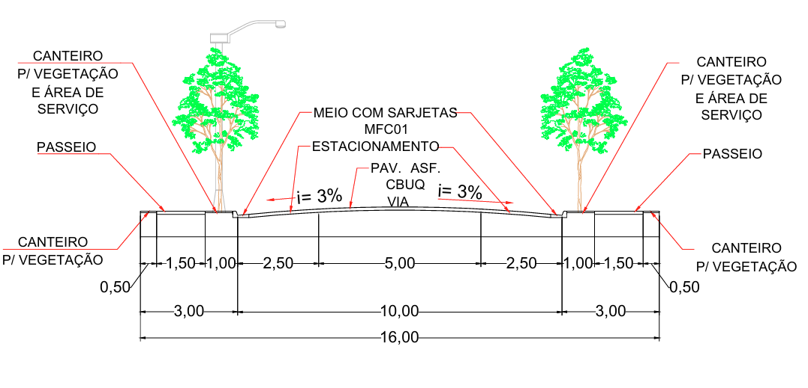
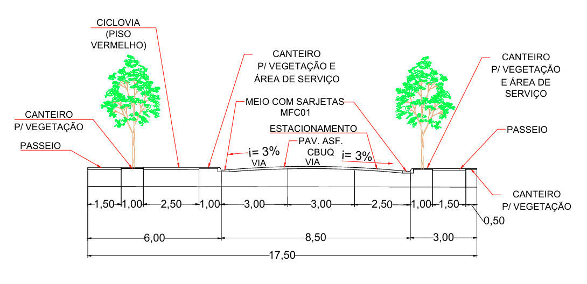
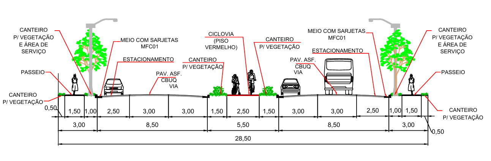
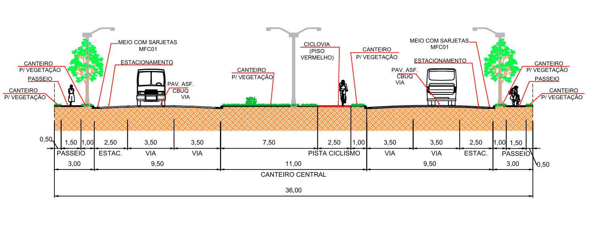
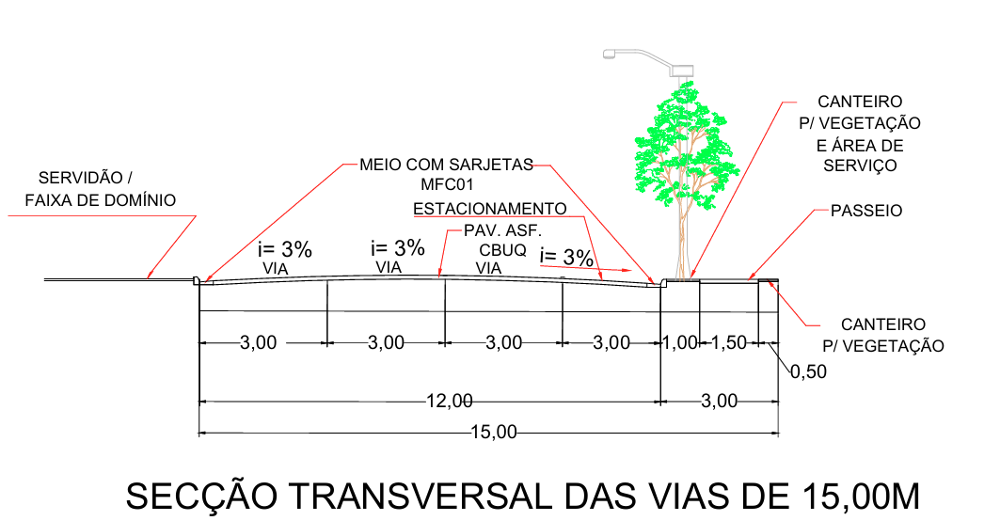

LEI COMPLEMENTAR Nº 392, DE 25 DE AGOSTO DE 2025.

Altera a Lei Complementar nº 3.633, de 4 de março de 1998, que dispõe sobre o parcelamento do solo para fins urbanos e dá outras providências.

**A CÂMARA MUNICIPAL DE RIO VERDE – GO APROVA E EU SANCIONO A SEGUINTE LEI:**

Art. 1º A Lei Complementar nº 3.633, de 4 de março de 1998, passa a vigorar com as seguintes alterações:

"Art.6° .......................................................................................

...................................................................................................

VI - .............................................................................................

a) ...............................................................................................

| Largura total (metros) | Calçada (metros) | Pista (metros) | Calçada (metros) |
| --- | --- | --- | --- |
| 15,00 | 3,00 | 9,00 | 3,00 |

b) ...............................................................................................

| Largura total (metros) | Calçada (metros) | Pista (metros) | Calçada (metros) |
| --- | --- | --- | --- |
| 16,00 | 3,00 | 10,00 | 3,00 |

c) ...............................................................................................

| Largura total (metros) | Calçada (metros) | Pista (metros) | Calçada (metros) |
| --- | --- | --- | --- |
| 17,50 | 6,00 | 8,50 | 3,00 |

d) ...............................................................................................

| Largura total (metros) | Calçada (metros) | Pista (metros) | Calçada (metros) |
| --- | --- | --- | --- |
| 17,50 | 6,00 | 8,50 | 3,00 |

e) ...............................................................................................

...................................................................................................

| Largura total (metros) | Calçada (metros) | Pista esquerda (metros) | Canteiro central/ciclovia (metros) | Pista direita (metros) | Calçada (metros) |
| --- | --- | --- | --- | --- | --- |
| 28,50 | 3,00 | 8,50 | 5,50 | 8,50 | 3,00 |

f) ...............................................................................................

| Largura total (metros) | Calçada (metros) | Pista esquerda (metros) | Canteiro central/ciclovia (metros) | Pista direita (metros) | Calçada (metros) |
| --- | --- | --- | --- | --- | --- |
| 36,00 | 3,00 | 9,50 | 11,00 | 9,50 | 3,00 |

...................................................................................................

X - os parcelamentos situados ao longo das Rodovias Federais, Estaduais ou Municipais deverão conter ruas marginais paralelas à faixa de domínio das referidas estradas com largura mínima de 15,00m (quinze metros), conforme dimensões mínimas estabelecidas na tabela e no perfil de via abaixo:

| Largura total (metros) | Pista (metros) | Calçada (metros) |
| --- | --- | --- |
| 15,00 | 12,00 | 3,00 |

...................................................................................................

XII - o Município de Rio Verde, através de resolução própria do Sistema Municipal de Planejamento, poderá aprovar novos loteamentos, considerados especiais, cujos lotes possuam área igual ou maior que 125,00 m2 (cento e vinte e cinco metros quadrados) e menor que 360,00 m2 (trezentos e sessenta metros quadrados) e quadras com comprimento máximo de 250 m (duzentos e cinquenta metros), desde que atendidos os demais parâmetros desta lei, e mediante a concessão de outorga onerosa do direito de parcelar, com a prestação de contrapartida a ser oferecida em lotes, cujo produto de alienação pode ser utilizado em outras áreas do Município, com o objetivo de promover a:

...................................................................................................

§ 4º ............................................................................................

NL (1) – NL (2): 2 = contrapartida a ser recolhida aos cofres do Município.

NL (1) = área somada dos lotes com metragem abaixo de 360,00 m² (trezentos e sessenta metros quadrados), porém, com metragem mínima de 125,00 m² (cento e vinte e cinco metros quadrados).

NL (2) = área somada dos lotes com metragem igual ou superior a 360,00 m² (trezentos e sessenta metros quadrados).

...................................................................................................

§ 14. As ruas marginais previstas no inciso X deste artigo também serão adotadas paralelamente às faixas de servidão destinadas à implantação de redes de subtransmissão e transmissão de energia elétrica (rede de alta tensão).” (NR)

“Art.17. ......................................................................................

...................................................................................................

§ 2º O prazo para execução das obras e serviços a que se referem os incisos I e II deste artigo será ajustado entre o loteador e o Município, quando da aprovação do loteamento, não podendo ser superior a 4 (quatro) anos, prorrogáveis por mais 4 (quatro) anos.” (NR)

Art. 2º Esta lei entrará em vigor na data de sua publicação.

Gabinete do Prefeito de Rio Verde, aos 25 de agosto de 2025.

WELLINGTON SOARES CARRIJO FILHO

Prefeito de Rio Verde

VINÍCIUS FONSÊCA CAMPOS

Procurador-Geral

luiz carlos fávero

Superintendente de Desenvolvimento Urbano
