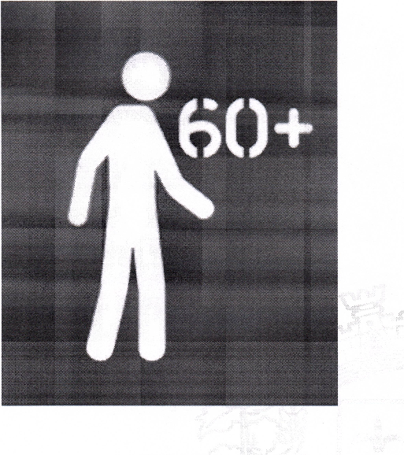
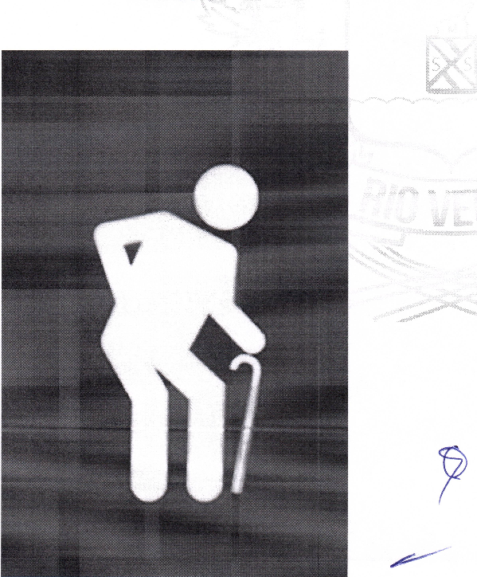

LEI N° 7.402,28 DE AGOSTO DE 2023

Dispõe sobre a substituição do pictograma atual de sinalização indicativa de prioridade à pessoa idosa representado por uma pessoa curvada de bengala, em vagas, assentos, filas dentre outros, nos Espaços Públicos no âmbito do Município de Rio Verde e dá outras providências.

**A CÂMARA MUNICIPAL DE RIO VERDE - GO APROVA E EU SANCIONO A SEGUINTE LEI:**

Art. 1° Fica determinada a substituição do pictograma atual de sinalização indicativa de prioridade à pessoa idosa representado por uma pessoa curvada de bengala, em vagas, assentos, filas dentre outros, nos espaços públicos no âmbito do Município de Rio garantidos pelo art. 3°, §1° da Lei Federal 10.741, de 1° de outubro de 2003.

Art. 2° A nova sinalização indicativa deve conter apenas a imagem de uma pessoa ereta com a sinalização “60+” (Anexo I), sendo substituído o pictograma atual, representado por uma pessoa curvada de bengala (Anexo II).

Art. 3° Caberá ao Executivo, por meio dos órgãos competentes, realizar a substituição das sinalizações.

Art. 4° Nos casos de sinalização indicativa realizada em vagas e placas a substituição poderá se dar gradualmente, de acordo com a necessidade de manutenção da sinalização.

Art. 5° A substituição se dará, necessariamente, sempre que houver necessidade de reposição ou criação de novas sinalizações.

Art. 6° Esta Lei entra em vigor na data de sua publicação.

Gabinete do Prefeito de Rio Verde, aos 28 de agosto de 2023

PAULO FARIA DO VALE

Prefeito de Rio Verde

VINÍCIUS FONSÊCA CAMPOS

Procurador-Geral

**ANEXO I**

**ANEXO II**

