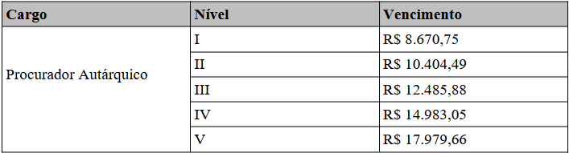

LEI COMPLEMENTAR Nº 254, DE 27 DE JUNHO DE 2022.

Altera a Lei Complementar nº. 130, de 03 de julho de 2018.

**A CÂMARA MUNICIPAL DE RIO VERDE APROVA E EU SANCIONO A SEGUINTE LEI:**

Art. 1º A Lei Complementar nº. 130, de 03 de julho de 2018, passa a vigorar com as seguintes alterações:

**“CAPÍTULO I

DAS DISPOSIÇÕES PRELIMINARES**

Art. 1º Fica criada a AGÊNCIA DE REGULAÇÃO DOS SERVIÇOS PÚBLICOS DE SANEAMENTO BÁSICO - AMAE, entidade integrante da administração pública municipal indireta, submetida a regime autárquico especial, dotada de poder de polícia e de autonomia técnica, administrativa e financeira, com a finalidade de dar cumprimento às políticas públicas e exercer as atividades de regulação, o controle e a fiscalização dos serviços públicos de abastecimento de água, esgotamento sanitário e gerenciamento de resíduos sólidos urbanos no Município de Rio Verde, visando a eficiência, continuidade, universalização da cobertura, equidade do acesso e a modicidade das tarifas desses serviços públicos, com vistas à elevação da qualidade de vida para a presente e futuras gerações.

§1º A AMAE poderá celebrar convênio ou contrato visando a assunção, isolada ou conjuntamente, das atividades de regulação e fiscalização da prestação de serviços públicos de saneamento básico, indicadas no caput deste artigo, de outros entes da federação.

§2º As atividades de regulação, fiscalização e controle dos serviços públicos de saneamento básico poderão ser realizadas pela AMAE independente da modalidade da prestação de tais serviços.

§3º A AMAE tem sede e foro na cidade de Rio Verde - GO.

§4º A AMAE poderá constituir e desenvolver atividades em escritórios ou unidades localizadas em outros municípios para melhor consecução de seus objetivos.

...................................................................................................

**CAPÍTULO II

DAS ATRIBUIÇÕES**

Art. 4º ........................................................................................

...................................................................................................

IX - realizar, anualmente, na forma prevista em regulamento, audiências públicas com o intuito de informar à população sobre a qualidade dos serviços e o cumprimento ou não dos marcos regulatórios e indicadores estabelecidos para os serviços públicos de saneamento básico;

...................................................................................................

XI - publicar no sítio oficial da AMAE, regularmente, os relatórios das ações de fiscalização, demonstrando o cumprimento ou não dos marcos regulatórios e indicadores;

XII - promover estudos técnicos relacionados aos serviços de abastecimento de água e coleta e tratamento de esgotos e gerenciamento de resíduos sólidos, a fim de amparar a definição de padrões mínimos de qualidade para a prestação dos referidos serviços públicos;

XIII - acompanhar e auditar a manutenção das instalações e recursos operacionais dos sistemas de abastecimento de água, coleta e tratamento de esgotos e de gerenciamento de resíduos sólidos, assim como a incorporação de novos bens, para a garantia da reversão dos ativos do poder público, nos termos dos instrumentos de delegação;

...................................................................................................

XVI - fiscalizar o cumprimento dos contratos de concessão e de programa, do plano municipal de água e esgotamento sanitário e dos planos de execução dos serviços elaborados pelos operadores, nos termos estabelecidos nos instrumentos de delegação e legislação aplicável;

...................................................................................................

XIX - controlar, acompanhar, analisar e aprovar proposta de estrutura tarifária e o reajuste das tarifas dos serviços de abastecimento de água, de coleta e tratamento de esgotos e de gerenciamento de resíduos sólidos urbanos mediante análise de estudo fundamentado apresentado pelo prestador de serviços;

XX - acompanhar e auditar o desempenho econômico-financeiro da execução dos serviços de abastecimento de água, coleta e tratamento de esgotos e gerenciamento de resíduos sólidos urbanos procedendo à análise e aprovando os pedidos de revisões e de reajustes, visando assegurar a manutenção do equilíbrio econômico-financeiro da prestação dos serviços;

...................................................................................................

XXXI - analisar e aprovar as alternativas técnicas adotadas nos projetos propostos pelos operadores dos serviços para execução de obras de abastecimento de água, esgotamento sanitário e gerenciamento de resíduos sólidos;

...................................................................................................

XXXIX - editar normas sobre procedimentos decisórios internos, realização de audiências públicas, emissão de decisões administrativas e procedimentos recursais, bem como sobre procedimentos de fiscalização e de aplicação de sanções previstas na legislação do titular dos serviços, nos instrumentos contratuais ou nas demais normas legais aplicáveis ao setor que regular; 

XL - cobrar seus créditos tributários e não tributários, inscrevendo-os no rol da dívida ativa da Agência, quando não pagos;

XLI - exercer o poder de polícia em relação à prestação de serviços regulados, na forma das leis, regulamentos, resoluções, contratos, atos e termos administrativos pertinentes;

XLII - assegurar o cumprimento de suas decisões administrativas e normas que expedir, por parte dos prestadores de serviços, usuários, consumidores, inclusive mediante imposição de penalidades previstas nas leis, regulamentos, contratos ou atos de outorga;

XLIII - firmar termos de ajustamento de conduta por iniciativa própria ou quando instada em conflitos de interesses nos serviços que regular;

XLIV - exercer outras funções correlatas à sua finalidade básica a serem dispostas no regimento interno.

§1º As atribuições previstas neste artigo podem ser exercidas no todo ou em parte em relação aos serviços de competência de outros entes federados ou reguladores que lhes forem delegados, na forma do § 2º do art. 1º desta lei;

§2º As decisões da AMAE, por seus órgãos singulares ou coletivos, bem como os atos normativos que editar possuem eficácia normativa.

**CAPÍTULO III

DAS FUNÇÕES DE PLANEJAMENTO, DE REGULAÇÃO E DE CONTROLE**

Art. 5º O exercício da atividade de planejamento dos serviços de abastecimento de água, coleta e tratamento de esgotos e gerenciamento de resíduos sólidos observará os dispositivos desta Lei, dos regulamentos, dos contratos de concessão e de programa e do Plano Municipal de Saneamento Básico, que poderá ser específico para cada serviço, o qual abrangerá:

...................................................................................................

Art. 9º A AMAE, observadas as diretrizes determinadas pela Agência Nacional de Águas e Saneamento Básico - ANA, editará normas relativas às dimensões técnica, econômica e social da prestação dos serviços, que abrangerão, ao menos, os seguintes aspectos:

...................................................................................................

XI - medidas de segurança, de contingência e de emergência, inclusive quanto a racionamento de água;

XII - procedimentos de fiscalização e de aplicação de sanções previstas nos instrumentos contratuais e na legislação do titular;

XIII - diretrizes para redução progressiva e controle das perdas de água.

...................................................................................................

Art. 11. ......................................................................................

§1ºExcluem-se do disposto no caput deste artigo os documentos considerados sigilosos em razão de interesse público relevante, mediante prévia e motivada decisão.

§ 2º A publicidade a que se refere o caput deste artigo pode se efetivar por meio de sítio mantido na rede mundial de computadores.

...................................................................................................

Art. 13. Os atos expedidos pelo Conselho Municipal de Saneamento Básico - CONSAB somente produzirão efeitos após publicação no sítio eletrônico da Agência e, aqueles de alcance particular expedidos pela AMAE, após a correspondente notificação.

...................................................................................................

**CAPÍTULO IV

DA ESTRUTURA ORGANIZACIONAL DA AGÊNCIA**

Art. 15. A AMAE conta com a seguinte estrutura organizacional básica:

I - Presidência;

II - Diretoria de Planejamento, Gestão, Administração e Finanças;

III - Diretoria de Normatização, Fiscalização e Controle; Coordenação de Fiscalização e Controle; Coordenação de Normatização;

IV - Ouvidoria;

V - Procuradoria Jurídica;

VI - Assessoria Institucional.

§1º O provimento e a exoneração do cargo de Presidente da AMAE são de competência exclusiva do Chefe do Poder Executivo Municipal, observado o disposto nos artigos 17 ao 19 desta Lei.

§2º A estrutura organizacional complementar da AMAE e as respectivas competências serão estabelecidas por regimento interno da Agência, respeitado decretos regulamentares e as disposições normativas aplicáveis, inclusive nos anexos desta lei.

...................................................................................................

Art. 19. ......................................................................................

...................................................................................................

§2º A Assessora Institucional, vinculada à Presidência da AMAE, tem por atribuição apoiar e assessorar as ações políticas e administrativas de competência do Presidente.

Art. 20. A Diretoria de Planejamento, Gestão, Administração e Finanças é o órgão responsável pela coordenação das atividades administrativas e financeiras da Agência e do desempenho econômico e financeiro das atividades reguladas.

**Seção I

Conselho Municipal de Saneamento Básico**

Art. 21. ......................................................................................

Art. 22. ......................................................................................

...................................................................................................

VIII - apreciar e emitir pareceres sobre os casos que lhe forem submetidos pelos órgãos da AMAE;

...................................................................................................

XI - julgar em última instância os recursos administrativos às decisões da AMAE em procedimentos administrativos relativos a autos de infração oriundos das atividades de fiscalização da AMAE.

Art. 23. O Conselho Municipal de Saneamento Básico de Rio Verde será composto por representantes da sociedade civil e do Poder Público, nomeados por ato do Prefeito Municipal, conforme segue:

...................................................................................................

XII - 1 (um) representante do CREA/GO – Conselho Regional de Engenharia e Agronomia do Estado de Goiás.

...................................................................................................

**Seção II

Conselho dos Prefeitos**

Art. 23-A. O Conselho dos Prefeitos é formado pelos Chefes do Poder Executivo dos municípios que firmarem convênio ou contrato com a AMAE para elegê-la sua agência reguladora e fiscalizadora, terá participação obrigatória do Presidente da Agência e é sua instância consultiva para assuntos inerentes a:

I - agenda de trabalho a ser executada pela AMAE em cada município conveniado;

II - questões importantes acerca da prestação e dos prestadores dos serviços regulados e/ou fiscalizados pela AMAE nos municípios conveniados;

III - melhoria dos serviços prestados pela AMAE.

§1º A Presidência do Conselho será exercida por um dos Prefeitos, eleito entre eles na primeira reunião anual para um mandato de um ano.

§2º Os Vice-prefeitos substituirão os Prefeitos em suas ausências nas reuniões do Conselho dos Prefeitos, salvo se outra pessoa for designada.

§3º É vedado que uma só pessoa represente dois ou mais Municípios em reuniões do Conselho.

§4º Nenhum membro, servidor ou dirigente da AMAE poderá representar qualquer Município na reunião do Conselho.

Art. 23-B. O Conselho dos Prefeitos reunir-se-á ordinariamente duas vezes por ano, nos períodos fixados em seu regimento e, extraordinariamente, por convocação fundamentada de qualquer de seus membros com apoio de mais da metade dos Conselheiros ou pelo Presidente do Conselho ou o da AMAE.

Parágrafo único. A estrutura e a equipe necessárias à realização das reuniões do Conselho dos Prefeitos são de competência do Presidente do Conselho durante o período de seu mandato. 

Art. 23-C. A AMAE poderá munir o Conselho dos Prefeitos com informações a fim de subsidiar decisões dos titulares dos serviços de saneamento básico e gestão de resíduos sólidos para formulação da respectiva política pública.

Art. 23-D. Ao Conselho dos Prefeitos caberá elaborar as suas normas de funcionamento por meio de regimento interno.

**CAPÍTULO V

DO FINANCIAMENTO E REGIME FINANCEIRO DA AMAE**

Art. 24. Para fazer face às despesas de operação da Agência, todos os prestadores dos serviços públicos de saneamento básico por ela regulados e/ou fiscalizados farão o repasse mensal de taxa de regulação e fiscalização, que será definida em legislação específica, a título de remuneração pela atividade regulatória e fiscalizatória dos serviços.

Parágrafo único. Fica delegada à AMAE a capacidade tributária ativa para promover o lançamento tributário, arrecadação, fiscalização e cobrança da taxa de regulação e fiscalização prevista nesta lei podendo, para tanto, executar leis, promover serviços, elaborar e fazer cumprir todos os atos normativos e regulamentares necessários. 

Art. 25. ......................................................................................

...................................................................................................

V - o produto de emolumentos, taxas, preços, multas e indenizações relativas ao exercício das funções do poder regulatório, bem como, seus acréscimos por atraso no recolhimento;

...................................................................................................

XIII - produto das multas por infrações aplicadas pela AMAE aos prestadores dos serviços públicos de saneamento básico que fiscalizar.

Art. 25-A. Os créditos da AMAE decorrentes da cobrança da taxa de regulação e fiscalização prevista no inciso IX do art. 25, desta lei, e os créditos decorrentes de valores não tributários constituídos em seu favor, quando não pagos nos prazos fixados para o recolhimento, serão inscritos como dívida ativa tributária ou não tributária da Agência, conforme o caso, para efeito de cobrança judicial a ser promovida por sua assessoria jurídica, nos termos da Lei Federal nº 6.830, de 22 de setembro de 1980.

Art. 25-B. Os créditos da AMAE, de natureza não tributária, não pagos nos prazos fixados pela legislação, em normas ou em atos expedidos pela Agência, além das penalidades capituladas para cada caso, estarão sujeitos a atualização monetária com base pelo INPC/IBGE (Índice Nacional de Preços ao Consumidor/ Instituto Brasileiro de Geografia e Estatística) ou outro que vier a o substituir, acrescidos de multa moratória de 0,33% (zero, trinta e três por cento) por dia limitada a 20% (vinte por cento) do valor total do débito e juros moratórios de 1% (um por cento) ao mês pro rata die. 

Parágrafo único. Sobre valores decorrentes de autuações por infrações não haverá incidência de multa moratória.

Art. 25-C. Dos débitos vencidos e não pagos, poderá ser concedido parcelamento de créditos de natureza tributária ou não tributária devidos à AMAE na forma e condições previstas neste artigo e em ato da Presidência da Agência:

§1° O parcelamento não exclui a espontaneidade e os débitos parcelados ficam sujeitos apenas à multa moratória, juros de mora e correção monetária até a data da concessão do parcelamento, quando serão consolidados.

§2º No ato do parcelamento, os débitos serão consolidados com os encargos previstos nesta lei e, a partir de então, acrescidos de juros compensatórios de 1% (um por cento) ao mês, caso o parcelamento seja superior a 04 (quatro) parcelas.

§3º O número de parcelas não poderá 24 (vinte e quatro) meses, respeitado o valor mínimo de cada parcela definido por ato da Presidência da Agência, a capacidade financeira do devedor e o valor total do débito.

§4º O não pagamento de 3 (três) ou mais parcelas acarretará o vencimento antecipado das parcelas vincendas, independentemente de aviso, notificação ou interpelação judicial ou extrajudicial, expurgados os juros compensatórios sobre as vincendas, voltando a incidir atualização monetária, juros de mora e multa moratória desde a data do parcelamento.

§5º Ocorrendo o vencimento antecipado previsto no § 4º deste artigo, o devedor perderá o benefício da redução da multa ou, se for o caso, da espontaneidade, aplicando-se, em ambos os casos, o valor integral da multa que fora reduzida ou exonerada.

§6º A adesão ao parcelamento por parte do devedor implica, de forma irrevogável e irretratável, na confissão da dívida, bem como na renúncia ou desistência de quaisquer meios de defesa ou impugnações administrativas ou judiciais.

§7º O remanescente de crédito decorrente de parcelamento inadimplido e de parcelas consideradas antecipadamente vencidas, nos termos do §3º, deste artigo deverá ser encaminhado para inscrição em dívida ativa e cobrança judicial.

§8º O parcelamento de parte não litigiosa do crédito será permitido desde que o sujeito passivo reconheça o que é incontroverso e comprove a existência de impugnação ou recurso da parte controversa mediante a exibição, no ato do pedido de parcelamento, da respectiva peça de impugnação ou recurso devidamente recepcionada pelo órgão competente especificando a parte do crédito tributário objeto da defesa. 

...................................................................................................

**CAPÍTULO VIII

DA FISCALIZAÇÃO**

Art. 37. As atividades relativas à prestação de serviços de abastecimento de água, coleta e tratamento de esgoto e de gerenciamento de resíduos sólidos urbanos serão fiscalizadas pela AMAE, que exercerá seu poder de polícia, sempre que necessário.

...................................................................................................

**CAPÍTULO IX

DAS SANÇÕES ADMINISTRATIVAS**

Art. 40. Os prestadores de serviços regulados pela AMAE que venham a incorrer em alguma infração à lei, regulamentos, contratos e outras normas pertinentes, ou, ainda, que não cumpram adequadamente as ordens, instruções e resoluções da Agência, serão objeto das sanções cabíveis previstas nesta lei, nas normas do titular dos serviços de saneamento básico, e/ou nos instrumentos de delegação e outorga dos serviços regulados, sem prejuízo da aplicação de sanções previstas na legislação federal e estadual atinentes à matéria.

Art. 41. ......................................................................................

...................................................................................................

§1º As sanções previstas nesta Lei poderão ser aplicadas cumulativamente.

§2º No exercício dos procedimentos fiscalizatórios pela entidade reguladora, se detectada ocorrência de infração que possa dar ensejo a aplicação de sanções, a AMAE notificará o infrator para, no prazo indicado na notificação, regularizar a situação verificada, apresentar informações e, caso queira, em 15 (quinze) dias, apresentar defesa prévia à Coordenação de Fiscalização e Controle acompanhada de documentos comprobatórios.

§3º A não regularização da situação configuradora de infração, ou a ausência de defesa prévia pelo infrator ou, ainda, se a defesa não for acatada, implicará a aplicação da penalidade correspondente sempre por decisão fundamentada emitida pela Coordenação de Fiscalização e Controle e a consequente a lavratura do auto de infração.

§4º No caso do § 3º deste artigo, o infrator será intimado da decisão do procedimento de fiscalização e do auto de infração lavrado, podendo cumprir a decisão, inclusive pagando a multa, se for o caso, ou, apresentar impugnação em 15 (quinze) dias dirigida ao Diretor de Normatização, Fiscalização e Controle, devendo arguir todas as questões fáticas e de Direito que entender aplicáveis e produzir provas, que após este prazo estarão preclusas, salvo se advierem de fatos novos, com as limitações indicadas no parágrafo seguinte.

§5º Da decisão do Diretor de Normatização, Fiscalização e Controle, em procedimentos administrativos sancionatórios, cabe recurso em 15 (quinze) dias ao Conselho Municipal de Saneamento Básico, sendo admitidas novas provas tão somente de fatos ocorridos entre a data da impugnação ao Auto de Infração e a data do protocolo recurso aqui mencionado.

§6º O Conselho Municipal de Saneamento Básico, no julgamento do recurso interposto, proferirá decisão em última instância. 

§7º Se subsistente o Auto de Infração, a Autuada terá prazo de 15 (quinze) dias para recolhimento da multa a contar da data de sua notificação.

Art. 41-A. A atribuição de valores às multas por infração e normas correlatas, bem como condutas descritas como infracionais serão estabelecidas na regulamentação desta lei, por ato do Chefe do Executivo ou, em sua omissão, por Resoluções Normativas da AMAE, observados os valores mínimo e máximo fixados no art. 41-B desta lei, sem prejuízo das multas previstas nos instrumentos contratuais firmados entre os titulares e os prestadores dos serviços públicos de saneamento básico.

Art. 41-B. O valor mínimo de multa, por uma infração, é de R$ 10.000,00 (dez mil reais) e o máximo é de R$ 360.000,00 (trezentos e sessenta mil reais), neles já computados os fatores redutores ou agravantes possíveis.

§1º Os valores indicados no caput, deste artigo serão atualizados monetariamente pelo INPC/IBGE acumulado nos últimos doze meses, por ato da Presidência da AMAE divulgado no sítio eletrônico da Agência;

§2º Um único Auto de Infração poderá conter autuações por mais de uma infração, caso em que cada multa sancionatória aplicada deve respeitar os valores mínimo e máximo por infração conforme o caput do artigo 41-A.

Art. 41-C. Serão concedidas reduções nos valores de multa por infração desde sejam pagas dentro do prazo para apresentar impugnação ou recurso, conforme o caso, e, concomitantemente, não exista reincidência específica, o autuado não tenha concorrido intencionalmente para a infração e haja comprovação da correção da irregularidade encontrada, respeitadas as seguintes condições:

I - se recolhidas dentro do prazo previsto para apresentação de impugnação ao Auto de Infração, haverá redução de 50% (cinquenta por cento) para pagamento integral da multa;

II - se recolhida dentro do prazo previsto para apresentação de recurso ao CONSAB, haverá redução de 30% (trinta por cento), para pagamento integral da multa.

Parágrafo único. Não haverá redução de valor da multa fora dos períodos e condições previstos neste artigo.

...................................................................................................

Art. 46. Na aplicação de sanções serão considerados a natureza e a gravidade da infração, os danos dela resultantes para o serviço, para os usuários, para o meio ambiente, a vantagem auferida pelo infrator, as circunstâncias agravantes, os antecedentes do infrator e a reincidência específica.

§1º À AMAE cabe estabelecer por meio de Resolução a metodologia ou fórmula de cálculo do valor das multas que aplicar em caso de ocorrência de infração, devendo estabelecer o peso de cada item descrito no disposto no caput deste artigo e o percentual aplicável para aumento ou diminuição para o valor final da multa.

§2º Considera-se reincidência específica a repetição de falta de igual natureza, tipificada em mesmo dispositivo legal, contratual ou norma do ente regulador, cujo infrator já tenha sido notificado anteriormente, independente de aplicação de penalidade anterior.

...................................................................................................

Art. 49. ......................................................................................

Parágrafo único. O pagamento de multa não exime o infrator da obrigação de reparar os danos resultantes da infração, caso existam.

Art. 50. A pena de caducidade implicará a extinção da outorga e será aplicada conforme os termos da lei, em normas de referência da ANA e/ou nos instrumentos específicos de delegação.

Art. 50-A. No caso de não atingimento das metas de universalização e não intermitência do abastecimento, de redução de perdas e de melhoria dos processos de tratamento, conforme definido no art. 11-B da Lei Federal nº 11.445/2007, deverá ser iniciado processo administrativo pela AMAE com o objetivo de avaliar as ações a serem adotadas, incluídas as medidas sancionatórias, com eventual declaração de caducidade da concessão, assegurado o direito à ampla defesa. 

...................................................................................................

**CAPÍTULO IX-A

DO QUADRO DE SERVIDORES**

Art. 51-A. O quadro de cargos de provimento em comissão e o quadro de cargos de provimento efetivo da Agência de Regulação dos Serviços Públicos de Saneamento Básico AMAE estão previstos nos Anexos I, II, III, IV, V e VI, desta Lei Complementar.

...................................................................................................

Art. 51-C. O regime jurídico dos servidores da Agência de Regulação dos Serviços Públicos de Saneamento Básico AMAE é o estatutário, com observância, no que couber, do Plano de Cargos e Vencimentos dos Servidores em geral.

**CAPÍTULO IX-B

DAS NORMAS PROCEDIMENTAIS**

**Seção I

Comunicação Entre Agência e Prestadores**

Art. 51-D. A comunicação entre a AMAE e os prestadores de serviços de saneamento básico por ela regulados e/ou fiscalizados ocorrerá preferencialmente por meio eletrônico e destina-se a:

I - cientificar o prestador de serviços públicos de saneamento básico sobre quaisquer atos administrativos, ações fiscais, intimações, notificações, entrega de guias e avisos em geral;

II - receber do prestador de serviços públicos de saneamento básico documentação eletrônica exigida no curso dos procedimentos fiscais ou apresentação de defesa e recurso no âmbito de processos administrativos.

§1º As comunicações realizadas por via eletrônica estipuladas nesta lei dispensam a sua publicação no Diário Oficial e o envio por via postal e são consideradas pessoais para todos os efeitos legais.

§2º Ficam convalidados todos os atos praticados eletronicamente pela AMAE e prestadores de serviços em data anterior à publicação desta Lei.

§3º Cada prestador de serviços de saneamento básico que seja regulado ou fiscalizado pela AMAE deverá firmar documento indicando seu endereço eletrônico e de seus prepostos para fins de comunicação nos termos desta Lei.

§4º Os documentos encaminhados via comunicação eletrônica deverão preencher os requisitos legais de validade e eficácia e, se for o caso, serem assinados respeitando o disposto na Lei Federal nº 14.063/2020, quando se tratar de assinatura eletrônica.

**Seção II

Das Notificações e Intimações**

Art. 51-E. A cientificação dos despachos e decisões dos órgãos preparadores e julgadores da AMAE ocorrerão:

I - por meio eletrônico, tendo como prova de recebimento o envio ao endereço eletrônico do notificado, de seu mandatário ou de seu preposto, previamente cadastrados junto à AMAE;

II - pessoalmente, pelo agente da AMAE, na repartição ou fora dela, provada com a assinatura do sujeito passivo, seu mandatário ou preposto, ou, no caso de recusa, com certidão exarada por quem o intimar;

III - por via postal com aviso de recebimento, ou por qualquer outro meio ou via, sempre tendo como prova o recebimento no domicílio do notificado;

§1º Os despachos interlocutórios que não afetem a defesa em processo administrativo independem de intimação.

§2º Quando, em um mesmo processo for interessado mais de um prestador de serviço, em relação a cada um deles serão atendidos os requisitos fixados nesta seção para as intimações e notificações, contando-se o prazo de cada um isoladamente da data de sua cientificação.

§3º O ônus de provar o não recebimento da comunicação eletrônica é do notificado.

§4º Os meios de cientificação previstos nos incisos do caput deste artigo não estão sujeitos a ordem de preferência.

§5º Quando inexitoso um dos meios previstos nos incisos do caput deste artigo, a notificação ou intimação poderá ser feita por edital publicado:

a) no endereço da AMAE na internet, ou,  

b) uma única vez, no Diário Oficial Municipal, ou na sua falta, em qualquer jornal da imprensa local. 

Art. 51-F. Considera-se consumada a notificação ou a intimação: 

I - se por meio eletrônico:

a) no 5º (quinto) dia útil após a data registrada de envio da intimação ou notificação ao endereço eletrônico do destinatário, ou, 

b) na data em que se efetuar a consulta/leitura da intimação ou notificação encaminhada ao endereço eletrônico cadastrado por ele junto à AMAE, caso ocorra antes do 5º (quinto) dia;

II - se pessoal, na data da ciência do notificado ou intimado;

III - se por via postal, na data do recebimento ou, se omissa, 15 (quinze) dias após a data da expedição da intimação ou notificação;

IV - se feita no Diário Oficial Municipal ou em jornal da imprensa local, na data da publicação da notificação ou intimação no endereço da AMAE na internet.

**Seção III

Dos Prazos**

Art. 51-G. A contagem do prazo terá início no primeiro dia útil que seguir à notificação ou intimação.

Art. 51-H. Na contagem de prazos processuais em dias computar-se-ão apenas os dias úteis.

Parágrafo único. Na contagem dos prazos, exclui-se o dia da intimação e

inclui-se o do vencimento;

Art. 51-I. A autoridade julgadora, atendendo a circunstância especial, poderá, em despacho fundamentado prorrogar o prazo processual pelo tempo necessário para realização de diligência.

Art. 51-J. Em procedimentos administrativos da AMAE, o prazo para defesa, impugnação e interposição será de 15 (quinze) dias úteis, conforme o caso.

Art. 51-K. Inexistindo preceito normativo ou prazo determinado pela autoridade, será de 10 (dez) dias úteis o prazo para prática de ato processual pelo interessado do procedimento administrativo.

...................................................................................................” (NR)

Art. 2º A ementa da Lei Complementar n º 130/2018 passa a vigorar com a seguinte redação:

“Dispõe sobre a criação da Agência de Regulação dos Serviços Públicos de Saneamento Básico - AMAE, entidade autárquica municipal e dá outras providências”.

Art. 3º Fica criado na Lei Complementar nº 130/2018 o cargo de Procurador Autárquico da Agência de Regulação dos Serviços Públicos de Saneamento Básico - AMAE.

Parágrafo único. Aplica-se ao cargo de Procurador Autárquico da AMAE, no que se refere aos critérios para progressão na carreira, as regras previstas na Lei Complementar n° 5.564/2009 para o cargo de Procurador do Município.

Art. 4º Em decorrência do disposto no art. 3º desta Lei, ficam alterados os Anexos III e V, para incluir o cargo de Procurador Autárquico, e criado o Anexo VI na Lei n° 130/2018 conforme Anexos I, II e III desta Lei Complementar.

Art. 5º Ficam extintos os cargos de Analista de Educação Sanitária e Ambiental e de Analista de Abastecimento de Água e Esgotamento Sanitário previstos na Lei Complementar nº. 130/2018.

Art. 6º Ficam alteradas as atribuições dos cargos de Analista de Tarifas e Subsídios; Analista de Normatização e Regulação; Analista de Fiscalização e Analista Jurídico previstas no Anexo V da Lei Complementar nº 130/2018, conforme Anexo IV desta Lei.

Parágrafo único. Em relação aos cargos de Analista de Tarifas e Subsídios; Analista de Normatização e Regulação e Analista de Fiscalização altera-se também os requisitos de provimento.

Art. 7º Revogam-se os seguintes dispositivos da Lei Complementar nº 130/2018: parágrafo único do art. 1º; parágrafo único do art. 11; parágrafo único do art. 15; inciso VII do art. 22; § 8º do art. 23; art. 33; parágrafo único do art. 41; art. 51-B.

Art. 8º Esta lei entra em vigor na data de sua publicação.

Gabinete do Prefeito de Rio Verde, aos 27 dias do mês de junho de 2022.

PAULO FARIA DO VALE

Prefeito de Rio Verde

VINÍCIUS FONSÊCA CAMPOS

Procurador-Geral

**ANEXO I

(Alteração do Anexo III da Lei Complementar nº. 130/2018 - Quadro de Cargos, Carga horária e Quantitativo do Quadro Efetivo)**

| CARGO | CARGA HORÁRIA SEMANAL | QUANTITATIVO |
| --- | --- | --- |
| Analista de Planejamento, Gestão, Orçamento e Financeiro | 40h | 01 |
| Analista de Tarifas e Subsídios | 40h | 01 |
| Analista de Normatização e Regulação | 40h | 04 |
| Analista de Fiscalização | 40h | 04 |
| Procurador Autárquico | 40h | 01 |
| Analista Jurídico | 40h | 01 |

**ANEXO II

(Inclusão no Anexo V da Lei Complementar nº. 130/2018 - Atribuições e requisitos dos cargos efetivos)**

“...................................................................................................

**Cargo:** Procurador Autárquico

**Categoria:** Administrativa

**Descrição da Função:**

Exercer a representação judicial, ativa e passivamente, e a consultoria jurídica da Agência de Regulação dos Serviços Públicos de Saneamento Básico - AMAE.

**Sumário:**

**Tarefas:**

• Exercer a representação judicial, ativa e passivamente, e a consultoria jurídica da Agência de Regulação dos Serviços Públicos de Saneamento Básico - AMAE

• Promover as ações judiciais necessárias à defesa dos interesses da Agência de Regulação dos Serviços Públicos de Saneamento Básico - AMAE;

• Zelar pela observância do princípio da legalidade da Administração Pública;

• Atuar extrajudicialmente em defesa dos interesses da AMAE;

• Emitir parecer sobre consultas formuladas relativamente a quaisquer matérias da área jurídica da AMAE;

• Emitir parecer escrito sobre editais, minutas de contratos e sobre casos de afastamento de licitação, relativamente a processos de interesse da AMAE;

• Prestar orientação na elaboração de contratos, inclusive quanto à documentação exigível;

• Redigir minuta padrão de contratos e editais, quando solicitado;

• Redigir as informações em mandados de segurança a serem prestadas por agentes públicos da AMAE e interpor os recursos necessários;

• Exercer outras funções jurídicas inerentes às atribuições do cargo, determinadas pelo superior hierárquico ou previstas em regulamento;

• Exercer as funções necessárias à instrumentalização da Dívida Ativa da AMAE judicial e extrajudicialmente.

**Requisitos:**

Registro profissional na OAB e certidão negativa do respectivo Conselho;

Experiência profissional mínima de 02 (dois) anos na área jurídica, conforme edital. ”

**ANEXO III

(Anexo VI da Lei Complementar nº. 130/2018)

Anexo VI - Quadro de Vencimentos do Cargo de Procurador Autárquico da AMAE**

**ANEXO IV

(Anexo V da Lei Complementar nº. 130/2018 - Atribuições e requisitos dos cargos efetivos)**

“...................................................................................................

**Cargo:** Analista de Tarifas e Subsídios 

**Categoria:** Operacional

**Descrição da Função:**

Analisar e emitir pareceres referentes às tarifas cobradas pelos serviços regulados; exame e emissão de pareceres sobre pedidos de reajustes e/ou revisão tarifária dos serviços regulados; realizar o acompanhamento contábil-financeiro e a regulação econômica dos serviços regulados pela AMAE.

**Sumário:**

**Tarefas:**

● executar as atividades relacionadas aos processos de fixação de tarifas, de reajustes e revisão tarifária dos serviços regulados, incluindo o monitoramento de custos, bem como a definição de metas que estimulem a eficiência na prestação dos serviços;

● elaborar relatórios e propor diretrizes e procedimentos para disciplinar os regimes tarifários relativos a evolução dos custos de investimentos, de forma a assegurar a eficiência, a equidade e o equilíbrio econômico-financeiro da sua prestação;

● realizar estudos para o estabelecimento dos padrões de custos dos serviços em regime de eficiência e estabelecer os respectivos indicadores de monitoramento;

● estabelecer metodologia de regime tarifário, de forma a garantir a modicidade das tarifas e o equilíbrio econômico-financeiro da prestação dos serviços;

● velar para que as tarifas assegurem tanto o equilíbrio econômico e financeiro dos contratos quanto a modicidade tarifária, mediante mecanismos que induzam a eficiência e eficácia dos serviços públicos e que permitam a apropriação social dos ganhos de produtividade;

● propor mediante estudos, reajustes anuais das tarifas e novas pautas tarifárias derivadas de revisões periódicas ou extraordinárias;

● propor critérios para a gestão de subsídios tarifários e não tarifários para usuários e localidades que não tenham capacidade de pagamento ou escala econômica suficiente para cobrir o custo integral dos serviços;

● fiscalizar e analisar a prestação de contas mensais e anuais dos prestadores dos serviços, assim como os demonstrativos financeiros e contábeis relacionados;

● promover a fiscalização da aplicação de tarifas e preços pela entidade regulada;

● aplicar penalidades previstas na legislação às entidades reguladas por infrações pela adoção de tarifas e preços não autorizados e pelo descumprimento de normas contábeis aplicáveis, observado o devido processo legal;

● elaborar em conjunto com a coordenação pertinente, estudos para aprimorar as modalidades tarifárias, aplicadas aos grupos residenciais, comerciais e industriais;

● colaborar na elaboração de convênios e contratos com órgãos e entidades internacionais, federais, estaduais e municipais e com pessoas jurídicas de direito privado, no âmbito da área de atuação da coordenação de tarifas e subsídios;

● acompanhar a evolução de práticas tarifárias pelos agentes atuantes no setor, a fim de identificar modelos e custos de referência para a comparação das condições de serviços dos agentes regulados;

● fiscalizar e acompanhar o atendimento aos requisitos de regularidade, continuidade, eficiência, qualidade, segurança, atualidade, generalidade e cortesia na prestação dos serviços;

● fiscalizar as exigências e metas previstas nos contratos de programa e na legislação pertinente;

● trabalhar em conjunto com o departamento de fiscalização no acompanhamento dos indicadores econômicos dos serviços regulados.

● acompanhar a evolução da amortização de ativos dos serviços regulados com vistas a composição tarifária e promoção de indenizações.

● desempenhar outras atividades correlatas e compatíveis com as funções de seu cargo.

**Requisitos:**

Concurso público: habilitação de nível superior completo de bacharelado em Ciências Contábeis e/ou Economia, em curso reconhecido pelo MEC, com registro profissional no respectivo conselho da classe.

**Cargo:** Analista de Normatização e Regulação 

**Categoria:** Operacional

**Descrição da Função:** 

Atuação na regulação da prestação dos serviços regulados, análise de estudos, projetos e licenciamentos, bem como classificar as operações de acordo com a legislação, auxiliando na elaboração de normas, procedimentos, instruções, notas técnicas e resoluções para atendimento dos aspectos legais, técnicos e operacionais dos serviços regulados pela AMAE, e ainda, na promoção da educação sanitária e ambiental.

**Sumário:**

**Tarefas:**

• Planejar, implantar e avaliar as ações voltadas à efetiva regulação e fiscalização dos serviços públicos concedidos, do Município, propondo as adequações necessárias;

• Atuar no planejamento, implantação e avaliação das ações voltadas ao atendimento e orientação aos usuários dos serviços públicos concedidos, do Município;

• Acompanhar a implementação da Política Ambiental Municipal em relação ao Plano Municipal de Saneamento Básico, em sua área de atuação, e dos respectivos Planos Estadual e Federal de Saneamento Básico;

• Zelar pela qualidade, universalidade e modicidade tarifária dos serviços regulados;

• Atuar na implantação e avaliação das ações e medidas voltadas ao monitoramento e controle dos serviços públicos concedidos, do Município, zelando pelo efetivo acompanhamento e gestão dos contratos envolvidos;

• Realizar estudos técnicos para o desenvolvimento de elementos e fundamentos para definição e/ou modificação dos padrões de operação e de prestação dos serviços concedidos;

• Definir, estruturar e gerir os sistemas para a gestão das informações sobre as atividades de interesse, para o planejamento e monitoramento dos serviços regulados;

•  Analisar e se manifestar sobre todas e quaisquer solicitações de usuários, concessionários ou permissionários, quanto à realização e remuneração dos serviços concedidos, particularmente nos casos de pedidos de revisão, visando à manutenção do equilíbrio econômico-financeiro dos serviços regulados; 

• Realizar o conjunto de procedimentos e técnicas aplicadas à regulação e fiscalização dos serviços públicos de saneamento básico, especialmente a elaboração de normas, regulamentos e indicadores voltados ao acompanhamento do desempenho das entidades reguladas e a análise técnica, financeira e operacional dos indicadores e relatórios produzidos pelos operadores regulados pela AMAE;

• Propor normas, instruções, resoluções complementares;

• Regular e orientar a prestação dos serviços públicos de abastecimento de água e de esgotamento sanitário, bem como editar normas de ordem técnica, econômica e social para a sua regulação; 

• Elaborar e submeter à aprovação da Presidência propostas de normas, regulamentos e demais instruções técnicas necessárias à definição de padrões para a prestação dos serviços de abastecimento de água e esgotamento sanitário e para a segurança das instalações;

• Promover o acompanhamento e a avaliação de índices de desempenho e de controle da qualidade dos serviços públicos  regulados pela AMAE;

• Garantir que os serviços prestados sejam realizados em condições adequadas, atendendo aos princípios básicos de regularidade, continuidade, eficiência, segurança, universalidade e modicidade;

• Atuar nas diversas áreas do Saneamento Ambiental, na avaliação dos projetos de tratamento e controle de qualidade de água e de efluentes, coordenando e monitorando os processos de tratamento de água e esgoto em todas as suas etapas (captação, tratamento, distribuição e coleta) visando a sua adequada gestão;

• Comunicar com órgãos fiscalizadores e entidades afins da área ambiental;

• Desenvolver, implementar e validar métodos analíticos de dados dos sistemas; 

• Validar os estudos e programas ambientais dentro do processo de licenciamento ambiental dos empreendimentos;

• Acompanhar os processos de licenciamento ambiental das atividades reguladas junto aos órgãos ambientais;

• Analisar e validar o plano de emergência e contingências para controle de acidentes com cargas perigosas nos mananciais de abastecimento público;

• Gerenciar, supervisionar e treinar equipes;

• Formular e elaborar estudo, projeto ou pesquisa científica básica e aplicada aos serviços regulados, executando direta ou indiretamente as atividades resultantes desses trabalhos;

• Vistoriar, fiscalizar e dar assistência técnica à direção de obras e serviços inerentes à área de formação e/ou especialização profissional;

• Consolidar e implementar as políticas públicas educativas voltadas ao Saneamento Básico e Ambiental, e de melhoria da qualidade de vida da população.

• Elaborar programas de educação sanitária e ambiental, e de cidadania, planos de ações, projetos, encontros, palestras, cursos, minicursos, oficinas, mesas redondas, manuais, cartilhas, folders informativos e/ou educativos;

• Planejar e desenvolver processos de articulações intra e interinstitucional, e com segmentos da sociedade civil, através de ações de integração, de sensibilização, de conscientização, de comprometimento, de atividades educativas de Educação Sanitária e Ambiental e de cidadania;

• Viabilizar a participação de instituições afins e da sociedade, visando a melhoria da oferta de serviços e da qualidade de vida das populações;

• Promover o fortalecimento de parcerias entre a Agência Reguladora e os fatores facilitadores públicos e/ou privados, dentro do contexto da Educação Formal e Não Formal, voltados estrategicamente para a formação de agentes multiplicadores de conhecimento;

• Viabilizar concretamente a participação da população na gestão e controle social das ações, e serviços ambientais existentes, motivando e capacitando por meio de cursos, minicursos, oficinas, palestras e formações, as lideranças comunitárias para uso racional dos recursos naturais, em especial os recursos hídricos;

• Promover e desenvolver estudos e pesquisas voltadas para a educação e comunicação sobre saneamento e meio ambiente, visando criar, produzir, testar, validar e veicular materiais educativos e instrucionais, impressos e audiovisuais, inclusive campanhas educativas e promocionais;

• Supervisionar e acompanhar, no plano qualitativo, as práticas educativas, sanitárias e ambientais, seguidas de avaliações periódicas;

• Analisar e validar projetos relativos a coleta, transporte, tratamento e destinação final de resíduos sólidos;

• Desempenhar outras atividades correlatas e compatíveis com as funções de seu cargo.

**Requisitos:** 

Concurso público: habilitação de nível superior completo de bacharelado em Engenharia Civil, Biologia, Gestão ambiental, Engenharia Ambiental e/ou Sanitária, ou tecnólogo em Saneamento Ambiental em curso reconhecido pelo MEC, com registro profissional no respectivo conselho da classe.

**Cargo:** Analista de Fiscalização 

**Categoria:** Operacional

**Descrição da Função:** 

Fiscalizar e orientar a prestação dos serviços públicos regulados pela AMAE quanto aos seus aspectos legais, técnicos e operacionais,

**Sumário:**

**Tarefas:**

• Fiscalizar o atendimento aos requisitos relativos à prestação dos serviços públicos sujeitos à regulação e o cumprimento dos contratos de concessão ou de programa da AMAE previstos na legislação pertinente, nas normas técnicas e regulamentares;

• Lavrar peças fiscais e aplicar penalidades na forma da lei;

• Fornecer elementos técnicos para definição e modificação dos padrões de operação e de qualidade da prestação de serviços de abastecimento de água e esgotamento sanitário;

• Promover estudos para subsidiar a tomada de decisão quanto à proposição de alocação de recursos financeiros para empreendimentos relativos aos serviços regulados

• Fiscalizar os contratos de concessão, permissão e autorização, os regulamentos técnicos e comerciais estabelecidos pela AMAE e legislação setorial.

• Propor regulamento sobre procedimentos de fiscalização e penalidades pelo descumprimento de normas técnicas relativas aos padrões de prestação dos serviços por parte das entidades reguladas, observada a gradação constante na legislação vigente;

• Realizar vistorias, entrevistas, coleta e análises de provas e evidências para subsidiar a atividade regulatória e a produção de peças fiscais.

• Desempenhar outras atividades correlatas e compatíveis com as funções de seu cargo.

**Requisitos:** 

Concurso público: habilitação de nível superior completo de bacharelado em Engenharia Civil, Biologia, Gestão ambiental, Engenharia Química, Engenharia Ambiental e/ou Sanitária, ou tecnólogo em Saneamento Ambiental em curso reconhecido pelo MEC, com registro profissional no respectivo conselho da classe.

**Cargo:** Analista Jurídico 

**Categoria: Operacional**

**Descrição da Função:** 

Prestar o assessoramento e a consultoria jurídica da AMAE, sob a coordenação de um Procurador, bem como assessorar o Procurador na representação judicial da AMAE.

**Sumário:**

**Tarefas:**

• Elaborar pareceres jurídicos quanto a assuntos de interesse da AMAE, bem como petições relativas a processos envolvendo a AMAE em âmbito administrativo ou judicial, assinando-os junto com um Procurador da AMAE;

• Elaborar ofícios, requerimentos, contratos e outros documentos que lhe forem solicitados;

• Coordenar as ações necessárias em ações judiciais de interesse da AMAE, sob a orientação de Procurador da AMAE;

• Coordenar as ações inerentes à relação de diversos prestadores de serviços de saneamento básico do Município;

• Coordenar e acompanhar a execução de contratos de concessão sob a vigilância da AMAE, em seus aspectos jurídicos;

• Elaborar em relação aos serviços regulados pareceres jurídicos de caráter interno, instrutivo ou na forma de recomendação aos municípios conveniados, assinando-os junto com um procurador.

• Elaborar pareceres jurídicos nos processos administrativos regulatórios e fiscalizatórios da AMAE.

• Assessorar na confecção, revisão de normas e documentos expedidos pela AMAE

• Outras atividades inerentes à assessoria jurídica.

**Requisitos:**

Concurso público de provas e títulos (voltados para aferir experiência na área do cargo), cujos critérios serão definidos no edital do concurso; bacharel em Direito, com inscrição na Ordem dos Advogados do Brasil. (NR)

...................................................................................................”
