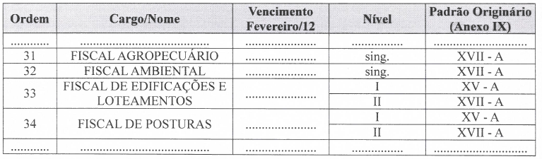

LEI COMPLEMENTAR Nº 277, 16 DE DEZEMBRO DE 2022

Altera a Lei Complementar nº 3.853/1999, a Lei Complementar nº 4.711/2003 e a Lei Complementar nº 5.225/06.

**A CÂMARA MUNICIPAL DE RIO VERDE-GO aprova, e eu sanciono a seguinte lei:**

Art. 1º Fica extinta a gratificação de produção prevista nos artigos 7º a 9º da Lei Complementar nº 4.711/2003 e nos artigos 6º a 8º da Lei Complementar nº 5.225/06, referente aos cargos de Fiscal Agropecuário, Fiscal Ambiental, Fiscal de Edificações e Loteamentos e 

Fiscal de Posturas, todos integrantes da Lei Complementar nº 3.853/1999.

Art. 2º Nos vencimentos dos cargos mencionados no art. 1º desta Lei, fixados no Anexo VIII da Lei Complementar n. 3.853/1999, alterado pelo Anexo I desta lei, já constam incorporados o adicional de produtividade e gratificação de produção que vinham sendo percebidos pelos respectivos fiscais.

Art. 3º Esta Lei Complementar entrará em vigor na data da sua publicação.

Gabinete do Prefeito de Rio Verde, aos 16 dias do mês de dezembro de 2022.

PAULO FARIA DO VALE

Prefeito de Rio Verde

VINÍCIUS FONSÊCA CAMPOS

Procurador-Geral

**ANEXO I**

**INCLUSÃO NO ANEXO VIII DA LEI Nº 3.853/1999 - QUADRO DE CARGOS E PADRÃO DE VENCIMENTO (GERAL)**

