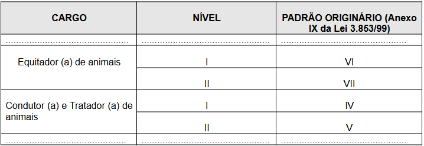

LEI COMPLEMENTAR Nº 285, DE 17 DE FEVEREIRO DE 2023.

Altera a Lei n. 3.853/1999, que dispõe sobre o Plano de Cargos e Vencimentos dos Funcionários do Município e dá outras providências.

**A CÂMARA MUNICIPAL DE RIO VERDE-GO APROVA, E EU SANCIONO A SEGUINTE LEI COMPLEMENTAR:**

Art. 1º Ficam criados os cargos de Equitador de Animais e Condutor e Tratador de Animais, que integrarão o quadro de pessoal permanente do Município, constante na Lei nº. 3.853, de 22 de setembro de 1999, Plano de Cargos e Vencimentos dos Servidores do Município de Rio Verde – Goiás, conforme Anexos I, II e III desta Lei Complementar.

Art. 2º Esta lei entrará em vigor na data de sua publicação.

Gabinete do Prefeito de Rio Verde - GO, aos 17 dias do mês de fevereiro de 2023.

ANEXO I

Inclusão no Anexo II da Lei nº. 3.853/1999 - Especificações de Funções

**Cargo:** Equitador de animais

**Categoria:** Operacional

**Descrição:** Executar atividades de seleção e treinamento do animal, levando em consideração as peculiaridades de cada praticante, conduzindo ou mantendo contato com o animal durante as sessões de equoterapia, bem como executar outras tarefas que lhes são correlatas.

**Tarefas:**

• Demonstrar capacidade e habilidades adequadas, a fim de ministrar atividades às Pessoas com Deficiências ou quaisquer aquelas que frequentem as sessões de equoterapia, mantendo, ainda, o estímulo e contato com o animal;

• Ministrar aulas de equitação especial;

• Selecionar os cavalos adequados para as sessões de equoterapia;

• Treinar cada animal, tornando-o apto à montaria em rampa, trapézio, banco, entre outras modalidades, devendo, o animal, permitir a montaria pelo lado esquerdo e direito, bem como aceitar a movimentação do cavaleiro, exercícios, mudança de posição na sela, sem alterar-se;

• Ensinar os membros da equipe a montar e conduzir o cavalo em várias andaduras e na montaria acompanhada em sela, manta ou selote, com ou sem estribos;

• Exercitar cada cavalo, acostumá-los com equipamentos, materiais ou brinquedos utilizados pela Equipe durante a sessão;

• Escolher, em conjunto com a equipe, o animal e o material a ser usado, levando-se em consideração as características do praticante e as do cavalo;

• Orientar os auxiliares guia a respeito da maneira correta de guiar o cavalo à mão, à guia ou outro modo definido previamente pela equipe;

• Orientar e auxiliar os responsáveis na manutenção, conservação e limpeza do material de montaria, orientando quanto à sua conservação e limpeza;

• Verificar, antes da montaria, o estado de saúde de cada animal, bem como a colocação dos arreios;

• Verificar constantemente o estado físico e mental dos cavalos, orientando os funcionários no trato com os animais, assim como zelar pela higiene e condições estruturais das cocheiras;

• Discutir com os outros membros das equipes os progressos obtidos, bem como detalhes e atitudes da equipe e dos praticantes, observando o desenvolvimento destes últimos e do cavalo, definindo métodos e etapas de progressão contínuos, propiciando a melhora gradativa das atividades.

**Requisitos:** 

• Ensino Médio Completo.

• Curso Básico (ANDE – BRASIL)

• Carga Horária: 40 horas semanais.

**Cargo:** Condutor e Tratador de Animais

**Categoria:** Operacional

**Descrição:** Executar atividades de condução do animal durante a sessão de equoterapia; Dar andamento e direção de forma correta, respeitando os limites do animal, preservando o equilíbrio e a segurança do praticante; executar atividades de higiene, alimentação e encilhamento dos animais; controlar a quantidade de alimentos; bem como executar outras tarefas que lhes são correlatas.

**Tarefas:**

• Demonstrar competências pessoais para a função, tais como o relacionamento para com as Pessoas com deficiências ou quaisquer aquelas que frequentem as sessões de equoterapia, mantendo, ainda, o estímulo e o contato com os animais;

• Manejar, alimentar e monitorar a saúde física, mental e o comportamento dos animais;

• Passear com os animais, verificando a sociabilidade dentre eles;

• Selecionar, higienizar e fazer armazenagem de alimentos destinados aos animais;

• Realizar a higienização dos animais, bem como recolher dejetos, lixos e restos de alimentos, mantendo limpos e bem temperados os seus recintos e adjacências;

• Limpar equipamentos, instrumentos e acessórios relacionados à tratativa de animais;

• Monitorar doenças, lesões, traumatismos e aumentos dos níveis de estresse dos animais, prestando, sucessivamente, os primeiros socorros;

• Realizar atividades de apoio, assessoramento em intervenções cirúrgicas, exames clínicos e radiológicos, pesquisas, necropsias e sacrifícios dos animais; 

• Confeccionar, periodicamente, relatórios, contendo informações sobre os estados de saúde física e mental, bem como a condição de cio de cada animal;

• Executar outras atividades correlatas.

**Requisitos:**

• Ensino médio completo.

**Carga Horária:**

40 horas semanais. 

**ANEXO II

Inclusão no Anexo IV da Lei nº. 3.853/1999 – Quadro de Quantitativos de Cargo**

| CARGO | QUANTITATIVO |
| --- | --- |
| ............................ | ............................ |
| Equitador de animais | 01 |
| Condutor e Tratador de Animais | 10 |
| ............................ | ............................ |

**ANEXO III

Inclusão no Anexo VIII da Lei nº. 3.853/1999 – Quadro de Cargos e Padrão de Vencimento**

