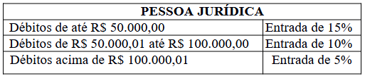

LEI Nº 7.189, DE 03 DE NOVEMBRO DE 2021.

Dispõe sobre transação e parcelamento de débitos decorrentes de tributos, multas tributárias e não tributárias do Município de Rio Verde, a fim de atender o Programa de Recuperação de Créditos Fiscal doravante denominado de REFIS, e dá outras providências.

**A CÂMARA MUNICIPAL DE RIO VERDE - GO APROVA E EU SANCIONO A SEGUINTE LEI:** 

Art. 1º Fica estabelecido no âmbito do Município de Rio Verde o Programa de Recuperação de Créditos Fiscais, doravante denominado de REFIS, destinado a promover a regularização de créditos do Município, decorrentes de débitos de contribuintes, pessoas físicas e jurídicas, constituídas ou não, inscritas ou não em dívida ativa, ajuizados ou a ajuizar, com exigibilidade suspensa ou não, inclusive os decorrentes de falta de recolhimento de valores retidos, com os seguintes propósitos:

I - fomentar e ampliar soluções de litígios em regime de parceria com os demais órgãos do Poder Judiciário visando permitir a recuperação ágil de créditos em favor do Município de Rio Verde – GO, sendo eles relativos a tributos, preços públicos, multas tributárias e administrativas, aplicadas pelo ente Municipal, suas Agências, Fundações ou Autarquias, com o objetivo de diminuir a tramitação e o índice de congestionamento processual nos Tribunais e garantir a efetiva prestação jurisdicional e administrativa aos munícipes rio-verdenses;

II - propiciar eficiência na tutela do crédito tributário e conferir maior flexibilidade e agilidade à Secretaria da Fazenda do Município em âmbito administrativo, bem como conferir celeridade à atuação da Procuradoria-Geral do Município de Rio Verde-GO, com o propósito de ampliar a capacidade de arrecadação de tributos;

III - garantir o crédito tributário, mesmo na situação de crise econômico-financeira do contribuinte, pessoa física ou jurídica, com a preservação da empresa, do emprego dos trabalhadores e públicos correspondentes, respeitando-se a função social e o estímulo à sociedade empresária;

IV – diminuir a evasão fiscal em todas as suas modalidades, notadamente dando oportunidade ao contribuinte para saldar suas dívidas;

VI - estabelecer mecanismos ágeis e eficientes no sentido de arrecadar tributos e viabilizar a extinção de processos executivos e contenciosos, independentemente de estarem em 1º grau, 2º grau ou Tribunais Superiores.

Art. 2º A adesão ao REFIS implica a inclusão da totalidade dos débitos tributários do contribuinte para com a Fazenda Municipal, ainda que tenham sido objeto de parcelamentos anteriores não integralmente quitados ou cancelados por falta de pagamento, e se dará mediante assinatura, física ou eletrônica, de termo de declaração espontânea.

§ 1º O REFIS alcança todos os créditos municipais sejam eles tributários ou não, vencidos até 30/06/2021, não constituídos, constituídos ou em constituição.

§ 2º Não haverá aplicação de multa por infração sobre os débitos ainda não lançados, declarados pelo contribuinte espontaneamente, por ocasião da adesão ao REFIS.

§ 3º Uma vez requerido a adesão ao programa REFIS, o pedido de parcelamento constitui confissão irretratável de dívida, ainda que não seja deferido o parcelamento ou não ocorra o pagamento das parcelas por desistência do sujeito passivo.

§ 4º Não se admitirá a adesão ao REFIS de débitos já ajuizados em que haja bloqueio judicial de valores (penhora on line) suficientes para liquidação integral do débito sem os descontos concedidos pelo REFIS. 

Art. 3º A inclusão no REFIS fica condicionada à renúncia ao direito sobre o qual se funda eventuais questionamentos de créditos da Fazenda Municipal, ajuizados ou não, inscritos em dívida ativa, seja em ação judicial ou pleito administrativo.

Art. 4º O Procurador-Geral do Município é a autoridade administrativa competente para chancelar a transação judicial ou deferir o parcelamento em tal âmbito.

Parágrafo único. Poderá o Procurador-Geral do Município baixar Portaria designando servidores para os fins do caput deste artigo.

Art. 5º Os débitos apurados serão atualizados monetariamente e incorporados os acréscimos previstos na legislação vigente até a data da opção, podendo ser liquidados com pagamento à vista ou parcelados em até 60 (sessenta) parcelas mensais e consecutivas.

Art. 6º Os percentuais de redução das multas moratórias, não moratórias e dos juros de mora sobre os débitos favorecidos por esta Lei serão concedidos da seguinte forma:

I – Para pagamento à vista: 

a) haverá a dispensa da multa moratória e dos juros de mora no percentual de 98% (noventa e oito por cento);

b) além das deduções previstas na alínea anterior haverá redução de 90% (noventa por cento), exclusivamente no valor das multas tributárias não moratórias. 

II - o valor da multa moratória e dos juros de mora serão reduzidos em função do número de parcelas nos percentuais constantes da Tabela I abaixo: 

**TABELA I**

| Parcelas | Redução |
| --- | --- |
| 1 | 98,00% |
| 2 | 95,21% |
| 3 | 95,20% |
| 4 | 89,87% |
| 5 | 87,31% |
| 6 | 84,83% |
| 7 | 82,42% |
| 8 | 80,07% |
| 9 | 77,79% |
| 10 | 75,58% |
| 11 | 73,43% |
| 12 | 71,34% |
| 13 | 69,31% |
| 14 | 67,34% |
| 15 | 65,42% |
| 16 | 63,56% |
| 17 | 61,75% |
| 18 | 60,00% |
| 19 | 40,00% |
| 20 | 38,09% |
| 21 | 36,25% |
| 22 | 34,50% |
| 23 | 32,82% |
| 24 | 31,21% |
| 25 | 29,67% |
| 26 | 28,19% |
| 27 | 26,77% |
| 28 | 25,41% |
| 29 | 24,10% |
| 30 | 22,84% |
| 31 | 21,63% |
| 32 | 20,48% |
| 33 | 19,36% |
| 34 | 18,29% |
| 35 | 17,26% |
| 36 | 16,27% |
| 37 | 15,32% |
| 38 | 14,40% |
| 39 | 13,52% |
| 40 | 12,68% |
| 41 | 11,86% |
| 42 | 11,08% |
| 43 | 10,32% |
| 44 | 9,59% |
| 45 | 8,89% |
| 46 | 8,22% |
| 47 | 7,57% |
| 48 | 6,94% |
| 49 | 6,34% |
| 50 | 5,76% |
| 51 | 5,20% |
| 52 | 4,66% |
| 53 | 4,14% |
| 54 | 3,64% |
| 55 | 3,16% |
| 56 | 2,70% |
| 57 | 2,25% |
| 58 | 1,82% |
| 59 | 1,40% |
| 60 | 1,00% |

Art. 7º Sem prejuízo das reduções definidas na tabela I aplicáveis aos juros de mora e multa moratória que compõem o débito, os percentuais de redução das multas previstas na alínea “b”, do inciso I, do artigo 6º, para o caso de parcelamento, serão reduzidos na seguinte forma:

I – os débitos cujo cálculo para pagamento, sem quaisquer reduções, perfazerem o valor de até R$ 100.000,00 (cem mil reais) serão reduzidos nos percentuais constantes da Tabela II, hipótese em que o número de parcelas restringe-se a 18 (dezoito);

II – os débitos cujo cálculo para pagamento, sem quaisquer reduções, perfazerem valor acima R$ 100.000,00 (cem mil reais) serão reduzidos nos percentuais constantes da Tabela II, hipótese em que o número de parcelas restringe-se a 36 (trinta e seis): 

**TABELA II**

| Parcelas | Redução |
| --- | --- |
| 1 | 90,00% |
| 2 | 87,30% |
| 3 | 84,68% |
| 4 | 82,14% |
| 5 | 75,00% |
| 6 | 70,89% |
| 7 | 66,99% |
| 8 | 63,32% |
| 9 | 59,84% |
| 10 | 56,56% |
| 11 | 53,45% |
| 12 | 50,0% |
| 13 | 46,76% |
| 14 | 43,72% |
| 15 | 40,89% |
| 16 | 38,24% |
| 17 | 35,76% |
| 18 | 33,44% |
| 19 | 31,27% |
| 20 | 29,24% |
| 21 | 27,35% |
| 22 | 25,57% |
| 23 | 23,91% |
| 24 | 22,36% |
| 25 | 20,91% |
| 26 | 19,56% |
| 27 | 18,29% |
| 28 | 17,10% |
| 29 | 15,99% |
| 30 | 14,96% |
| 31 | 13,99% |
| 32 | 13,08% |
| 33 | 12,23% |
| 34 | 11,44% |
| 35 | 10,70% |
| 36 | 10,00% |

Art. 8º Sobre o saldo devedor parcelado incidirão juros de 0,5% (cinco décimos por cento) e atualização monetária, ambos mensais, sucessíveis e capitalizáveis, salvo se o parcelamento for de, no máximo, de 06 (seis) parcelas, hipótese em que não haverá incidência dos juros e nem da atualização monetária aqui prevista, consoante § 2º, do artigo 190, da Lei Complementar nº 5.727/2009 (Código Tributário Municipal).

Art. 9º A adesão às facilidades desta Lei exclui a aplicação da redução da multa prevista no art. 207 do Código Tributário Municipal, instituído pela Lei Complementar nº 5.727/2009.

Art. 10. Nenhuma parcela poderá ser inferior ao valor de R$ 150,00 (cento e cinquenta reais).

Art. 11. A opção pelo REFIS considera-se formalizada com o pagamento à vista do crédito consolidado ou com a assinatura, escrita ou digital, do Termo de Acordo e Confissão Dívida e Parcelamento do crédito tributário ou não tributário com o recolhimento do percentual definido nesta Lei a título de entrada e o valor remanescente será dividido em parcelas, desde que atenda o disposto no art. 5º desta Lei. 

<table style="width: 229px;"><tbody><tr><td style="width: 193px; text-align: center;">**PESSOA FÍSICA**</td></tr><tr><td style="width: 193px; text-align: center;">Entrada de 10%</td></tr></tbody></table>

Parágrafo único. O pagamento da entrada, ou parcela única, deverá ser efetuado no prazo máximo de 05 (cinco) dias contados da assinatura do termo de adesão.

Art. 12. A opção pelo REFIS municipal implica ao contribuinte assumir as seguintes obrigações:

I – confissão irrevogável e irretratável da totalidade dos débitos fiscais abrangidos pelo Programa;

II – aceitação plena e irretratável de todas as condições estabelecidas nesta Lei;

III – cumprimento regular das parcelas do débito consolidado.

§ 1º Nos casos de débitos ajuizados, com exigibilidade suspensa por força de decisões judiciais, a renegociação dos referidos débitos pelo REFIS implicará na dispensa dos juros de mora até a data da opção, além dos benefícios descritos no art. 6º, desde que o contribuinte promova o encerramento do feito por desistência expressa e irretratável da respectiva ação judicial, bem como renuncie expressamente aos direitos sobre os quais se fundar a ação.

§ 2º A opção pelo REFIS relativa a débitos objeto de execuções fiscais da Fazenda Pública Municipal implicará automaticamente na suspensão daqueles processos até o pagamento final do débito renegociado, mantidos todos os gravames decorrentes, bem como as garantias prestadas nas respectivas execuções fiscais.

§ 3º A requerimento do contribuinte a opção pelo REFIS exclui qualquer outra forma de parcelamento antes efetuado pelo contribuinte, seja administrativo ou judicial, de acordo com o montante faltante para pagamento, ressalvadas as parcelas já pagas.

Art. 13. O termo de transação apresentado em juízo conterá:

I – qualificação das partes, relatório, motivação, decisão, data, local e a assinatura dos envolvidos;

II – relatório que conterá o resumo do litígio, a descrição do procedimento adotado e as recíprocas concessões;

III – fundamento mencionando as questões de fato, direito e as condições para cumprimento do acordo;

IV – termo de confissão, renúncia e desistência mencionados no § 1º do art. 12;

V – manutenção da penhora se houver, até a comprovação do pagamento do crédito tributário remanescente.

Art.14. Quando o pedido de parcelamento incidir sobre débitos que estejam sob a competência da Procuradoria do Município, o sujeito passivo deverá promover o pagamento à vista, junto com o percentual determinado como entrada, das custas processuais, os honorários advocatícios devidos na forma do Código de Processo Civil e art. 54-A, inciso III, da Lei Complementar n. 5.564/2009, e o valor remanescente será parcelado atendendo os ditames desta Lei.

Parágrafo único. O não pagamento da entrada, ou o não cumprimento de qualquer outra obrigação relativa ao termo de transação, especialmente o inadimplemento de 03 (três) ou mais parcelas, implicará no vencimento antecipado da dívida e a exigência do débito na sua integralidade, com expurgo dos descontos concedidos, ficando o acordo automaticamente prejudicado, salvo a confissão, renúncia ou a desistência a que se refere o art. 12 desta Lei e o seu §1º.

Art. 15. O contribuinte será excluído do REFIS diante da ocorrência das seguintes hipóteses:

I - inobservância de qualquer das exigências estabelecidas nesta Lei;

II - prática de qualquer ato ou procedimento tendente a omitir informações, a diminuir ou a subtrair receita do contribuinte optante;

III- inadimplência de 03 (três) ou mais parcelas relativamente a qualquer tributo abrangido pelo REFIS, inclusive os decorrentes de fatos geradores ocorridos posteriormente à data de opção.

§ 1º A exclusão do contribuinte do REFIS implicará a exigibilidade imediata da totalidade do débito tributário, confessado e não pago, restabelecendo-se, em relação ao montante não pago, os acréscimos legais na forma da legislação vigente a época da ocorrência dos respectivos fatos geradores, e inscrição automática do débito em dívida ativa e consequente cobrança judicial.

§ 2º Em caso de inadimplemento, o Município poderá optar pela cobrança bancária do débito, valendo o respectivo boleto de cobrança como instrumento de protesto a ser providenciado pela instituição bancária responsável, junto ao Cartório de Títulos e Documentos ou, na forma do regulamento, ter os seus débitos ajuizados e protestados junto aos Tabelionatos de Protestos de Títulos de Rio Verde, com fulcro no parágrafo único do art. 1º, da Lei Federal nº 9.429, de 10 de setembro de 1997.

Art. 16. Os efeitos desta Lei não retroagirão de modo que o gozo dos benefícios por ela instituídos não confere direito à restituição ou compensação de importância já paga, seja a que título for.

Art. 17. É facultada a qualquer pessoa, física ou jurídica, assumir e liquidar débitos tributários de terceiros mediante procuração outorgada pelo sujeito passivo, assunção que deverá contar com a anuência expressa da Fazenda Pública Municipal.

Art. 18. A opção pelo parcelamento dos débitos, na forma estabelecida nesta lei, possibilita ao contribuinte a obtenção de certidão positiva de débitos com efeito de negativa, de acordo com o art. 206 do CTN.

Art. 19. As situações pretéritas relacionadas com parcelamentos de créditos tributários em geral que careçam de decisão para suas definições serão resolvidos sob a égide desta Lei.

Art. 20. Fica vedada a concessão do benefício de que trata esta Lei a contribuintes envolvidos em fraudes tributárias.

Art. 21. O sujeito passivo autoriza o Município de Rio Verde-GO a negociar no mercado financeiro os acordos e parcelamentos objetos da presente Lei.

Art. 22. Os benefícios contidos nesta Lei deverão ser formalizados até 180 (cento e oitenta) dias após a promulgação.

Art. 23. O Poder Executivo poderá prorrogar, por meio de decreto, por até 2 (duas) vezes, o prazo para formalização do pedido de parcelamento do programa REFIS. 

Art. 24. Esta Lei entrará em vigor na data de sua publicação.

Gabinete do Prefeito de Rio Verde-GO, aos 03 de novembro de 2021.

PAULO FARIA DO VALE

Prefeito de Rio Verde

VINÍCIUS FONSÊCA CAMPOS

Procurador-Geral

enio freitas de sene

Secretário da Fazenda
