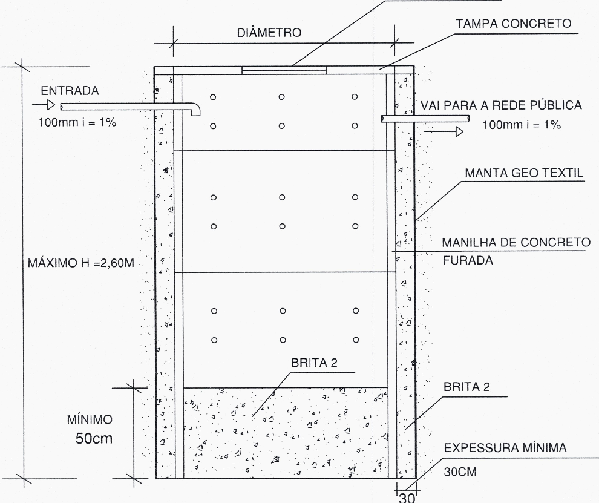

LEI COMPLEMENTAR Nº 294, DE 30 DE MARÇO DE 2023.

Altera a Lei Complementar nº 6.167/2012, que dispõe sobre o parcelamento do solo com fins urbanos em zona rural sob a forma de condomínio de lotes, e, ainda, as Tabelas I e II da Lei Complementar 5478/2008, que dispõem sobre o uso e ocupação do solo urbano - zoneamento da sede do Município.

**A CÂMARA MUNICIPAL DE RIO VERDE-GO APROVA E EU SANCIONO A SEGUINTE LEI:**

Art. 1º O art. 5º da Lei Complementar nº 6.167, de 18 de junho de 2012, passa a vigorar com as seguintes alterações:

“Art. 5º .................................................................................................................

I - cada unidade do condomínio de lotes localizado em Zona Urbana Específica deverá ter área mínima de 600,00 m2 (seiscentos metros quadrados), com coeficiente máximo de 1,0 (um) e taxa de ocupação máxima de 70% (setenta por cento), devendo observar os demais regramentos de uso e ocupação, previstos na Tabela I e II constantes da Lei Complementar nº 5478/2008.

...............................................................................................................................

X - os condomínios de lotes situados ao longo das rodovias federais, estaduais ou municipais, deverão conter faixa paralela ao domínio das referidas estradas, com largura mínima de 17,50m (dezessete metros e cinquenta decímetros), fora dos limites da área delimitada pelo tipo de tapagem admitido pelo Poder Executivo, porém, integrando o percentual de área destinada a vias públicas exigidas por lei.

...............................................................................................................................

Parágrafo único. Os lotes dos empreendimentos já regulamentados com área superior à prevista no inciso I deste artigo poderão ser objeto de desmembramento, desde que respeitada a área mínima do inciso I e as regras do uso e ocupação do solo previstas em lei.”

Art. 2º O art. 7º da [Lei Complementar nº 194](https://legisla.casacivil.go.gov.br/pesquisa_legislacao/114899), de 21 de dezembro de 2020, passa a vigorar com as seguintes alterações: 

“Art. 7º ..................................................................................................................

I - os projetos das vias de circulação do condomínio de lotes deverão obedecer às dimensões mínimas estabelecidas abaixo:

1\. Ruas

**Largura total (metros)**

**Passeio esq. (metros)**

**Pista (metros)**

**Passeio dir. (metros)**

16,00

3,00

10,00

3,00

2\. Alamedas

**Largura total (metros)**

**Passeio esq. (metros)**

**Pistas (metros)**

**Passeio dir. (metros)**

17,50

6,00

8,50

3,00

3\. Avenidas

**Largura total (metros)**

**Passeio esq. (metros)**

**Pistas (metros)**

**Canteiro central (metros)**

28,50

6,50

8,50

2,00

II - o proprietário cederá ao Município, sem ônus para este, percentual da área onde se implantará o empreendimento de no mínimo, 15% (quinze por cento), destinados à implantação de equipamentos urbanos e comunitários e áreas verdes, cujas localizações serão aprovadas pelo setor competente do Município, e, ainda, a área da via de acesso ao empreendimento, que será também implantada por ele e se integrará ao sistema viário público, sendo:

a) 7% (sete por cento), no mínimo, destinados à implantação de equipamentos urbanos e comunitários;

b) 8% (dez por cento), no mínimo, destinados à área verde;

c) Revogado.

...............................................................................................................................

XII - cada unidade constante do condomínio de lotes localizado na Subzona Especial Residencial I deverá ter área mínima de 450m2 (quatrocentos e cinquenta metros quadrados), com coeficiente de aproveitamento (CA) máximo de 1,0 (um) e taxa de ocupação (TO) máxima de 50% (cinquenta por cento), devendo observar os demais regramentos de uso e ocupação do solo previstas nas Tabelas I e II da Lei Complementar nº 5.478/2008;

XIII - cada unidade constante do condomínio de lotes localizado na Subzona Especial de Indústria, Comércio e Serviço I deverá ter área mínima de 525m2 (quinhentos e vinte e cinco metros quadrados), com coeficiente de aproveitamento (CA) máximo de 1,0 (um) e taxa de ocupação (TO) máxima de 40% (quarenta por cento), devendo observar os demais regramentos de uso e ocupação do solo previstas nas Tabelas I e II da Lei Complementar nº 5.478/2008

...............................................................................................................................

Art. 3º Revoga a alínea “c” do inciso II do art. 7º da Lei Complementar nº 194/2020.

Art. 4º As Tabelas I (OCUPAÇÃO) e II (USO) da Lei Complementar n° 5478/2008, que dispõem sobre o uso e ocupação do solo urbano - Zoneamento da sede do Município, passam a vigorar com a seguinte redação:

“TABELA I

OCUPAÇÃO

**Zona**

**Área mínima do lote**

**Dimensão mínima de Testada**

**Taxa de Ocupação**

**Aproveit. Básico não oneroso**

**Outorga Onerosa (9)**

**Índice de Permeab. (mínimo)**

**Afastam. Frontal**

**Afastam. lateral/fundos**

ZR-I

180m² <nota>(13) </nota>360m²  <nota>(16)</nota>

7,50m <nota>(13)</nota> 10m <nota>(16)</nota>

70%

1 <nota>(4)</nota>

---

20% <nota>(14)</nota>

3m

1,50m <nota>(3)</nota>

ZR-II

180m² <nota>(13) </nota>360m²

7,50m <nota>(13)</nota> 10m

70%

1 <nota>(4)</nota>

---

20% <nota>(14)</nota>

3m

1,50m <nota>(3) (6)</nota>

ZR-III

180m²  <nota>(13)</nota> 360m²

7,50m <nota>(13)</nota> 10m

70%

1 <nota>(4)</nota>

---

20% <nota>(14)</nota>

3m

1,50m<nota> (3)</nota>

ZE-I

360m²

10m

70%

1 <nota>(4)</nota>

2 <nota>(4)</nota>

20% <nota>(14)</nota>

-<nota> (8)</nota>

1,50m<nota> (3) (6)</nota>

ZE-II

360m²

10m

70%

1 <nota>(4)</nota>

2 <nota>(4)</nota>

20% <nota>(14)</nota>

- <nota>(8)</nota>

1,50m <nota>(3) (6)</nota>

ZE-III

360m²

10m

70%

1 <nota>(4)</nota>

1,5 <nota>(4)</nota>

20% <nota>(14)</nota>

- <nota>(8)</nota>

1,50m<nota> (3) (6)</nota>

ZE-IV

360m²

10m

60% <nota>(11)</nota>

1 <nota>(4)</nota>

1,5 <nota>(4)</nota>

30% <nota>(14)</nota>

5m <nota>(8)</nota>

1,50m<nota> (3) (6)</nota>

ZE-V

360m²

10m

70

1 <nota>(4)</nota>

1,5 <nota>(4)</nota> 2 <nota>(4)</nota>

20% <nota>(14)</nota>

- <nota>(8)</nota>

1,50m <nota>(3) (6)</nota>

ZE-VI

360m²

10m

70

1 <nota>(4)</nota>

1,5 <nota>(4)</nota> <nota></nota>2 <nota>(4)</nota>

20% <nota>(14)</nota>

- <nota>(8)</nota>

1,50m <nota>(3) (6)</nota>

ZC-I

360m²

10m

70%

1 <nota>(4)</nota>

1 <nota>(4)</nota>

20% <nota>(14)</nota>

- <nota>(8)</nota>

1,50m<nota> (3) (6)</nota>

ZC-II

360m²

10m

70%

1 <nota>(4)</nota>

1 <nota>(4)</nota>

20% <nota>(14)</nota>

- <nota>(8)</nota>

1,50m<nota> (3) (6)</nota>

ZCL

360m²

10m

70%

1 <nota>(4)</nota>

1 <nota>(4)</nota>

20% <nota>(14)</nota>

- <nota>(8)</nota>

1,50m <nota>(3) (6)</nota>

ZS

360m²

10m

70%

1 <nota>(4)</nota>

1 <nota>(4)</nota>

20%<nota> (14)</nota>

3m

1,50m <nota>(3) (6)</nota>

ZI-I

360m²

-

70%

1 <nota>(4)</nota>

---

20% <nota>(14)</nota>

10m

5m

ZI-II

360m²

-

70%

1 <nota>(4)</nota>

---

20%<nota> (14)</nota>

10m

5m

ZIE-I

360m²

10m

70%

1 <nota>(4)</nota>

---

30% <nota>(14)</nota>

3m

<nota>1,50m (3) (6)</nota>

ZV

180m²  <nota>(13) </nota>360m²  <nota>(1)</nota>

7,50m <nota>(13)</nota> 10m

50% <nota>(7)</nota> 70% <nota>(11)</nota>

1 <nota>(4)</nota>

---

20%<nota> (14)</nota>

3m

<nota>1,50m</nota><nota><nota> (5) </nota></nota><nota></nota>

Subzona Especial-I ZER-1

450m²

15m

50%

1 <nota>(4)</nota>

---

40%<nota> (14)</nota>

3m

1,50m

Subzona Especial Ind. Com. Serv. ZES-I

525m²

15m

40%

1 <nota>(4)</nota>

---

50% <nota>(14)</nota>

5m

1,50m

Chácaras até 5 km da linha de Expansão Urbana

1.200m²

20m

60%

1 <nota>(4)</nota>

---

30% <nota>(14)</nota>

3m

1,50m

Chácaras mais de 5 km da linha de Expansão Urbana

5.000m²

40m

10%

1 <nota>(4)</nota>

---

85% <nota>(14)</nota>

10m

5,00m

Chácaras inserida nas Bacias de abastecimento

2.000m²

30m

35%

1 <nota>(4)</nota>

---

60% <nota>(14)</nota>

10m

5,00m

ZAH

360m²

10m

70%

1 <nota>(4)</nota>

---

20% <nota>(14)</nota>

1,50m <nota>(3) (6)</nota>

ZUE

600,00m²

15m

50%

1 <nota>(4)</nota>

---

40% <nota>(14)</nota>

3m

1,50m<nota> (3) (6)</nota>

ZIS-I

1.500m²

10m

60%

1 <nota>(4)</nota>

---

30% <nota>(14)</nota>

3m

1,50m<nota> (3) (6)</nota>

ZIS-II

1.500m²

10m

60%

1 <nota>(4)</nota>

---

30% <nota>(14)</nota>

3m

1,50m <nota>(3) (6)</nota>

ZIS-III

1.500m²

10m

60%

1 <nota>(4)</nota>

---

30%<nota> (14)</nota>

3m

1,50m <nota>(3) (6)</nota>

ZIS-IV

1.500m²

10m

60%

1 <nota>(4)</nota>

---

30% <nota>(14)</nota>

3m

1,50m <nota>(3) (6)</nota>

ZIS-V

1.000m²

20m

60%

1 <nota>(4)</nota>

---

30%<nota> (14)</nota>

5m

1,50m <nota>(3) (6)</nota>

ZMPE

360.00m²

12m

70%

1 <nota>(4)</nota>

---

20% <nota>(14)</nota>

5m

1,50m<nota> (3) (6)</nota>

ZAL-I

____<nota>(15)</nota>

____ (15)

70%

1 <nota>(4)</nota>

---

20% <nota>(14)</nota>

----

5m

ZPA

360m²

10m

70%

1 <nota>(4.1)</nota>

---

20% <nota>(14)</nota>

5m<nota> (8)</nota>

5m <nota>(3)</nota>

ZEIS

125m²

6m

70%

1 <nota>(4)</nota> 3 <nota>(4) (17)</nota>

---

20%<nota> (14)</nota>

3m

1m 1,50m

**Observações:**

**(1)** Para loteamentos com utilização para conjuntos Habitacionais com alta densidade populacional os lotes poderão ter área mínima de 180m² (cento e oitenta metros quadrados).

**(2)** Poderá ser substituída ou complementada a área permeável utilizando-se caixa de recarga de lençol freático, nos termos do art. 124 da Lei 5.318/2007 (Plano Diretor).

**(3)** Nas edificações de até 2 (dois) pavimentos com abertura os afastamentos laterais e de fundos deverão obedecer 1,50m, podendo estar nas divisas apenas se as paredes não contarem com abertura. Poços de iluminação, ou o que lhe corresponda poderão se situar nas divisas, porém, suas aberturas não poderão contar com visão incidente sobre a linha divisória, bem como as perpendiculares, devendo se situar, no mínimo, a setenta e cinco centímetros da citada linha, conforme o disposto no §1º do art. 1.301 da Lei nº 10.406, de 10 de janeiro de 2002, Código Civil Brasileiro.

**(4)** A altura máxima deverá respeitar o Cone da Aeronáutica e feixes de microondas de telecomunicações.

**(4.1)** Plano Básico de Zona de Proteção de Aeródromo - PBZPA e suas futuras alterações.

**(4.2)** Plano Básico de Zoneamento de Ruído - PBZR e suas futuras alterações.

**(5)** Na Zona Verde onde houver faixas de fundo de vale, bosques nativos cadastrados e áreas de parques, prevalece legislação própria.

**(6)** Os afastamentos das laterais e fundos ficam sujeitos a tabela:

a) Nas paredes com aberturas os afastamentos mínimos são:

• Até 2 (dois) pavimentos 1,50m para todas as divisas.

• 3 (três) e 4 (quatro) pavimentos 2,00m para todas as divisas.

• 5 (cinco) e 6 (seis) pavimentos, a soma de 5,00 m, desde que respeitado o mínimo de 2,00 m em uma das laterais.

• Acima de 6 (seis) pavimentos, a cada novo pavimento, todos os afastamentos das divisas serão acrescidos de 20 cm (vinte centímetros) em relação ao pavimento inferior.

b) Em edificações acima de dois pavimentos, ainda que sem abertura, os afastamentos mínimos serão os estabelecidos na alínea “a” deste item.

**(7)** Os terrenos localizados entre as vias marginais e o manancial terão a ocupação de no máximo de 50% (cinquenta por cento).

**(8)** As edificações de comércio varejista, atacadista, prestação de serviço ou institucional, quando não estiverem inseridas nas Zonas Residenciais, poderão utilizar o afastamento frontal como estacionamento de veículos, desde que o mesmo seja descoberto e o afastamento frontal tenha no mínimo 05 (cinco) metros.

**(9)** Para a concessão da Outorga Onerosa do Direito de Construir será aplicado o disposto no art. 137 da Lei 5.318/2007 (Plano Diretor).

**(10)** Revogado.

**(11)** Os terrenos cujas testadas sejam para a Avenida Presidente Vargas terão taxa de ocupação de até 70%.

**(12)** ZE IV - A edificação deverá ser iniciada 20 cm (vinte centímetros) acima do nível do passeio público, não sendo permitida a construção de subsolo.

**(13)** Serão admitidos lotes com área igual ou superior a 180m (Cento e oitenta metros quadrados), com testada mínima de 7,50m (sete metros e cinquenta centímetros), em loteamentos considerados especiais, com dispensa do pagamento de outorga na proporção de 50% (cinquenta por cento) dos lotes que tenham por finalidade habitações de interesse social.

**(14)** Obrigatoriedade de caixa de recarga, a ser construída de acordo com o Projeto Anexo - Tabela I, além do cumprimento do índice de permeabilidade para todas as áreas cobertas.

(15) Proibição de parcelamento do Solo.

(16) Para imóveis localizados nos condomínios de lotes e loteamentos fechados. (17) Aproveitamento básico não oneroso a ser observado em habitações familiares coletivos.”

**“TABELA II**

**USO**

| **Zona** | **Usos Permitidos** | **Usos Permissíveis** | **Usos Proibidos** |
| --- | --- | --- | --- |
| ZR-I | Habitação unifamiliar | 1.2 - SERVIÇO VICINAL Atividades profissionais e serviços pessoais de pequeno porte não incômodas ao uso residencial, subclassificando-se em: 1.2.1 - SERVIÇO VICINAL- Profissionais Autônomos- Atelier de Profissionais Autônomos, Salão de beleza, Manicure e Montagem de Bijuterias. \* Os serviços descritos acima somente serão permitidos no interior das residências, vedada a descaracterização do imóvel residencial. | Demais |
| ZR-II | Habitação unifamiliar, habitação geminada, habitação seriada, habitação coletiva. | Comércio Varejista (Baixo Impacto), Comércio Atacadista (Baixo Impacto), Prestação de Serviço (Baixo Impacto). | Demais |
| ZR-III | Habitação unifamiliar, habitação geminada. | Comércio Varejista (Baixo Impacto), Comércio Atacadista (Baixo Impacto), Prestação de Serviço (Baixo Impacto). | Demais |
| ZE-I | Comércio Varejista (Baixo e Médio Impacto), Comércio Atacadista (Baixo e Médio Impacto), Prestação de Serviços (Baixo e Médio Impacto), Habitação Unifamiliar, Geminada, Seriada e Coletiva. | Comércio Varejista, Atacadista, Prestação de Serviço (Alto Impacto). | Demais |
| ZE-II | Comércio Varejista (Baixo e Médio Impacto), Comércio Atacadista (Baixo e Médio Impacto), Prestação de Serviços (Baixo e Médio Impacto), Habitação Unifamiliar, Geminada, Seriada e Coletiva. | Comércio Varejista, Atacadista, Prestação de Serviço (Alto Impacto). | Demais |
| ZE-III | Comércio Varejista (Baixo e Médio Impacto), Comércio Atacadista (Baixo e Médio Impacto), Prestação de Serviços (Baixo e Médio Impacto), Habitação Unifamiliar, Geminada, Seriada e Coletiva. | Comércio Varejista, Atacadista, Prestação de Serviço (Alto Impacto). | Demais |
| ZE-IV | Habitação Unifamiliar, habitação geminada, habitação seriada, habitação coletiva | Comércio Varejista (baixo impacto), comércio atacadista (baixo impacto), prestação de serviços (baixo impacto) | Demais |
| ZE-V | Comércio Varejista (Baixo Impacto), Prestação de Serviços (Baixo Impacto), | Habitação Unifamiliar, Geminada, Seriada e ColetivaHabitação Unifamiliar, Geminada, Seriada e Coletiva | Demais |
| ZE-VI | Comércio Varejista (Baixo Impacto), Prestação de Serviços (Baixo Impacto), | Habitação Unifamiliar e Geminada | Demais |
| ZC-I | Comércio Varejista (Baixo e Médio Impacto), Comércio Atacadista (Baixo e Médio Impacto), Prestação de Serviços (Baixo e Médio Impacto), Habitação Unifamiliar, Geminada, Seriada e Coletiva | Comércio Varejista, Atacadista e Prestação de Serviço (Alto Impacto) | Demais |
| ZC-II | Comércio Varejista (Baixo e Médio Impacto), Comércio Atacadista (Baixo e Médio Impacto), Prestação de Serviços (Baixo e Médio Impacto), Habitação Unifamiliar, Geminada, Seriada e Coletiva | Comércio Varejista, Atacadista e Prestação de Serviço (Alto Impacto) | Demais |
| ZCL-I | Comércio Varejista (Baixo e Médio Impacto), Comércio Atacadista (Baixo e Médio Impacto), Prestação de Serviços (Baixo e Médio Impacto) | Habitação Unifamiliar | Demais |
| ZS | Comércio Varejista (Baixo e Médio Impacto), Comércio Atacadista (Baixo e Médio Impacto), Prestação de Serviços (Baixo e Médio Impacto) | Comércio Varejista, Atacadista, Prestação de Serviço (Alto Impacto). | Demais |
| ZI-I | Indústria de baixo grau de degradação ambiental | \--- | Demais |
| ZI-II | Indústria de médio grau de degradação ambiental | Indústria de alto grau de degradação ambiental | Demais |
| ZIE-I  (1) | Indústria de baixo grau de degradação ambiental | \--- | Demais |
| ZV | Habitação unifamiliar e Comércio Varejista (Baixo Impacto), Prestação de Serviços (Baixo Impacto), apenas em imóveis cuja testada seja para a Avenida Presidente Vargas | Na ZV (Zona Verde), os imóveis cujas testadas sejam para a Avenida Presidente Vargas, serão permissíveis os seguintes usos: Habitação Geminada, Habitação Seriada e Habitação Coletiva | Demais |
| Subzona Especial-I ZER-1 | Habitação unifamiliar | 1 - COMÉRCIO E SERVIÇO VICINAL 1.1 - COMÉRCIO VICINAL Atividade comercial varejista de pequeno porte subclassifícando-se em: 1.1.1 - COMÉRCIO VICINAL - Açougue - Armarinhos - Mercearia, Hortifrutigranjeiros - Papelaria, Revistaria   - Padaria 1.2 - SERVIÇO VICINAL Atividades profissionais e serviços pessoais de pequeno porte não incômodas ao uso residencial, subclassificando-se em: 1.2.1 - SERVIÇO VICINAL - Profissionais Autônomos - Atelier de Profissionais Autônomos, Salão de beleza, Manicure e Montagem de Bijuterias | Demais |
| Subzona Especial Ind. Com. Serv. ZES-I | Comércio Varejista (Baixo Impacto), Comércio Atacadista (Baixo Impacto), Indústria de baixo grau de degradação ambiental Prestação de serviços de baixo grau de degradação ambiental | Habitação unifamiliar, dentro do mesmo imóvel da atividade Industrial e de Prestação de Serviços | Demais |
| Chácaras até 5 km da linha de Expansão Urbana | Habitação unifamiliar | 1.2 - SERVIÇO VICINAL Atividades profissionais e serviços pessoais de pequeno porte não incômodas ao uso residencial, subclassificando-se em: 1.2.1 - SERVIÇO VICINAL - Profissionais Autônomos - Atelier de Profissionais Autônomos, Salão de beleza, Manicure e Montagem de Bijuterias. \* Os serviços descritos acima somente serão permitidos no interior das residências, vedada a descaracterização do imóvel residencial. | Demais |
| Chácaras mais de 5 km da linha de Expansão Urbana | Habitação unifamiliar | 1.2 - SERVIÇO VICINAL Atividades profissionais e serviços pessoais de pequeno porte não incômodas ao uso residencial, subclassificando-se em: 1.2.1 - SERVIÇO VICINAL - Profissionais Autônomos - Atelier de Profissionais Autônomos, Salão de beleza, Manicure e Montagem de Bijuterias. \* Os serviços descritos acima somente serão permitidos no interior das residências, vedada a descaracterização do imóvel residencial. | Demais |
| Chácaras inserida nas Bacias de abastecimento | Habitação unifamiliar | 1.2 - SERVIÇO VICINAL Atividades profissionais e serviços pessoais de pequeno porte não incômodas ao uso residencial, subclassificando-se em: 1.2.1 - SERVIÇO VICINAL - Profissionais Autônomos - Atelier de Profissionais Autônomos, Salão de beleza, Manicure e Montagem de Bijuterias. \* Os serviços descritos acima somente serão permitidos no interior das residências, vedada a descaracterização do imóvel residencial. | Demais |
| ZAH | Indústria de médio a alto grau de degradação ambiental; Prestação de Serviços (de baixo, médio e alto grau de degradação ambiental). | Plantação de hortas e pomares | Demais |
| ZUE | Habitação unifamiliar | \--- | Demais |
| ZIS-I | Indústria de baixo grau de degradação ambiental Prestação de serviços de baixo grau de degradação ambiental | \--- | Demais |
| ZIS-II | Indústria de alto grau de degradação ambiental Prestação de serviços de alto grau de degradação ambiental | \--- | Demais |
| ZIS-III | Indústria de alto grau de degradação ambiental Prestação de serviços de alto grau de degradação ambiental | \--- | Demais |
| ZIS-IV | Indústria de alto grau de degradação ambiental Prestação de serviços de alto grau de degradação ambiental | \--- | Demais |
| ZIS-V | Indústria de alto grau de degradação ambiental Prestação de serviços de alto grau de degradação ambiental | Comércio | Comércio Varejista, bebida/alimento com ou sem entretenimento, pensão, hotel, motel, pensionato, pousada, restaurante, mini- mercado, supermerca do, borracharia, comércio ambulante geral e outros |
| ZMPE | Indústria de baixo, médio e alto impacto; | \- Prestação de Serviços de Médio e Alto Impacto; - Comércio Varejista ou Atacadista de médio ou alto impacto, desde que os produtos comercializados tenham sido fabricados pela própria indústria do DIMPE; - Ficam recepcionadas as atividades que não se enquadram nesta lei, mas que já estavam sendo exploradas até 31/10/2019; - Quadra 19 do DIMPE: farmácia, restaurante, ferragista, desde que atendidos os critérios da Lei Municipal nº 7.013/2019. | Profissionais Liberais, escritórios de serviços, representação comercial, serviços de saúde, educação e motéis. |
| ZAL-I | Atividades comerciais de transporte, logística distribuição e armazenamento de mercadorias de alto grau de degradação ambiental Prestação de serviços de suporte às atividades permitidas de alto grau de degradação ambiental | Indústria de alto grau de degradação ambiental | Demais |
| ZPA | Comércio varejista e atacadista (Baixo, Médio e Alto impacto), Prestação de serviços (Baixo, Médio e Alto impacto) | Indústria (Baixo Impacto) | Demais |
| ZEIS |   |   |   |

Observação:

**(1)** Exceto atividades industriais que gerem efluentes ensejadores de tratamento prévio para serem despejados

**(2)** Nos condomínios de lotes as atividades comerciais e de prestação de serviços, definidas nos usos permissíveis, respeitarão o limite de edificação residencial definida para a Zona.

**(3)** Nos condomínios de lotes as atividades comerciais e de prestação de serviços, definidas nos usos permissíveis, poderão ser instalados de forma isolada, em unidades autônomas.

**(4)** Atividades comerciais e de prestação de serviços definidos nos usos permissíveis serão instalados de forma isolada, em unidades autônomas;

**(5)** Nos condomínios de lotes dentro de Zonas Urbanas Especificas, o uso permissível será definido no ato de criação, por lei, da referida zona. "

Art. 5º Esta Lei Complementar entrará em vigor na data de sua publicação.

Gabinete do Prefeito de Rio Verde, aos 30 dias do mês de março de 2023.

ANEXO DA TABELA I

OBSERVAÇÃO (14)

CAIXA DE RECARGA DO LENÇOL FREÁTICO TAMPA INSPEÇÃO

\- Dimensão - Para cada 200m² de área coberta, é necessário 1 m³ de caixa de recarga.

\- Superfície da caixa com no mínimo de 1.0m²

\- Profundidade máxima de caixa de recarga de 2,60m

\- Para coberturas maior que 1.500m², deverá ser feito estudo geológico, ou quando se tratar de áreas que apresentem características de solo adversas a adoção dos critérios estabelecidos pelo Plano Diretor.
